# Flow G01 Tài khoản, onboarding và cài đặt

> **Nguồn:** [srs-g01](../../features/srs-g01-tai-khoan.md) (commit `8fac830`) · **Brief:** `[chờ]`
> **Quy ước:** [_quy-uoc.md](_quy-uoc.md) · **FigJam:** `[chờ]`

Bản 1.0 là app Windows cho một người dùng. Các nhánh của web / macOS, 2FA, trial, thanh toán, chế độ chỉ đọc, lời mời và workspace nhiều thành viên không vẽ, ghi "Bỏ (1.1)" ở bảng đối chiếu.

## Mục lục

| UC | Flow | Màn chính | Nhánh A / E (1.0) |
|---|---|---|---|
| [UC-01](#uc-01-đăng-ký-bằng-email-và-mật-khẩu) | Đăng ký bằng email và mật khẩu | SCR-01 Đăng ký, SCR-02 Nhập mã xác minh | 3 / 7 |
| [UC-02](#uc-02-đăng-ký--đăng-nhập-bằng-google-hoặc-microsoft) | Đăng ký / đăng nhập bằng Google hoặc Microsoft | SCR-01, SCR-03 (overlay chờ MSG-49) | 6 / 5 |
| [UC-03](#uc-03-đăng-nhập-duy-trì-phiên-và-đăng-xuất) | Đăng nhập, duy trì phiên và đăng xuất | SCR-03 Đăng nhập | 4 / 5 |
| [UC-04](#uc-04-quên-và-đặt-lại-mật-khẩu) | Quên và đặt lại mật khẩu | SCR-04 Quên / đặt lại mật khẩu | 2 / 3 |
| [UC-05](#uc-05-onboarding-lần-đầu) | Onboarding lần đầu | SCR-05 Onboarding | 5 / 4 |
| [UC-06](#uc-06-xem-và-đổi-cài-đặt) | Xem và đổi cài đặt | SCR-06, SCR-07, SCR-08, SCR-09, SCR-13, SCR-16 | 7 / 3 |
| [UC-07](#uc-07-hồ-sơ-và-bảo-mật-tài-khoản) | Hồ sơ và bảo mật tài khoản | SCR-10 Hồ sơ, SCR-11 Tài khoản | 5 / 7 |
| [UC-08](#uc-08-xuất-dữ-liệu) | Xuất dữ liệu | SCR-11 | 1 / 3 |
| [UC-09](#uc-09-xoá-tài-khoản) | Xoá tài khoản | SCR-12 Xoá tài khoản | 3 / 3 |
| [UC-10](#uc-10-cài-đặt-lịch-làm-việc) | Cài đặt Lịch làm việc | SCR-14 Lịch làm việc | 3 / 3 |
| [UC-11](#uc-11-rút-lại-đồng-ý-và-xin-đồng-ý-lại) | Rút lại đồng ý và xin đồng ý lại | SCR-15, SCR-11 | 3 / 3 |

Không có UC thuần 1.1 trong SRS G01. Nhánh đã bỏ: UC-01 A4, UC-02 A3, UC-03 A3, A4, UC-08 A1, UC-09 A3, E1, một nửa UC-11 E2.

---

## UC-01 Đăng ký bằng email và mật khẩu

**Mở đầu:** khách chưa đăng nhập, mở app lần đầu sau khi cài. **Thành công:** tài khoản `HOAT_DONG`, dữ liệu khởi tạo theo BR-05, đã đăng nhập, ở SCR-05 bước 1. **Thất bại:** không có tài khoản `HOAT_DONG`, nội dung đã nhập còn trên form.

### Happy case

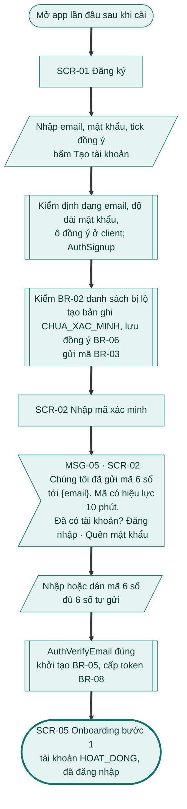

### Nhánh thay thế và lỗi

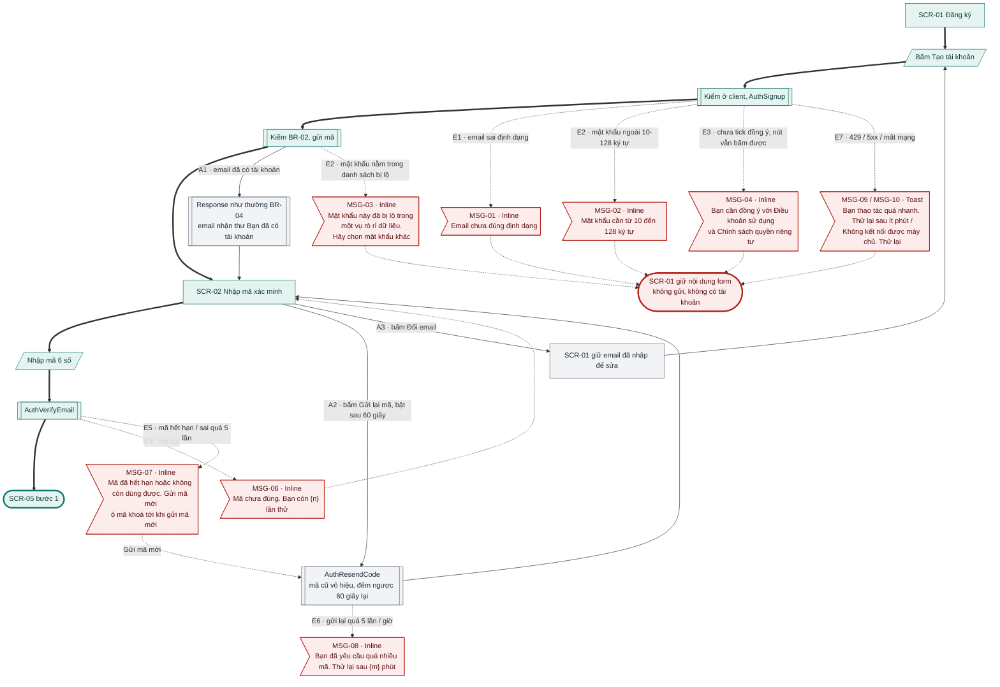

### Đối chiếu

| Mã | Điều kiện | Kết thúc ở | Thông báo |
|---|---|---|---|
| A1 | Email đã có tài khoản | SCR-02 như thường; email nhận thư "Bạn đã có tài khoản" | MSG-05 |
| A2 | Gửi lại mã sau 60 giây | SCR-02, mã mới | – |
| A3 | Đổi email trên SCR-02 | SCR-01 giữ email đã nhập | – |
| A4 | Mở từ link mời workspace (bản sau, BR-26) | Bỏ (1.1) | – |
| E1 | Email sai định dạng | Không gửi | MSG-01 |
| E2 | Mật khẩu ngoài 10–128 ký tự / bị lộ | Không gửi mã | MSG-02 / MSG-03 |
| E3 | Chưa tick đồng ý | Không gửi | MSG-04 |
| E4 | Mã sai | SCR-02, còn n lần | MSG-06 |
| E5 | Mã hết hạn / sai quá 5 lần | Ô mã khoá tới khi gửi mã mới | MSG-07 |
| E6 | Gửi lại quá 5 lần / giờ | Chặn gửi lại | MSG-08 |
| E7 | 429 / 5xx / mất mạng | Giữ nội dung form | MSG-09 / MSG-10 |

---

## UC-02 Đăng ký / đăng nhập bằng Google hoặc Microsoft

**Mở đầu:** khách chưa đăng nhập, đang ở SCR-01 hoặc SCR-03. **Thành công:** tài khoản mới (BR-05) hoặc tài khoản có sẵn được đăng nhập, phương thức Google / Microsoft được liên kết. **Thất bại:** không tạo, không đăng nhập; khách ở SCR-03 kèm thông báo.

### Happy case

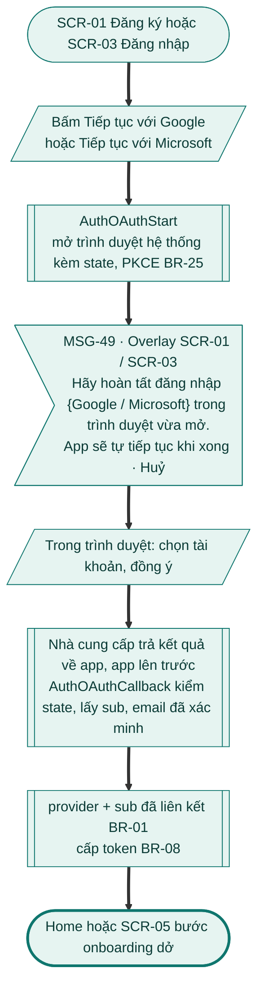

### Nhánh thay thế

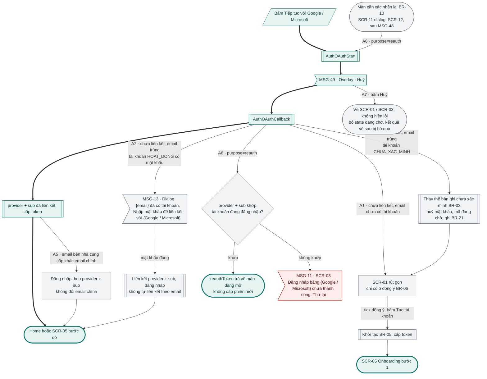

### Nhánh lỗi

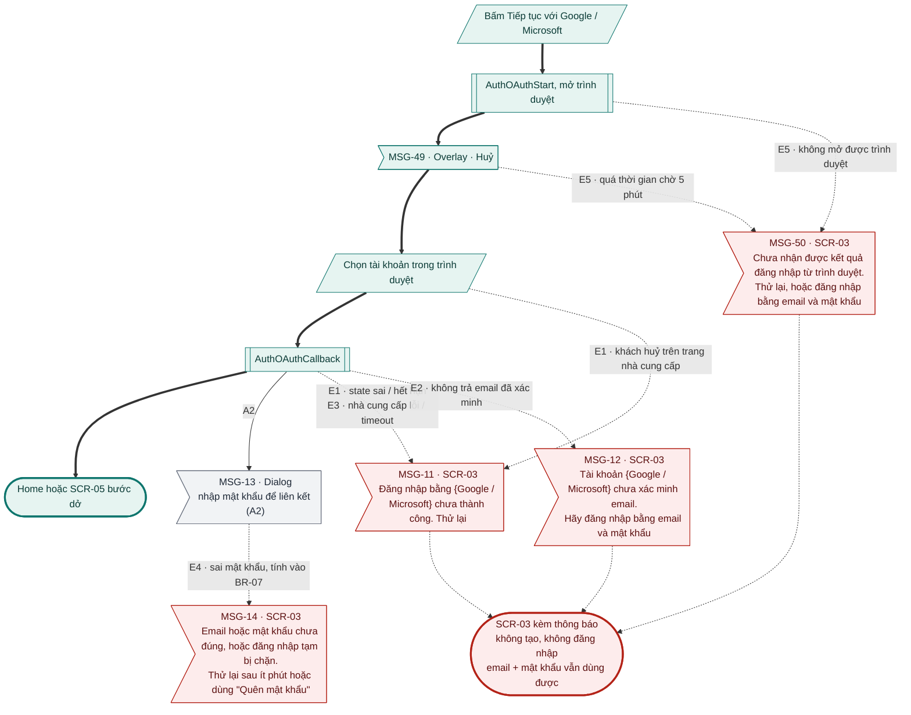

### Đối chiếu

| Mã | Điều kiện | Kết thúc ở | Thông báo |
|---|---|---|---|
| A1 | Chưa liên kết, email mới | SCR-01 rút gọn → SCR-05 bước 1 | – |
| A2 | Email trùng tài khoản có mật khẩu | Nhập mật khẩu → liên kết, đăng nhập | MSG-13 |
| A3 | Từ link mời workspace (bản sau, BR-26) | Bỏ (1.1) | – |
| A4 | Email trùng tài khoản `CHUA_XAC_MINH` | Thay bản ghi, tiếp như A1 | – |
| A5 | Email nhà cung cấp khác email chính | Đăng nhập, không đổi email chính | – |
| A6 | `purpose=reauth` | `reauthToken` về màn đang mở; không khớp → MSG-11 | MSG-11 |
| A7 | Bấm "Huỷ" trên màn chờ | Màn trước, không lỗi | – |
| E1 | Huỷ trên trang nhà cung cấp / `state` sai, hết hạn | SCR-03 | MSG-11 |
| E2 | Không có email đã xác minh | SCR-03 | MSG-12 |
| E3 | Nhà cung cấp lỗi / timeout | SCR-03 | MSG-11 |
| E4 | A2 nhập sai mật khẩu | Tính vào BR-07 | MSG-14 |
| E5 | Không mở được trình duyệt / quá thời gian chờ | SCR-03 | MSG-50 |

---

## UC-03 Đăng nhập, duy trì phiên và đăng xuất

**Mở đầu:** SCR-03, tài khoản `HOAT_DONG` (đang bị khoá BR-07 thì chỉ OAuth / quên mật khẩu). **Thành công:** có phiên hợp lệ (BR-08), mở Home hoặc bước onboarding dở. **Thất bại:** không có phiên, khách ở SCR-03.

### Happy case

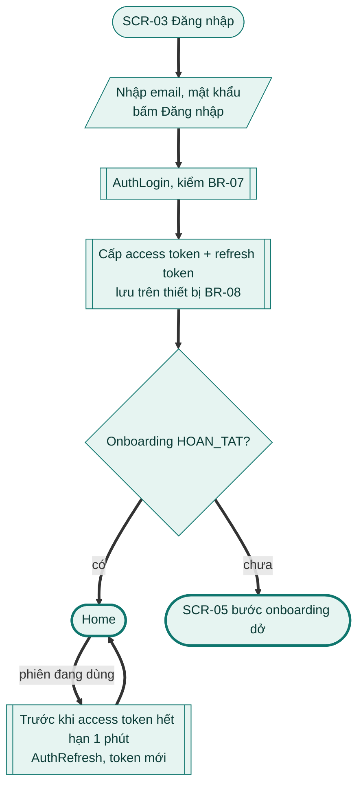

### Nhánh thay thế và lỗi: đăng nhập

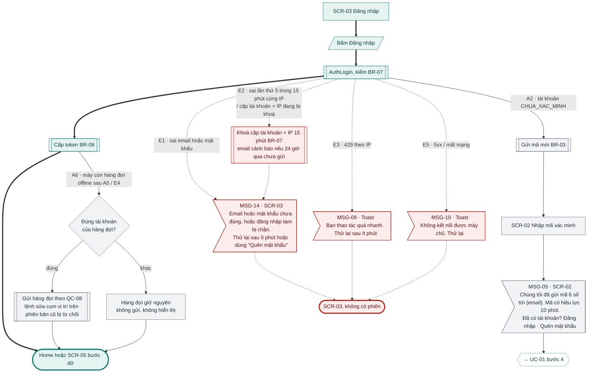

### Nhánh thay thế và lỗi: đăng xuất và mất phiên

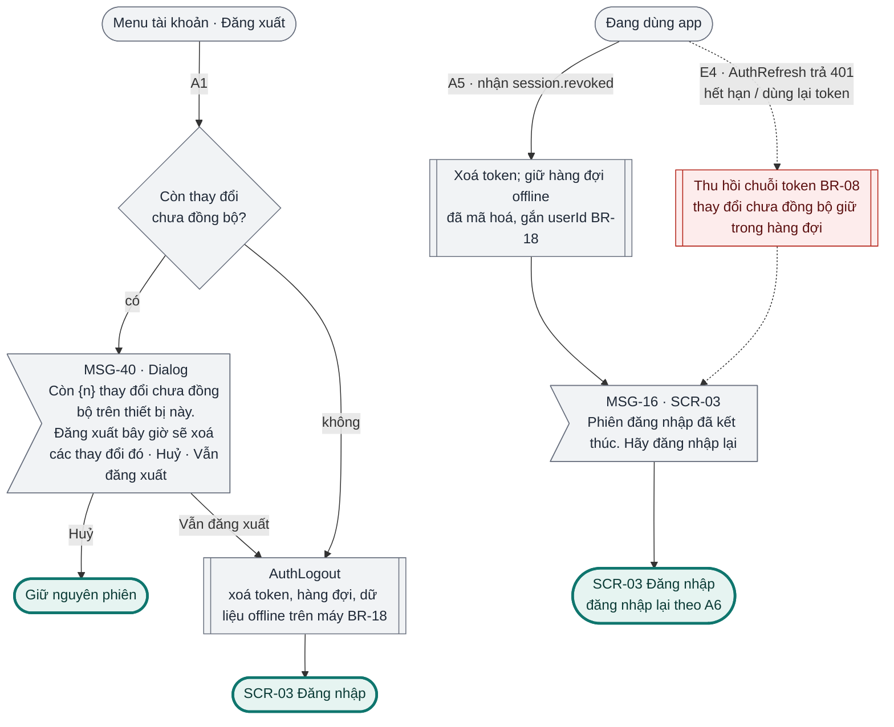

### Đối chiếu

| Mã | Điều kiện | Kết thúc ở | Thông báo |
|---|---|---|---|
| A1 | Đăng xuất | SCR-03; còn thay đổi chưa đồng bộ thì hỏi trước | MSG-40 |
| A2 | Tài khoản `CHUA_XAC_MINH` | SCR-02, mã mới → [UC-01](#uc-01-đăng-ký-bằng-email-và-mật-khẩu) | MSG-05 |
| A3 | Tài khoản bật 2FA (1.1) | Bỏ (1.1) | – |
| A4 | Mở từ link mời workspace (bản sau, BR-26) | Bỏ (1.1) | – |
| A5 | Nhận `session.revoked` | SCR-03, giữ hàng đợi đã mã hoá | MSG-16 |
| A6 | Đăng nhập lại sau A5 / E4 | Đúng tài khoản: gửi hàng đợi; khác: giữ, không gửi | – |
| E1 | Sai email hoặc mật khẩu | SCR-03 | MSG-14 |
| E2 | Sai lần 5 / cặp tài khoản + IP đang khoá | Khoá 15 phút, thông báo chung | MSG-14 |
| E3 | 429 theo IP | SCR-03 | MSG-09 |
| E4 | AuthRefresh 401 | SCR-03, giữ hàng đợi | MSG-16 |
| E5 | 5xx / mất mạng | SCR-03 | MSG-10 |

---

## UC-04 Quên và đặt lại mật khẩu

**Mở đầu:** khách chưa đăng nhập, ở SCR-03. **Thành công:** mật khẩu mới có hiệu lực (BR-09); khách quay lại app và đăng nhập bằng mật khẩu mới. Phần 2 chạy trên **trang web tối giản** (tech mục 1), trang web không cấp token cho app. **Thất bại:** mật khẩu không đổi.

### Happy case

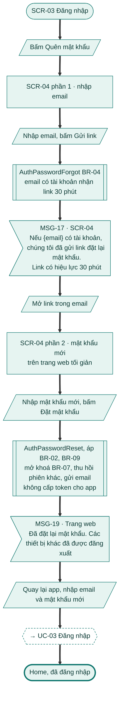

### Nhánh thay thế và lỗi

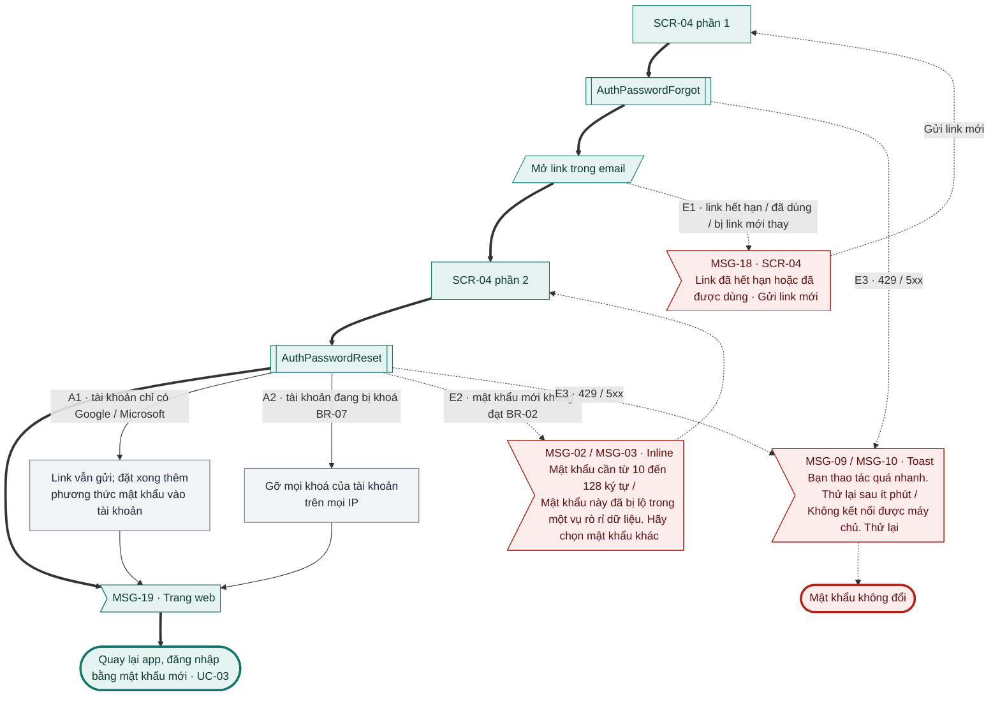

### Đối chiếu

| Mã | Điều kiện | Kết thúc ở | Thông báo |
|---|---|---|---|
| A1 | Tài khoản chỉ có Google / Microsoft | Thêm phương thức mật khẩu | MSG-19 |
| A2 | Đang bị khoá BR-07 | Gỡ khoá mọi IP | MSG-19 |
| E1 | Link hết hạn / đã dùng / bị thay | "Gửi link mới" | MSG-18 |
| E2 | Mật khẩu mới không đạt BR-02 | SCR-04 phần 2 | MSG-02 / MSG-03 |
| E3 | 429 / 5xx | Mật khẩu không đổi | MSG-09 / MSG-10 |

---

## UC-05 Onboarding lần đầu

**Mở đầu:** đã đăng nhập, onboarding `CHUA_BAT_DAU` hoặc `DANG_LAM`. **Thành công:** onboarding `HOAN_TAT`; ngôn ngữ, timezone, lịch làm việc, giờ plan đã lưu; ≥ 1 task hôm nay; Daily planning (G08) đang mở. **Thất bại:** giữ ở bước đang làm, dữ liệu bước trước đã lưu.

### Happy case

```mermaid
flowchart TD
  start(["Đăng nhập lần đầu<br/>onboarding CHUA_BAT_DAU / DANG_LAM"])
  s1["SCR-05 bước 1<br/>ngôn ngữ theo Windows, timezone theo thiết bị"]
  u1[/"Giữ hoặc sửa, bấm Tiếp"/]
  p1[["SettingsUpdate<br/>giá trị + onboardingStep"]]
  s2["SCR-05 bước 2 · kết nối lịch"]
  u2[/"Chọn Google Calendar / Outlook"/]
  x1{{"→ G05 · UC-01<br/>kết nối qua trình duyệt hệ thống BR-25"}}
  s2b["SCR-05 bước 2<br/>dấu tích Đã kết nối, email lịch"]
  s3["SCR-05 bước 3 · công cụ đang dùng"]
  u3[/"Chọn nhiều, bấm Tiếp<br/>lưu workTools"/]
  s4["SCR-05 bước 4<br/>lịch làm việc BR-22, giờ plan ngày 09:00"]
  u4[/"Chỉnh, bấm Tiếp"/]
  s5["SCR-05 bước 5 · 3 ô task<br/>thời lượng, channel gợi ý theo G02"]
  u5[/"Nhập 1-3 task<br/>bấm Bắt đầu ngày đầu tiên"/]
  p2[["Tạo task G02<br/>OnboardingComplete"]]
  x2{{"→ G08 · UC-01 A16<br/>Daily planning hôm nay, chế độ có hướng dẫn"}}
  ok(["Daily planning hôm nay đang mở<br/>onboarding HOAN_TAT"])

  start ==> s1 ==> u1 ==> p1 ==> s2 ==> u2 ==> x1 ==> s2b ==>|"Tiếp"| s3 ==> u3 ==> s4 ==> u4 ==> s5 ==> u5 ==> p2 ==> x2 ==> ok

  class start,s1,u1,p1,s2,u2,s2b,s3,u3,s4,u4,s5,u5,p2 happy
  class x1,x2 link
  class ok done
  classDef happy fill:#E6F4F1,stroke:#0F766E,color:#0B3B36
  classDef alt fill:#F1F3F5,stroke:#6B7280,color:#1F2937
  classDef err fill:#FDECEC,stroke:#B42318,color:#5C1010
  classDef warn fill:#FEF4E2,stroke:#B45309,color:#4A2604
  classDef ai fill:#F1ECFD,stroke:#6D28D9,color:#2E1065
  classDef sync fill:#FFFFFF,stroke:#6B7280,stroke-dasharray:4 3,color:#1F2937
  classDef link fill:#FFFFFF,stroke:#0F766E,stroke-dasharray:4 3,color:#0B3B36
  classDef done fill:#E6F4F1,stroke:#0F766E,stroke-width:3px,color:#0B3B36
  classDef fail fill:#FDECEC,stroke:#B42318,stroke-width:3px,color:#5C1010
```

### Nhánh thay thế và lỗi

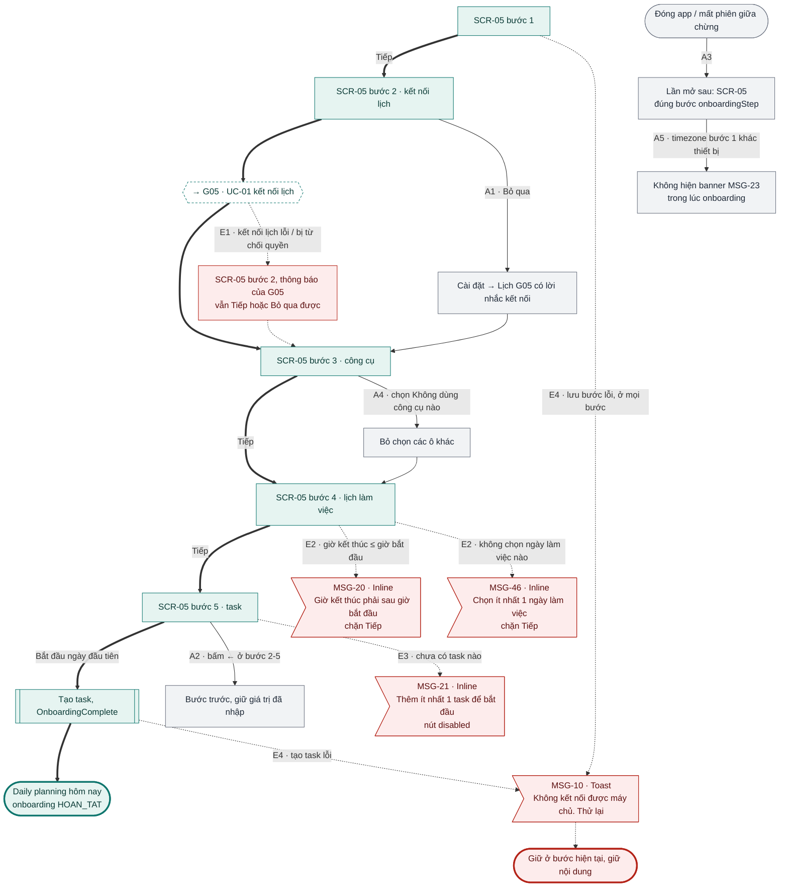

### Đối chiếu

| Mã | Điều kiện | Kết thúc ở | Thông báo |
|---|---|---|---|
| A1 | Bỏ qua bước 2 | Bước 3; Cài đặt → Lịch có lời nhắc | – |
| A2 | Bấm ← | Bước trước, giữ giá trị | – |
| A3 | Đóng app / mất phiên giữa chừng | Lần sau vào đúng bước | – |
| A4 | "Không dùng công cụ nào" | Bỏ chọn ô khác, sang bước 4 | – |
| A5 | Timezone khác thiết bị khi mở lại | Không hiện banner | (không hiện MSG-23) |
| E1 | Kết nối lịch lỗi / bị từ chối | Bước 2 → [G05 · UC-01](g05-lich-timebox.md) | Thông báo của G05 |
| E2 | Giờ kết thúc ≤ bắt đầu / không ngày nào | Chặn Tiếp | MSG-20 / MSG-46 |
| E3 | Bước 5 chưa có task | Nút disabled | MSG-21 |
| E4 | Lưu bước / tạo task lỗi | Giữ bước, giữ nội dung | MSG-10 |

Sang flow khác: kết nối lịch [G05 · UC-01](g05-lich-timebox.md), Daily planning [G08 · UC-01](g08-daily-rituals.md), tạo task theo [G02 · UC-01](g02-quan-ly-task.md#uc-01-tạo-task).

---

## UC-06 Xem và đổi cài đặt

**Mở đầu:** đã đăng nhập; menu tài khoản → "Cài đặt", command menu "Mở cài đặt" hoặc Ctrl+,. **Thành công:** giá trị mới lưu, áp dụng ngay, đồng bộ thiết bị khác (BR-12). **Thất bại:** trường giữ giá trị cũ, có thông báo.

### Happy case

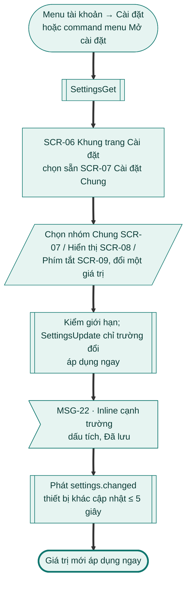

### Nhánh thay thế

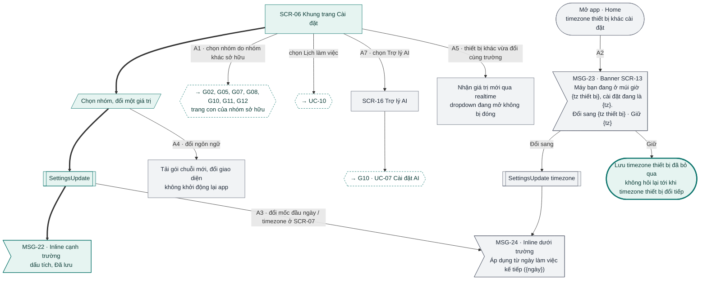

### Nhánh lỗi và xung đột

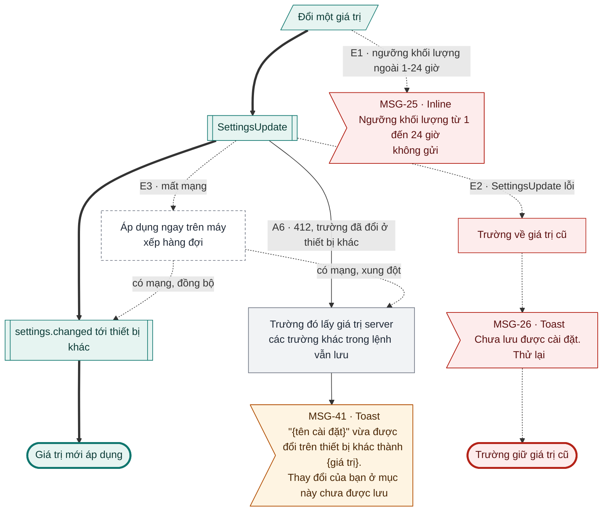

### Đối chiếu

| Mã | Điều kiện | Kết thúc ở | Thông báo |
|---|---|---|---|
| A1 | Nhóm do nhóm khác sở hữu | Trang con của nhóm đó (G02, G05, G07, G08, G10, G11 (1.1, chưa có flow), [G12](g12-workspace-billing.md)) | – |
| A2 | Mở app, timezone thiết bị khác cài đặt | Đổi sang → MSG-24; Giữ → không hỏi lại | MSG-23, MSG-24 |
| A3 | Đổi mốc đầu ngày / timezone | Lưu, hiệu lực ngày làm việc kế tiếp | MSG-24 |
| A4 | Đổi ngôn ngữ | Giao diện đổi ngay | – |
| A5 | Thiết bị khác vừa đổi cùng trường | Nhận giá trị mới | – |
| A6 | 412 trường đã đổi ở thiết bị khác | Trường theo server | MSG-41 |
| A7 | Chọn "Trợ lý AI" | SCR-16 → [G10 · UC-07](g10-tro-ly-ai.md) | – |
| E1 | Ngưỡng khối lượng ngoài 1–24 giờ | Không gửi | MSG-25 |
| E2 | SettingsUpdate lỗi | Giá trị cũ | MSG-26 |
| E3 | Mất mạng | Hàng đợi, đồng bộ sau; xung đột theo A6 | – |

---

## UC-07 Hồ sơ và bảo mật tài khoản

**Mở đầu:** đã đăng nhập, Cài đặt → "Hồ sơ" hoặc "Tài khoản". **Thành công:** hồ sơ / mật khẩu / email được đổi, hoặc các phiên khác bị thu hồi; ghi nhật ký (BR-21). **Thất bại:** không thay đổi.

### Happy case

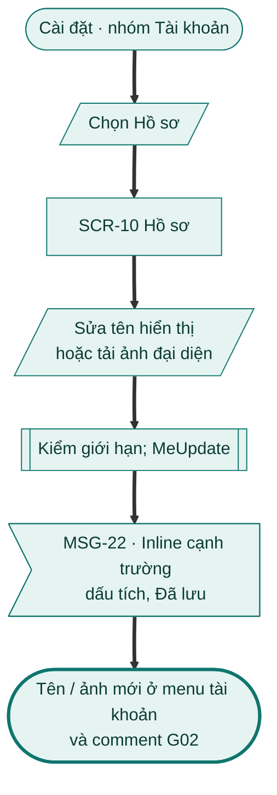

### Nhánh lỗi: hồ sơ

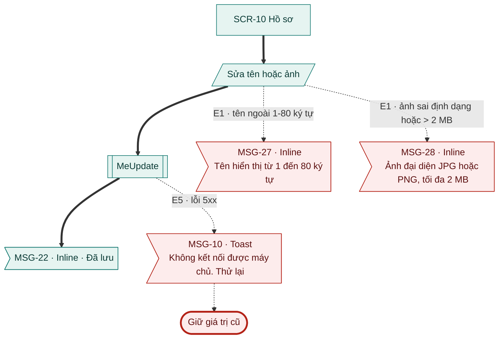

### Nhánh thay thế và lỗi: mật khẩu, đăng xuất mọi thiết bị

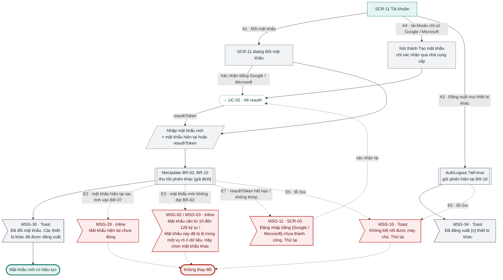

### Nhánh thay thế và lỗi: đổi email, "Không phải tôi"

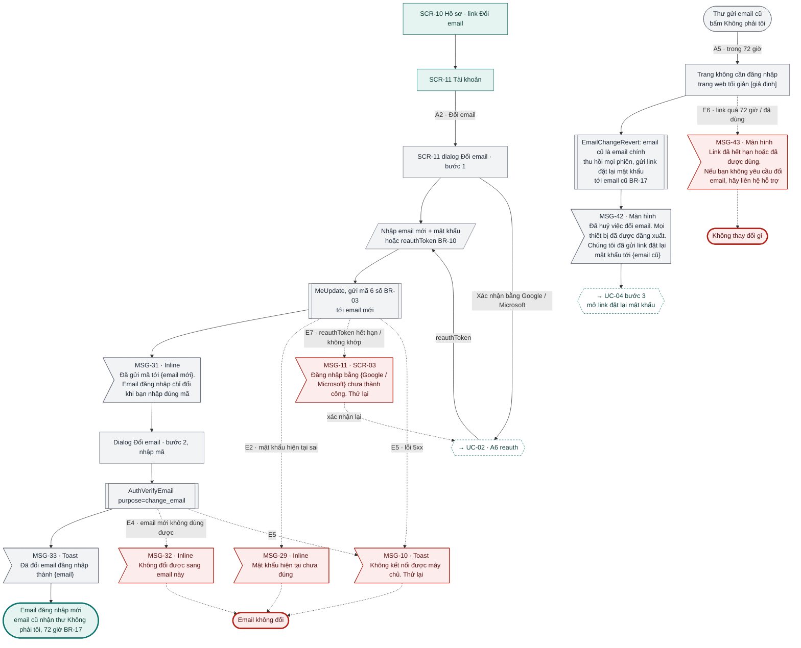

### Đối chiếu

| Mã | Điều kiện | Kết thúc ở | Thông báo |
|---|---|---|---|
| A1 | Đổi mật khẩu | Mật khẩu mới, thu hồi phiên khác | MSG-30 |
| A2 | Đổi email | Email mới sau khi nhập đúng mã | MSG-31, MSG-33 |
| A3 | Đăng xuất mọi thiết bị khác | Giữ phiên hiện tại | MSG-34 |
| A4 | Chỉ có Google / Microsoft | "Tạo mật khẩu", xác nhận qua [UC-02 A6](#uc-02-đăng-ký--đăng-nhập-bằng-google-hoặc-microsoft) | – |
| A5 | "Không phải tôi" trong 72 giờ | Email cũ khôi phục, mọi phiên thu hồi → [UC-04](#uc-04-quên-và-đặt-lại-mật-khẩu) | MSG-42 |
| E1 | Tên ngoài 1–80 / ảnh sai định dạng, > 2 MB | Không lưu | MSG-27 / MSG-28 |
| E2 | Mật khẩu hiện tại sai | Tính vào BR-07 | MSG-29 |
| E3 | Mật khẩu mới không đạt BR-02 | Không lưu | MSG-02 / MSG-03 |
| E4 | Email mới không dùng được | Báo ở bước nhập mã | MSG-32 |
| E5 | Lỗi 5xx | Giữ giá trị cũ | MSG-10 |
| E6 | Link "Không phải tôi" quá hạn / đã dùng | Không thay đổi | MSG-43 |
| E7 | `reauthToken` hết hạn / không khớp | Xác nhận lại | MSG-11 |

---

## UC-08 Xuất dữ liệu

**Mở đầu:** đã đăng nhập, SCR-11, không có yêu cầu xuất `DANG_XU_LY`. **Thành công:** yêu cầu `DANG_XU_LY`; khi xong `SAN_SANG`, người dùng nhận email có link. **Thất bại:** không tạo yêu cầu.

### Happy case

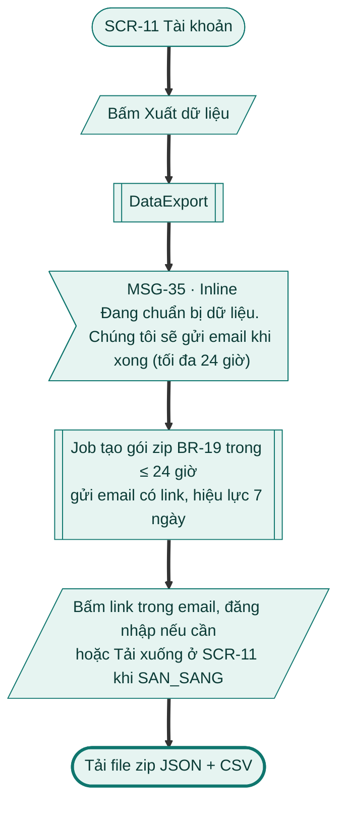

### Nhánh thay thế và lỗi

```mermaid
flowchart TD
  u1[/"Bấm Xuất dữ liệu"/]
  p1[["DataExport"]]
  p2[["Job tạo gói, email có link"]]
  u2[/"Mở link / Tải xuống"/]
  ok(["Tải file zip"])

  u1 ==> p1 ==> p2 ==> u2 ==> ok

  u2 -->|"A2 · link quá 7 ngày"| a2["SCR-11 trạng thái HET_HAN<br/>nút Tạo bản xuất mới"]
  a2 -->|"Tạo bản xuất mới"| u1

  p1 -.->|"E1 · đã có yêu cầu đang xử lý"| e1m>"MSG-36 · Inline<br/>Đã có một yêu cầu xuất dữ liệu đang xử lý"]
  e1m -.-> fail(["Không tạo yêu cầu mới"])
  p2 -.->|"E2 · job lỗi sau 3 lần thử"| e2["SCR-11 trạng thái LOI, email báo<br/>nút Thử lại"]
  e2 -.->|"Thử lại"| p1
  u2 -.->|"E3 · mở link bằng tài khoản khác"| e3(["403, trang<br/>Link này thuộc tài khoản khác"])

  class u1,p1,p2,u2 happy
  class a2 alt
  class e1m,e2 err
  class ok done
  class fail,e3 fail
  classDef happy fill:#E6F4F1,stroke:#0F766E,color:#0B3B36
  classDef alt fill:#F1F3F5,stroke:#6B7280,color:#1F2937
  classDef err fill:#FDECEC,stroke:#B42318,color:#5C1010
  classDef warn fill:#FEF4E2,stroke:#B45309,color:#4A2604
  classDef ai fill:#F1ECFD,stroke:#6D28D9,color:#2E1065
  classDef sync fill:#FFFFFF,stroke:#6B7280,stroke-dasharray:4 3,color:#1F2937
  classDef link fill:#FFFFFF,stroke:#0F766E,stroke-dasharray:4 3,color:#0B3B36
  classDef done fill:#E6F4F1,stroke:#0F766E,stroke-width:3px,color:#0B3B36
  classDef fail fill:#FDECEC,stroke:#B42318,stroke-width:3px,color:#5C1010
```

### Đối chiếu

| Mã | Điều kiện | Kết thúc ở | Thông báo |
|---|---|---|---|
| A1 | Workspace chỉ đọc (1.1, QC-09) | Bỏ (1.1) | – |
| A2 | Link quá 7 ngày | `HET_HAN`, "Tạo bản xuất mới" | – |
| E1 | Đã có yêu cầu đang xử lý | Không tạo | MSG-36 |
| E2 | Job lỗi sau 3 lần thử | `LOI`, email báo, "Thử lại" | – (chưa có MSG) |
| E3 | Mở link bằng tài khoản khác | 403, trang "Link này thuộc tài khoản khác" | – (chưa có MSG) |

---

## UC-09 Xoá tài khoản

**Mở đầu:** đã đăng nhập, SCR-11, không có yêu cầu xuất `DANG_XU_LY`. **Thành công:** tài khoản `CHO_XOA`, workspace cá nhân đã xoá (BR-20), người dùng ở màn MSG-38. **Thất bại:** tài khoản và workspace không đổi.

### Happy case

```mermaid
flowchart TD
  start(["SCR-11 Tài khoản"])
  u1[/"Bấm Xoá tài khoản"/]
  s1["SCR-12 Xoá tài khoản<br/>hậu quả BR-20: số task, kết nối lịch / tích hợp bị thu hồi<br/>gợi ý Xuất dữ liệu trước"]
  u2[/"Nhập mật khẩu hoặc xác nhận qua nhà cung cấp<br/>gõ XOÁ, bấm Xoá vĩnh viễn"/]
  p1[["AccountDelete, áp BR-20: CHO_XOA, xoá workspace cá nhân<br/>đăng xuất mọi phiên, thu hồi token G05, G11<br/>gửi email xác nhận"]]
  m1>"MSG-38 · Màn hình<br/>Tài khoản đã được xoá. Dữ liệu sẽ bị xoá vĩnh viễn trong vòng 30 ngày"]
  ok(["Tài khoản CHO_XOA, đã đăng xuất"])

  start ==> u1 ==> s1 ==> u2 ==> p1 ==> m1 ==> ok

  class start,u1,s1,u2,p1,m1 happy
  class ok done
  classDef happy fill:#E6F4F1,stroke:#0F766E,color:#0B3B36
  classDef alt fill:#F1F3F5,stroke:#6B7280,color:#1F2937
  classDef err fill:#FDECEC,stroke:#B42318,color:#5C1010
  classDef warn fill:#FEF4E2,stroke:#B45309,color:#4A2604
  classDef ai fill:#F1ECFD,stroke:#6D28D9,color:#2E1065
  classDef sync fill:#FFFFFF,stroke:#6B7280,stroke-dasharray:4 3,color:#1F2937
  classDef link fill:#FFFFFF,stroke:#0F766E,stroke-dasharray:4 3,color:#0B3B36
  classDef done fill:#E6F4F1,stroke:#0F766E,stroke-width:3px,color:#0B3B36
  classDef fail fill:#FDECEC,stroke:#B42318,stroke-width:3px,color:#5C1010
```

### Nhánh thay thế và lỗi

```mermaid
flowchart TD
  s1["SCR-12 Xoá tài khoản"]
  u2[/"Mật khẩu, gõ XOÁ, Xoá vĩnh viễn"/]
  p1[["AccountDelete"]]
  m1>"MSG-38 · Màn hình"]
  ok(["Tài khoản CHO_XOA"])

  s1 ==> u2 ==> p1 ==> m1 ==> ok

  s1 -->|"A1 · Xuất dữ liệu trước"| a1x{{"→ UC-08<br/>đóng SCR-12"}}
  u2 -->|"xác nhận qua nhà cung cấp"| rx{{"→ UC-02 · A6 reauth"}}
  rx -->|"reauthToken"| u2
  p1 -->|"A2 · đang có timer chạy"| a2x{{"→ G07 · UC-02<br/>dừng và lưu bản ghi thời gian trước khi xoá"}}
  a2x --> a4
  p1 -->|"A4 · OWNER workspace chỉ có mình<br/>mọi tài khoản ở 1.0"| a4["Xoá workspace cá nhân cùng giao dịch"]
  a4 --> m1

  s1 -.->|"E4 · có yêu cầu xuất DANG_XU_LY"| e4m>"MSG-44 · Inline<br/>Đang chuẩn bị bản xuất dữ liệu.<br/>Bạn có thể xoá tài khoản sau khi bản xuất sẵn sàng<br/>nút xoá disabled tới khi SAN_SANG / LOI"]
  u2 -.->|"E2 · chưa gõ đúng XOÁ"| e2bm>"MSG-39 · Inline<br/>Gõ #quot;XOÁ#quot; để xác nhận"]
  p1 -.->|"E2 · mật khẩu sai"| e2m>"MSG-29 · Inline<br/>Mật khẩu hiện tại chưa đúng"]
  p1 -.->|"E3 · lỗi 5xx"| e3m>"MSG-10 · Toast<br/>Không kết nối được máy chủ. Thử lại"]
  e4m -.-> fail(["Tài khoản và workspace không đổi"])
  e2bm -.-> fail
  e2m -.-> fail
  e3m -.-> fail

  class s1,u2,p1,m1 happy
  class a4 alt
  class a1x,rx,a2x link
  class e4m,e2bm,e2m,e3m err
  class ok done
  class fail fail
  classDef happy fill:#E6F4F1,stroke:#0F766E,color:#0B3B36
  classDef alt fill:#F1F3F5,stroke:#6B7280,color:#1F2937
  classDef err fill:#FDECEC,stroke:#B42318,color:#5C1010
  classDef warn fill:#FEF4E2,stroke:#B45309,color:#4A2604
  classDef ai fill:#F1ECFD,stroke:#6D28D9,color:#2E1065
  classDef sync fill:#FFFFFF,stroke:#6B7280,stroke-dasharray:4 3,color:#1F2937
  classDef link fill:#FFFFFF,stroke:#0F766E,stroke-dasharray:4 3,color:#0B3B36
  classDef done fill:#E6F4F1,stroke:#0F766E,stroke-width:3px,color:#0B3B36
  classDef fail fill:#FDECEC,stroke:#B42318,stroke-width:3px,color:#5C1010
```

### Đối chiếu

| Mã | Điều kiện | Kết thúc ở | Thông báo |
|---|---|---|---|
| A1 | "Xuất dữ liệu trước" | Đóng SCR-12 → [UC-08](#uc-08-xuất-dữ-liệu) | – |
| A2 | Đang có timer chạy | Dừng, lưu bản ghi → [G07 · UC-02](g07-focus-timer.md) | – |
| A3 | Không phải `OWNER` (bản sau, BR-26) | Bỏ (1.1) | – |
| A4 | `OWNER` workspace chỉ có mình | Xoá workspace cá nhân (phần huỷ gói: Bỏ (1.1)) | MSG-38 |
| E1 | `OWNER`, workspace còn thành viên (bản sau) | Bỏ (1.1) | – |
| E2 | Mật khẩu sai / chưa gõ đúng "XOÁ" | Không xoá | MSG-29 / MSG-39 |
| E3 | Lỗi 5xx | Tài khoản giữ nguyên | MSG-10 |
| E4 | Có yêu cầu xuất `DANG_XU_LY` | Nút xoá disabled | MSG-44 |

---

## UC-10 Cài đặt Lịch làm việc

**Mở đầu:** đã đăng nhập; Cài đặt → "Lịch làm việc", hoặc link từ G04 (sức chứa), G08 (cài đặt ritual). **Thành công:** `workSchedule` mới lưu theo BR-22, đồng bộ thiết bị khác; G04, G05, G08, G09 đọc giá trị mới. **Thất bại:** giữ lịch làm việc cũ.

### Happy case

```mermaid
flowchart TD
  start(["Cài đặt → Lịch làm việc<br/>hoặc link từ G04, G08"])
  p1[["SettingsGet"]]
  s1["SCR-14 Lịch làm việc<br/>7 ngày, ngày làm việc bật kèm giờ bắt đầu / kết thúc"]
  u1[/"Bật / tắt một ngày<br/>hoặc đổi giờ của một ngày"/]
  p2[["Kiểm BR-22<br/>SettingsUpdate workSchedule"]]
  m1>"MSG-22 · Inline cạnh dòng<br/>dấu tích, Đã lưu"]
  m2>"MSG-24 · Inline dưới bảng<br/>Áp dụng từ ngày làm việc kế tiếp ({ngày})"]
  ok(["workSchedule mới, đồng bộ thiết bị khác<br/>G04, G05, G08, G09 đọc giá trị mới"])

  start ==> p1 ==> s1 ==> u1 ==> p2 ==> m1 ==> m2 ==> ok

  class start,p1,s1,u1,p2,m1,m2 happy
  class ok done
  classDef happy fill:#E6F4F1,stroke:#0F766E,color:#0B3B36
  classDef alt fill:#F1F3F5,stroke:#6B7280,color:#1F2937
  classDef err fill:#FDECEC,stroke:#B42318,color:#5C1010
  classDef warn fill:#FEF4E2,stroke:#B45309,color:#4A2604
  classDef ai fill:#F1ECFD,stroke:#6D28D9,color:#2E1065
  classDef sync fill:#FFFFFF,stroke:#6B7280,stroke-dasharray:4 3,color:#1F2937
  classDef link fill:#FFFFFF,stroke:#0F766E,stroke-dasharray:4 3,color:#0B3B36
  classDef done fill:#E6F4F1,stroke:#0F766E,stroke-width:3px,color:#0B3B36
  classDef fail fill:#FDECEC,stroke:#B42318,stroke-width:3px,color:#5C1010
```

### Nhánh thay thế và lỗi

```mermaid
flowchart TD
  s1["SCR-14 Lịch làm việc"]
  u1[/"Bật / tắt ngày, đổi giờ"/]
  p2[["Kiểm BR-22, SettingsUpdate"]]
  m2>"MSG-22, MSG-24 · Inline"]

  s1 ==> u1 ==> p2 ==> m2

  u1 -->|"A1 · bật Thứ Bảy hoặc ngày khác"| a1["Ngày đó nhận giờ mặc định<br/>09:00-17:00 [giả định], sửa được"]
  a1 --> p2
  a2s(["SCR-05 Onboarding bước 4"]) -->|"A2"| a2["Cùng thành phần SCR-14<br/>lưu theo UC-05 bước 2"]
  a2 --> a2x{{"→ UC-05"}}
  s1 -->|"A3 · Đặt khung giờ cho channel, SCR-14 #4"| a3x{{"→ G02 · UC-06<br/>khung giờ channel"}}

  u1 -.->|"E1 · tắt ngày làm việc cuối cùng"| e1m>"MSG-46 · Inline<br/>Chọn ít nhất 1 ngày làm việc<br/>không gửi"]
  u1 -.->|"E2 · giờ kết thúc ≤ giờ bắt đầu"| e2m>"MSG-20 · Inline<br/>Giờ kết thúc phải sau giờ bắt đầu<br/>không gửi"]
  p2 -.->|"E3 · SettingsUpdate lỗi, như UC-06 E2"| e3m>"MSG-26 · Toast<br/>Chưa lưu được cài đặt. Thử lại"]
  p2 -.->|"E3 · xung đột 412, như UC-06 A6"| e3bm>"MSG-41 · Toast<br/>#quot;{tên cài đặt}#quot; vừa được đổi trên thiết bị khác thành {giá trị}.<br/>Thay đổi của bạn ở mục này chưa được lưu"]
  e1m -.-> fail(["Giữ lịch làm việc cũ"])
  e2m -.-> fail
  e3m -.-> fail
  e3bm -.-> fail

  class s1,u1,p2,m2 happy
  class a1,a2s,a2 alt
  class a2x,a3x link
  class e1m,e2m,e3m,e3bm err
  class fail fail
  classDef happy fill:#E6F4F1,stroke:#0F766E,color:#0B3B36
  classDef alt fill:#F1F3F5,stroke:#6B7280,color:#1F2937
  classDef err fill:#FDECEC,stroke:#B42318,color:#5C1010
  classDef warn fill:#FEF4E2,stroke:#B45309,color:#4A2604
  classDef ai fill:#F1ECFD,stroke:#6D28D9,color:#2E1065
  classDef sync fill:#FFFFFF,stroke:#6B7280,stroke-dasharray:4 3,color:#1F2937
  classDef link fill:#FFFFFF,stroke:#0F766E,stroke-dasharray:4 3,color:#0B3B36
  classDef done fill:#E6F4F1,stroke:#0F766E,stroke-width:3px,color:#0B3B36
  classDef fail fill:#FDECEC,stroke:#B42318,stroke-width:3px,color:#5C1010
```

### Đối chiếu

| Mã | Điều kiện | Kết thúc ở | Thông báo |
|---|---|---|---|
| A1 | Bật Thứ Bảy / ngày khác | Giờ mặc định 09:00–17:00 | MSG-22, MSG-24 |
| A2 | Từ onboarding bước 4 | Lưu theo [UC-05](#uc-05-onboarding-lần-đầu) | – |
| A3 | "Đặt khung giờ cho channel" | [G02 · UC-06](g02-quan-ly-task.md#uc-06-quản-lý-context-và-channel) | – |
| E1 | Tắt ngày làm việc cuối cùng | Không gửi | MSG-46 |
| E2 | Giờ kết thúc ≤ bắt đầu | Không gửi | MSG-20 |
| E3 | SettingsUpdate lỗi / xung đột | Như UC-06 E2 / A6 | MSG-26 / MSG-41 |

---

## UC-11 Rút lại đồng ý và xin đồng ý lại

**Mở đầu:** đã đăng nhập; mở app khi có phiên bản Điều khoản mới, hoặc SCR-11. **Thành công:** đồng ý phiên bản mới được lưu (BR-06), hoặc đồng ý bị rút lại và tài khoản `CHO_XOA` `[giả định]`; ghi BR-21. **Thất bại:** trạng thái đồng ý không đổi.

### Happy case

```mermaid
flowchart TD
  start(["Mở app<br/>hoặc API bất kỳ trả CONSENT_REQUIRED"])
  p1[["ConsentGet trả CAN_DONG_Y_LAI"]]
  s1["SCR-15 Đồng ý phiên bản Điều khoản mới"]
  m1>"MSG-47 · Màn hình<br/>Điều khoản sử dụng / Chính sách quyền riêng tư đã cập nhật ngày {ngày}.<br/>Đọc và đồng ý để tiếp tục dùng app"]
  u1[/"Đọc tóm tắt thay đổi, tick đồng ý<br/>bấm Đồng ý và tiếp tục"/]
  p2[["ConsentUpdate phiên bản, thời điểm<br/>ghi BR-21"]]
  ok(["Về màn đang mở<br/>đồng ý DA_DONG_Y"])

  start ==> p1 ==> s1 ==> m1 ==> u1 ==> p2 ==> ok

  class start,p1,s1,m1,u1,p2 happy
  class ok done
  classDef happy fill:#E6F4F1,stroke:#0F766E,color:#0B3B36
  classDef alt fill:#F1F3F5,stroke:#6B7280,color:#1F2937
  classDef err fill:#FDECEC,stroke:#B42318,color:#5C1010
  classDef warn fill:#FEF4E2,stroke:#B45309,color:#4A2604
  classDef ai fill:#F1ECFD,stroke:#6D28D9,color:#2E1065
  classDef sync fill:#FFFFFF,stroke:#6B7280,stroke-dasharray:4 3,color:#1F2937
  classDef link fill:#FFFFFF,stroke:#0F766E,stroke-dasharray:4 3,color:#0B3B36
  classDef done fill:#E6F4F1,stroke:#0F766E,stroke-width:3px,color:#0B3B36
  classDef fail fill:#FDECEC,stroke:#B42318,stroke-width:3px,color:#5C1010
```

### Nhánh thay thế và lỗi

```mermaid
flowchart TD
  s1["SCR-15 Đồng ý phiên bản mới"]
  u1[/"Tick đồng ý, Đồng ý và tiếp tục"/]
  p2[["ConsentUpdate"]]
  ok(["Về màn đang mở"])

  s1 ==> u1 ==> p2 ==> ok

  s1 -->|"A2 · Xuất dữ liệu"| x8{{"→ UC-08"}}
  s1 -->|"A2 · Xoá tài khoản"| x9{{"→ UC-09"}}
  s1 -->|"A2 · Đăng xuất"| x3{{"→ UC-03 · A1"}}

  a1s(["SCR-11 · Rút lại đồng ý xử lý dữ liệu"]) -->|"A1"| a1m>"MSG-48 · Dialog<br/>Rút lại đồng ý xử lý dữ liệu đồng nghĩa với việc chúng tôi<br/>không thể tiếp tục cung cấp dịch vụ.<br/>Tài khoản và dữ liệu sẽ bị xoá trong 30 ngày<br/>· Xuất dữ liệu trước · Huỷ · Rút lại đồng ý"]
  a1m -->|"Huỷ"| a1k(["Giữ nguyên đồng ý"])
  a1m -->|"Xuất dữ liệu trước"| x8
  a1m -->|"Rút lại đồng ý"| a1r[/"Xác nhận lại BR-10: mật khẩu<br/>hoặc reauth qua nhà cung cấp"/]
  a1r --> a1p[["ConsentUpdate withdraw=true<br/>chạy như UC-09 bước 4, BR-20 [giả định]"]]
  a1p --> a1x{{"→ UC-09 bước 4<br/>màn MSG-38, tài khoản CHO_XOA"}}

  a3s(["Muốn rút đồng ý Trợ lý AI<br/>hoặc Product updates"]) -->|"A3 · không ở đây"| a3a{{"→ G10 · UC-07 A6<br/>Cài đặt → Trợ lý AI SCR-16"}}
  a3s -->|"A3"| a3b{{"→ G12 · UC-08<br/>Cài đặt → Thông báo"}}

  u1 -.->|"E1 · chưa tick đồng ý"| e1m>"MSG-04 · Inline<br/>Bạn cần đồng ý với Điều khoản sử dụng<br/>và Chính sách quyền riêng tư"]
  a1p -.->|"E2 · đang xuất dữ liệu, như UC-09 E4"| e2m>"MSG-44 · Inline<br/>Đang chuẩn bị bản xuất dữ liệu.<br/>Bạn có thể xoá tài khoản sau khi bản xuất sẵn sàng"]
  p2 -.->|"E3 · lỗi 5xx"| e3m>"MSG-10 · Toast<br/>Không kết nối được máy chủ. Thử lại"]
  a1p -.->|"E3 · lỗi 5xx"| e3m
  e1m -.-> fail(["Trạng thái đồng ý không đổi"])
  e2m -.-> fail
  e3m -.-> fail

  class s1,u1,p2 happy
  class a1s,a1m,a1r,a1p,a3s alt
  class x8,x9,x3,a1x,a3a,a3b link
  class e1m,e2m,e3m err
  class ok,a1k done
  class fail fail
  classDef happy fill:#E6F4F1,stroke:#0F766E,color:#0B3B36
  classDef alt fill:#F1F3F5,stroke:#6B7280,color:#1F2937
  classDef err fill:#FDECEC,stroke:#B42318,color:#5C1010
  classDef warn fill:#FEF4E2,stroke:#B45309,color:#4A2604
  classDef ai fill:#F1ECFD,stroke:#6D28D9,color:#2E1065
  classDef sync fill:#FFFFFF,stroke:#6B7280,stroke-dasharray:4 3,color:#1F2937
  classDef link fill:#FFFFFF,stroke:#0F766E,stroke-dasharray:4 3,color:#0B3B36
  classDef done fill:#E6F4F1,stroke:#0F766E,stroke-width:3px,color:#0B3B36
  classDef fail fill:#FDECEC,stroke:#B42318,stroke-width:3px,color:#5C1010
```

### Đối chiếu

| Mã | Điều kiện | Kết thúc ở | Thông báo |
|---|---|---|---|
| A1 | Rút lại đồng ý xử lý dữ liệu | Xác nhận lại → như [UC-09](#uc-09-xoá-tài-khoản) bước 4, `CHO_XOA` | MSG-48, MSG-38 |
| A2 | Trên SCR-15 chọn Xuất / Xoá / Đăng xuất | [UC-08](#uc-08-xuất-dữ-liệu) / [UC-09](#uc-09-xoá-tài-khoản) / [UC-03](#uc-03-đăng-nhập-duy-trì-phiên-và-đăng-xuất) A1, không cần đồng ý mới | – |
| A3 | Rút đồng ý Trợ lý AI / Product updates | [G10 · UC-07](g10-tro-ly-ai.md) / [G12 · UC-08](g12-workspace-billing.md) | – |
| E1 | Chưa tick đồng ý | Không lưu | MSG-04 |
| E2 | `OWNER` workspace còn thành viên (bản sau) | Bỏ (1.1) | – |
| E2 | Đang xuất dữ liệu | Như UC-09 E4 | MSG-44 |
| E3 | Lỗi 5xx | Không đổi | MSG-10 |

## Kiểm tra

- [x] Mọi A# / E# của UC-01 … UC-11 bản 1.0 có trên sơ đồ hoặc ghi "Bỏ (1.1)".
- [x] Mọi nút màn hình có mã SCR; mọi nút thông báo có mã MSG. Ngoại lệ là các màn SRS chưa đặt mã SCR, ghi ở dưới.

**Ghi chú cho brief G01**
- **MSG-22 có ký tự ✓** ("✓ Đã lưu"). Quy ước cấm ký tự này trong nhãn, nên sơ đồ ghi "dấu tích, Đã lưu". SCR-05 bước 2 ("✓ Đã kết nối") cũng ghi là "dấu tích".
- **Màn chưa có mã SCR:** menu tài khoản (UC-03 A1, UC-06 bước 1); Home (UC-02 bước 5, UC-03 bước 3, UC-04 bước 4); SCR-01 "rút gọn chỉ có ô đồng ý" (UC-02 A1); trang web tối giản / deep link của link đặt lại mật khẩu (UC-04 bước 3), link tải bản xuất (UC-08 bước 4) và link "Không phải tôi" (UC-07 A5); màn MSG-38 (UC-09), màn MSG-42 / MSG-43 (UC-07); dialog xác nhận lại sau MSG-48 (UC-11 A1). **Đã sửa 06/11/2026:** link đặt lại mật khẩu mở trên trang web tối giản (tech mục 1); UC-04 kết thúc bằng đăng nhập lại trong app.
- **Thông báo không có mã MSG:** UC-08 E2 (trạng thái `LOI`, nút "Thử lại"), UC-08 E3 (trang 403 "Link này thuộc tài khoản khác"), UC-08 A2 (nhãn "Tạo bản xuất mới"; SCR-11 #6 chỉ ghi "Đã hết hạn"). UC-05 E1 dùng "thông báo của G05", G01 không có MSG.
- **UC-08 `LOI` mâu thuẫn:** mục 4.2 ghi tự thử lại 3 lần "rồi báo người dùng tạo lại", UC-08 E2 ghi nút "Thử lại".
- **MSG-11 sai nơi hiện khi xác nhận lại:** UC-02 A6 và UC-07 E7 dùng MSG-11 ("Đăng nhập bằng … chưa thành công"), nhưng MSG-11 ghi nơi hiện là SCR-03. Lúc đó người dùng đang ở dialog SCR-11 / SCR-12, không ở SCR-03. Tương tự, UC-02 E4 dùng MSG-14 (nơi hiện SCR-03) trong dialog MSG-13.
- **SCR-12 không có lối xác nhận qua Google / Microsoft:** UC-09 bước 3 cho phép, nhưng SCR-12 chỉ có ô Mật khẩu (#3), và nút "Xoá vĩnh viễn" (#5) disabled tới khi #3 hợp lệ. Như vậy tài khoản chỉ có Google / Microsoft không xoá được. UC-09 và UC-11 A1 cũng không có nhánh lỗi cho xác nhận lại (mật khẩu sai ở UC-11, `reauthToken` hỏng ở cả hai). Sơ đồ chỉ nối tới UC-02 A6.
- **UC-05 E3:** SRS ghi "Nút disabled, MSG-21". Nút đã disabled thì không rõ MSG-21 hiện lúc nào (ngay khi vào bước 5 hay sau khi xoá hết ô). UC-01 E3 thì cố ý để nút bấm được để hiện lỗi.
- **UC-04 E1:** MSG-18 có nút "Gửi link mới" nhưng SRS không nói nút này mở lại SCR-04 phần 1 (nhập lại email) hay gửi thẳng. Sơ đồ đang giả định về SCR-04 phần 1.
- **MSG-19, MSG-30** báo "Các thiết bị khác đã được đăng xuất", nhưng việc thu hồi phiên khác ở BR-09 và UC-07 A1 vẫn đang là `[giả định]`. Nếu PO bỏ quy tắc này thì phải sửa chữ của hai MSG.
- **Đổi cài đặt khi mất mạng:** UC-10 E3 chỉ nói "như UC-06 E2 / A6", không nhắc mất mạng (UC-06 E3), trong khi mục 10 cho đổi Lịch làm việc khi offline. Sơ đồ UC-10 không vẽ nhánh mất mạng. UC-06 E3 cũng không có dấu hiệu "chờ đồng bộ" hay MSG nào trên màn Cài đặt.
- **MSG-44 dùng cho UC-11 E2** (rút lại đồng ý khi đang xuất), nhưng chữ là "…có thể xoá tài khoản sau khi…", không khớp ngữ cảnh rút lại đồng ý.
