# Flow G02 Quản lý task

> **Nguồn:** [srs-g02](../../features/srs-g02-quan-ly-task.md) (commit `8fac830`) · **Brief:** [bản thử G02](../_thu-g02-tao-va-chi-tiet-task.md), brief đầy đủ `[chờ #11]`
> **Quy ước:** [_quy-uoc.md](_quy-uoc.md) · **FigJam:** `[chờ]`

## Mục lục

| UC | Flow | Màn chính | Nhánh A / E (1.0) |
|---|---|---|---|
| [UC-01](#uc-01-tạo-task) | Tạo task | SCR-01 Ô soạn task, SCR-02 Task card | 5 / 5 |
| [UC-02](#uc-02-xem-và-sửa-chi-tiết-task) | Xem và sửa chi tiết task | SCR-03 Chi tiết task | 12 / 7 |
| [UC-03](#uc-03-hoàn-thành--bỏ-hoàn-thành-task) | Hoàn thành / bỏ hoàn thành | SCR-02, SCR-03 | 7 / 3 |
| [UC-04](#uc-04-xoá-hoàn-tác-và-khôi-phục-task) | Xoá, hoàn tác, khôi phục | SCR-04 Menu "Khác", SCR-05 Thùng rác | 7 / 3 |
| [UC-05](#uc-05-nhân-bản-task) | Nhân bản task | SCR-04, SCR-03 | 2 / 1 |
| [UC-06](#uc-06-quản-lý-context-và-channel) | Quản lý context và channel | SCR-06, SCR-07 | 9 / 7 |

---

## UC-01 Tạo task

**Mở đầu:** board, cột ngày D ≥ hôm nay. **Thành công:** task nằm trên cột D (hoặc trong Backlog), tổng thời lượng cột tăng. **Thất bại:** không có task mới, nội dung còn trong ô soạn.

### Happy case

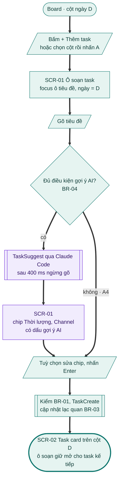

### Nhánh thay thế và lỗi

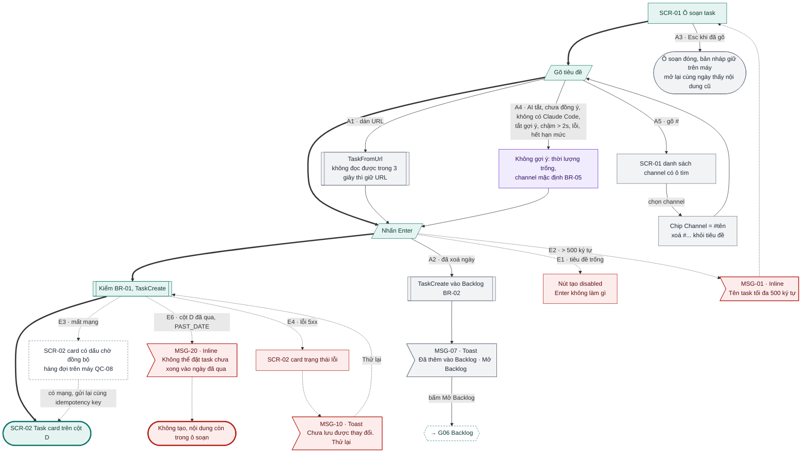

### Đối chiếu

| Mã | Điều kiện | Kết thúc ở | Thông báo |
|---|---|---|---|
| A1 | Dán URL | Về luồng chính, tiêu đề = tiêu đề trang | – |
| A2 | Xoá ngày | Task trong Backlog | MSG-07 |
| A3 | Esc khi đã gõ | Ô soạn đóng, giữ nháp | – |
| A4 | Không có gợi ý AI | Về luồng chính, không chờ | – |
| A5 | Gõ "#" | Chip Channel được gán | – |
| E1 | Tiêu đề trống | Nút tạo disabled | – |
| E2 | > 500 ký tự | Chặn tạo | MSG-01 |
| E3 | Mất mạng | Card chờ đồng bộ → gửi lại | – |
| E4 | Lỗi 5xx | Card lỗi, Thử lại | MSG-10 |
| E5 | Workspace chỉ đọc | Bỏ (1.1) | – |
| E6 | Cột ngày đã qua | Không tạo | MSG-20 |

---

## UC-02 Xem và sửa chi tiết task

**Mở đầu:** task card trên board (không ở Đã xoá). **Thành công:** trường đã sửa được lưu, card và tổng ngày cập nhật. **Thất bại:** trường giữ giá trị cũ, có lỗi tại trường.

### Happy case

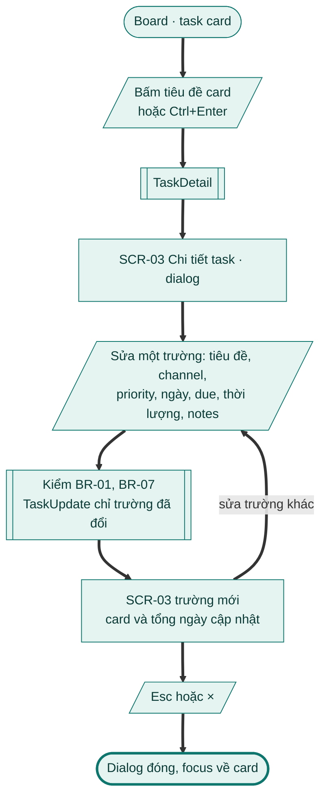

### Nhánh thay thế: subtask, comment, nhật ký

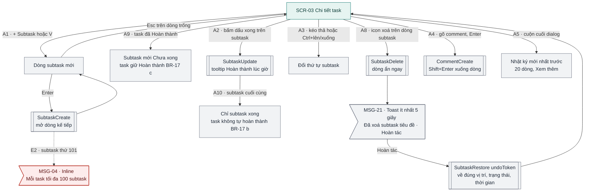

### Nhánh thay thế và lỗi: sửa trường

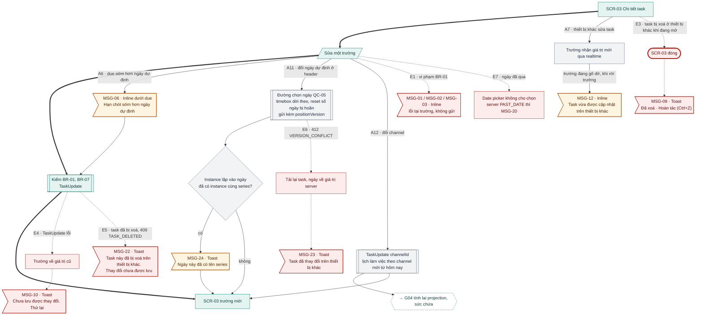

### Đối chiếu

| Mã | Điều kiện | Kết thúc ở | Thông báo |
|---|---|---|---|
| A1 | Thêm subtask | Dòng subtask mới, lặp tới Esc | – |
| A2 | Tích xong subtask | Subtask xong, tooltip giờ | – |
| A3 | Đổi thứ tự subtask | Thứ tự mới | – |
| A4 | Thêm comment | Comment mới | – |
| A5 | Xem nhật ký | 20 dòng, Xem thêm | – |
| A6 | Due < ngày dự định | Lưu, cảnh báo | MSG-06 |
| A7 | Thiết bị khác sửa | Trường cập nhật | MSG-12 (khi đang gõ dở) |
| A8 | Xoá subtask | Dòng ẩn, Hoàn tác được | MSG-21 |
| A9 | Thêm subtask vào task đã xong | Task giữ Hoàn thành | – |
| A10 | Tích subtask cuối | Task không tự xong | – |
| A11 | Đổi ngày dự định | Ngày mới | MSG-24 (instance trùng series) |
| A12 | Đổi channel | Channel mới → [G04](g04-board-ngay.md) tính lại | – |
| E1 | Vi phạm BR-01 | Không gửi | MSG-01 / 02 / 03 |
| E2 | Subtask thứ 101 | Chặn | MSG-04 |
| E3 | Task bị xoá khi đang mở | Dialog đóng | MSG-09 |
| E4 | TaskUpdate lỗi | Giá trị cũ | MSG-10 |
| E5 | Sửa task đã xoá | Bỏ lệnh | MSG-22 |
| E6 | VERSION_CONFLICT khi đổi ngày | Ngày theo server | MSG-23 |
| E7 | Đổi sang ngày đã qua | Không chọn được | MSG-20 |

---

## UC-03 Hoàn thành / bỏ hoàn thành task

**Mở đầu:** task Kế hoạch hoặc Backlog trên card / SCR-03. **Thành công:** task Hoàn thành, thanh tiến độ ngày tăng. **Thất bại:** trạng thái không đổi.

### Happy case

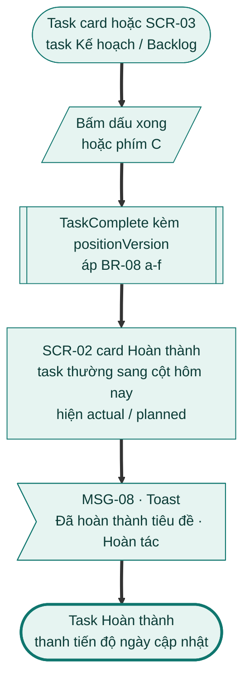

### Nhánh thay thế và lỗi

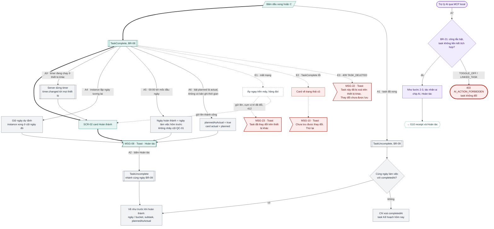

### Đối chiếu

| Mã | Điều kiện | Kết thúc ở | Thông báo |
|---|---|---|---|
| A1 | Bấm dấu xong trên task đã xong | Kế hoạch (cùng ngày: về như cũ; khác ngày: hôm nay) | – |
| A2 | Hoàn tác trong toast | Về như trước khi hoàn thành | – |
| A3 | Timer chạy ở thiết bị khác | Timer dừng, task xong | MSG-08 |
| A4 | Instance lặp ngày tương lai | Xong ở cột ngày đó | MSG-08 |
| A5 | Hoàn thành trước mốc đầu ngày | Ngày hoàn thành = hôm trước | MSG-08 |
| A6 | Planned là actual | actual = planned | MSG-08 |
| A7 | AI hoàn thành | Xong (tác nhân ai) hoặc 403 → [G10](g10-tro-ly-ai.md) | – |
| E1 | Mất mạng | Hàng đợi; xung đột → trạng thái server | MSG-23 |
| E2 | TaskComplete lỗi | Trạng thái cũ | MSG-10 |
| E3 | Task đã bị xoá | – | MSG-22 |

---

## UC-04 Xoá, hoàn tác và khôi phục task

**Mở đầu:** task không ở Đã xoá (xoá) hoặc ở Thùng rác (khôi phục). **Thành công:** task biến khỏi board và lịch; hoặc về trạng thái trước khi xoá. **Thất bại:** trạng thái không đổi.

### Happy case

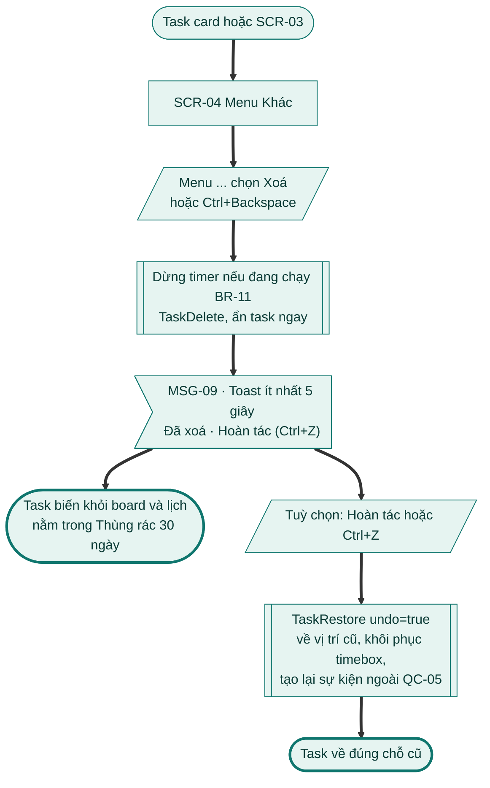

### Nhánh thay thế và lỗi

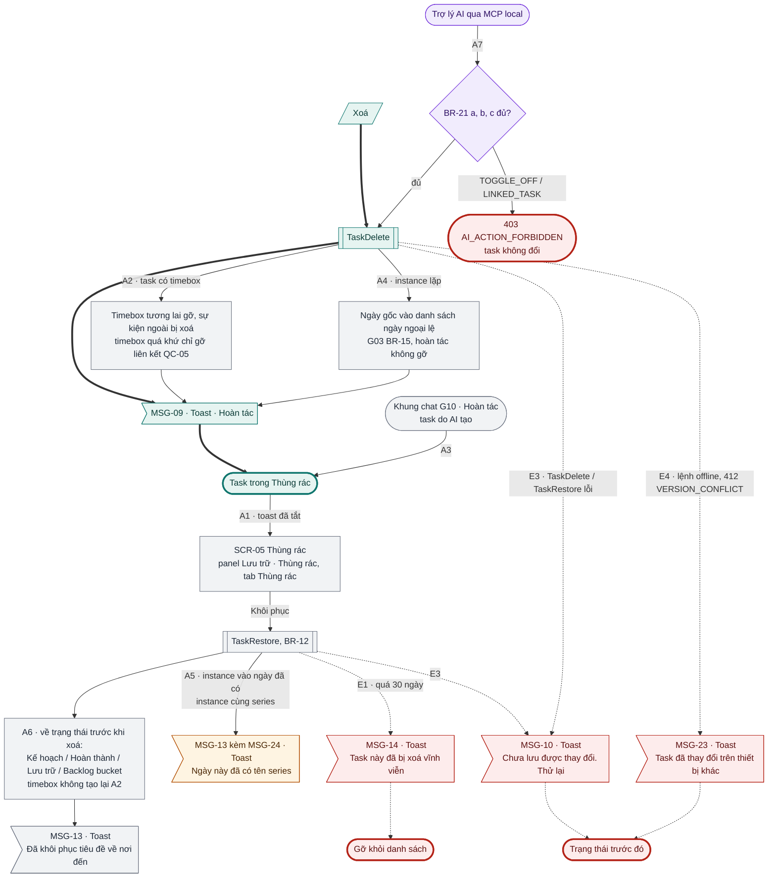

### Đối chiếu

| Mã | Điều kiện | Kết thúc ở | Thông báo |
|---|---|---|---|
| A1 | Khôi phục khi toast đã tắt | SCR-05 → trạng thái trước khi xoá | MSG-13 |
| A2 | Task có timebox | Xoá theo QC-05; khôi phục không tạo lại timebox | MSG-09 |
| A3 | Hoàn tác task AI tạo trong chat | Thùng rác | – |
| A4 | Xoá instance lặp | Thêm ngày ngoại lệ | MSG-09 |
| A5 | Khôi phục instance trùng series | Vẫn khôi phục | MSG-13 + MSG-24 |
| A6 | Khôi phục task Hoàn thành / Lưu trữ / Backlog | Về đúng trạng thái cũ | MSG-13 |
| A7 | AI xoá | Như xoá thường hoặc 403 | – |
| E1 | Quá 30 ngày | Gỡ khỏi danh sách | MSG-14 |
| E2 | (SRS đã bỏ) | – | – |
| E3 | Lỗi xoá / khôi phục | Trạng thái trước | MSG-10 |
| E4 | VERSION_CONFLICT | Trạng thái server | MSG-23 |

---

## UC-05 Nhân bản task

**Mở đầu:** task không ở Đã xoá. **Thành công:** bản sao trong danh sách hôm nay, SCR-03 mở bản sao. **Thất bại:** không có task mới.

### Happy case

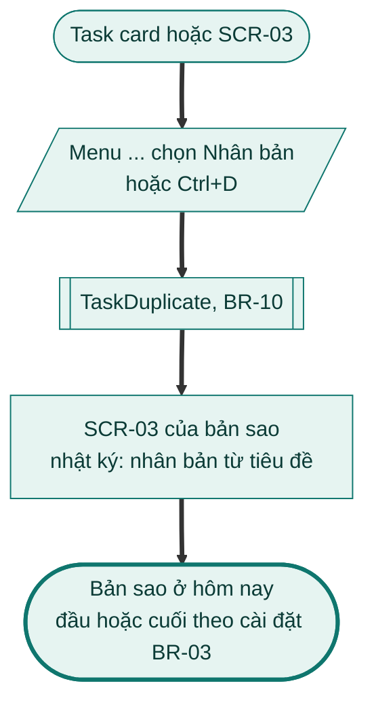

### Nhánh thay thế và lỗi

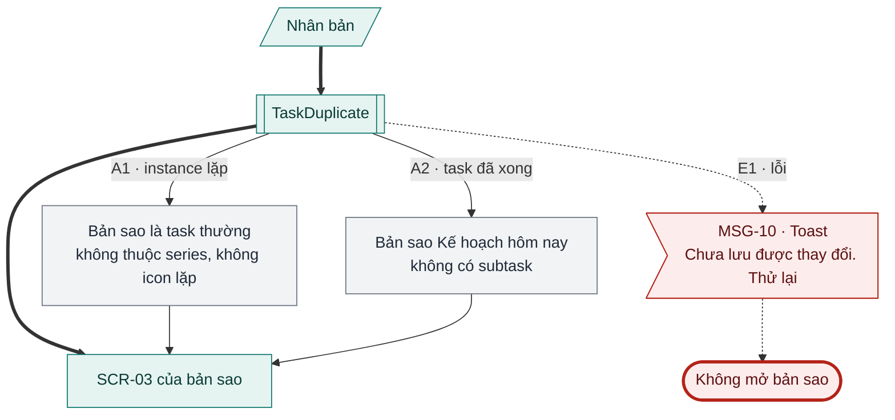

### Đối chiếu

| Mã | Điều kiện | Kết thúc ở | Thông báo |
|---|---|---|---|
| A1 | Nhân bản instance lặp | Task thường | – |
| A2 | Nhân bản task đã xong | Kế hoạch hôm nay, không subtask | – |
| E1 | Lỗi | Không mở bản sao | MSG-10 |

---

## UC-06 Quản lý context và channel

**Mở đầu:** Cài đặt → Context & channel, hoặc "Quản lý channel" trong bộ lọc. **Thành công:** context / channel được tạo, sửa, ẩn, xoá; khung giờ channel lưu và có hiệu lực từ ngày làm việc kế tiếp. **Thất bại:** không thay đổi.

### Happy case

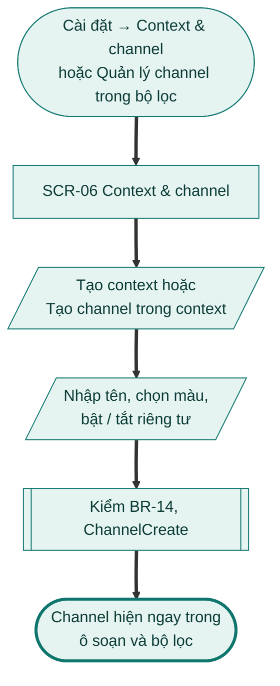

### Nhánh thay thế: sửa, ẩn, xoá

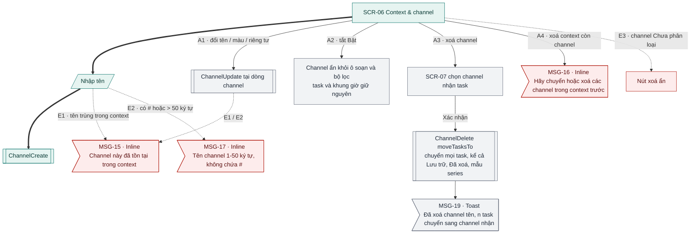

### Nhánh thay thế và lỗi: khung giờ channel

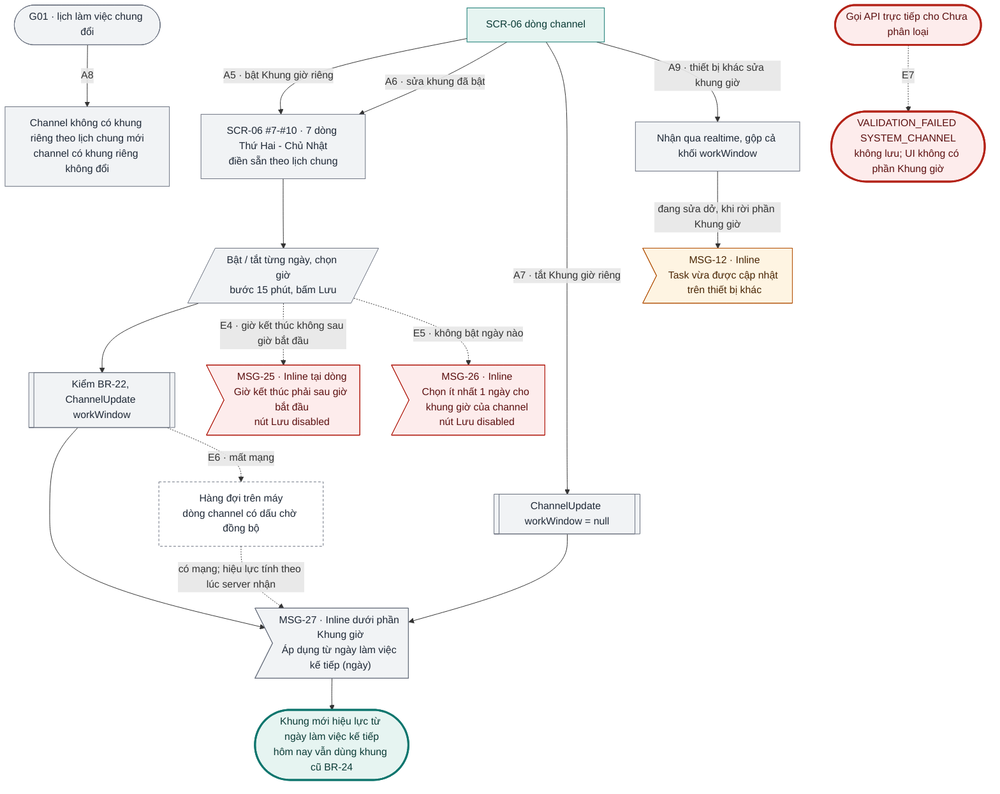

### Đối chiếu

| Mã | Điều kiện | Kết thúc ở | Thông báo |
|---|---|---|---|
| A1 | Đổi tên / màu / riêng tư | Channel cập nhật | – |
| A2 | Ẩn channel | Ẩn khỏi ô soạn, bộ lọc | – |
| A3 | Xoá channel | SCR-07 → task chuyển sang channel nhận | MSG-19 |
| A4 | Xoá context còn channel | Chặn | MSG-16 |
| A5 | Bật khung giờ riêng | Hiệu lực ngày làm việc kế tiếp | MSG-27 |
| A6 | Sửa khung đã bật | Khung chờ, hiệu lực ngày kế tiếp | MSG-27 |
| A7 | Tắt khung giờ riêng | Theo lịch chung từ ngày kế tiếp | MSG-27 |
| A8 | Lịch chung G01 đổi | Chỉ channel không có khung riêng đổi | – |
| A9 | Thiết bị khác sửa khung giờ | Gộp cả khối | MSG-12 |
| E1 | Tên trùng | Chặn | MSG-15 |
| E2 | Tên có "#" / > 50 ký tự | Chặn | MSG-17 |
| E3 | Xoá "Chưa phân loại" | Nút xoá ẩn | – |
| E4 | Giờ kết thúc ≤ bắt đầu | Lưu disabled | MSG-25 |
| E5 | Không ngày nào bật | Lưu disabled | MSG-26 |
| E6 | Mất mạng khi lưu | Hàng đợi, chờ đồng bộ | – |
| E7 | API đặt khung cho "Chưa phân loại" | Không lưu | – |

## Kiểm tra

- [x] Mọi A# / E# của UC-01 … UC-06 bản 1.0 có trên sơ đồ hoặc ghi "Bỏ (1.1)" / "SRS đã bỏ".
- [x] Mọi nút màn hình có mã SCR; mọi nút thông báo có mã MSG.

**Ghi chú cho brief G02 đầy đủ (#11)**
- MSG-12 dùng chữ "Task vừa được cập nhật…" cho cả khung giờ channel (UC-06 A9); chữ này không đúng ngữ cảnh channel. Đề xuất thêm một MSG riêng.
