# Flow G03 Task lặp lại

> **Nguồn:** [srs-g03](../../features/srs-g03-task-lap-lai.md) (commit `8fac830`, sửa theo [chốt 09/11/2026](../../review/cau-hoi-chot-flow-2026-11-09.md)) · **Brief:** `[chờ]`
> **Quy ước:** [_quy-uoc.md](_quy-uoc.md) · **FigJam:** `[chờ]`

## Mục lục

| UC | Flow | Màn chính | Nhánh A / E (1.0) |
|---|---|---|---|
| [UC-01](#uc-01-bật-lặp-cho-task) | Bật lặp cho task | SCR-01 Picker lặp lại, SCR-06 Dấu lặp trên card | 7 / 7 |
| [UC-02](#uc-02-sinh-instance-job-recurrencegenerate) | Sinh instance (job) | Không có màn riêng; kết quả ở SCR-06 trên board | 2 / 1 |
| [UC-03](#uc-03-xem-và-sửa-một-instance) | Xem và sửa một instance | SCR-02 Banner series (trong G02 SCR-03) | 9 / 3 |
| [UC-04](#uc-04-sửa-series-đổi-tần-suất-đặt-giờ-áp-nội-dung) | Sửa series: đổi tần suất, đặt giờ, áp nội dung | SCR-03 Menu "Sửa series", SCR-01, SCR-07 Bộ chọn giờ bắt đầu | 7 / 4 |
| [UC-05](#uc-05-dừng-lặp--xoá-mọi-instance-chưa-xong) | Dừng lặp / xoá mọi instance chưa xong | SCR-03, SCR-04 Xác nhận xoá, SCR-08 Xác nhận dừng lặp | 4 / 3 |
| [UC-06](#uc-06-xử-lý-instance-trùng-series-trong-một-ngày-qc-06-rollover-g06-phím-d-g04-shutdown-g08) | Instance trùng series trong một ngày (QC-06) | Không có màn riêng; G06 SCR-05 Lưu trữ | 7 / 1 |
| [UC-07](#uc-07-quản-lý-mọi-task-lặp) | Quản lý mọi task lặp | SCR-05 Quản lý mọi task lặp | 2 / 3 |

---

## UC-01 Bật lặp cho task

**Mở đầu:** task Kế hoạch hoặc Backlog, chưa thuộc series đang lặp. **Thành công:** series Đang lặp, task là instance đầu, instance 60 ngày tới đã sinh. **Thất bại:** không có series, task không đổi.

### Happy case

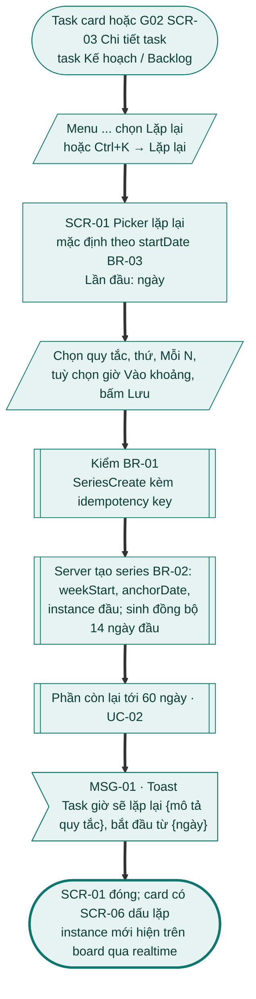

### Nhánh thay thế

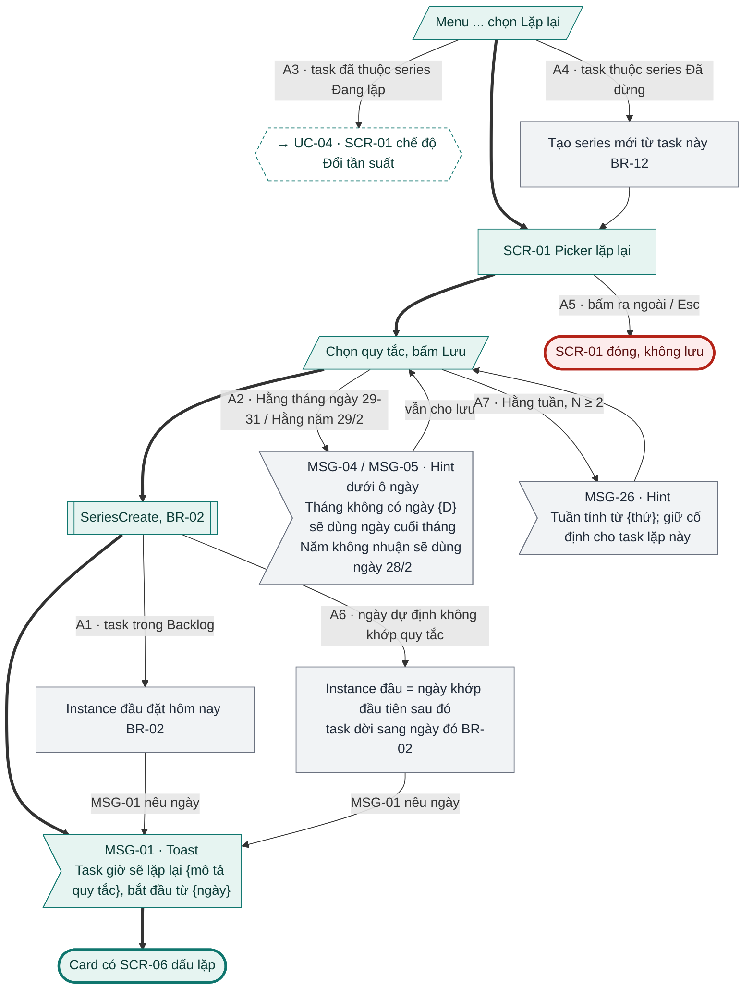

### Nhánh lỗi

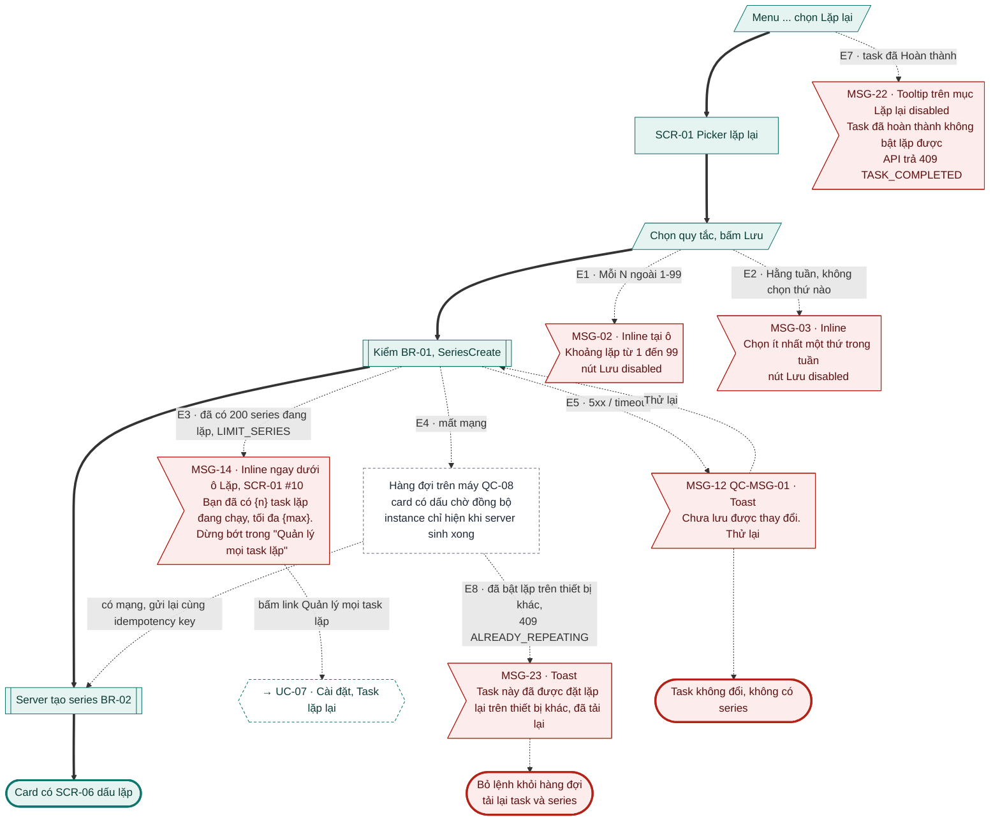

### Đối chiếu

| Mã | Điều kiện | Kết thúc ở | Thông báo |
|---|---|---|---|
| A1 | Task trong Backlog | Instance đầu hôm nay | MSG-01 (nêu ngày) |
| A2 | Ngày 29-31 / 29/2 | Vẫn lưu, có ghi chú | MSG-04 / MSG-05 |
| A3 | Task đã thuộc series đang lặp | [→ UC-04](#uc-04-sửa-series-đổi-tần-suất-đặt-giờ-áp-nội-dung) | – |
| A4 | Task thuộc series đã dừng | Series mới từ task này | MSG-01 |
| A5 | Bấm ra ngoài / Esc | SCR-01 đóng, không lưu | – |
| A6 | Ngày dự định không khớp quy tắc | Task dời sang ngày khớp đầu tiên | MSG-01 (nêu ngày) |
| A7 | Hằng tuần, N ≥ 2 | Hint ngày đầu tuần | MSG-26 |
| E1 | Mỗi N ngoài 1-99 | Lưu disabled | MSG-02 |
| E2 | Hằng tuần không chọn thứ | Lưu disabled | MSG-03 |
| E3 | Đã có 200 series | Chặn, MSG-14 dưới ô Lặp; link mở Cài đặt → Task lặp lại [→ UC-07](#uc-07-quản-lý-mọi-task-lặp) (C16) | MSG-14 |
| E4 | Mất mạng | Hàng đợi, card chờ đồng bộ | – |
| E5 | 5xx / timeout | Task không đổi, Thử lại | MSG-12 (QC-MSG-01) |
| E6 | Workspace chỉ đọc | Bỏ (1.1) | – |
| E7 | Task đã Hoàn thành | Mục Lặp lại disabled | MSG-22 |
| E8 | Đã bật lặp trên thiết bị khác | Bỏ lệnh, tải lại | MSG-23 |

---

## UC-02 Sinh instance (job `recurrence.generate`)

**Mở đầu:** job hệ thống, có series Đang lặp với `generatedUntil` < hôm nay + 60 ngày. **Thành công:** mỗi ngày khớp quy tắc tới hôm nay + 60 ngày (trừ ngày ngoại lệ) có đúng một instance. **Thất bại:** series giữ `generatedUntil` cũ, lần chạy sau sinh bù.

### Happy case

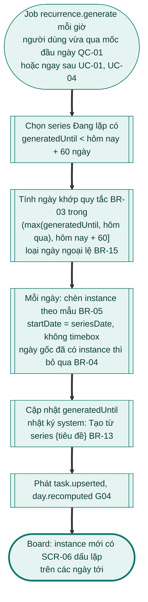

### Nhánh thay thế và lỗi

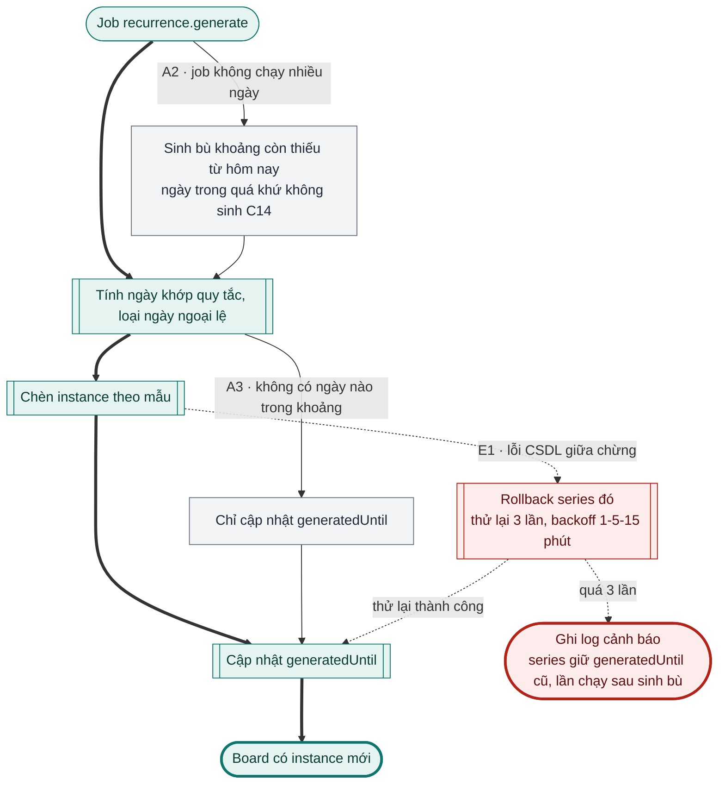

### Đối chiếu

| Mã | Điều kiện | Kết thúc ở | Thông báo |
|---|---|---|---|
| A1 | Lập lịch cứng (G05) | Bỏ (1.1) | – |
| A2 | Job không chạy nhiều ngày | Sinh bù từ hôm nay | – |
| A3 | Không có ngày nào trong khoảng | Chỉ cập nhật `generatedUntil` | – |
| A4 | Workspace chỉ đọc | Bỏ (1.1) | – |
| E1 | Lỗi CSDL | Rollback series, thử lại 3 lần, rồi log cảnh báo | – |
| E2 | (SRS đã bỏ) | – | – |

---

## UC-03 Xem và sửa một instance

**Mở đầu:** instance không ở Đã xoá. **Thành công:** trường đã sửa chỉ đổi trên instance này. **Thất bại:** trường giữ giá trị cũ.

### Happy case

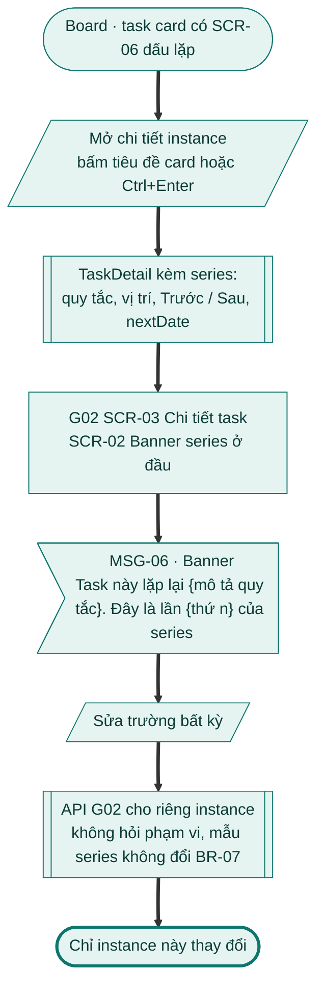

### Nhánh thay thế và lỗi: banner series

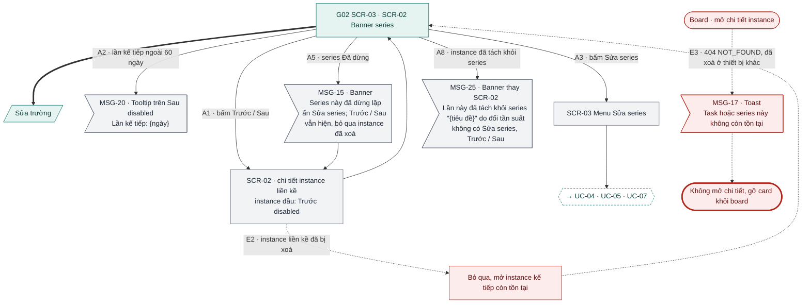

### Nhánh thay thế và lỗi: sửa instance

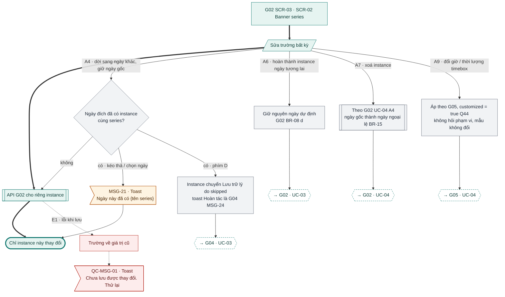

### Đối chiếu

| Mã | Điều kiện | Kết thúc ở | Thông báo |
|---|---|---|---|
| A1 | Bấm Trước / Sau | Chi tiết instance liền kề | – |
| A2 | Lần kế tiếp ngoài 60 ngày | Sau disabled | MSG-20 |
| A3 | Bấm Sửa series | SCR-03 → [UC-04](#uc-04-sửa-series-đổi-tần-suất-đặt-giờ-áp-nội-dung), [UC-05](#uc-05-dừng-lặp--xoá-mọi-instance-chưa-xong), [UC-07](#uc-07-quản-lý-mọi-task-lặp) | – |
| A4 | Dời instance sang ngày khác | Kéo / chọn ngày: cho phép; phím D: Lưu trữ `skipped` → [G04 UC-03](g04-board-ngay.md#uc-03-di-chuyển-task-giữa-các-ngày) | MSG-21 (kéo / chọn ngày); G04 MSG-24 (phím D) |
| A5 | Series đã dừng | Banner, ẩn Sửa series; Trước / Sau vẫn hiện, bỏ qua instance đã xoá (B16) | MSG-15 |
| A6 | Hoàn thành instance ngày tương lai | Giữ ngày dự định → [G02 UC-03](g02-quan-ly-task.md#uc-03-hoàn-thành--bỏ-hoàn-thành-task) | – |
| A7 | Xoá instance | Thêm ngày ngoại lệ → [G02 UC-04](g02-quan-ly-task.md#uc-04-xoá-hoàn-tác-và-khôi-phục-task) | – |
| A8 | Instance đã tách khỏi series | Banner thay SCR-02 | MSG-25 |
| A9 | Đổi giờ / thời lượng timebox | `customized` → [G05 UC-04](g05-lich-timebox.md#uc-04-dời-đổi-thời-lượng-gỡ-timebox) | – |
| E1 | Lỗi khi lưu | Giá trị cũ | QC-MSG-01 (G02 MSG-10) |
| E2 | Instance liền kề đã bị xoá | Mở instance kế tiếp còn tồn tại | – |
| E3 | Mở instance đã bị xoá ở thiết bị khác | Không mở, gỡ card (C11) | MSG-17 |

---

## UC-04 Sửa series: đổi tần suất, đặt giờ, áp nội dung

**Mở đầu:** series Đang lặp, có mạng; người dùng đang mở một instance, hoặc ở dòng SCR-05 (chỉ Đổi tần suất). **Thành công:** quy tắc / giờ / mẫu cập nhật, instance bị ảnh hưởng cập nhật theo bảng phạm vi (BR-08). **Thất bại:** series và instance không đổi.

### Happy case

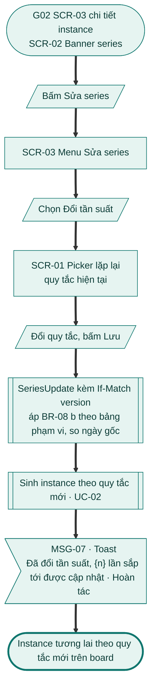

### Nhánh thay thế

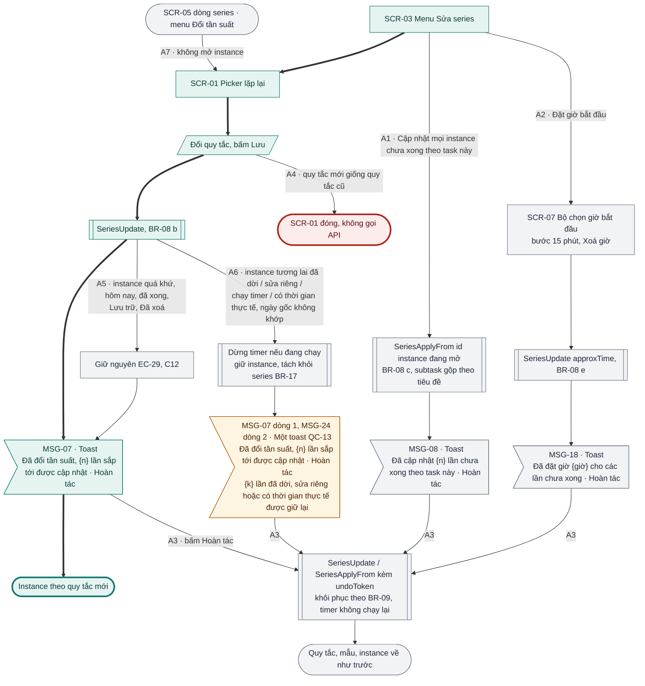

### Nhánh lỗi

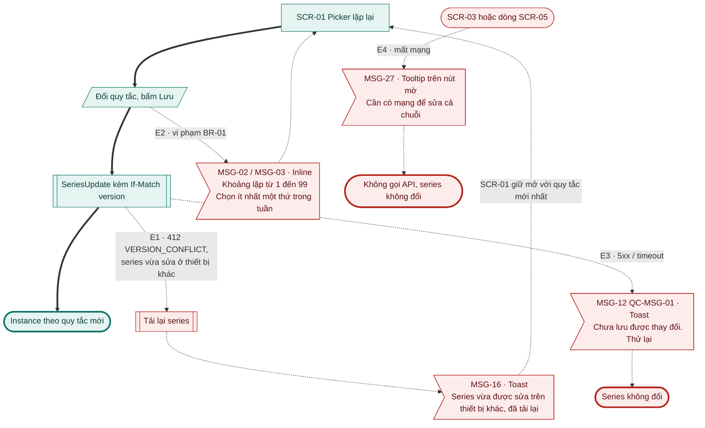

### Đối chiếu

| Mã | Điều kiện | Kết thúc ở | Thông báo |
|---|---|---|---|
| A1 | Cập nhật mọi instance chưa xong theo task này | Mẫu và instance trong phạm vi theo instance đang mở | MSG-08 |
| A2 | Đặt giờ bắt đầu | SCR-07 → `approxTime` mới cho mẫu và instance trong phạm vi (C12) | MSG-18 |
| A3 | Bấm Hoàn tác | Về như trước (BR-09) | – |
| A4 | Quy tắc mới giống cũ | SCR-01 đóng, không gọi API | – |
| A5 | Instance quá khứ, hôm nay, đã xong, Lưu trữ, Đã xoá | Giữ nguyên | MSG-07 |
| A6 | Instance đã dời / sửa riêng / có timer, thời gian thực tế, ngày gốc không khớp | Giữ, tách khỏi series (banner MSG-25 ở [UC-03](#uc-03-xem-và-sửa-một-instance) A8) | MSG-07 + MSG-24, một toast hai dòng (QC-13 mục 3) |
| A7 | Đổi tần suất từ dòng SCR-05 | SCR-01 ngay trên dòng, không mở instance (B15) | MSG-07 |
| E1 | VERSION_CONFLICT | Tải lại, SCR-01 giữ mở | MSG-16 |
| E2 | Vi phạm BR-01 | Lưu disabled | MSG-02 / MSG-03 |
| E3 | 5xx / timeout | Series không đổi | MSG-12 (QC-MSG-01) |
| E4 | Mất mạng | Nút mờ, không gọi API (QC-08 mục 7) | MSG-27 |

---

## UC-05 Dừng lặp / xoá mọi instance chưa xong

**Mở đầu:** series Đang lặp, có mạng; SCR-03 đang mở, hoặc dòng series ở SCR-05. **Thành công:** series Đã dừng; instance bị xoá mềm hoặc giữ theo bảng phạm vi BR-08 (a) / (d). **Thất bại:** series Đang lặp, instance không đổi.

### Happy case

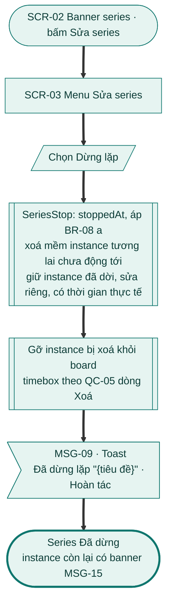

### Nhánh thay thế

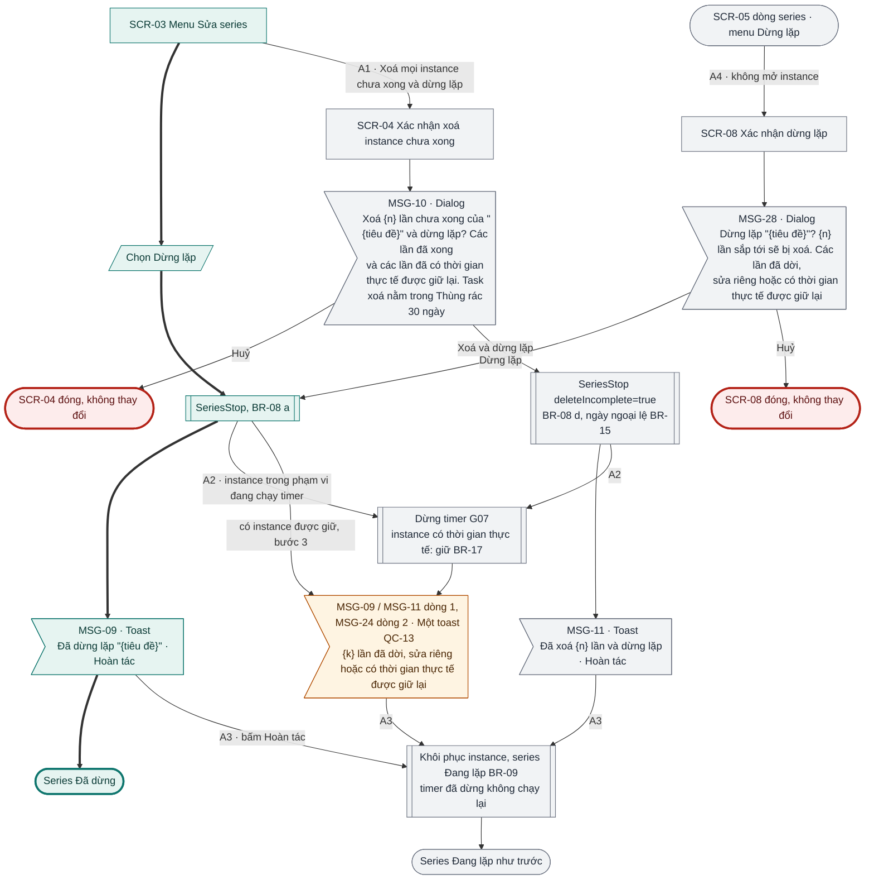

### Nhánh lỗi

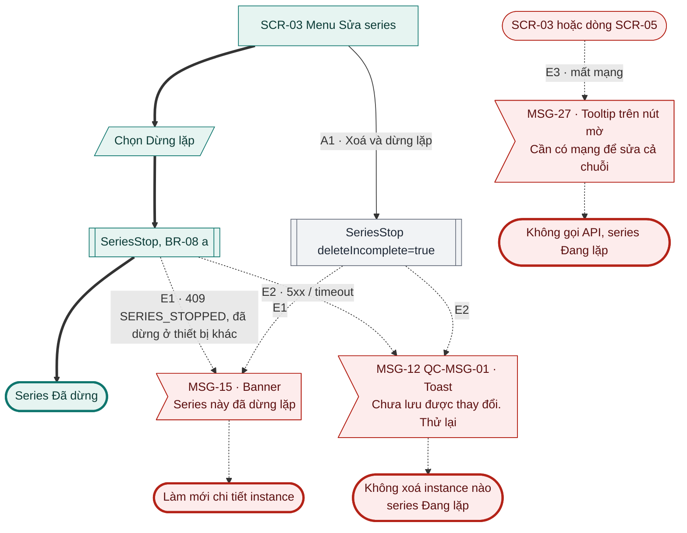

### Đối chiếu

| Mã | Điều kiện | Kết thúc ở | Thông báo |
|---|---|---|---|
| A1 | Xoá mọi instance chưa xong và dừng lặp | SCR-04 → "Xoá và dừng lặp" (C13) → xoá mềm, ngày ngoại lệ, series Đã dừng | MSG-10, MSG-11 |
| A2 | Instance đang chạy timer | Dừng timer, giữ instance có thời gian thực tế | MSG-24, dòng 2 của toast MSG-09 / MSG-11 (QC-13 mục 3) |
| A3 | Bấm Hoàn tác | Series Đang lặp, instance khôi phục | – |
| A4 | Dừng lặp từ dòng SCR-05 | SCR-08 → như luồng chính, không mở instance (B15) | MSG-28, MSG-09 |
| E1 | Series đã dừng ở thiết bị khác | Làm mới | MSG-15 |
| E2 | 5xx / timeout | Không xoá gì | MSG-12 (QC-MSG-01) |
| E3 | Mất mạng | Nút mờ, không gọi API (QC-08 mục 7) | MSG-27 |

---

## UC-06 Xử lý instance trùng series trong một ngày (QC-06; rollover G06, phím D G04, shutdown G08)

**Mở đầu:** job rollover sau mốc đầu ngày, có instance chưa xong ngày dự định < hôm nay; hoặc một đường đổi ngày đưa instance vào ngày D đã có instance cùng series. **Thành công:** đường tự động / hàng loạt không để hai instance cùng series trong một ngày; đường thủ công cho phép, có cảnh báo. **Thất bại:** instance giữ nguyên, lượt sau xử lý lại.

G06 thực thi rollover: xem [G06 UC-04](g06-backlog-rollover.md#uc-04-rollover-hằng-ngày-job-rollover).

### Happy case

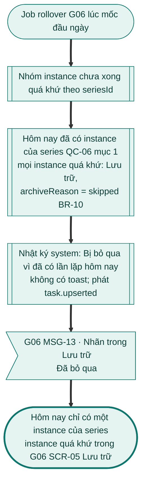

### Nhánh thay thế và lỗi: rollover

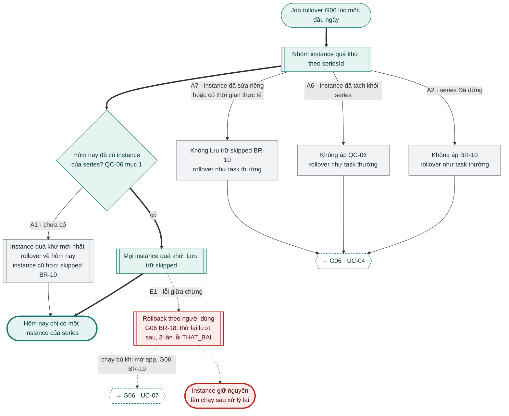

### Nhánh thay thế: đường đổi ngày khác

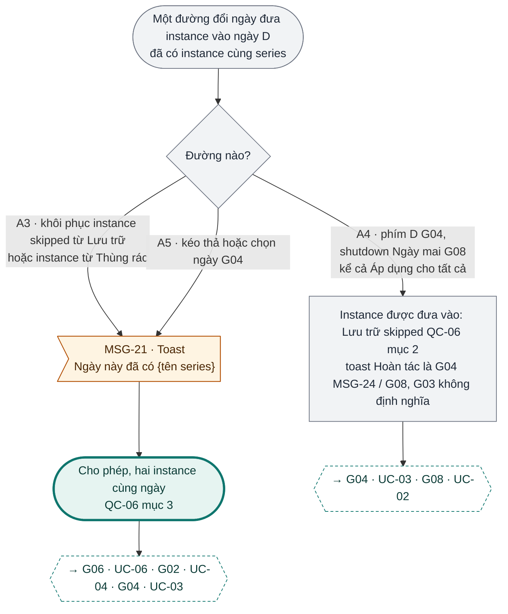

### Đối chiếu

| Mã | Điều kiện | Kết thúc ở | Thông báo |
|---|---|---|---|
| A1 | Series chưa có instance hôm nay | Instance mới nhất rollover, cũ hơn `skipped` | – |
| A2 | Series đã dừng | Rollover như task thường → [G06 UC-04](g06-backlog-rollover.md#uc-04-rollover-hằng-ngày-job-rollover) | – |
| A3 | Khôi phục từ Lưu trữ / Thùng rác vào ngày đã có instance | Cho phép → [G06 UC-06](g06-backlog-rollover.md#uc-06-xem-lưu-trữ-khôi-phục-và-xoá-tất-cả), [G02 UC-04](g02-quan-ly-task.md#uc-04-xoá-hoàn-tác-và-khôi-phục-task) | MSG-21 |
| A4 | Phím D / shutdown "Ngày mai" | Lưu trữ `skipped`, toast Hoàn tác của G04 / G08 → [G04 UC-03](g04-board-ngay.md#uc-03-di-chuyển-task-giữa-các-ngày), [G08 UC-02](g08-daily-rituals.md#uc-02-daily-shutdown) | G04 MSG-24 / G08 UC-02 A9 (C15) |
| A5 | Kéo thả / chọn ngày | Cho phép → [G04 UC-03](g04-board-ngay.md#uc-03-di-chuyển-task-giữa-các-ngày) | MSG-21 |
| A6 | Instance đã tách | Không áp QC-06 | – |
| A7 | Instance đã sửa riêng / có thời gian thực tế | Không `skipped`, rollover như task thường (B08) → [G06 UC-04](g06-backlog-rollover.md#uc-04-rollover-hằng-ngày-job-rollover) | – |
| E1 | Lỗi giữa chừng | Rollback, thử lại theo G06 → [G06 UC-07](g06-backlog-rollover.md#uc-07-đảm-bảo-rollover-theo-yêu-cầu-rolloverensure) | – |

---

## UC-07 Quản lý mọi task lặp

**Mở đầu:** SCR-03 hoặc Cài đặt → Task lặp lại. **Thành công:** danh sách series hiển thị, thao tác chọn chạy qua UC-03 / UC-04 / UC-05. **Thất bại:** lỗi tải, giữ dữ liệu lần cuối.

### Happy case

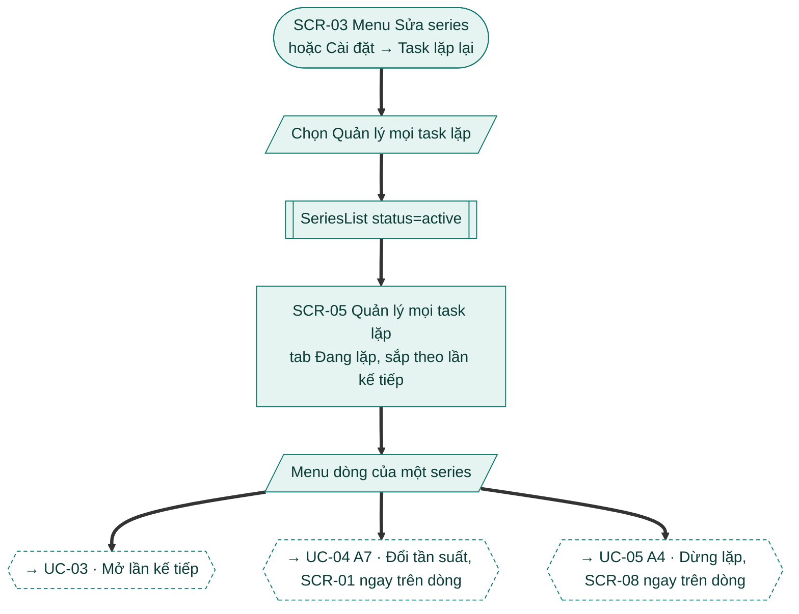

### Nhánh thay thế và lỗi

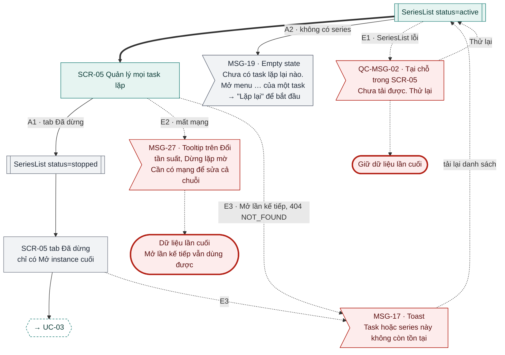

### Đối chiếu

| Mã | Điều kiện | Kết thúc ở | Thông báo |
|---|---|---|---|
| A1 | Lọc Đã dừng | Chỉ có "Mở instance cuối" → [UC-03](#uc-03-xem-và-sửa-một-instance) | – |
| A2 | Không có series | Empty state | MSG-19 |
| E1 | SeriesList lỗi | Giữ dữ liệu lần cuối, Thử lại (C14) | QC-MSG-02 |
| E2 | Mất mạng | Dữ liệu lần cuối, Đổi tần suất / Dừng lặp mờ (QC-08 mục 7) | MSG-27 |
| E3 | Instance / series đã bị xoá ở thiết bị khác | Tải lại danh sách (C11) | MSG-17 |

## Kiểm tra

- [x] Mọi A# / E# của UC-01 … UC-07 bản 1.0 có trên sơ đồ hoặc ghi "Bỏ (1.1)" / "SRS đã bỏ".
- [x] Mọi nút màn hình có mã SCR; mọi nút thông báo có mã MSG.

**Ghi chú cho brief G03**
- ~~SRS mục 10 nói thao tác series cần mạng, nhưng UC-04, UC-05, UC-07 không có nhánh mất mạng và không có MSG tooltip~~ **Đã sửa 09/11/2026 (C10 / A6):** thêm UC-04 E4, UC-05 E3, UC-07 E2 và MSG-27 "Cần có mạng để sửa cả chuỗi"; SCR-03 #7. Đã vẽ.
- ~~MSG-17 (`NOT_FOUND`) không UC nào dùng~~ **Đã sửa 09/11/2026 (C11):** UC-03 E3 (mở instance đã xoá), UC-07 E3 (mở từ danh sách). Đã vẽ.
- ~~UC-04 A2 mở bộ chọn giờ nhưng không có mã SCR~~ **Đã sửa 09/11/2026 (C12):** thêm SCR-07 Bộ chọn giờ bắt đầu.
- ~~Nút xác nhận ở SCR-04 là "Xoá và dừng lặp", UC-05 A1 ghi "Xoá và dừng"~~ **Đã sửa 09/11/2026 (C13):** thống nhất "Xoá và dừng lặp".
- ~~UC-07 cho "Đổi tần suất" / "Dừng lặp" trên dòng SCR-05 trong khi UC-04 cần đang mở instance~~ **Đã sửa 09/11/2026 (B15):** làm ngay trên dòng: Đổi tần suất mở SCR-01 (UC-04 A7), Dừng lặp mở SCR-08 với MSG-28 (UC-05 A4); tiền điều kiện UC-04 sửa theo.
- ~~UC-07 E1 dùng MSG-12 (câu lỗi lưu) cho lỗi tải danh sách~~ **Đã sửa 09/11/2026 (C14 / A1):** UC-07 E1 dùng QC-MSG-02 tại chỗ.
- ~~UC-03 E1 dẫn G02 MSG-10, trong khi G03 MSG-12 có cùng chữ~~ **Đã sửa 09/11/2026 (C14 / A1):** cả hai trỏ về QC-MSG-01; UC-03 E1 hiện QC-MSG-01.
- ~~MSG-24 "kèm" MSG-07 / 09 / 11: một toast hai dòng hay hai toast~~ **Đã sửa 09/11/2026 (A3):** một toast, dòng 1 là MSG-07 / 09 / 11 kèm Hoàn tác, dòng 2 là MSG-24 (QC-13 mục 3).
- ~~UC-03 A5: series đã dừng thì Trước / Sau hiện hay ẩn~~ **Đã sửa 09/11/2026 (B16):** vẫn hiện, bỏ qua instance đã xoá; SCR-02 #3 sửa theo.
- ~~Toast Hoàn tác khi instance vào Lưu trữ `skipped` do phím D / shutdown: G03 không định nghĩa~~ **Đã sửa 09/11/2026 (C15):** G03 chỉ trỏ sang G04 MSG-24 và G08 UC-02 A9 (BR-16, UC-03 A4, UC-06 A4).
- ~~UC-01 E3: MSG-14 hiện ở đâu, "Quản lý mọi task lặp" có phải link~~ **Đã sửa 09/11/2026 (C16):** hiện ngay dưới ô Lặp (SCR-01 #10); là link mở Cài đặt → Task lặp lại.
- Mới 09/11/2026 (B14, B08): "Dừng lặp" chỉ xoá instance tương lai chưa động tới, giữ instance đã dời / sửa riêng / có thời gian thực tế (bảng phạm vi, UC-05 bước 2); instance bị lỡ đã sửa riêng / có thời gian thực tế không bị `skipped` (UC-06 A7).
