# Flow G04 Board ngày

> **Nguồn:** [srs-g04](../../features/srs-g04-board-ngay.md) (commit `8fac830`) · **Brief:** `[chờ]`
> **Quy ước:** [_quy-uoc.md](_quy-uoc.md) · **FigJam:** `[chờ]`

## Mục lục

| UC | Flow | Màn chính | Nhánh A / E (1.0) |
|---|---|---|---|
| [UC-01](#uc-01-xem-board-và-chuyển-chế-độ-xem) | Xem board và chuyển chế độ xem | SCR-01 Home board, SCR-02 Cột ngày, SCR-03 Thanh công cụ | 10 / 4 |
| [UC-02](#uc-02-điều-hướng-ngày) | Điều hướng ngày | SCR-03, SCR-04 Popover chọn ngày | 3 / 2 |
| [UC-03](#uc-03-di-chuyển-task-giữa-các-ngày) | Di chuyển task giữa các ngày | SCR-02 Cột ngày | 7 / 6 |
| [UC-04](#uc-04-sắp-xếp-task-trong-ngày) | Sắp xếp task trong ngày | SCR-02, SCR-05 Menu "Sắp xếp lại" | 4 / 2 |
| [UC-05](#uc-05-tính-projection-và-khối-lượng-ngày) | Tính projection và khối lượng ngày (hệ thống) | SCR-02 | 11 / 2 |
| [UC-06](#uc-06-lọc-theo-channel) | Lọc theo channel | SCR-03, SCR-06 Bộ lọc channel | 4 / 1 |
| [UC-07](#uc-07-tìm-kiếm-task) | Tìm kiếm task | SCR-07 Panel Search | 4 / 3 |
| [UC-08](#uc-08-command-menu-và-phím-tắt) | Command menu và phím tắt | SCR-08 Command menu, SCR-09 Bảng phím tắt | 6 / 2 |

---

## UC-01 Xem board và chuyển chế độ xem

**Mở đầu:** người dùng đã đăng nhập, mở app / phím H / sidebar Home. **Thành công:** board / view hiện đúng tổng, tiến độ, giờ dự kiến, trạng thái ngày; view được lưu trên thiết bị. **Thất bại:** dữ liệu lần cuối trên máy (nếu có) kèm MSG-15.

### Happy case

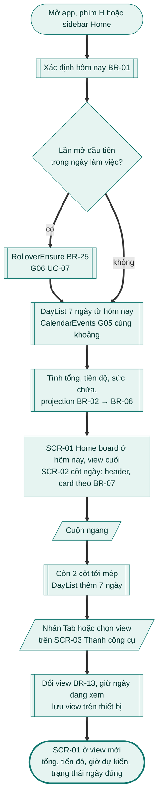

### Nhánh thay thế

```mermaid
flowchart TD
  s1["SCR-01 Home board"]
  u2[/"Tab / chọn view"/]
  ok(["SCR-01 ở view mới"])
  s1 ==> u2 ==> ok

  s1 -->|"A1 · phím T / sidebar Today"| a1["Today view, chưa có mã SCR<br/>task của ngày đang xem + lịch ngày G05"]
  s1 -->|"A2 · hover header cột ngày ≥ hôm nay"| a2["SCR-02 #4 nút Plan hiện"]
  a2 -->|"bấm Plan"| a2x{{"→ G08 · UC-01"}}
  s1 -->|"cột ngày đã qua, IA-20"| ia20["SCR-02 #4, #6 không có nút Plan<br/>và không có + Thêm task"]
  ia20 -->|"nhấn A"| ia20x{{"→ G02 · UC-01 A6<br/>ô soạn mở ở cột hôm nay"}}
  u2 -->|"A3 · Calendar views"| a3["SCR-01 Calendar view<br/>sự kiện G05, timebox,<br/>projection mờ hơn sự kiện thật"]
  u2 -->|"A4 · Month view"| a4["SCR-01 Month view<br/>mỗi ngày tối đa 3 task, +n"]
  a4 -->|"bấm +n"| a4b["Popover danh sách task của ngày"]
  s1 -->|"A5 · bật Ẩn task đã xong"| a5["SCR-02 card xong ẩn<br/>tổng, tiến độ vẫn tính BR-02, BR-03"]
  s1 -->|"A6 · ngày > 100 task, EC-40"| a6["SCR-02 danh sách ảo hoá BR-19"]
  s1 -->|"A7 · qua mốc đầu ngày khi đang mở app"| a7["Hôm nay chuyển sang ngày mới<br/>cột cũ thành DA_QUA"]
  a7 --> d7{"Đã nhận kết quả rollover<br/>qua realtime G06?"}
  d7 -->|"có"| s1
  d7 -->|"chưa"| a7b[["Như BR-25: RolloverEnsure<br/>rollover tạm trên máy"]]
  a7b --> s1
  s1 -->|"A8 · timezone thiết bị khác timezone người dùng, EC-02"| a8x{{"→ G01 · UC-06 banner timezone MSG-23 của G01"}}
  a8x --> a8["Hiệu lực từ ngày làm việc kế tiếp: task giữ ngày dự định,<br/>timebox giữ thời điểm tuyệt đối<br/>timebox rơi khác ngày: task vẫn ở cột ngày dự định,<br/>không gắn cờ, không tự sửa F5"]
  s1 -->|"A9 · cửa sổ < 768 px"| a9["SCR-01 1 cột<br/>cuộn ngang / Shift+→/← đổi ngày"]
  s1 -->|"A10 · ngày ngoài khoảng instance lặp đã sinh, C17"| a10["SCR-02 card mờ nhãn Dự kiến BR-23<br/>không kéo được, không tính vào tổng"]

  class s1,u2 happy
  class ia20 alt
  class ia20x link
  class a1,a2,a3,a4,a4b,a5,a6,a7,d7,a7b,a8,a9,a10 alt
  class a2x,a8x link
  class ok done
  classDef happy fill:#E6F4F1,stroke:#0F766E,color:#0B3B36
  classDef alt fill:#F1F3F5,stroke:#6B7280,color:#1F2937
  classDef err fill:#FDECEC,stroke:#B42318,color:#5C1010
  classDef warn fill:#FEF4E2,stroke:#B45309,color:#4A2604
  classDef ai fill:#F1ECFD,stroke:#6D28D9,color:#2E1065
  classDef sync fill:#FFFFFF,stroke:#6B7280,stroke-dasharray:4 3,color:#1F2937
  classDef link fill:#FFFFFF,stroke:#0F766E,stroke-dasharray:4 3,color:#0B3B36
  classDef done fill:#E6F4F1,stroke:#0F766E,stroke-width:3px,color:#0B3B36
  classDef fail fill:#FDECEC,stroke:#B42318,stroke-width:3px,color:#5C1010
```

### Nhánh lỗi

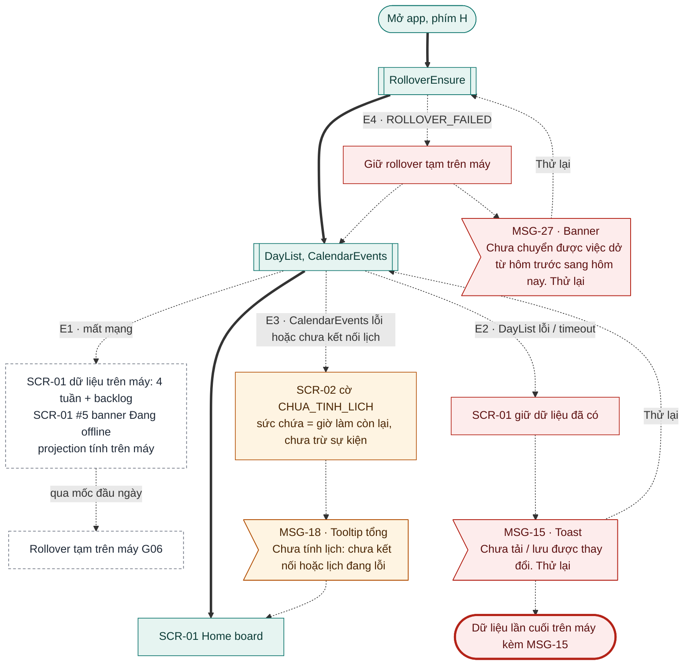

### Banner trạng thái (SCR-01 #5, IA-17)

Vùng chính chỉ có **một** banner cùng lúc. Nhiều điều kiện cùng đúng thì banner ưu tiên cao nhất hiện; các banner còn lại chờ tới lượt và vào trung tâm thông báo ([G12 UC-09](g12-workspace-billing.md)).

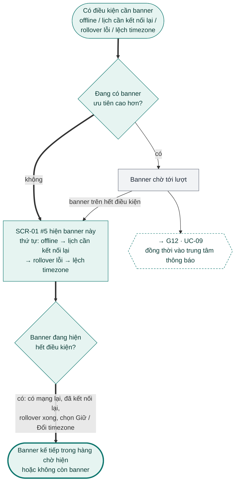

### Đối chiếu

| Mã | Điều kiện | Kết thúc ở | Thông báo |
|---|---|---|---|
| A1 | Phím T / sidebar Today | Today view | – |
| A2 | Hover header cột ≥ hôm nay | Nút Plan → [G08 UC-01](g08-daily-rituals.md) | – |
| A3 | Calendar views | Sự kiện, timebox, projection mờ | – |
| A4 | Month view | 3 task / ngày, "+n" mở popover | – |
| A5 | Ẩn task đã xong | Card xong ẩn, tổng giữ | – |
| A6 | Ngày > 100 task | Danh sách ảo hoá | – |
| A7 | Qua mốc đầu ngày khi đang mở | Hôm nay mới, cột cũ `DA_QUA`; chưa có kết quả rollover thì như BR-25 | – |
| A8 | Lệch timezone | Banner của [G01 UC-06](g01-tai-khoan.md); task giữ cột ngày dự định, không gắn cờ (F5) | G01 MSG-23 |
| A9 | Cửa sổ < 768 px | 1 cột | – |
| A10 | Ngày ngoài khoảng instance đã sinh | Instance dự kiến mờ | – |
| E1 | Mất mạng | Dữ liệu trên máy, banner offline | – (chưa có mã MSG) |
| E2 | DayList lỗi / timeout | Giữ dữ liệu, Thử lại | MSG-15 |
| E3 | Lịch lỗi / chưa kết nối | Cờ `CHUA_TINH_LICH` | MSG-18 |
| E4 | `ROLLOVER_FAILED` | Rollover tạm, banner Thử lại | MSG-27 |

---

## UC-02 Điều hướng ngày

**Mở đầu:** đang ở Home, Today view hoặc Calendar views. **Thành công:** ngày / khoảng đang xem đổi đúng, chip ngày cập nhật. **Thất bại:** ngày đang xem không đổi.

### Happy case

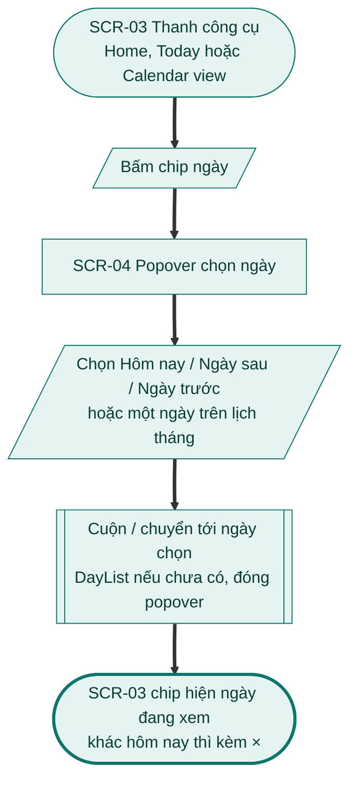

### Nhánh thay thế và lỗi

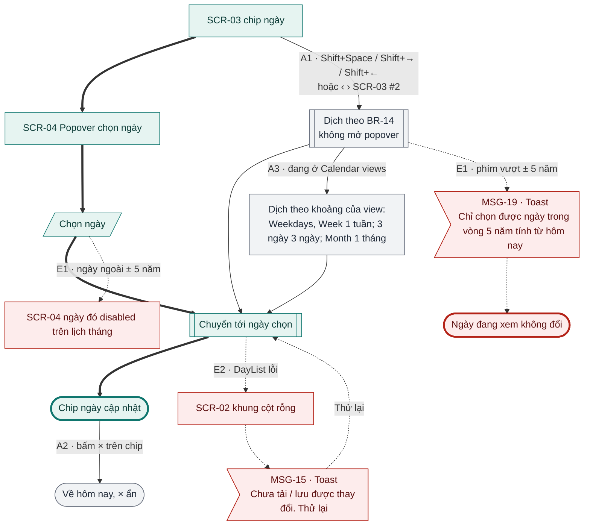

### Đối chiếu

| Mã | Điều kiện | Kết thúc ở | Thông báo |
|---|---|---|---|
| A1 | Shift+Space / Shift+→ / Shift+← | Ngày mới, không mở popover | – |
| A2 | Bấm × trên chip | Về hôm nay | – |
| A3 | Calendar views | Dịch theo khoảng của view | – |
| E1 | Ngày ngoài ± 5 năm | Ngày disabled / phím không đi tiếp | MSG-19 |
| E2 | DayList lỗi | Khung cột rỗng, Thử lại | MSG-15 |

---

## UC-03 Di chuyển task giữa các ngày

**Mở đầu:** task `KE_HOACH`, `BACKLOG` hoặc `HOAN_THANH` trên board. **Thành công:** cụm vị trí và vị trí đổi theo BR-08 / BR-10, hai ngày được tính lại, nhật ký ghi, có Hoàn tác. **Thất bại:** task về vị trí cũ.

### Happy case

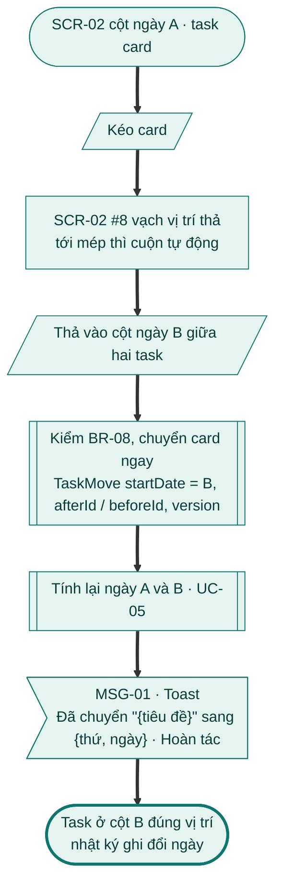

### Nhánh thay thế

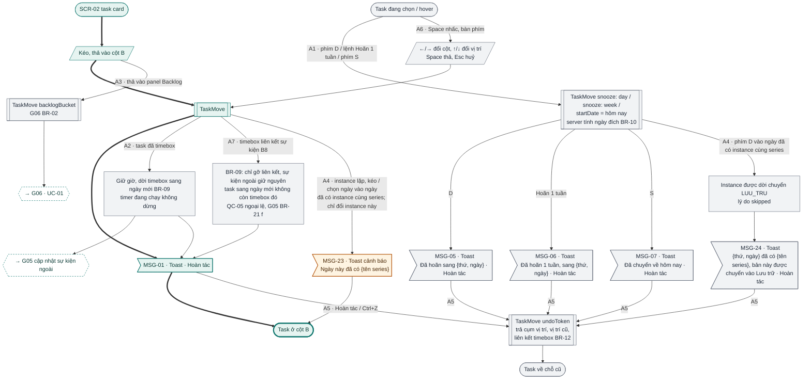

### Nhánh lỗi

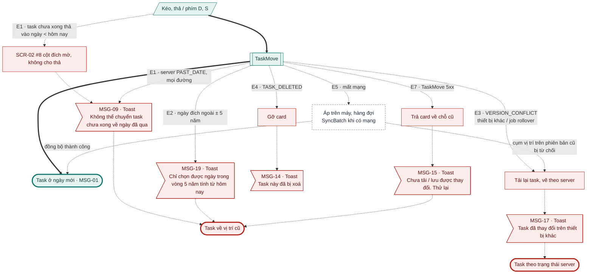

### Đối chiếu

| Mã | Điều kiện | Kết thúc ở | Thông báo |
|---|---|---|---|
| A1 | Phím D / "Hoãn 1 tuần" / phím S | Ngày đích theo BR-10 | MSG-05 / MSG-06 / MSG-07 |
| A2 | Task đã timebox | Timebox dời theo, [G05](g05-lich-timebox.md) cập nhật sự kiện ngoài; timer không dừng | MSG-01 |
| A3 | Thả vào panel Backlog | Task trong backlog → [G06 UC-01](g06-backlog-rollover.md) | – |
| A4 | Instance lặp vào ngày đã có instance cùng series | Kéo / chọn ngày: vẫn đặt; phím D: bản bị dời vào Lưu trữ (`skipped`) | MSG-23 / MSG-24 |
| A5 | Hoàn tác / Ctrl+Z | Về cụm vị trí, vị trí cũ, liên kết timebox | – |
| A6 | Kéo bằng bàn phím | Như kéo thả | MSG-01 |
| A7 | Timebox liên kết sự kiện | Gỡ liên kết, sự kiện giữ nguyên (BR-09, QC-05) | – |
| E1 | Task chưa xong vào ngày < hôm nay | Không thả / server từ chối | MSG-09 |
| E2 | Ngoài ± 5 năm | Task về chỗ cũ | MSG-19 |
| E3 | `VERSION_CONFLICT` | Trạng thái server | MSG-17 |
| E4 | `TASK_DELETED` | Gỡ card | MSG-14 |
| E5 | Mất mạng | Hàng đợi; bị từ chối thì như E3 | MSG-17 (khi xung đột) |
| E6 | Workspace chỉ đọc | Bỏ (1.1) | – |
| E7 | TaskMove 5xx | Task về chỗ cũ | MSG-15 |

---

## UC-04 Sắp xếp task trong ngày

**Mở đầu:** ngày có ≥ 2 task chưa xong. **Thành công:** vị trí tuỳ chỉnh lưu, projection tính lại, có Hoàn tác. **Thất bại:** thứ tự không đổi.

### Happy case

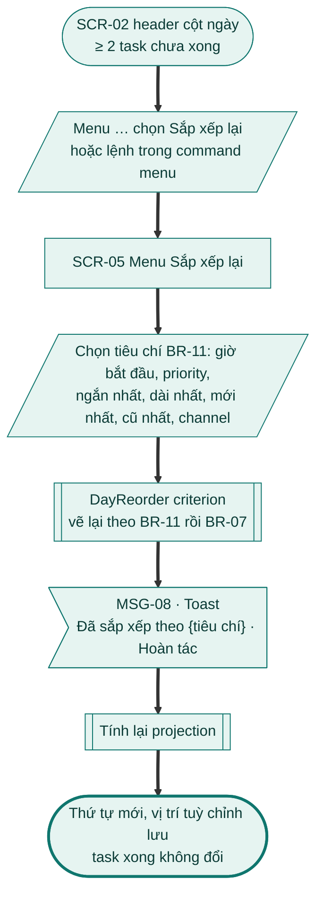

### Nhánh thay thế và lỗi

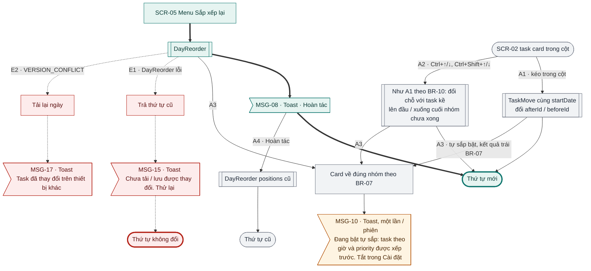

### Đối chiếu

| Mã | Điều kiện | Kết thúc ở | Thông báo |
|---|---|---|---|
| A1 | Kéo trong cột | Vị trí mới | – |
| A2 | Ctrl+↑/↓, Ctrl+Shift+↑/↓ | Vị trí mới | – |
| A3 | Tự sắp bật, kết quả trái BR-07 | Card về đúng nhóm | MSG-10 (một lần / phiên) |
| A4 | Hoàn tác | Thứ tự cũ | – |
| E1 | DayReorder lỗi | Thứ tự cũ | MSG-15 |
| E2 | `VERSION_CONFLICT` | Tải lại ngày | MSG-17 |

---

## UC-05 Tính projection và khối lượng ngày

**Mở đầu:** hệ thống nhận thay đổi ảnh hưởng ngày D (projection, cảnh báo: D ≥ hôm nay; tổng, tiến độ: mọi ngày). **Thành công:** tổng, tiến độ, sức chứa, trạng thái ngày (4.1), giờ trên card (4.2) đúng; thiết bị khác nhận `day.recomputed` ≤ 5 giây. **Thất bại:** giữ kết quả lần trước.

### Happy case

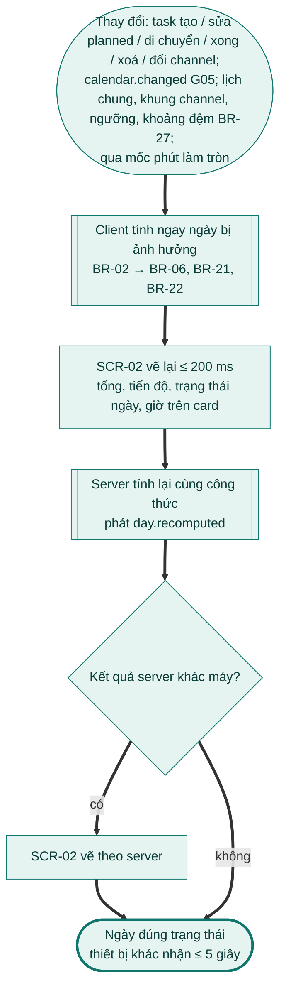

### Nhánh thay thế và lỗi: sự kiện lịch và thời gian

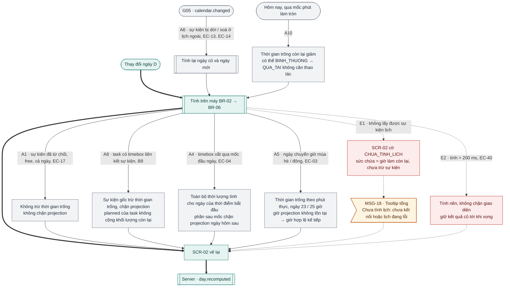

### Nhánh thay thế: sức chứa, quá tải, vượt giờ làm

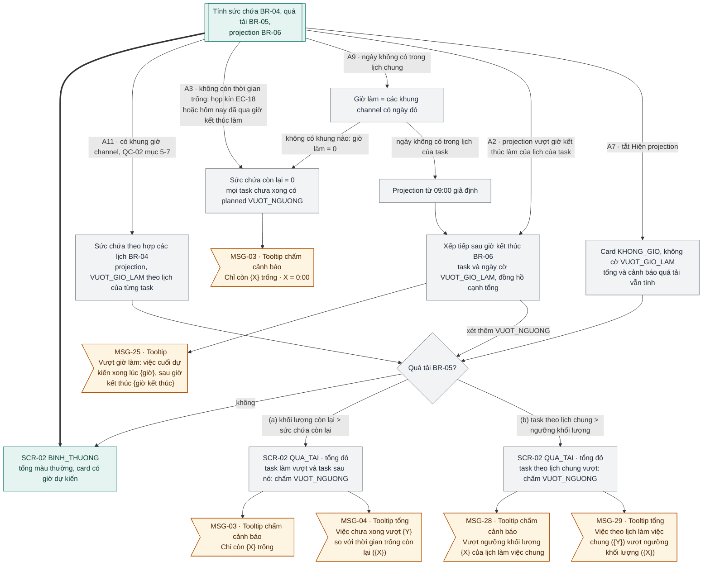

### Đối chiếu

| Mã | Điều kiện | Kết thúc ở | Thông báo |
|---|---|---|---|
| A1 | Sự kiện từ chối / free / cả ngày | Không trừ thời gian trống | – |
| A2 | Projection vượt giờ kết thúc làm | Cờ `VUOT_GIO_LAM`; thêm `VUOT_NGUONG` nếu quá tải | MSG-25 (+ MSG-03 / MSG-28) |
| A3 | Không còn thời gian trống | Sức chứa 0, mọi task có planned `VUOT_NGUONG` | MSG-03 |
| A4 | Timebox vắt qua mốc đầu ngày | Tính cho ngày bắt đầu | – |
| A5 | Ngày chuyển giờ mùa | Phút thực, giờ hợp lệ kế tiếp | – |
| A6 | Sự kiện dời / xoá ở lịch ngoài | Tính lại ngày cũ và mới | – |
| A7 | Tắt "Hiện projection" | Không giờ dự kiến; quá tải vẫn tính | MSG-04 / MSG-29 nếu quá tải |
| A8 | Timebox liên kết sự kiện | Trừ một lần theo sự kiện gốc | – |
| A9 | Ngày không có trong lịch chung | Giờ làm theo khung channel; không có khung → như A3 | MSG-03, MSG-25 |
| A10 | Thời gian trôi qua ở hôm nay | Có thể chuyển `QUA_TAI` | MSG-03 / MSG-04 |
| A11 | Có khung giờ channel | Sức chứa theo hợp lịch; ngưỡng chỉ cho task lịch chung | MSG-03 / 04 (a), MSG-28 / 29 (b) |
| E1 | Không lấy được sự kiện lịch | Cờ `CHUA_TINH_LICH` | MSG-18 |
| E2 | Tính > 200 ms | Tính nền, giữ kết quả cũ | – |

---

## UC-06 Lọc theo channel

**Mở đầu:** đang ở Home / Today / Calendar views. **Thành công:** chỉ card thuộc bộ lọc hiển thị, bộ lọc lưu trên thiết bị. **Thất bại:** bộ lọc không đổi.

### Happy case

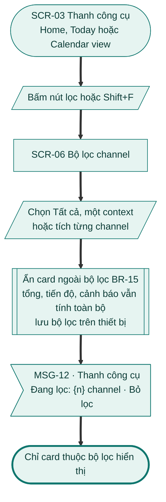

### Nhánh thay thế và lỗi

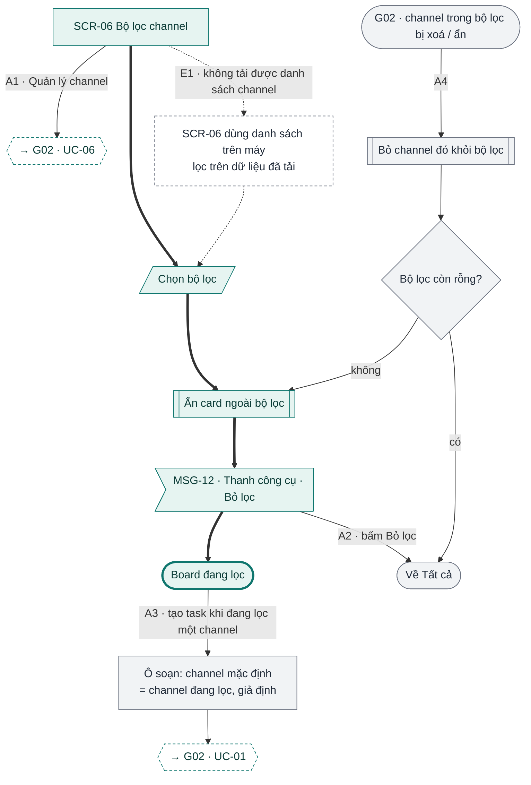

### Đối chiếu

| Mã | Điều kiện | Kết thúc ở | Thông báo |
|---|---|---|---|
| A1 | "Quản lý channel" | Context & channel → [G02 UC-06](g02-quan-ly-task.md#uc-06-quản-lý-context-và-channel) | – |
| A2 | Bấm "Bỏ lọc" | Tất cả | – |
| A3 | Tạo task khi đang lọc | Channel mặc định = channel đang lọc `[giả định]` → [G02 UC-01](g02-quan-ly-task.md#uc-01-tạo-task) | – |
| A4 | Channel trong bộ lọc bị xoá / ẩn | Bỏ khỏi bộ lọc; rỗng → Tất cả | – |
| E1 | Không tải được danh sách channel | Dùng danh sách trên máy | – |

---

## UC-07 Tìm kiếm task

**Mở đầu:** người dùng đã đăng nhập. **Thành công:** danh sách kết quả hiện, bấm kết quả mở chi tiết task. **Thất bại:** giữ kết quả cũ, hiện lỗi.

### Happy case

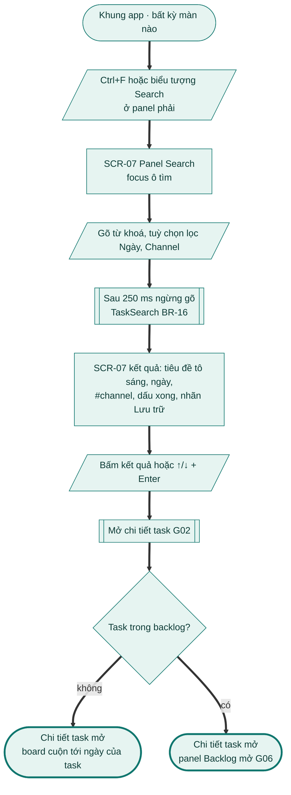

### Nhánh thay thế và lỗi

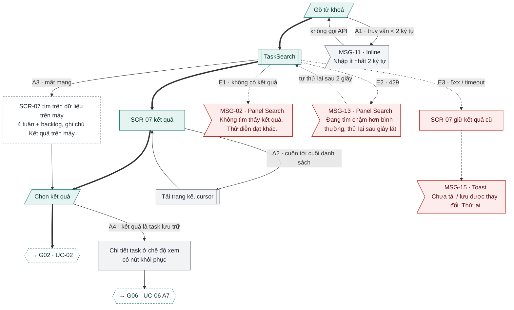

### Đối chiếu

| Mã | Điều kiện | Kết thúc ở | Thông báo |
|---|---|---|---|
| A1 | Truy vấn < 2 ký tự | Không gọi API | MSG-11 |
| A2 | Cuộn tới cuối | Tải trang kế | – |
| A3 | Mất mạng | Tìm trên máy, ghi chú "Kết quả trên máy" | – (chưa có mã MSG) |
| A4 | Kết quả là task lưu trữ | Chi tiết ở chế độ xem, nút khôi phục → [G06 UC-06](g06-backlog-rollover.md) | – |
| E1 | Không có kết quả | Trạng thái rỗng | MSG-02 |
| E2 | 429 | Tự thử lại sau 2 giây | MSG-13 |
| E3 | 5xx / timeout | Giữ kết quả cũ | MSG-15 |

Bấm kết quả task thường → [G02 UC-02](g02-quan-ly-task.md#uc-02-xem-và-sửa-chi-tiết-task); task backlog → panel Backlog [G06](g06-backlog-rollover.md).

---

## UC-08 Command menu và phím tắt

**Mở đầu:** ứng dụng đang focus; với phím một ký tự: không có ô nhập focus và cài đặt "Phím tắt" bật (BR-17). **Thành công:** lệnh chạy đúng ngữ cảnh; lệnh có tác dụng phụ có Hoàn tác. **Thất bại:** không có lệnh nào chạy.

### Happy case

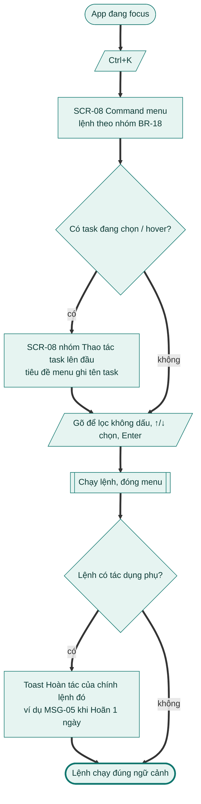

### Nhánh thay thế và lỗi

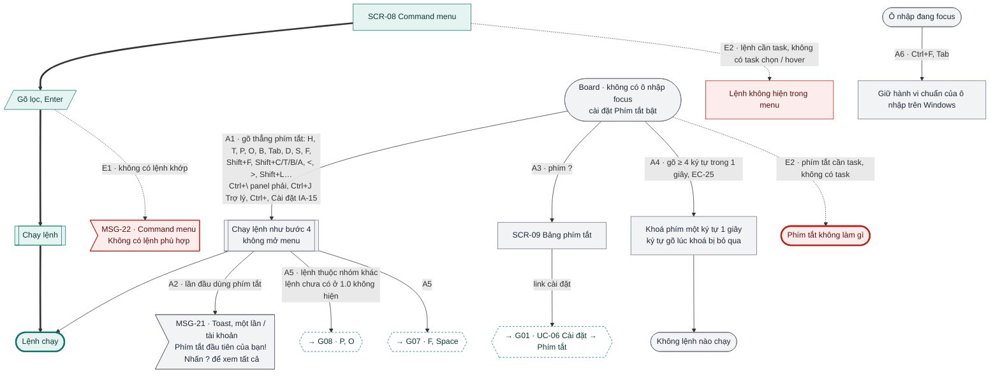

### Đối chiếu

| Mã | Điều kiện | Kết thúc ở | Thông báo |
|---|---|---|---|
| A1 | Gõ thẳng phím tắt | Lệnh chạy, không mở menu | Toast của lệnh |
| A2 | Lần đầu dùng phím tắt | Lệnh chạy | MSG-21 |
| A3 | Phím ? | SCR-09; link → Cài đặt Phím tắt [G01 UC-06](g01-tai-khoan.md) | – |
| A4 | Gõ nhanh ≥ 4 ký tự / 1 giây | Khoá phím một ký tự 1 giây | – |
| A5 | Lệnh thuộc nhóm khác | [G08](g08-daily-rituals.md) (P, O), [G07](g07-focus-timer.md) (F, Space); K và Shift+R là lệnh 1.1, không hiện | – |
| A6 | Ctrl+F, Tab trong ô nhập | Hành vi chuẩn của ô nhập. Phím trùng trình duyệt: Bỏ (1.1) | – |
| E1 | Không có lệnh khớp | Danh sách rỗng | MSG-22 |
| E2 | Lệnh cần task, không có task | Lệnh ẩn / phím không làm gì | – |
| E3 | Workspace chỉ đọc | Bỏ (1.1) | – |

## Kiểm tra

- [x] Mọi A# / E# của UC-01 … UC-08 bản 1.0 có trên sơ đồ hoặc ghi "Bỏ (1.1)".
- [x] Mọi nút màn hình có mã SCR, trừ Today view (SRS chưa đặt mã, ghi chú 2); mọi nút thông báo có mã MSG, trừ hai chỗ SRS chưa đặt mã (ghi chú 3).

**Ghi chú cho brief G04**
1. **UC-01 A9 mâu thuẫn với IA-11.** SRS ghi "cửa sổ < 768 px → 1 cột"; kiến trúc thông tin chốt cửa sổ tối thiểu 800 × 600 và mốc 1280 / 1024 px, nên mốc 768 px không bao giờ xảy ra. Cần chốt mốc nào board chuyển 1 cột.
2. **Today view chưa có mã SCR** (UC-01 A1; IA chỉ dẫn "G04 UC-01 A1, G05 SCR-04"). Panel Tasks (Shift+T) cũng còn là `SCR-N`. Đề xuất đặt mã trong SRS.
3. **Thông báo chưa có mã MSG:** banner "Đang offline" (UC-01 E1, SCR-01 #5) và ghi chú "Kết quả trên máy" (UC-07 A3). Sơ đồ đang vẽ chúng là trạng thái màn; cần thêm MSG để có nguyên văn.
4. **BR-17 mâu thuẫn UC-08 A6.** BR-17: "Ctrl/Cmd+K, Ctrl+F luôn chạy"; UC-08 A6: Ctrl+F trong ô nhập giữ hành vi chuẩn của ô nhập. Cần chốt Ctrl+F khi đang gõ mở Search hay không.
5. **Phím K ở 1.0.** UC-08 A1 và SCR-08 #7 liệt kê "K nghỉ (G07)" không ghi phiên bản; G07 BR-14, BR-17 ghi K là 1.1. Theo UC-08 A5 ("lệnh chưa có ở 1.0 không hiện"), sơ đồ đã bỏ K khỏi danh sách 1.0; đề xuất sửa A1 và SCR-08 #7.
6. **UC-02 E2:** "khung cột rỗng có MSG-15 'Thử lại'" nhưng MSG-15 khai báo nơi hiện là Toast. Cần chốt MSG-15 nằm trong cột hay là toast.
7. **UC-03 A4:** kéo / chọn ngày vào ngày đã có instance cùng series hiện MSG-23; SRS không nói MSG-23 thay MSG-01 hay hiện cùng. Nếu thay thì người dùng mất nút "Hoàn tác" của MSG-01.
8. ~~**UC-03 A7 / BR-09** còn `[giả định]`~~ **Đã sửa 06/11/2026:** theo QC-05 (ngoại lệ timebox liên kết sự kiện), chỉ gỡ liên kết, sự kiện ngoài giữ nguyên; đã ghi ngược vào SRS G04 BR-09, UC-03 A7.
9. **Kéo trong cột (UC-04 A1, A2)** không có toast / MSG; BR-12 nói mọi thao tác BR-10 có Hoàn tác "toast hoặc Ctrl+Z". Cần chốt có toast không.
10. **UC-04 tiền điều kiện** ghi "workspace không chỉ đọc" thiếu nhãn "(1.1)"; BR-20 nói 1.0 không có chế độ chỉ đọc.
11. **UC-03 A3** (thả vào panel Backlog) không ghi thông báo; phụ thuộc G06 UC-01.
