# Flow G05 Lịch & timebox

> **Nguồn:** [srs-g05](../../features/srs-g05-lich-timebox.md) (commit `8fac830`, cập nhật theo chốt 09/11/2026) · **Brief:** `[chờ]`
> **Quy ước:** [_quy-uoc.md](_quy-uoc.md) · **FigJam:** `[chờ]`

## Mục lục

| UC | Flow | Màn chính | Nhánh A / E (1.0) |
|---|---|---|---|
| [UC-01](#uc-01-kết-nối-tài-khoản-lịch) | Kết nối tài khoản lịch | SCR-01 Cài đặt → Lịch, SCR-02 Lịch của một tài khoản | 4 / 5 |
| [UC-02](#uc-02-chọn-lịch-hiển-thị-và-lịch-ghi-timebox) | Chọn lịch hiển thị và lịch ghi timebox | SCR-02, SCR-03 Lịch ghi theo channel | 4 / 2 |
| [UC-03](#uc-03-timebox-task-bằng-kéo-thả) | Timebox task bằng kéo thả | SCR-04 Lưới lịch, SCR-05 Block timebox, SCR-06 | 11 / 6 |
| [UC-04](#uc-04-dời-đổi-thời-lượng-gỡ-timebox) | Dời, đổi thời lượng, gỡ timebox | SCR-05, SCR-06 | 11 / 4 |
| UC-05 | Auto-schedule (X / Shift+X) | – | Bỏ (1.1) |
| [UC-06](#uc-06-đẩy-timebox-ra-lịch-ngoài-job-timeboxpush) | Đẩy timebox ra lịch ngoài (job chạy nền) | SCR-05 (trạng thái đồng bộ) | 4 / 5 |
| [UC-07](#uc-07-nhận-thay-đổi-từ-lịch-ngoài) | Nhận thay đổi từ lịch ngoài (chạy nền) | SCR-04, SCR-05, SCR-07 Popover xung đột | 12 / 4 |
| [UC-08](#uc-08-kết-nối-lại-và-ngắt-kết-nối) | Kết nối lại và ngắt kết nối | SCR-09 Banner, SCR-01, SCR-08 Xác nhận ngắt | 5 / 2 |
| UC-09 | Lập lịch cứng cho task lặp | – | Bỏ (1.1) |
| [UC-10](#uc-10-tạo-timebox-liên-kết-sự-kiện) | Tạo timebox liên kết sự kiện | SCR-05 (block liên kết) | 2 / 1 |
| UC-11 | Xử lý cờ "Lệch ngày" | – | Bỏ (F5) |

---

## UC-01 Kết nối tài khoản lịch

**Mở đầu:** Cài đặt → Lịch (SCR-01) hoặc bước "Kết nối lịch" của onboarding (G01); số tài khoản lịch dưới giới hạn. **Thành công:** tài khoản `HOAT_DONG`, lịch chính bật hiển thị và làm lịch ghi mặc định (nếu chưa có), sự kiện trong cửa sổ đã tải. **Thất bại:** không có tài khoản mới, trạng thái cũ giữ nguyên.

### Happy case

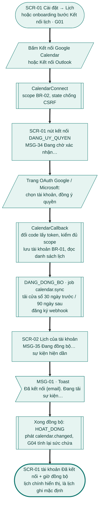

### Nhánh thay thế và lỗi

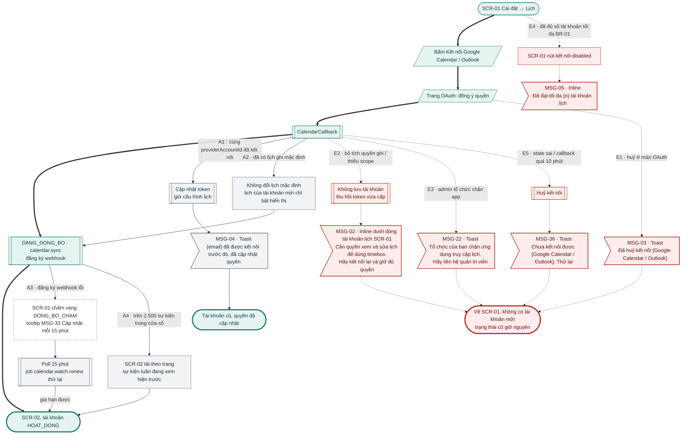

### Đối chiếu

| Mã | Điều kiện | Kết thúc ở | Thông báo |
|---|---|---|---|
| A1 | Tài khoản đã kết nối trước đó | Token cập nhật, cấu hình lịch giữ | MSG-04 |
| A2 | Đã có lịch ghi mặc định | Về luồng chính, lịch mới chỉ bật hiển thị | – |
| A3 | Đăng ký webhook lỗi | `DONG_BO_CHAM`, poll 15 phút | – |
| A4 | Trên 2.500 sự kiện | Tải theo trang, tuần đang xem trước | – |
| E1 | Huỷ ở màn OAuth | SCR-01, không có tài khoản mới | MSG-03 |
| E2 | Thiếu quyền ghi / scope | SCR-01, không lưu, thu hồi token | MSG-02 (dưới dòng tài khoản lịch) |
| E3 | Admin tổ chức chặn app | SCR-01, không có tài khoản mới | MSG-22 |
| E4 | Đủ 5 tài khoản (B17) | SCR-01, nút kết nối disabled | MSG-05 |
| E5 | `state` sai / callback quá 10 phút | SCR-01, huỷ | MSG-36 |

---

## UC-02 Chọn lịch hiển thị và lịch ghi timebox

**Mở đầu:** có ít nhất 1 tài khoản `HOAT_DONG` / `DONG_BO_CHAM`. Lịch ghi timebox mặc định chỉ chọn ở SCR-01 #5 (A3, B18). **Thành công:** cấu hình hiển thị / màu / lịch ghi được lưu; lịch app và sức chứa ngày (G04) cập nhật. **Thất bại:** cấu hình cũ giữ nguyên.

### Happy case

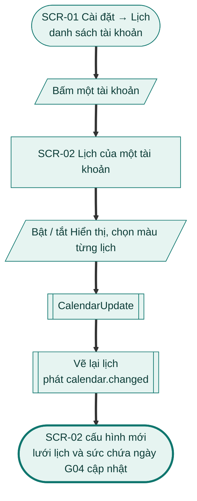

### Nhánh thay thế và lỗi

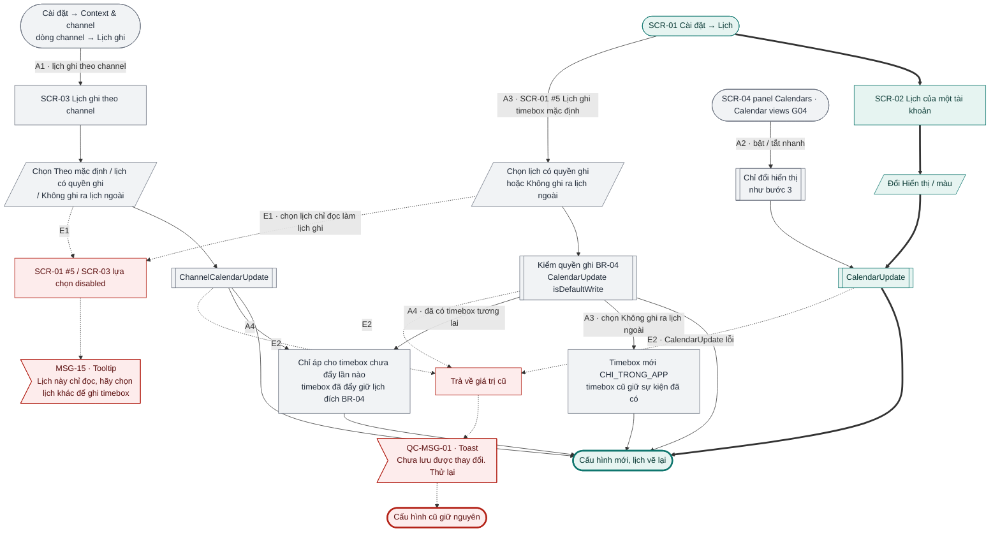

### Đối chiếu

| Mã | Điều kiện | Kết thúc ở | Thông báo |
|---|---|---|---|
| A1 | Chọn lịch ghi theo channel | SCR-03, lịch ghi của channel lưu | – |
| A2 | Bật / tắt nhanh ở panel Calendars ([G04](g04-board-ngay.md)) | Chỉ đổi hiển thị | – |
| A3 | Chọn lịch ghi mặc định ở SCR-01 #5 (nơi duy nhất, B18) | Lịch ghi mặc định lưu; "Không ghi ra lịch ngoài" → block mới `CHI_TRONG_APP` | – |
| A4 | Đổi lịch ghi khi đã có timebox tương lai | Chỉ áp cho timebox chưa đẩy | – |
| E1 | Chọn lịch chỉ đọc (SCR-01 #5, SCR-03) | Lựa chọn disabled | MSG-15 |
| E2 | `CalendarUpdate` / `ChannelCalendarUpdate` lỗi | Giá trị cũ | QC-MSG-01 |

---

## UC-03 Timebox task bằng kéo thả

**Mở đầu:** task chưa xoá, đang ở Calendar views / Today view / panel Calendar (G04). **Thành công:** task có block theo BR-05, `startDate` cập nhật, block `CHO_DONG_BO` rồi `DA_DONG_BO`, card có badge giờ cam, G04 tính lại projection. **Thất bại:** task không có block mới, vị trí cũ giữ nguyên.

### Happy case

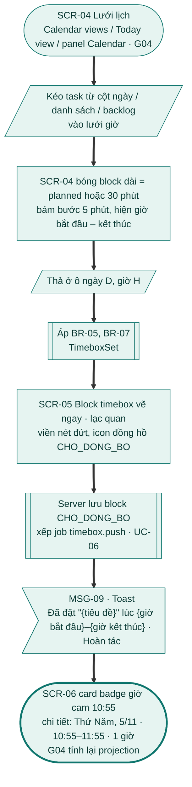

### Nhánh thay thế

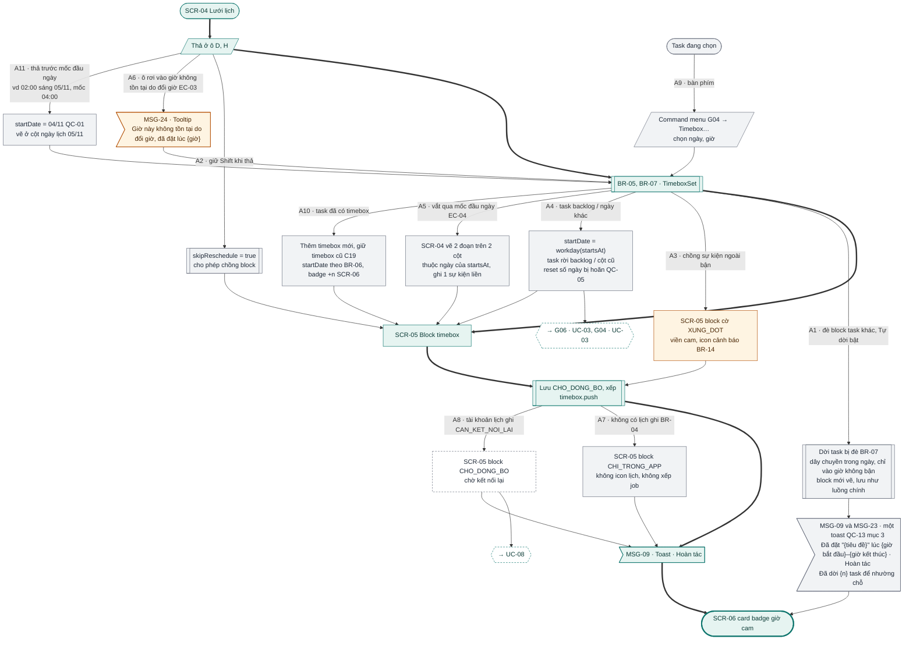

### Nhánh lỗi

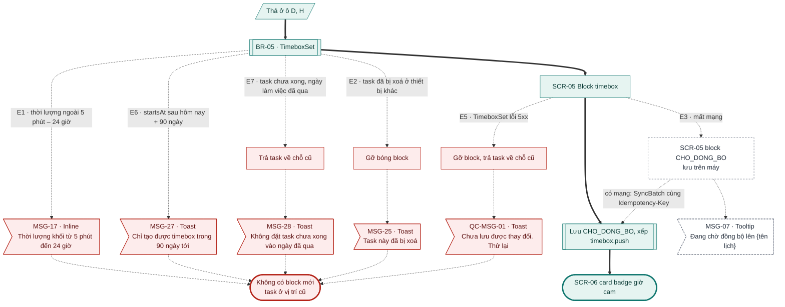

### Đối chiếu

| Mã | Điều kiện | Kết thúc ở | Thông báo |
|---|---|---|---|
| A1 | Đè block task khác, tự dời bật | Task bị đè dời xuống; Hoàn tác trả cả hai về như trước | MSG-09 + MSG-23 (một toast, A3) |
| A2 | Giữ Shift khi thả | Cho phép chồng | MSG-09 |
| A3 | Thả chồng sự kiện ngoài bận | Block có cờ `XUNG_DOT` (popover ở [UC-07](#uc-07-nhận-thay-đổi-từ-lịch-ngoài) A3) | MSG-09 |
| A4 | Task backlog / ngày khác | `startDate` mới, rời backlog / cột cũ → [G06 UC-03](g06-backlog-rollover.md#uc-03-đưa-task-từ-backlog-ra-ngày), [G04 UC-03](g04-board-ngay.md#uc-03-di-chuyển-task-giữa-các-ngày) | MSG-09 |
| A5 | Vắt qua mốc đầu ngày | 2 đoạn trên lưới, 1 sự kiện | MSG-09 |
| A6 | Giờ không tồn tại do đổi giờ | Dời tới giờ hợp lệ kế tiếp | MSG-24 |
| A7 | Không có lịch ghi | Block `CHI_TRONG_APP` | MSG-09 |
| A8 | Lịch ghi `CAN_KET_NOI_LAI` | Block `CHO_DONG_BO` → [UC-08](#uc-08-kết-nối-lại-và-ngắt-kết-nối) | MSG-09 |
| A9 | Bàn phím | Command menu "Timebox…" ([G04 UC-08](g04-board-ngay.md#uc-08-command-menu-và-phím-tắt), B20) | MSG-09 |
| A10 | Task đã có timebox | Thêm timebox, badge "+n" | MSG-09 |
| A11 | Thả trước mốc đầu ngày | `startDate` = ngày làm việc hôm trước | MSG-09 |
| E1 | Thời lượng ngoài 5 phút – 24 giờ | Không tạo | MSG-17 |
| E2 | Task bị xoá ở thiết bị khác | Gỡ bóng block | MSG-25 |
| E3 | Mất mạng | Block chờ đồng bộ → `SyncBatch` | MSG-07 |
| E4 | Workspace chỉ đọc | Bỏ (1.1) | – |
| E5 | `TimeboxSet` lỗi 5xx | Gỡ block, task về chỗ cũ | QC-MSG-01 |
| E6 | Quá 90 ngày | Không tạo | MSG-27 |
| E7 | Ngày đã qua, task chưa xong | Không tạo, task về chỗ cũ | MSG-28 |

---

## UC-04 Dời, đổi thời lượng, gỡ timebox

**Mở đầu:** task có ít nhất 1 block trên SCR-04 / SCR-06. **Thành công:** block, planned, `startDate` cập nhật theo BR-06; sự kiện ngoài cập nhật hoặc xoá trong 10 giây. **Thất bại:** block giữ như cũ.

### Happy case

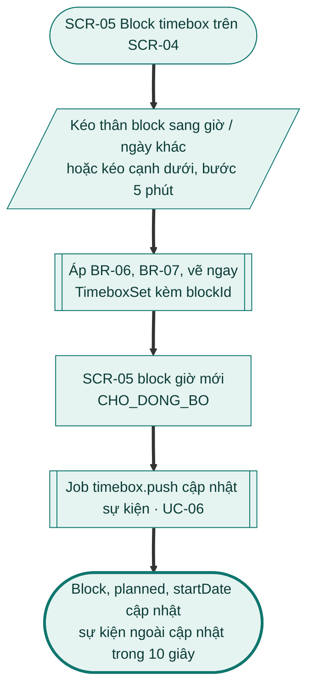

### Nhánh thay thế: thao tác trên block

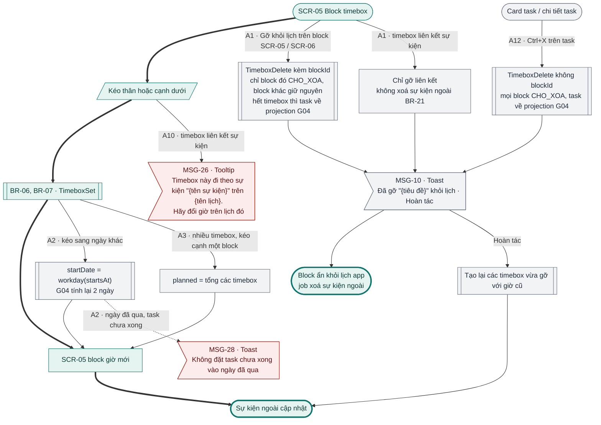

### Nhánh lỗi: thao tác trên block

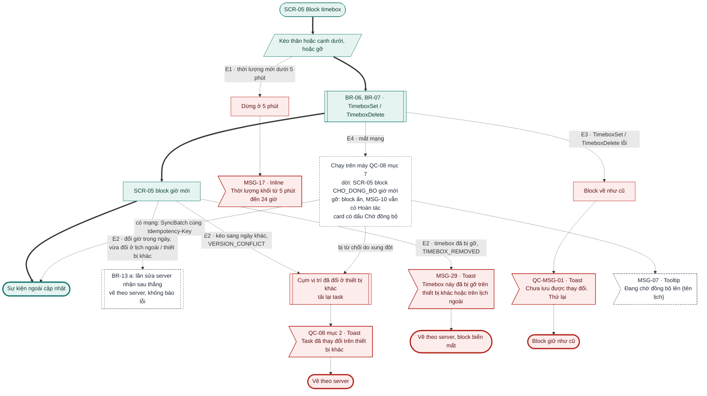

### Nhánh thay thế: đường đổi ngày, hoàn thành, xoá từ nhóm khác

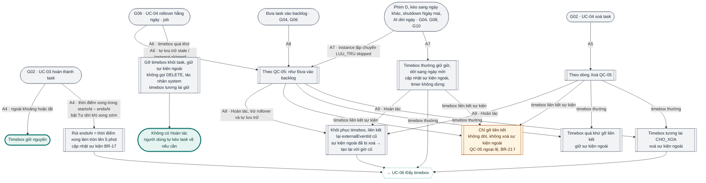

### Đối chiếu

| Mã | Điều kiện | Kết thúc ở | Thông báo |
|---|---|---|---|
| A1 | "Gỡ khỏi lịch" trên một block (B22) | Chỉ block đó `CHO_XOA`; hết timebox thì task về projection; Hoàn tác tạo lại | MSG-10 |
| A2 | Kéo sang ngày khác | `startDate` mới; ngày đã qua thì chặn | MSG-28 (ngày đã qua) |
| A3 | Kéo cạnh một trong nhiều timebox | planned = tổng | – |
| A4 | Hoàn thành trong khoảng timebox ([G02 UC-03](g02-quan-ly-task.md#uc-03-hoàn-thành--bỏ-hoàn-thành-task)) | `endsAt` rút ngắn | – |
| A5 | Xoá task ([G02 UC-04](g02-quan-ly-task.md#uc-04-xoá-hoàn-tác-và-khôi-phục-task)) | Tương lai `CHO_XOA`, quá khứ gỡ liên kết; timebox liên kết sự kiện chỉ gỡ liên kết, giữ sự kiện | – |
| A6 | Rollover ([G06 UC-04](g06-backlog-rollover.md#uc-04-rollover-hằng-ngày-job-rollover)) | Gỡ timebox quá khứ, giữ sự kiện, không Hoàn tác | – |
| A7 | Phím D / kéo ngày / shutdown / AI ([G04 UC-03](g04-board-ngay.md#uc-03-di-chuyển-task-giữa-các-ngày), [G08 UC-02](g08-daily-rituals.md#uc-02-daily-shutdown), [G10 UC-03](g10-tro-ly-ai.md#uc-03-trò-chuyện-và-ra-lệnh-cho-trợ-lý)) | Timebox dời theo ngày mới; timebox liên kết sự kiện chỉ gỡ liên kết | – |
| A8 | Đưa vào backlog ([G06 UC-01](g06-backlog-rollover.md#uc-01-chuyển-task-vào-backlog)) | Như A5 | – |
| A9 | Hoàn tác A5, A7, A8 ([G10 UC-04](g10-tro-ly-ai.md#uc-04-hoàn-tác-hành-động-ai) khi do AI) | Timebox và liên kết khôi phục | – |
| A10 | Kéo timebox liên kết sự kiện | Không cho | MSG-26 |
| A11 | Timebox lập lịch cứng | Bỏ (1.1) | – |
| A12 | Ctrl+X trên task (B22) | Mọi block `CHO_XOA`, task về projection; Hoàn tác tạo lại hết | MSG-10 |
| E1 | Thời lượng dưới 5 phút | Dừng ở 5 phút | MSG-17 |
| E2 | Đổi từ lịch ngoài / thiết bị khác | Đổi giờ trong ngày: theo server, không báo; kéo sang ngày khác bị `VERSION_CONFLICT`: tải lại (B21); đã bị gỡ thì báo | Câu xung đột QC-08 mục 2 (kéo sang ngày khác); MSG-29 (khi bị gỡ) |
| E3 | `TimeboxSet` / `TimeboxDelete` lỗi | Block như cũ | QC-MSG-01 |
| E4 | Mất mạng (C22) | Chạy trên máy, dấu "Chờ đồng bộ", gửi lại qua `SyncBatch` | MSG-07 |

---

## UC-06 Đẩy timebox ra lịch ngoài (job `timebox.push`)

**Mở đầu:** sự kiện hệ thống: timebox `CHO_DONG_BO` / `CHO_XOA` / `LOI` (không phải `LIEN_KET_SU_KIEN`), tài khoản lịch ghi `HOAT_DONG` / `DONG_BO_CHAM`. **Thành công:** sự kiện ngoài khớp block, block `DA_DONG_BO` (hoặc bản ghi bị xoá với `CHO_XOA`). **Thất bại:** block `LOI`, thử lại theo BR-12.

### Happy case

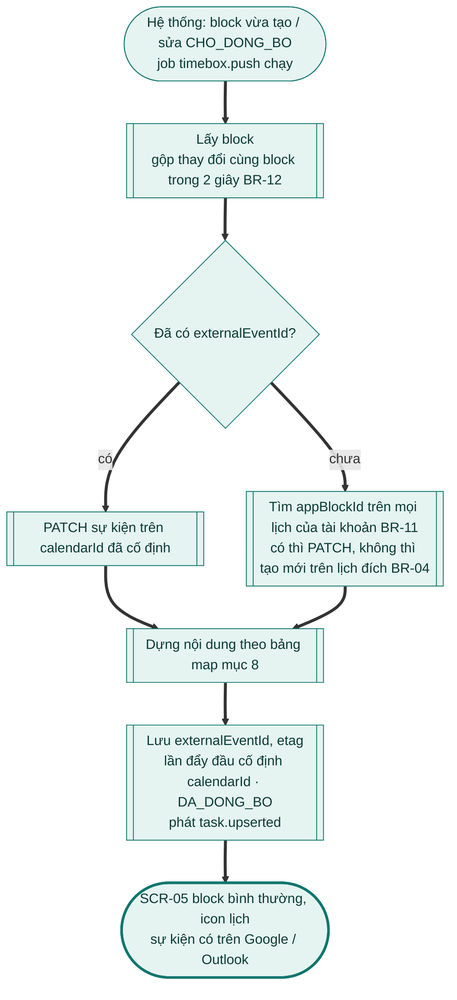

### Nhánh thay thế

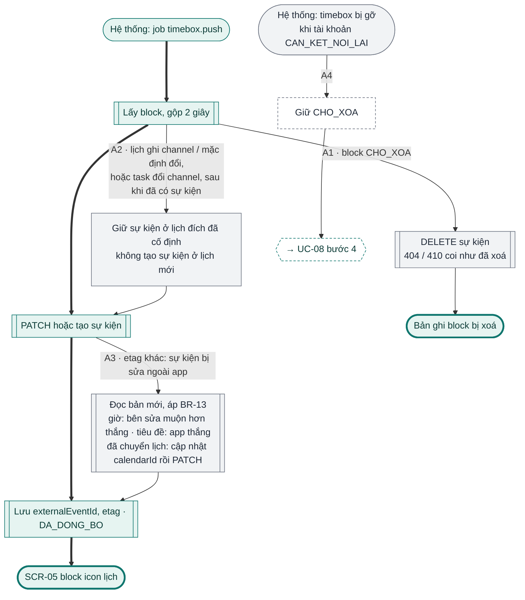

### Nhánh lỗi

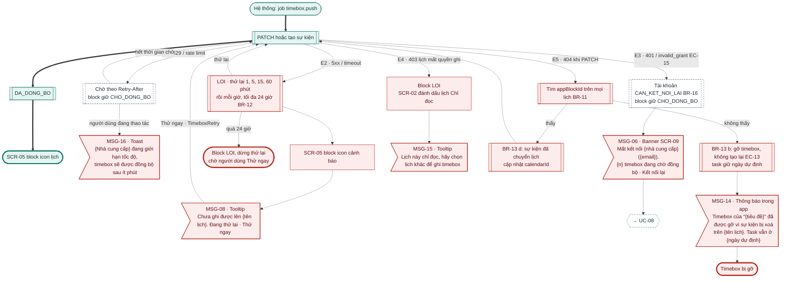

### Đối chiếu

| Mã | Điều kiện | Kết thúc ở | Thông báo |
|---|---|---|---|
| A1 | Block `CHO_XOA` | Sự kiện xoá, bản ghi block xoá | – |
| A2 | Lịch ghi / channel đổi sau khi đã có sự kiện | Sự kiện giữ ở lịch đích cố định | – |
| A3 | Sự kiện bị sửa ngoài app (etag khác) | Áp BR-13 rồi PATCH | – |
| A4 | `CHO_XOA` khi tài khoản `CAN_KET_NOI_LAI` | Chờ [UC-08](#uc-08-kết-nối-lại-và-ngắt-kết-nối) bước 4 | – |
| E1 | 429 | Chờ `Retry-After`, giữ `CHO_DONG_BO` | MSG-16 |
| E2 | 5xx / timeout | `LOI`, thử lại tới 24 giờ | MSG-08 |
| E3 | 401 / `invalid_grant` | `CAN_KET_NOI_LAI` → [UC-08](#uc-08-kết-nối-lại-và-ngắt-kết-nối) | MSG-06 |
| E4 | 403 mất quyền ghi | Block `LOI`, lịch đánh dấu chỉ đọc | MSG-15 |
| E5 | 404 khi PATCH | Chuyển lịch → cập nhật; không thấy → gỡ timebox (B19) | MSG-14 (khi gỡ) |
| (tiền điều kiện) | Workspace chỉ đọc | Bỏ (1.1) | – |

---

## UC-07 Nhận thay đổi từ lịch ngoài

**Mở đầu:** sự kiện hệ thống: Google / Microsoft gọi webhook, hoặc tới lượt poll 15 phút; tài khoản `HOAT_DONG` / `DONG_BO_CHAM`. **Thành công:** cache sự kiện cập nhật, block liên quan cập nhật / xoá theo BR-13, cờ `XUNG_DOT` đúng, thiết bị nhận `calendar.changed` trong 5 giây. **Thất bại:** cache giữ bản cũ, lần poll / webhook sau xử lý lại.

### Happy case

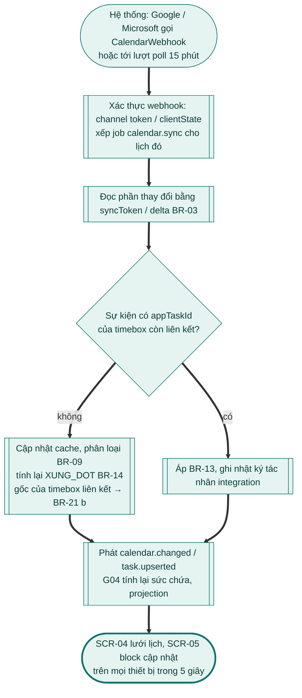

### Nhánh thay thế: sự kiện timebox do app tạo

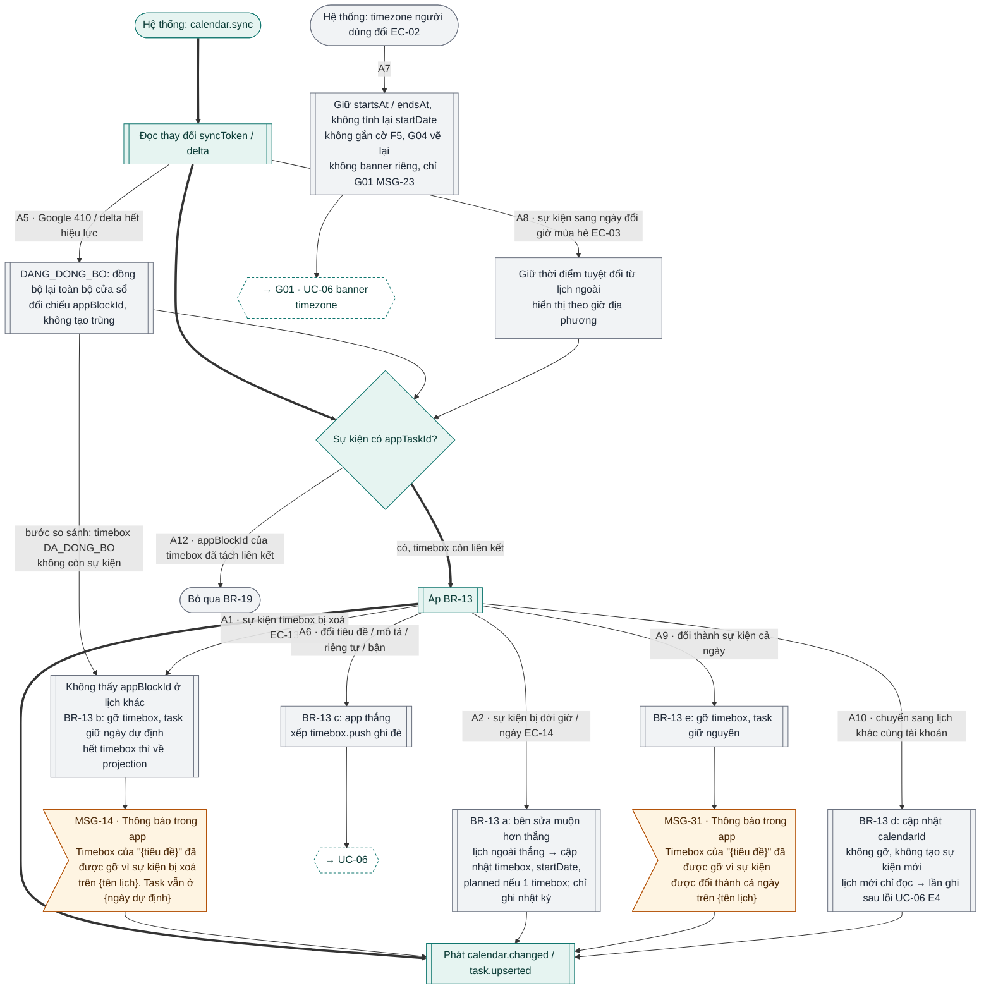

### Nhánh thay thế và lỗi: sự kiện ngoài, xung đột

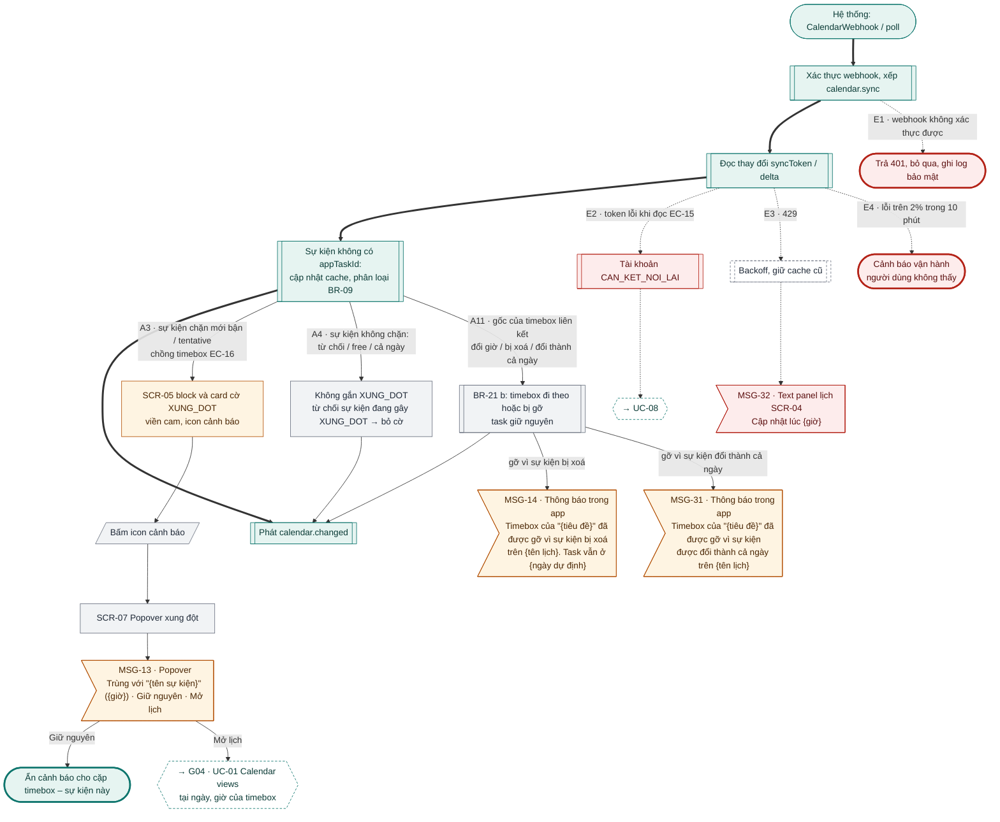

### Đối chiếu

| Mã | Điều kiện | Kết thúc ở | Thông báo |
|---|---|---|---|
| A1 | Sự kiện timebox bị xoá | Gỡ timebox, task giữ ngày | MSG-14 |
| A2 | Sự kiện timebox bị dời | Bên sửa muộn hơn thắng | – |
| A3 | Sự kiện chặn mới chồng timebox | `XUNG_DOT`, SCR-07 bản 1.0 chỉ có "Giữ nguyên" / "Mở lịch" (C17) ([G04 UC-01](g04-board-ngay.md#uc-01-xem-board-và-chuyển-chế-độ-xem)) | MSG-13 |
| A3 (nút "Dời sang khe trống") | Dời theo Shift+X | Bỏ (1.1) | – |
| A4 | Sự kiện không chặn | Không gắn cờ / bỏ cờ | – |
| A5 | Google 410 / delta hết hiệu lực | Đồng bộ lại toàn bộ, không trùng | – (MSG-14 nếu gỡ) |
| A6 | Đổi tiêu đề / mô tả / riêng tư / bận | App thắng → [UC-06](#uc-06-đẩy-timebox-ra-lịch-ngoài-job-timeboxpush) | – |
| A7 | Timezone đổi | Giữ giờ tuyệt đối, không gắn cờ (F5); banner ở [G01 UC-06](g01-tai-khoan.md#uc-06-xem-và-đổi-cài-đặt) | – (G01 MSG-23) |
| A8 | Ngày đổi giờ mùa hè | Hiển thị giờ địa phương | – |
| A9 | Đổi thành sự kiện cả ngày | Gỡ timebox | MSG-31 |
| A10 | Chuyển sang lịch khác | Cập nhật `calendarId` | – |
| A11 | Gốc của timebox liên kết đổi / xoá / đổi thành cả ngày | Timebox đi theo / bị gỡ | MSG-14 (bị xoá), MSG-31 (đổi thành cả ngày, C18) |
| A12 | Sự kiện mồ côi | Bỏ qua | – |
| A13 | Workspace chỉ đọc | Bỏ (1.1) | – |
| E1 | Webhook không xác thực | 401, log bảo mật | – |
| E2 | Token lỗi | `CAN_KET_NOI_LAI` → [UC-08](#uc-08-kết-nối-lại-và-ngắt-kết-nối) | – |
| E3 | 429 | Giữ cache | MSG-32 |
| E4 | Lỗi trên 2% / 10 phút | Cảnh báo vận hành | – |

---

## UC-08 Kết nối lại và ngắt kết nối

**Mở đầu:** tài khoản `CAN_KET_NOI_LAI` (kết nối lại) hoặc bất kỳ (ngắt). **Thành công:** kết nối lại: `HOAT_DONG`, mọi block chờ đã đẩy, không trùng; ngắt: tài khoản `DA_NGAT`, token thu hồi, block `CHI_TRONG_APP`. **Thất bại:** trạng thái cũ giữ nguyên.

### Happy case

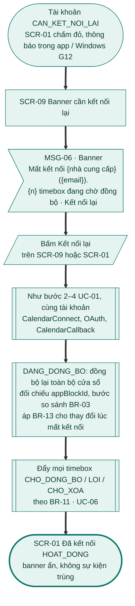

### Nhánh thay thế và lỗi: kết nối lại

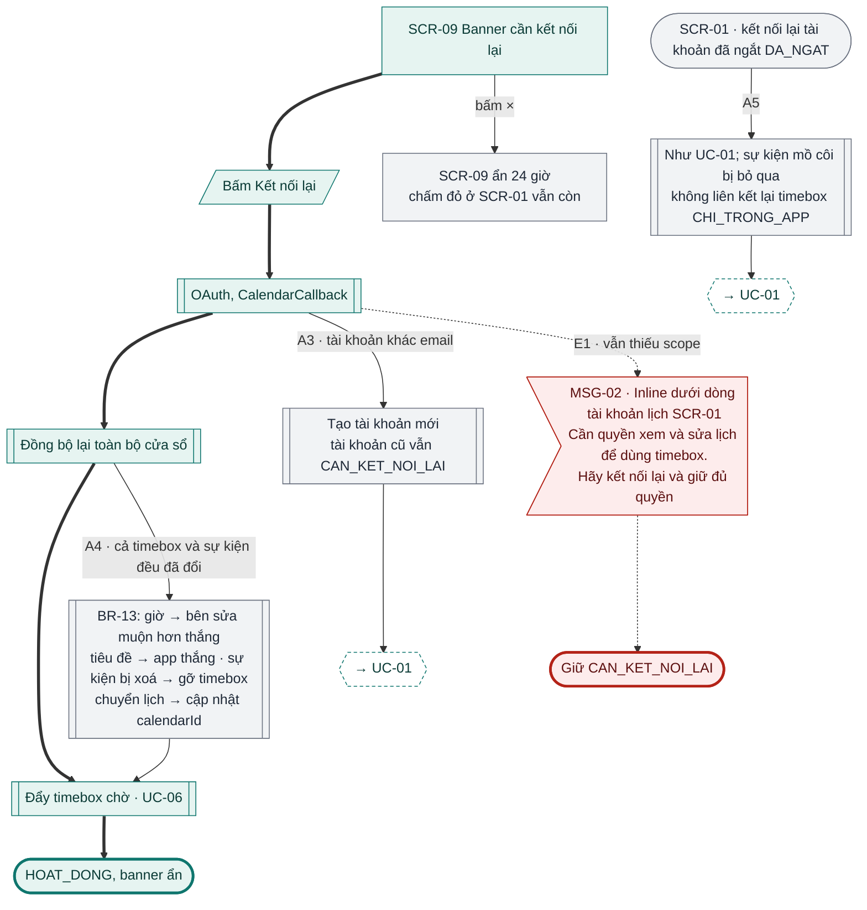

### Nhánh thay thế và lỗi: ngắt kết nối

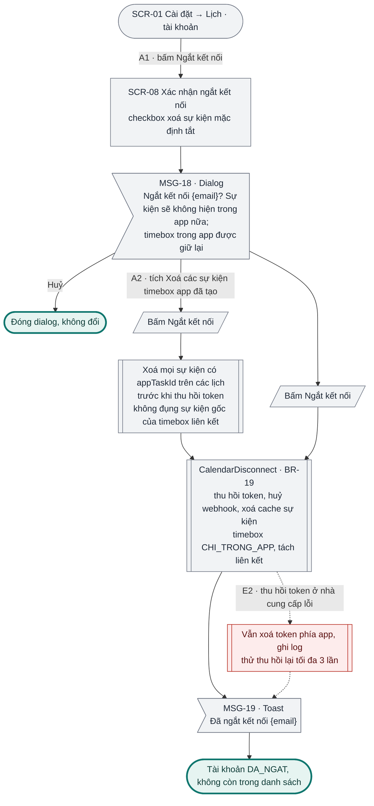

### Đối chiếu

| Mã | Điều kiện | Kết thúc ở | Thông báo |
|---|---|---|---|
| A1 | Ngắt kết nối | SCR-08 → `DA_NGAT`, timebox `CHI_TRONG_APP` | MSG-18, MSG-19 |
| A2 | Tích "Xoá các sự kiện timebox app đã tạo" | Sự kiện app tạo bị xoá trước khi thu hồi | MSG-19 |
| A3 | Kết nối lại bằng email khác | Tài khoản mới → [UC-01](#uc-01-kết-nối-tài-khoản-lịch) | – |
| A4 | Cả hai phía đều đã đổi | Áp BR-13 | – |
| A5 | Kết nối lại tài khoản đã ngắt | Như [UC-01](#uc-01-kết-nối-tài-khoản-lịch), không liên kết lại | – |
| E1 | Vẫn thiếu scope | Giữ `CAN_KET_NOI_LAI` | MSG-02 |
| E2 | Thu hồi token ở nhà cung cấp lỗi | Vẫn ngắt, thử thu hồi lại 3 lần | MSG-19 |

---

## UC-10 Tạo timebox liên kết sự kiện

**Mở đầu:** Daily planning bước Thêm task (G08): người dùng kéo sự kiện lịch thành task; sự kiện có trong cache, không mang `appTaskId`, không phải cả ngày. **Thành công:** task có timebox `LIEN_KET_SU_KIEN` cùng giờ sự kiện, không có sự kiện mới trên lịch ngoài. **Thất bại:** task không có timebox liên kết, task vẫn tồn tại (G08 xử lý).

### Happy case

```mermaid
flowchart TD
  start(["G08 · UC-01 Daily planning bước Thêm task<br/>kéo sự kiện lịch thành task"])
  p1[["G08 gọi TimeboxLink<br/>taskId, calendarId, eventId"]]
  p2[["Kiểm sự kiện tồn tại<br/>tạo timebox kind = event_linked, giờ của sự kiện<br/>startDate = workday(startsAt)"]]
  p3[["Không xếp timebox.push, phát task.upserted<br/>G04 tính sức chứa không trừ hai lần"]]
  ok(["SCR-05 block LIEN_KET_SU_KIEN<br/>viền liền màu lịch gốc, icon liên kết, không kéo được"])

  start ==> p1 ==> p2 ==> p3 ==> ok

  class start,p1,p2,p3 happy
  class ok done
  classDef happy fill:#E6F4F1,stroke:#0F766E,color:#0B3B36
  classDef alt fill:#F1F3F5,stroke:#6B7280,color:#1F2937
  classDef err fill:#FDECEC,stroke:#B42318,color:#5C1010
  classDef warn fill:#FEF4E2,stroke:#B45309,color:#4A2604
  classDef ai fill:#F1ECFD,stroke:#6D28D9,color:#2E1065
  classDef sync fill:#FFFFFF,stroke:#6B7280,stroke-dasharray:4 3,color:#1F2937
  classDef link fill:#FFFFFF,stroke:#0F766E,stroke-dasharray:4 3,color:#0B3B36
  classDef done fill:#E6F4F1,stroke:#0F766E,stroke-width:3px,color:#0B3B36
  classDef fail fill:#FDECEC,stroke:#B42318,stroke-width:3px,color:#5C1010
```

### Nhánh thay thế và lỗi

```mermaid
flowchart TD
  p1[["TimeboxLink"]]
  p2[["Tạo timebox event_linked"]]
  p3[["Phát task.upserted"]]
  ok(["SCR-05 block LIEN_KET_SU_KIEN"])
  p1 ==> p2 ==> p3 ==> ok

  p2 -->|"A1 · sự kiện đã có task liên kết"| a1(["Trả timebox đã có, không tạo thêm<br/>G08 BR-07: một sự kiện một task"])
  p2 -->|"A2 · một lần xuất hiện của sự kiện lặp"| a2["Liên kết đúng lần xuất hiện đó<br/>eventId của instance"]
  a2 --> p3
  p2 -.->|"E1 · sự kiện không còn / tài khoản CAN_KET_NOI_LAI"| e1[["EVENT_NOT_FOUND"]]
  e1 -.-> e1m>"MSG-14 · Thông báo trong app<br/>Timebox của #quot;{tiêu đề}#quot; đã được gỡ vì sự kiện bị xoá<br/>trên {tên lịch}. Task vẫn ở {ngày dự định}"]
  e1m -.-> e1x{{"→ G08 · UC-01 tạo task không có timebox"}}
  e1x -.-> fail(["Task không có timebox liên kết"])

  class p1,p2,p3 happy
  class a1,a2 alt
  class e1,e1m err
  class e1x link
  class ok done
  class fail fail
  classDef happy fill:#E6F4F1,stroke:#0F766E,color:#0B3B36
  classDef alt fill:#F1F3F5,stroke:#6B7280,color:#1F2937
  classDef err fill:#FDECEC,stroke:#B42318,color:#5C1010
  classDef warn fill:#FEF4E2,stroke:#B45309,color:#4A2604
  classDef ai fill:#F1ECFD,stroke:#6D28D9,color:#2E1065
  classDef sync fill:#FFFFFF,stroke:#6B7280,stroke-dasharray:4 3,color:#1F2937
  classDef link fill:#FFFFFF,stroke:#0F766E,stroke-dasharray:4 3,color:#0B3B36
  classDef done fill:#E6F4F1,stroke:#0F766E,stroke-width:3px,color:#0B3B36
  classDef fail fill:#FDECEC,stroke:#B42318,stroke-width:3px,color:#5C1010
```

### Đối chiếu

| Mã | Điều kiện | Kết thúc ở | Thông báo |
|---|---|---|---|
| A1 | Sự kiện đã có task liên kết | Timebox đã có | – |
| A2 | Lần xuất hiện của sự kiện lặp | Liên kết đúng lần đó | – |
| E1 | Sự kiện không còn / cần kết nối lại | Task không có timebox → [G08 UC-01](g08-daily-rituals.md#uc-01-daily-planning-luồng-thủ-công) | MSG-14 (`EVENT_NOT_FOUND`, C23) |

---

## UC-11 Xử lý cờ "Lệch ngày"

Bỏ theo F5 (06/11/2026): không còn cờ Lệch ngày.

## Kiểm tra

- [x] Mọi A# / E# của UC-01 … UC-10 bản 1.0 có trên sơ đồ hoặc ghi "Bỏ (1.1)"; UC-05 và UC-09 thuần 1.1, UC-11 bỏ theo F5, ghi bỏ ở Mục lục.
- [x] Mọi nút màn hình có mã SCR; mọi nút thông báo có mã MSG.

**Ghi chú cho brief G05**
- ~~MSG-13 chứa cả phần của 1.1, brief nên tách nội dung theo bản.~~ **Đã sửa 09/11/2026 (C17):** MSG-13 bản 1.0 chỉ có "Giữ nguyên · Mở lịch"; "Dời sang khe trống" ghi "(1.1)", ẩn hẳn ở 1.0 (QC-13 mục 6). Sơ đồ UC-07 đã bỏ phần 1.1.
- ~~UC-07 A11 dùng MSG-14 cho cả trường hợp sự kiện gốc đổi thành cả ngày.~~ **Đã sửa 09/11/2026 (C18):** nhánh đổi thành cả ngày dùng MSG-31; sơ đồ UC-07 tách hai thông báo.
- ~~UC-06 E5 (404 khi PATCH, không thấy sự kiện) gỡ timebox nhưng không nói có MSG-14.~~ **Đã sửa 09/11/2026 (B19):** gỡ timebox và báo MSG-14 như UC-07 A1; đã thêm vào sơ đồ UC-06.
- ~~"Cập nhật lúc {giờ}", "Cập nhật mỗi 15 phút", "Đang chờ xác nhận…", "Đang đồng bộ…" chưa có mã MSG.~~ **Đã sửa 09/11/2026 (C19):** MSG-32, MSG-33, MSG-34, MSG-35.
- ~~UC-01 E5 dùng MSG-21 "Chưa lưu được thay đổi", không hợp ngữ cảnh kết nối lịch.~~ **Đã sửa 09/11/2026 (C20):** MSG-36 "Chưa kết nối được {Google Calendar / Outlook}. Thử lại".
- ~~UC-01 E4: PRD còn hỏi bản 1.0 có áp giới hạn số tài khoản lịch không.~~ **Đã sửa 09/11/2026 (B17):** có, giới hạn kỹ thuật 5 tài khoản, đọc từ bảng quyền; bỏ `[giả định]`.
- ~~Lịch ghi mặc định có ở hai chỗ (SCR-01 #5 và SCR-02 #4).~~ **Đã sửa 09/11/2026 (B18):** chỉ chọn ở SCR-01 #5, có "Không ghi ra lịch ngoài"; SCR-02 #4 bỏ; UC-02 bước 2 và A3 sửa theo; sơ đồ UC-02 vẽ lại.
- ~~UC-01 E1, E2, E3, E5 không nói người dùng dừng ở màn nào; MSG-02 inline không nói ở đâu.~~ **Đã sửa 09/11/2026 (C21):** E1–E5 kết thúc ở SCR-01; MSG-02 hiện ngay dưới dòng tài khoản lịch.
- ~~UC-03 A1: không rõ MSG-23 thay thế hay hiện cùng MSG-09.~~ **Đã sửa 09/11/2026 (A3):** một toast, dòng 1 MSG-09 giữ Hoàn tác, dòng 2 MSG-23 (QC-13 mục 3).
- ~~UC-03 A9 dẫn tới lệnh "Timebox…" mà SRS G04 chưa có.~~ **Đã sửa 09/11/2026 (B20):** giữ A9, bỏ `[giả định]`; lệnh nằm trong command menu G04 (G04 bổ sung).
- ~~BR-21 (f) và SRS G04 BR-09 mâu thuẫn về timebox liên kết sự kiện khi đổi ngày.~~ **Đã sửa 06/11/2026:** G04 BR-09 theo QC-05 (chỉ gỡ liên kết); UC-04 A5, A7, A8 đã có nhánh timebox liên kết sự kiện.
- ~~UC-04 không có nhánh mất mạng.~~ **Đã sửa 09/11/2026 (C22):** thêm E4: dời / gỡ chạy trên máy, dấu "Chờ đồng bộ", gửi lại qua `SyncBatch` (QC-08 mục 7).
- ~~UC-04 E2 nói "không báo lỗi" nhưng map lỗi gán `VERSION_CONFLICT` → MSG-21.~~ **Đã sửa 09/11/2026 (B21):** kéo sang ngày khác bị `VERSION_CONFLICT` thì báo câu xung đột chung QC-08 mục 2 và tải lại; đổi giờ trong ngày vẫn không báo. Map lỗi mục 8 tách dòng.
- ~~Gỡ timebox luôn xoá mọi block của task, không gỡ riêng được một block.~~ **Đã sửa 09/11/2026 (B22):** "Gỡ khỏi lịch" trên một block chỉ gỡ block đó (UC-04 A1, SCR-05 #9, SCR-06 #3); Ctrl+X trên task gỡ hết (UC-04 A12).
- ~~UC-10 E1 trả `EVENT_NOT_FOUND`, mã này không có trong bảng map lỗi.~~ **Đã sửa 09/11/2026 (C23):** `EVENT_NOT_FOUND` → MSG-14.
- ~~SCR-05 #6 ghi thành phần là ký hiệu dấu tích.~~ **Đã sửa 09/11/2026 (C24):** dấu xong là icon (QC-13 mục 4).
- **Đã sửa 09/11/2026 (A1):** MSG-21 bỏ, các nhánh lỗi lưu trỏ về QC-MSG-01 (QC-13 mục 1).
