# Flow G06 Backlog, rollover và lưu trữ

> **Nguồn:** [srs-g06](../../features/srs-g06-backlog-rollover.md) (commit `8fac830`, sửa theo [chốt 09/11/2026](../../review/cau-hoi-chot-flow-2026-11-09.md)) · **Brief:** `[chờ]`
> **Quy ước:** [_quy-uoc.md](_quy-uoc.md) · **FigJam:** `[chờ]`

## Mục lục

| UC | Flow | Màn chính | Nhánh A / E (1.0) |
|---|---|---|---|
| [UC-01](#uc-01-chuyển-task-vào-backlog) | Chuyển task vào backlog | SCR-02 Menu chọn bucket, SCR-03 Menu Ngày dự định | 5 / 4 |
| [UC-02](#uc-02-xem-và-tổ-chức-backlog) | Xem và tổ chức backlog | SCR-01 Trang Backlog, SCR-09 Panel Backlog gọn, SCR-04 Tạo / sửa folder | 9 / 5 |
| [UC-03](#uc-03-đưa-task-từ-backlog-ra-ngày) | Đưa task từ backlog ra ngày | SCR-01, SCR-03 | 6 / 4 |
| [UC-04](#uc-04-rollover-hằng-ngày-job-rollover) | Rollover hằng ngày (job) | SCR-07 Nhãn "Dời {n} ngày" trên board | 11 / 3 |
| [UC-05](#uc-05-tự-lưu-trữ-trong-job-rollover) | Tự lưu trữ (trong job) | SCR-05 Panel Lưu trữ | 4 / 0 |
| [UC-06](#uc-06-xem-lưu-trữ-khôi-phục-và-xoá-tất-cả) | Xem Lưu trữ, khôi phục, xoá tất cả | SCR-05, SCR-06 Xác nhận "Xoá tất cả", SCR-08 Chi tiết task chỉ xem | 9 / 4 |
| [UC-07](#uc-07-đảm-bảo-rollover-theo-yêu-cầu-rolloverensure) | Đảm bảo rollover theo yêu cầu | Không có màn riêng; board (G04), Daily planning (G08) | 4 / 2 |

---

## UC-01 Chuyển task vào backlog

**Mở đầu:** task Kế hoạch (hoặc Backlog, để đổi bucket). **Thành công:** task trong đúng bucket, rời cột ngày, tổng thời lượng ngày cập nhật. **Thất bại:** task giữ ngày / bucket cũ.

### Happy case

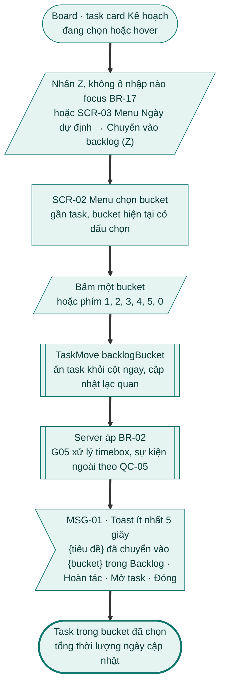

### Nhánh thay thế

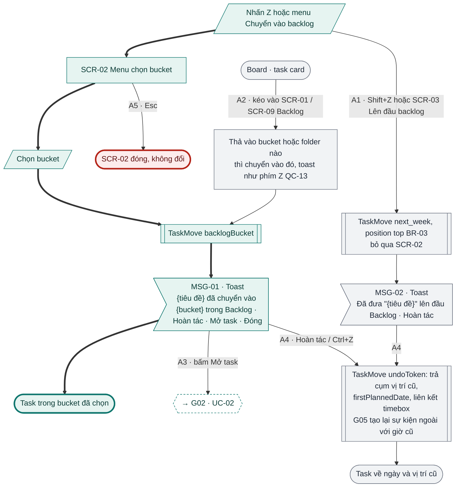

### Nhánh lỗi

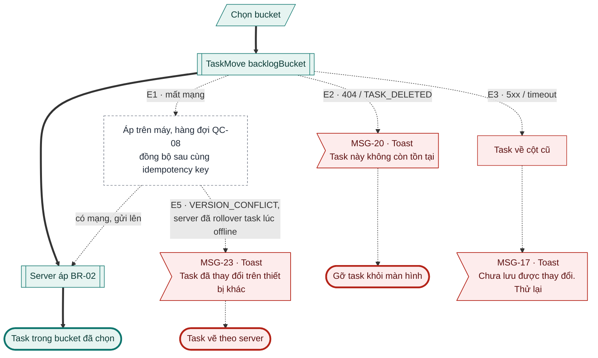

### Đối chiếu

| Mã | Điều kiện | Kết thúc ở | Thông báo |
|---|---|---|---|
| A1 | Shift+Z / Lên đầu backlog | Đầu bucket Tuần tới | MSG-02 |
| A2 | Kéo vào trang / panel Backlog | Bucket / folder nơi thả, toast có Hoàn tác (A2 chốt 09/11/2026) | MSG-01 |
| A3 | Bấm Mở task | Chi tiết task → [G02 UC-02](g02-quan-ly-task.md#uc-02-xem-và-sửa-chi-tiết-task) | – |
| A4 | Hoàn tác trên MSG-01 / MSG-02 / Ctrl+Z | Cụm vị trí cũ, timebox, sự kiện ngoài tạo lại | – |
| A5 | Esc khi SCR-02 mở | Không đổi | – |
| E1 | Mất mạng | Hàng đợi, đồng bộ sau | – |
| E2 | Task đã bị xoá ở thiết bị khác | Gỡ khỏi màn hình | MSG-20 |
| E3 | 5xx / timeout | Task về cột cũ | MSG-17 |
| E4 | Workspace chỉ đọc | Bỏ (1.1) | – |
| E5 | VERSION_CONFLICT (lệnh offline trên phiên bản cũ) | Vẽ theo server | MSG-23 |

---

## UC-02 Xem và tổ chức backlog

**Mở đầu:** người dùng đã đăng nhập. **Thành công:** backlog hiển thị theo bucket; folder / task mới được lưu. **Thất bại:** dữ liệu trên máy kèm lỗi tải.

### Happy case

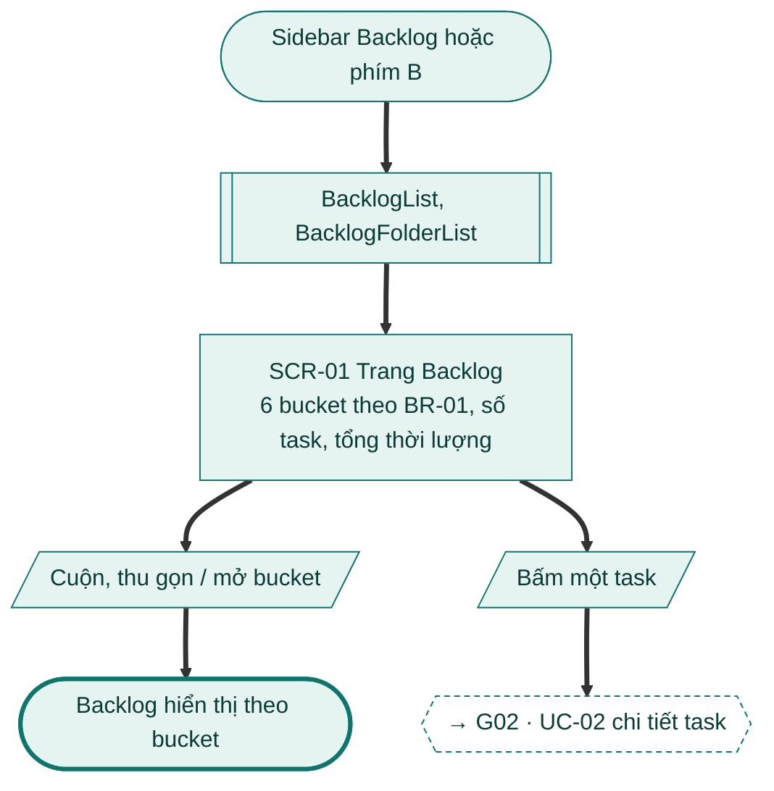

### Nhánh thay thế và lỗi: xem và sắp xếp

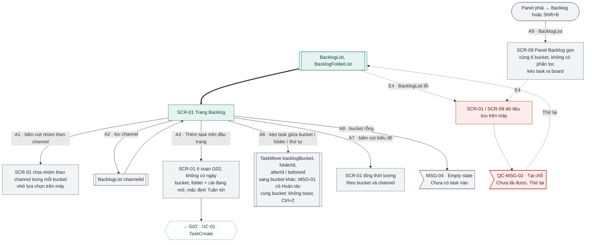

### Nhánh thay thế và lỗi: folder

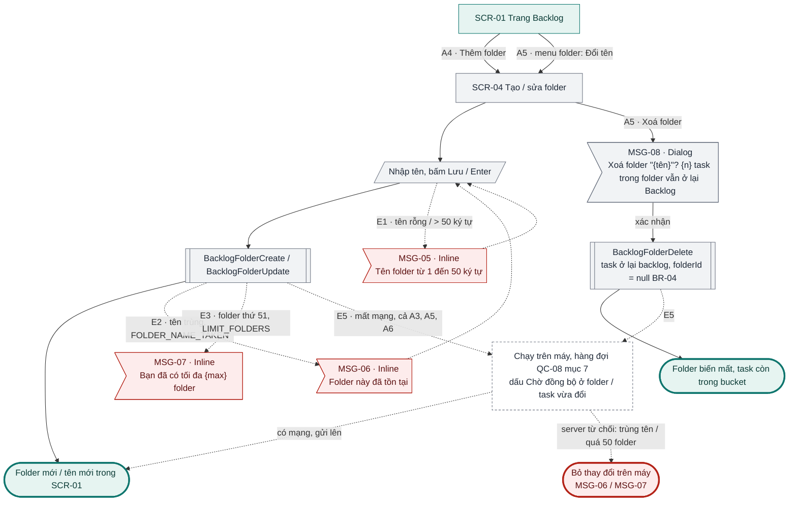

### Đối chiếu

| Mã | Điều kiện | Kết thúc ở | Thông báo |
|---|---|---|---|
| A1 | Nhóm theo channel | Nhóm trong bucket, nhớ trên máy | – |
| A2 | Lọc channel | Danh sách lọc | – |
| A3 | Thêm task | Ô soạn không ngày → [G02 UC-01](g02-quan-ly-task.md#uc-01-tạo-task) | – |
| A4 | Thêm folder | SCR-04 → folder mới | – |
| A5 | Đổi tên / xoá folder | SCR-04; xoá: hộp xác nhận, task ở lại backlog | MSG-08 |
| A6 | Kéo task giữa bucket / folder / thứ tự | Vị trí mới; sang bucket khác có toast Hoàn tác, cùng bucket thì không (QC-13) | MSG-01 (sang bucket khác) |
| A7 | Nút biểu đồ | Tổng thời lượng theo bucket, channel | – |
| A8 | Bucket rỗng | Empty state | MSG-04 |
| A9 | Shift+B / panel phải → Backlog | SCR-09 Panel Backlog gọn (C09) | – |
| E1 | Tên folder rỗng / > 50 ký tự | Chặn | MSG-05 |
| E2 | Tên folder trùng | Chặn | MSG-06 |
| E3 | Folder thứ 51 | Chặn | MSG-07 |
| E4 | BacklogList lỗi | Dữ liệu trên máy, Thử lại | QC-MSG-02 |
| E5 | Mất mạng khi thêm task, sửa folder, kéo task | Chạy trên máy, Chờ đồng bộ, gửi lên khi có mạng (QC-08 mục 7) | MSG-06 / MSG-07 nếu server từ chối |

---

## UC-03 Đưa task từ backlog ra ngày

**Mở đầu:** task ở Backlog. **Thành công:** task Kế hoạch trên ngày D, tổng thời lượng ngày D cập nhật. **Thất bại:** task ở lại bucket.

### Happy case

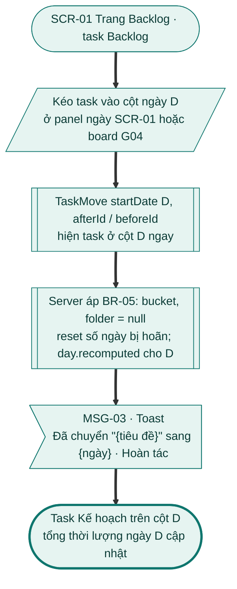

### Nhánh thay thế và lỗi

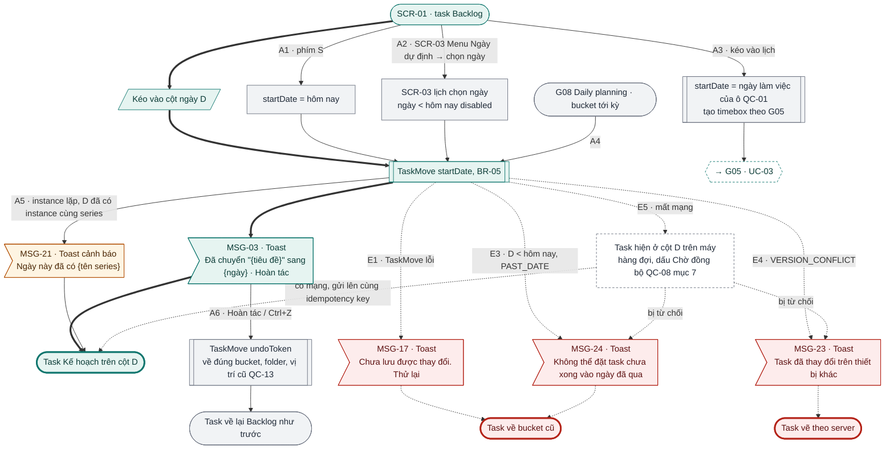

### Đối chiếu

| Mã | Điều kiện | Kết thúc ở | Thông báo |
|---|---|---|---|
| A1 | Phím S | Hôm nay | MSG-03 |
| A2 | Menu Ngày dự định → chọn ngày | Ngày chọn | MSG-03 |
| A3 | Kéo vào lịch | Ngày của ô, timebox → [G05 UC-03](g05-lich-timebox.md#uc-03-timebox-task-bằng-kéo-thả) | – |
| A4 | Ritual đưa task tới kỳ ra ngày | Như luồng chính → [G08 UC-01](g08-daily-rituals.md#uc-01-daily-planning-luồng-thủ-công); phần G09 Weekly planning (1.1): Bỏ (1.1) | – |
| A5 | Instance lặp, D đã có instance cùng series | Vẫn đặt, cảnh báo | MSG-21 |
| A6 | Hoàn tác / Ctrl+Z | Về đúng bucket, folder, vị trí cũ (QC-13 mục 5) | – |
| E1 | TaskMove lỗi | Về bucket cũ | MSG-17 |
| E2 | Workspace chỉ đọc | Bỏ (1.1) | – |
| E3 | D < hôm nay | Về bucket cũ | MSG-24 |
| E4 | VERSION_CONFLICT | Vẽ theo server | MSG-23 |
| E5 | Mất mạng | Cột D trên máy, Chờ đồng bộ, gửi lên khi có mạng (QC-08 mục 7) | – |

---

## UC-04 Rollover hằng ngày (job `rollover`)

**Mở đầu:** job hệ thống; người dùng vừa qua mốc đầu ngày, chưa có lượt `XONG` cho ngày đó, không ở `CHO_SHUTDOWN`. **Thành công:** mọi task Kế hoạch ngày cũ ở hôm nay hoặc ở Lưu trữ; lượt `XONG`. **Thất bại:** không task nào đổi (rollback); lượt `LOI` hoặc `THAT_BAI`.

### Happy case

```mermaid
flowchart TD
  start(["Job rollover lúc mốc đầu ngày<br/>chạy mỗi 15 phút, người dùng vừa qua mốc QC-01"])
  p1[["Chọn người dùng chưa có lượt XONG BR-13<br/>không THAT_BAI, không lượt DANG_CHAY còn lease"]]
  p2[["Không có phiên shutdown ngày cũ BR-20<br/>rollover_runs = DANG_CHAY, leaseUntil = now + 5 phút"]]
  p3[["Lấy task Kế hoạch có startDate < hôm nay BR-06<br/>nhóm instance lặp theo series, áp BR-11 trước<br/>xem G03 UC-06"]]
  p4[["Một giao dịch: BR-07 startDate = hôm nay,<br/>BR-08 priority về Normal, BR-09 timebox<br/>tăng version từng task"]]
  p5[["Áp BR-12 cho task bị hoãn ≥ ngưỡng · UC-05"]]
  p6[["Nhật ký system BR-16<br/>rollover_runs = XONG kèm số liệu"]]
  p7[["Phát task.upserted, day.recomputed<br/>G05 gỡ liên kết timebox quá khứ, bất đồng bộ"]]
  m1>"MSG-09 · Tooltip trên SCR-07 nhãn Dời {n} ngày<br/>Dời {n} ngày · dự định từ {ngày dự định đầu tiên}"]
  ok(["Board hôm nay: task dở ở đầu / cuối danh sách,<br/>sau instance lặp hôm nay, có SCR-07 nhãn Dời {n} ngày"])

  start ==> p1 ==> p2 ==> p3 ==> p4 ==> p5 ==> p6 ==> p7 ==> m1 ==> ok

  class start,p1,p2,p3,p4,p5,p6,p7,m1 happy
  class ok done
  classDef happy fill:#E6F4F1,stroke:#0F766E,color:#0B3B36
  classDef alt fill:#F1F3F5,stroke:#6B7280,color:#1F2937
  classDef err fill:#FDECEC,stroke:#B42318,color:#5C1010
  classDef warn fill:#FEF4E2,stroke:#B45309,color:#4A2604
  classDef ai fill:#F1ECFD,stroke:#6D28D9,color:#2E1065
  classDef sync fill:#FFFFFF,stroke:#6B7280,stroke-dasharray:4 3,color:#1F2937
  classDef link fill:#FFFFFF,stroke:#0F766E,stroke-dasharray:4 3,color:#0B3B36
  classDef done fill:#E6F4F1,stroke:#0F766E,stroke-width:3px,color:#0B3B36
  classDef fail fill:#FDECEC,stroke:#B42318,stroke-width:3px,color:#5C1010
```

### Nhánh thay thế

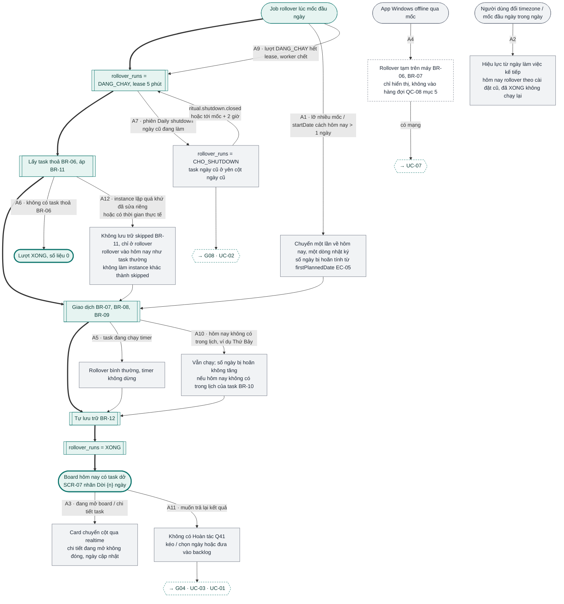

### Nhánh lỗi

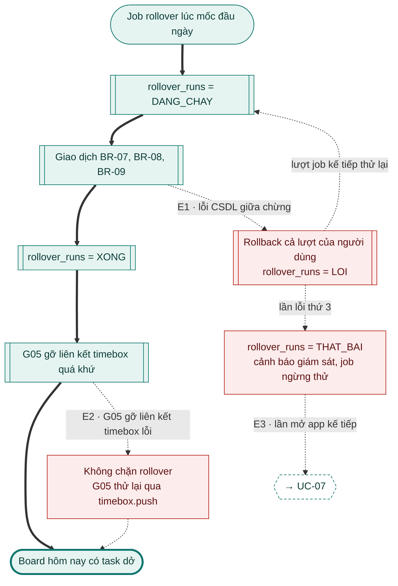

### Đối chiếu

| Mã | Điều kiện | Kết thúc ở | Thông báo |
|---|---|---|---|
| A1 | Lỡ nhiều mốc | Chuyển một lần, số ngày bị hoãn đủ | – |
| A2 | Đổi timezone / mốc đầu ngày | Hiệu lực ngày kế tiếp | – |
| A3 | Đang mở board / chi tiết | Cập nhật qua realtime | – |
| A4 | Client offline qua mốc | Rollover tạm trên máy → [UC-07](#uc-07-đảm-bảo-rollover-theo-yêu-cầu-rolloverensure) | – |
| A5 | Task đang chạy timer | Rollover, timer không dừng | – |
| A6 | Không có task thoả BR-06 | Lượt `XONG`, số liệu 0 | – |
| A7 | Phiên Daily shutdown ngày cũ đang làm | `CHO_SHUTDOWN` → [G08 UC-02](g08-daily-rituals.md#uc-02-daily-shutdown) | – |
| A8 | Workspace chỉ đọc | Bỏ (1.1) | – |
| A9 | Lượt `DANG_CHAY` hết lease | Nhận lại, chạy từ bước 2 | – |
| A10 | Hôm nay không có trong lịch | Vẫn chạy, n không tăng | – |
| A11 | Muốn trả lại kết quả | Không Hoàn tác → [G04 UC-03](g04-board-ngay.md#uc-03-di-chuyển-task-giữa-các-ngày), [UC-01](#uc-01-chuyển-task-vào-backlog) | – |
| A12 | Instance lặp quá khứ đã sửa riêng / có thời gian thực tế | Không `skipped`, rollover vào hôm nay như task thường kể cả khi đã có instance cùng series; không làm instance khác thành `skipped`; chỉ ở rollover (B08, ngoại lệ QC-06) | – |
| E1 | Lỗi CSDL | Rollback, `LOI`, lần 3 `THAT_BAI` | – |
| E2 | G05 gỡ timebox lỗi | Không chặn, G05 thử lại | – |
| E3 | `THAT_BAI` | Chạy bù khi mở app → [UC-07](#uc-07-đảm-bảo-rollover-theo-yêu-cầu-rolloverensure) | – |

Instance lặp trong rollover (BR-11): xem [G03 UC-06](g03-task-lap-lai.md#uc-06-xử-lý-instance-trùng-series-trong-một-ngày-qc-06-rollover-g06-phím-d-g04-shutdown-g08).

---

## UC-05 Tự lưu trữ (trong job `rollover`)

**Mở đầu:** job rollover, sau UC-04 bước 4; task có số ngày bị hoãn ≥ 4 (ngưỡng cố định), Tự lưu trữ bật, task không có hoạt động. **Thành công:** task ở Lưu trữ, không còn trên hôm nay. **Thất bại:** như UC-04 (rollback cả lượt).

### Happy case

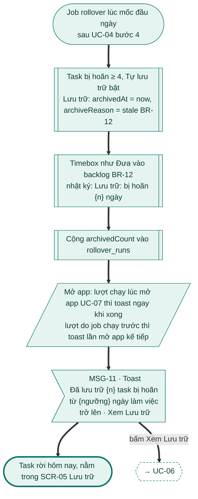

### Nhánh thay thế

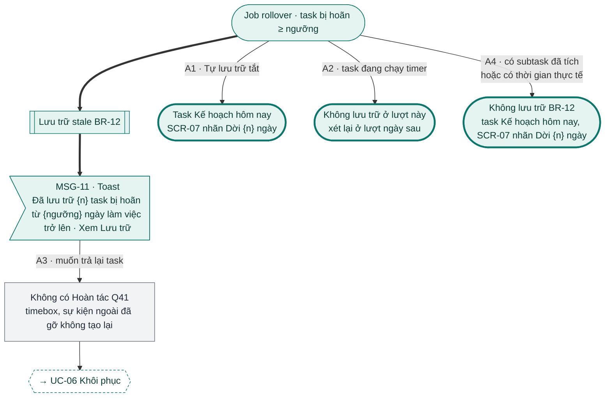

### Đối chiếu

| Mã | Điều kiện | Kết thúc ở | Thông báo |
|---|---|---|---|
| A1 | Tự lưu trữ tắt | Kế hoạch hôm nay, nhãn "Dời {n} ngày" | – |
| A2 | Task đang chạy timer | Không lưu trữ lượt này | – |
| A3 | Muốn trả lại task | Không Hoàn tác → [UC-06](#uc-06-xem-lưu-trữ-khôi-phục-và-xoá-tất-cả) | – |
| A4 | Task có subtask đã tích / thời gian thực tế | Không lưu trữ, Kế hoạch hôm nay (B11) | – |
| (lỗi) | Không có E#; lỗi lượt xử lý như UC-04 E1 | Rollback cả lượt | – |

---

## UC-06 Xem Lưu trữ, khôi phục và xoá tất cả

**Mở đầu:** người dùng đã đăng nhập. **Thành công:** khôi phục → task Kế hoạch hôm nay (hoặc vào Backlog), số ngày bị hoãn = 0; xoá tất cả → mọi task Lưu trữ vào Thùng rác; toggle Tự lưu trữ được lưu. **Thất bại:** Lưu trữ không đổi.

### Happy case

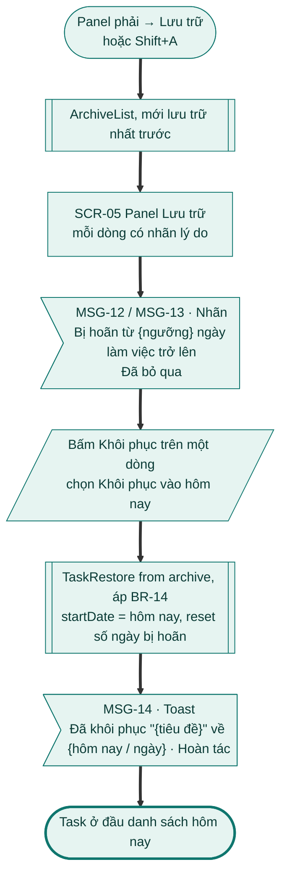

### Nhánh thay thế

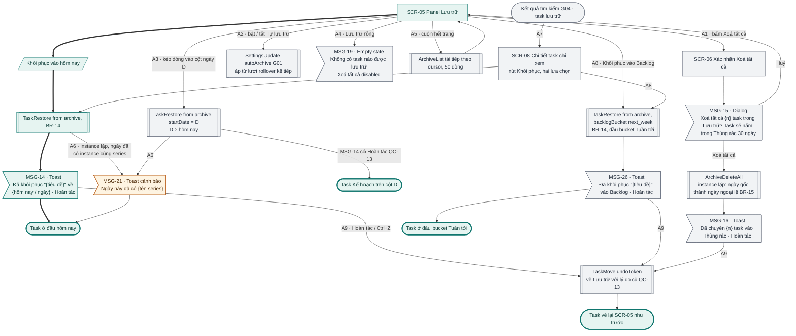

### Nhánh lỗi

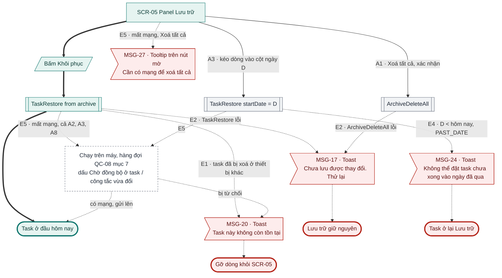

### Đối chiếu

| Mã | Điều kiện | Kết thúc ở | Thông báo |
|---|---|---|---|
| A1 | Xoá tất cả | SCR-06 → mọi task Lưu trữ vào Thùng rác | MSG-15, MSG-16 |
| A2 | Bật / tắt Tự lưu trữ | Áp từ lượt rollover kế tiếp | – |
| A3 | Kéo dòng vào cột ngày D | Task Kế hoạch trên D, toast Hoàn tác (QC-13) | MSG-14 |
| A4 | Lưu trữ rỗng | Empty state, Xoá tất cả disabled | MSG-19 |
| A5 | Cuộn hết trang | Tải thêm 50 dòng | – |
| A6 | Khôi phục instance vào ngày đã có instance cùng series | Vẫn khôi phục | MSG-21 |
| A7 | Mở task lưu trữ từ tìm kiếm | SCR-08 chi tiết chỉ xem → Khôi phục ([G04 UC-07](g04-board-ngay.md#uc-07-tìm-kiếm-task)) | MSG-14 / MSG-26 |
| A8 | Khôi phục vào Backlog | Đầu bucket Tuần tới (B12) | MSG-26 |
| A9 | Hoàn tác trên MSG-14 / MSG-26 / MSG-16 | Về lại Lưu trữ với lý do cũ (QC-13 mục 5) | – |
| E1 | Task đã bị xoá ở thiết bị khác | Gỡ dòng | MSG-20 |
| E2 | TaskRestore / ArchiveDeleteAll lỗi | Lưu trữ giữ nguyên | MSG-17 |
| E3 | Workspace chỉ đọc | Bỏ (1.1) | – |
| E4 | D < hôm nay | Ở lại Lưu trữ | MSG-24 |
| E5 | Mất mạng | Khôi phục, Tự lưu trữ: chạy trên máy, Chờ đồng bộ, gửi lên khi có mạng; Xoá tất cả: nút mờ (QC-08 mục 7) | MSG-27 (Xoá tất cả) |

---

## UC-07 Đảm bảo rollover theo yêu cầu (\[RolloverEnsure\])

**Mở đầu:** client mở app lần đầu trong ngày làm việc (G04), hoặc G08 chuẩn bị tải bước "Xem lại hôm qua". **Thành công:** trả trạng thái lượt rollover hôm nay; chạy được thì `XONG` và board nhận kết quả. **Thất bại:** trả lỗi, dữ liệu task không đổi.

### Happy case

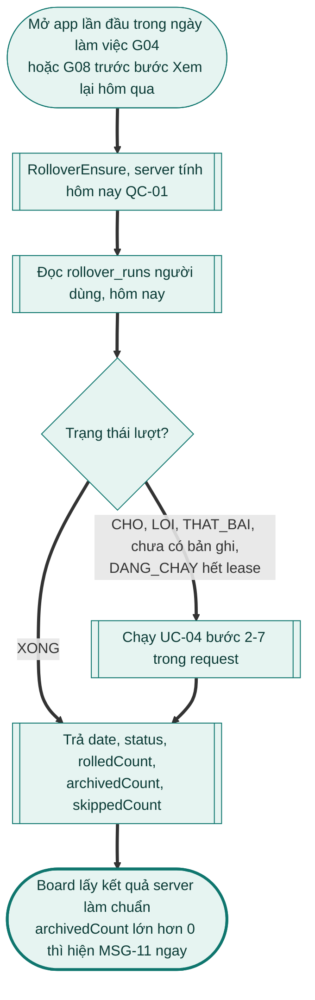

### Nhánh thay thế và lỗi

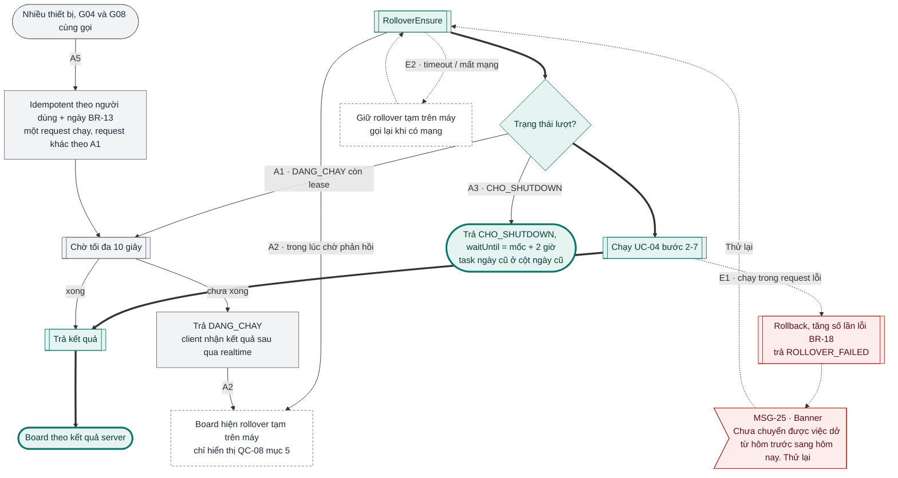

### Đối chiếu

| Mã | Điều kiện | Kết thúc ở | Thông báo |
|---|---|---|---|
| A1 | `DANG_CHAY` còn lease | Chờ ≤ 10 giây; chưa xong trả `DANG_CHAY` | – |
| A2 | Đang chờ / nhận `DANG_CHAY` | Rollover tạm trên máy | – |
| A3 | `CHO_SHUTDOWN` | Không ép chạy, task ngày cũ ở cột cũ | – |
| A4 | Workspace chỉ đọc (`DONG_BANG`) | Bỏ (1.1) | – |
| A5 | Gọi lặp nhiều lần | Idempotent, chỉ một request chạy | – |
| E1 | Chạy trong request lỗi | Rollback, Thử lại | MSG-25 |
| E2 | Timeout / mất mạng | Giữ rollover tạm, gọi lại khi có mạng | – |

## Kiểm tra

- [x] Mọi A# / E# của UC-01 … UC-07 bản 1.0 có trên sơ đồ hoặc ghi "Bỏ (1.1)".
- [x] Mọi nút màn hình có mã SCR; mọi nút thông báo có mã MSG.

**Ghi chú cho brief G06**
- ~~MSG-01 (toast sau Z) không có "Hoàn tác" trong khi BR-17 nói Z luôn có toast Hoàn tác~~ **Đã sửa 09/11/2026 (B06):** MSG-01 thêm "Hoàn tác"; UC-01 bước 6, A4 và sơ đồ UC-01 sửa theo.
- ~~Lỗi `ROLLOVER_FAILED` có hai thông báo cùng chữ (G06 MSG-25, G04 MSG-27), G08 lại hiện MSG-32 khi `THAT_BAI`~~ **Đã sửa trước 09/11/2026 (F2, BR-24):** chỉ một banner MSG-25 ở mọi nơi; G04 MSG-27 dùng đúng nội dung này; MSG-32 chỉ cho trạng thái đang chờ.
- ~~UC-07 E1 trả `ROLLOVER_FAILED` nhưng API cũng trả `status = THAT_BAI`; chưa rõ giao diện khác nhau thế nào~~ **Đã sửa trước 09/11/2026 (F2, BR-24 b):** `ROLLOVER_FAILED` và `THAT_BAI` hiển thị như nhau, banner MSG-25 có "Thử lại".
- ~~UC-02 E4 dùng MSG-17 (câu lỗi lưu) cho lỗi tải BacklogList~~ **Đã sửa 09/11/2026 (C07, A1):** UC-02 E4 dùng QC-MSG-02 "Chưa tải được. Thử lại" tại chỗ; MSG-17 trỏ về QC-MSG-01.
- ~~MSG-14, MSG-16, MSG-03 có "Hoàn tác" nhưng không A# nào nói Hoàn tác làm gì~~ **Đã sửa 09/11/2026 (A10):** thêm UC-03 A6 (về đúng bucket, folder, vị trí cũ) và UC-06 A9 (về lại Lưu trữ với lý do cũ); BR-14, BR-15 ghi rõ. Đã vẽ.
- ~~UC-01 A2 (kéo vào Backlog) và UC-03 (kéo ra ngày) không nói có toast / Hoàn tác~~ **Đã sửa 09/11/2026 (A2):** kéo vào Backlog có MSG-01, kéo ra ngày có MSG-03, kéo từ Lưu trữ ra ngày có MSG-14, kéo sang bucket khác có MSG-01; cùng bucket thì không toast (BR-17, QC-13 mục 2).
- ~~MSG-11 viết "từ {ngưỡng} ngày", MSG-12 viết "từ {ngưỡng} ngày làm việc"~~ **Đã sửa 09/11/2026 (C06):** MSG-11 viết "ngày làm việc" như MSG-12.
- ~~UC-06 A7 mở "chi tiết ở chế độ xem" nhưng không có mã SCR~~ **Đã sửa 09/11/2026 (C08):** thêm SCR-08 Chi tiết task chỉ xem, có nút "Khôi phục" hai lựa chọn.
- ~~UC-05 bước 4: lượt chạy trong \[RolloverEnsure\] lúc mở app thì MSG-11 hiện ngay hay đợi lần mở sau~~ **Đã sửa 09/11/2026 (B07):** hiện ngay khi lượt chạy xong; lượt do job chạy trước thì hiện lần mở app kế tiếp (UC-05 bước 4, UC-07 bước 5).
- ~~UC-03 A4 gộp G08 (1.0) và G09 Weekly planning (1.1)~~ **Đã sửa 09/11/2026 (A9):** SRS ghi "G09 Weekly planning (1.1)"; sơ đồ chỉ vẽ G08.
- ~~IA có panel Backlog gọn (Shift+B) nhưng SRS chỉ có SCR-01~~ **Đã sửa 09/11/2026 (C09):** thêm SCR-09 Panel Backlog gọn (cùng bucket với SCR-01, bỏ phần lọc) và UC-02 A9.
- Mới 09/11/2026 (A6): thêm nhánh mất mạng UC-02 E5, UC-03 E5, UC-06 E5 (chạy trên máy, dấu "Chờ đồng bộ"). "Xoá tất cả" khi mất mạng: nút mờ, MSG-27 `[giả định]`.
- Mới 09/11/2026 (B08, B09, B11, B12): instance lặp đã sửa riêng / có thời gian thực tế không bị `skipped` (UC-04 A12); MSG-13 thành "Đã bỏ qua"; task có hoạt động không bị tự lưu trữ (UC-05 A4); khôi phục vào Backlog (UC-06 A8, MSG-26). Bucket đích khi khôi phục vào Backlog vẫn là `[giả định]` ("Tuần tới", đầu bucket).
