# Flow G07 Focus và theo dõi thời gian

> **Nguồn:** [srs-g07](../../features/srs-g07-focus-timer.md) (commit `8fac830`, cập nhật theo chốt 09/11/2026) · **Brief:** `[chờ]`
> **Quy ước:** [_quy-uoc.md](_quy-uoc.md) · **FigJam:** `[chờ]`

## Mục lục

| UC | Flow | Màn chính | Nhánh A / E (1.0) |
|---|---|---|---|
| [UC-01](#uc-01-bật-timer) | Bật timer | SCR-01 Điều khiển timer | 5 / 3 |
| [UC-02](#uc-02-dừng-timer) | Dừng timer | SCR-01 | 4 / 3 |
| [UC-03](#uc-03-nhập-sửa-xoá-thời-gian-thực-tế) | Nhập, sửa, xoá thời gian thực tế | SCR-02 Thời gian thực tế | 6 / 4 |
| [UC-04](#uc-04-focus-mode-và-âm-báo) | Focus mode và âm báo | SCR-03 Focus mode | 4 / 2 |
| UC-05 | Pomodoro và nghỉ | SCR-04, SCR-05 | Bỏ (1.1) |
| [UC-06](#uc-06-giám-sát-timer-chạy-lâu-job-timerwatchdog) | Giám sát timer chạy lâu (hệ thống) | SCR-06 Xác nhận giờ dừng | 6 / 2 |
| [UC-07](#uc-07-đồng-bộ-timer-nhiều-thiết-bị-và-offline) | Đồng bộ timer nhiều thiết bị và offline (hệ thống) | SCR-01 | 6 / 2 |
| UC-08 | Focus Bar | SCR-07 | Bỏ (1.2) |

---

## UC-01 Bật timer

**Mở đầu:** task cha thoả BR-02 (không ở `DA_XOA`, `LUU_TRU`) trên card hoặc trong chi tiết task. **Thành công:** timer `DANG_CHAY` trên task, timer cũ (nếu có) đã đóng, mọi thiết bị nhận `timer.changed`. **Thất bại:** timer giữ như trước.

### Happy case

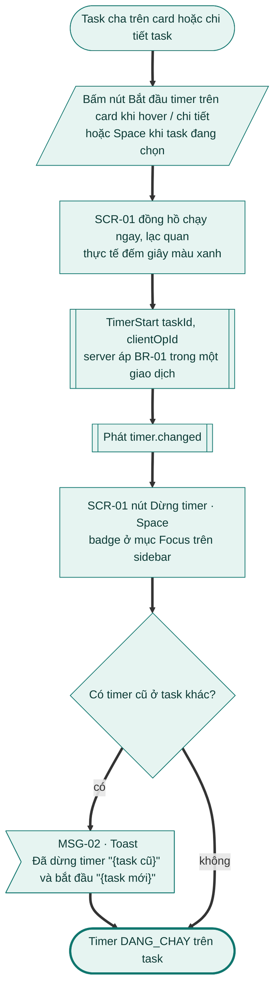

### Nhánh thay thế và lỗi

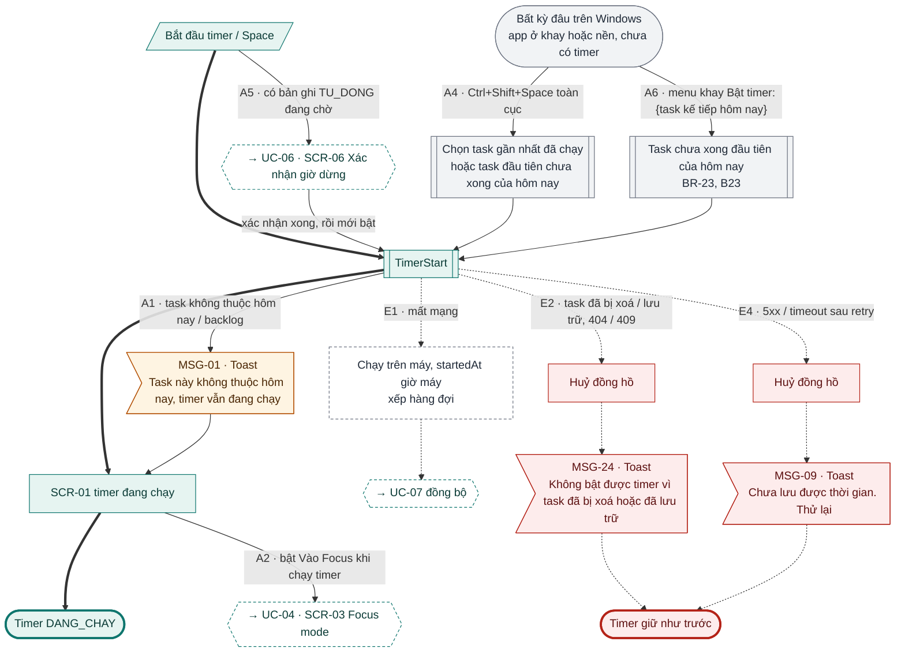

### Đối chiếu

| Mã | Điều kiện | Kết thúc ở | Thông báo |
|---|---|---|---|
| A1 | Task không thuộc hôm nay / backlog | Vẫn chạy, không đổi ngày task | MSG-01 |
| A2 | Bật "Vào Focus khi chạy timer" | SCR-03 → [UC-04](#uc-04-focus-mode-và-âm-báo) | – |
| A3 | (SRS đã bỏ) | – | – |
| A4 | Ctrl+Shift+Space toàn cục, chưa có timer | Timer task gần nhất / task đầu tiên chưa xong hôm nay; đang có timer thì phím này dừng → [UC-02](#uc-02-dừng-timer) (C25) | – |
| A6 | Menu khay "Bật timer: {task kế tiếp hôm nay}" (B23) | Timer task chưa xong đầu tiên của hôm nay | – |
| A5 | Có bản ghi `TU_DONG` chờ | SCR-06 trước → [UC-06](#uc-06-giám-sát-timer-chạy-lâu-job-timerwatchdog), rồi bật | MSG-20 |
| E1 | Mất mạng | Chạy trên máy, hàng đợi → [UC-07](#uc-07-đồng-bộ-timer-nhiều-thiết-bị-và-offline) | – |
| E2 | Task đã xoá / lưu trữ | Huỷ đồng hồ | MSG-24 (C28) |
| E3 | Workspace chỉ đọc | Bỏ (1.1) | – |
| E4 | 5xx / timeout sau retry | Huỷ đồng hồ | MSG-09 |

---

## UC-02 Dừng timer

**Mở đầu:** timer `DANG_CHAY` hoặc `CHAY_LAU`; dừng từ card, chi tiết, Focus, hoặc Ctrl+Shift+Space và menu khay (C25). **Thành công:** bản ghi thời gian đóng (BR-04), thực tế cộng dồn, block thực tế hiện trên lịch (G05). **Thất bại:** timer vẫn chạy.

### Happy case

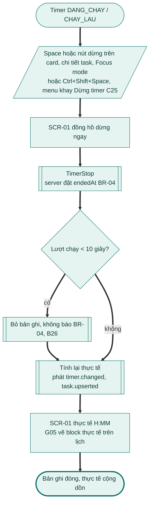

### Nhánh thay thế và lỗi

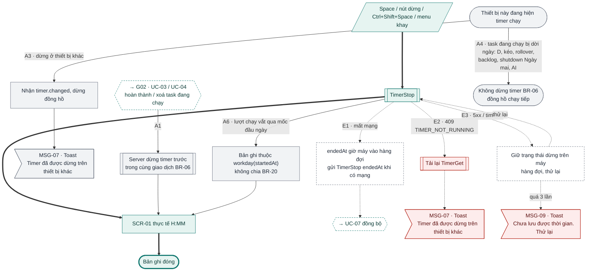

### Đối chiếu

| Mã | Điều kiện | Kết thúc ở | Thông báo |
|---|---|---|---|
| A1 | Hoàn thành / xoá task đang chạy | Timer dừng trước, rồi [G02 UC-03](g02-quan-ly-task.md#uc-03-hoàn-thành--bỏ-hoàn-thành-task) / [UC-04](g02-quan-ly-task.md#uc-04-xoá-hoàn-tác-và-khôi-phục-task) xử lý | Theo G02 |
| A2 | Vào nghỉ / hết phiên Pomodoro | Bỏ (1.1) | – |
| A3 | Dừng ở thiết bị khác | Đồng hồ dừng | MSG-07 |
| A4 | Task đang chạy bị dời ngày | Timer chạy tiếp | – |
| A5 | Workspace vào chỉ đọc | Bỏ (1.1) | – |
| A6 | Vắt qua mốc đầu ngày | Bản ghi thuộc ngày bắt đầu | – |
| E1 | Mất mạng | Hàng đợi → [UC-07](#uc-07-đồng-bộ-timer-nhiều-thiết-bị-và-offline) | – |
| E2 | `TIMER_NOT_RUNNING` | Tải lại timer | MSG-07 |
| E3 | 5xx / timeout | Dừng trên máy, thử lại; quá 3 lần báo lỗi | MSG-09 |

---

## UC-03 Nhập, sửa, xoá thời gian thực tế

**Mở đầu:** task không ở `DA_XOA`. **Thành công:** bản ghi được thêm / sửa / xoá, thực tế tính lại, nhật ký ghi (BR-18). **Thất bại:** bản ghi không đổi, lỗi tại ô.

### Happy case

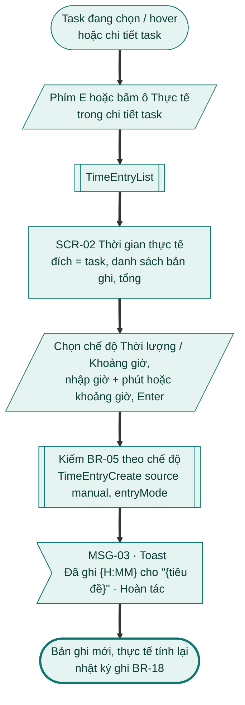

### Nhánh thay thế và lỗi

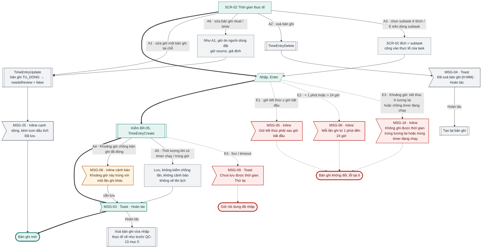

### Đối chiếu

| Mã | Điều kiện | Kết thúc ở | Thông báo |
|---|---|---|---|
| (bước 4) | Hoàn tác trên MSG-03 | Xoá bản ghi vừa nhập (C29) | MSG-03 |
| A1 | Sửa giờ một bản ghi | Bản ghi cập nhật; `TU_DONG` hết chờ xác nhận | MSG-25 (C29) |
| A2 | Xoá bản ghi | Xoá cứng, Hoàn tác tạo lại | MSG-04 |
| A3 | Nhập cho subtask | Đích = subtask | MSG-03 |
| A4 | Khoảng giờ chồng bản ghi đã đóng | Vẫn lưu | MSG-08 |
| A5 | Thời lượng khi đang có timer / trùng giờ | Lưu, không cảnh báo, không lên lịch | MSG-03 |
| A6 | Sửa bản ghi `ritual` / `timer` | Như A1, giữ `source` `[giả định]` | – |
| E1 | Giờ kết thúc ≤ giờ bắt đầu | Không lưu | MSG-05 |
| E2 | < 1 phút hoặc > 24 giờ | Không lưu | MSG-06 |
| E3 | Kết thúc ở tương lai / chồng timer đang chạy | Không lưu | MSG-18 |
| E4 | 5xx / timeout | Giữ nội dung đã nhập | MSG-09 |
| E5 | Workspace chỉ đọc | Bỏ (1.1) | – |

---

## UC-04 Focus mode và âm báo

**Mở đầu:** người dùng đã đăng nhập; không có task để focus thì đi nhánh A3 (C26). **Thành công:** Focus mode hiện một task, điều khiển timer được từ Focus. **Thất bại:** ở lại màn hiện tại.

### Happy case

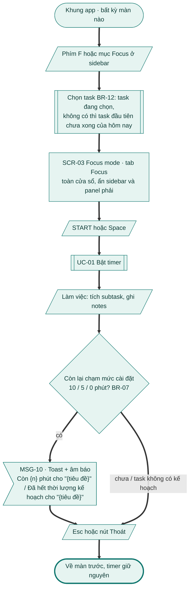

### Nhánh thay thế và lỗi

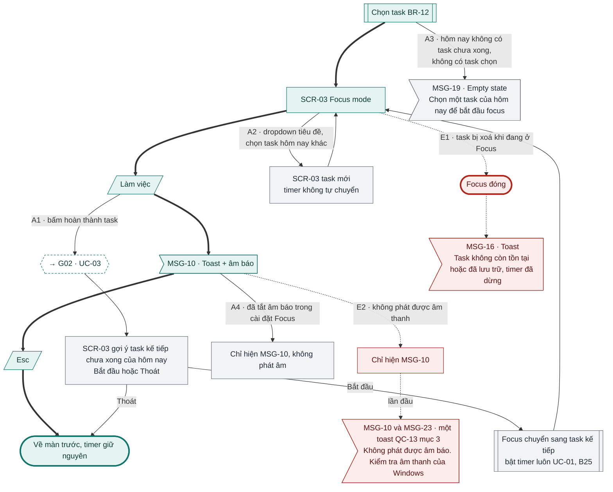

### Đối chiếu

| Mã | Điều kiện | Kết thúc ở | Thông báo |
|---|---|---|---|
| A1 | Hoàn thành task trong Focus | [G02 UC-03](g02-quan-ly-task.md#uc-03-hoàn-thành--bỏ-hoàn-thành-task), gợi ý task kế tiếp; "Bắt đầu" chuyển task và bật timer luôn (B25) | Theo G02 |
| A2 | Đổi task trong Focus | Task mới, timer không tự chuyển | – |
| A3 | Không có task để focus | Empty state | MSG-19 |
| A4 | Tắt âm báo | Chỉ toast | MSG-10 |
| E1 | Task bị xoá khi ở Focus | Đóng Focus | MSG-16 |
| E2 | Không phát được âm thanh | Chỉ toast; lần đầu thêm dòng gợi ý kiểm tra âm thanh (C27) | MSG-10, lần đầu MSG-10 + MSG-23 (một toast) |

Tab Pomodoro, nút "Nghỉ một chút (K)" trên SCR-03: Bỏ (1.1).

---

## UC-06 Giám sát timer chạy lâu (job `timer.watchdog`)

**Mở đầu:** có bản ghi thời gian `endedAt` trống. SCR-06 hiện ngay nếu cửa sổ app đang mở, hoặc lần đầu cửa sổ được mở lên nếu app đang ở khay (B24). **Thành công:** timer > 4 giờ được nhắc đúng một lần; timer > 24 giờ tự đóng và chờ xác nhận, người dùng chọn giờ dừng thật. **Thất bại:** lượt sau xử lý lại (idempotent).

### Happy case

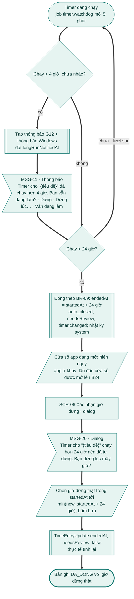

### Nhánh thay thế và lỗi

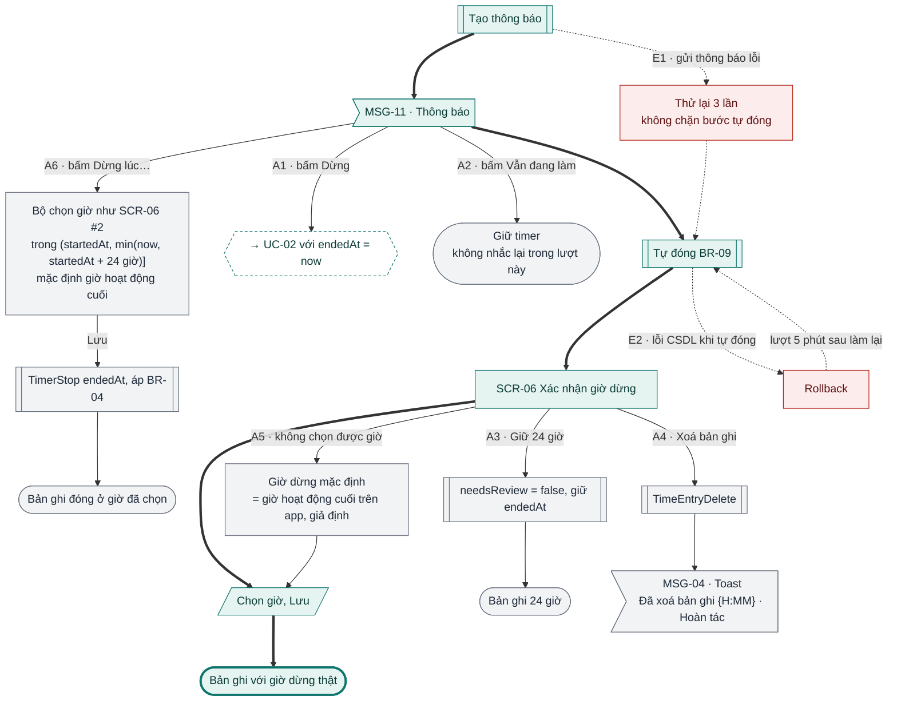

### Đối chiếu

| Mã | Điều kiện | Kết thúc ở | Thông báo |
|---|---|---|---|
| A1 | Bấm "Dừng" trong MSG-11 | [UC-02](#uc-02-dừng-timer), `endedAt` = now | – |
| A2 | Bấm "Vẫn đang làm" | Timer chạy tiếp, không nhắc lại lượt này | – |
| A3 | SCR-06 "Giữ 24 giờ" | Bản ghi 24 giờ | – |
| A4 | SCR-06 "Xoá bản ghi" | Bản ghi xoá | MSG-04 |
| A5 | SCR-06 không chọn được giờ | Mặc định giờ hoạt động cuối `[giả định]` | – |
| A6 | Bấm "Dừng lúc…" trong MSG-11 | Bộ chọn giờ, cùng khoảng với SCR-06 (B24) → TimerStop | – |
| E1 | Gửi thông báo lỗi | Thử lại 3 lần, vẫn tự đóng | – |
| E2 | Lỗi CSDL khi tự đóng | Rollback, lượt sau làm lại | – |

Thông báo MSG-11 nằm ở trung tâm thông báo [G12 UC-09](g12-workspace-billing.md); push di động: Bỏ (1.2).

---

## UC-07 Đồng bộ timer nhiều thiết bị và offline

**Mở đầu:** người dùng dùng ≥ 2 thiết bị, hoặc một thiết bị vừa có mạng lại sau khi bật / dừng timer offline. **Thành công:** mọi thiết bị hiện cùng một timer, dữ liệu thoả BR-01. **Thất bại:** thiết bị giữ trạng thái cục bộ, thử lại ở lần kết nối sau.

### Happy case

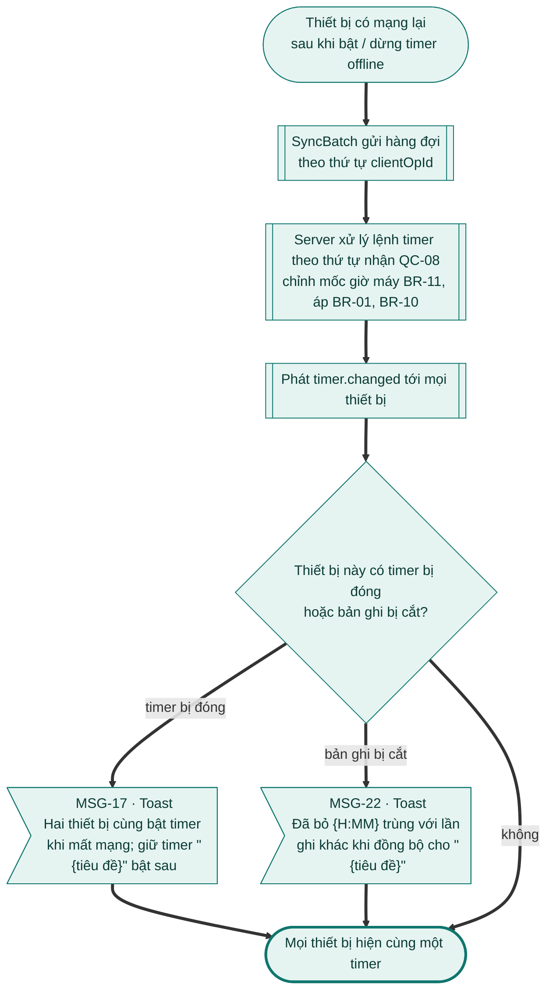

### Nhánh thay thế và lỗi

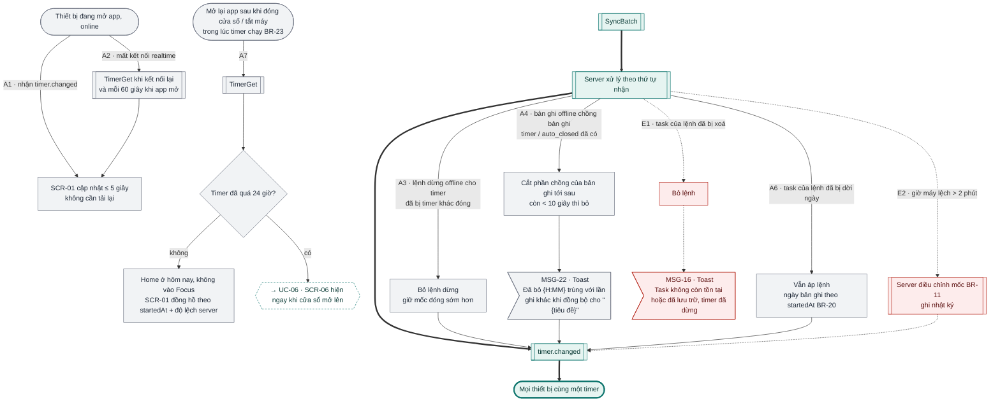

### Đối chiếu

| Mã | Điều kiện | Kết thúc ở | Thông báo |
|---|---|---|---|
| A1 | Thiết bị online nhận `timer.changed` | Cập nhật ≤ 5 giây | – |
| A2 | Mất kết nối realtime | TimerGet khi kết nối lại / mỗi 60 giây | – |
| A3 | Dừng offline cho timer đã bị đóng | Bỏ lệnh dừng, giữ mốc sớm hơn | – |
| A4 | Bản ghi offline chồng bản ghi đã có | Cắt phần chồng của bản tới sau | MSG-22 |
| A5 | Lệnh offline trước khi vào chỉ đọc | Bỏ (1.1) | – |
| A6 | Task của lệnh đã bị dời ngày | Vẫn áp, ngày theo `startedAt` | – |
| A7 | Mở lại app khi timer đang chạy | Home, đồng hồ đúng; > 24 giờ → [UC-06](#uc-06-giám-sát-timer-chạy-lâu-job-timerwatchdog) | – |
| E1 | Task của lệnh đã bị xoá | Bỏ lệnh | MSG-16 |
| E2 | Giờ máy lệch > 2 phút | Server chỉnh mốc, ghi nhật ký | – |

## Kiểm tra

- [x] Mọi A# / E# của UC-01 … UC-04, UC-06, UC-07 bản 1.0 có trên sơ đồ hoặc ghi "Bỏ (1.1)" / "SRS đã bỏ"; UC-05 Bỏ (1.1), UC-08 Bỏ (1.2).
- [x] Mọi nút màn hình có mã SCR; mọi nút thông báo có mã MSG.

**Ghi chú cho brief G07**
1. ~~**Phím toàn cục và menu khay chỉ có chiều "bật"**; menu khay khi chưa có timer chưa ghi.~~ **Đã sửa 09/11/2026 (B23 / C25):** Ctrl+Shift+Space và menu khay dừng timer khi đang có timer (UC-02 bước 1, BR-17, BR-23); menu khay khi chưa có timer có "Bật timer: {task kế tiếp hôm nay}" (UC-01 A6). Sơ đồ UC-01, UC-02 đã thêm.
2. ~~**Nút trong MSG-11 lệch PRD.**~~ **Đã sửa 09/11/2026 (B27):** giữ "Dừng · Dừng lúc… · Vẫn đang làm" theo SRS; PRD US5.1 AC01 sửa theo.
3. ~~**"Lần mở app kế tiếp" (UC-06 bước 4, BR-09)** chưa rõ với app ở khay; hai bộ chọn giờ khác khoảng.~~ **Đã sửa 09/11/2026 (B24):** SCR-06 hiện ngay nếu cửa sổ đang mở, nếu app ở khay thì hiện lần đầu cửa sổ được mở lên; giờ dừng chọn trong (`startedAt`, min(now, `startedAt` + 24 giờ)], chung cho SCR-06 và "Dừng lúc…".
4. ~~**UC-04 tiền điều kiện mâu thuẫn A3.**~~ **Đã sửa 09/11/2026 (C26):** bỏ điều kiện "có ít nhất 1 task chưa xong hoặc có task đang chọn" khỏi tiền điều kiện; A3 xử lý trường hợp đó.
5. ~~**UC-04 A1** "Bắt đầu" sau khi hoàn thành: chỉ chuyển task hay bật timer luôn?~~ **Đã sửa 09/11/2026 (B25):** chuyển sang task kế tiếp và bật timer luôn; sơ đồ UC-04 thêm bước bật timer.
6. ~~**UC-04 E2** "lần đầu gợi ý kiểm tra âm thanh" chưa có mã MSG / chữ.~~ **Đã sửa 09/11/2026 (C27):** MSG-23 "Không phát được âm báo. Kiểm tra âm thanh của Windows", là dòng 2 của toast MSG-10 (QC-13 mục 3).
7. ~~**MSG-16** dùng cho UC-01 E2, chữ không khớp ngữ cảnh.~~ **Đã sửa 09/11/2026 (C28):** UC-01 E2 dùng MSG-24 "Không bật được timer vì task đã bị xoá hoặc đã lưu trữ"; MSG-16 giữ cho timer đang chạy và lệnh offline.
8. ~~**BR-04 bỏ lượt chạy dưới 10 giây** không có phản hồi.~~ **Đã sửa 09/11/2026 (B26):** không báo người dùng (thường là bấm nhầm).
9. ~~**UC-03:** Hoàn tác của MSG-03 chưa ghi cách xử lý; A1 sửa bản ghi không có xác nhận.~~ **Đã sửa 09/11/2026 (C29):** Hoàn tác xoá bản ghi vừa nhập (QC-13 mục 5); sửa bản ghi hiện MSG-25 "Đã lưu" kèm icon dấu tích.
10. ~~**\[TimeEntryList\]** còn `[giả định — chưa có trong danh sách API]`.~~ **Đã sửa 09/11/2026 (C30):** việc kỹ thuật, không cần PO; chốt khi viết code, SRS giữ nguyên.
