# Flow G08 Daily planning và Daily shutdown

> **Nguồn:** [srs-g08](../../features/srs-g08-daily-rituals.md) (commit `8fac830`) · **Brief:** `[chờ]`
> **Quy ước:** [_quy-uoc.md](_quy-uoc.md) · **FigJam:** `[chờ]`

Wizard ritual thay vùng chính; sidebar và panel phải vẫn dùng được để kéo task, sự kiện vào (IA-07). Wizard **không** thoát bằng Esc, chỉ bằng × (IA-16, SRS SCR-01 #7); các chỗ SRS còn ghi "Esc / ×" được vẽ theo IA, xem Ghi chú cuối file.

## Mục lục

| UC | Flow | Màn chính | Nhánh A / E (1.0) |
|---|---|---|---|
| [UC-01](#uc-01-daily-planning-luồng-thủ-công) | Daily planning (luồng thủ công) | SCR-01 khung, SCR-02 … SCR-07 | 15 / 4 (E2 Bỏ (1.1)) |
| [UC-02](#uc-02-daily-shutdown) | Daily shutdown | SCR-01 khung, SCR-08, SCR-09, SCR-10, SCR-07, SCR-11 | 11 / 3 (E1 Bỏ (1.1)) |
| [UC-03](#uc-03-chia-sẻ-kết-quả-ritual) | Chia sẻ kết quả ritual | SCR-07 | 5 / 4 |
| [UC-04](#uc-04-tự-kích-hoạt-và-nhắc-ritual) | Tự kích hoạt và nhắc ritual | SCR-12 lời nhắc | 10 / 2 |
| [UC-05](#uc-05-cài-đặt-ritual-ngày) | Cài đặt ritual ngày | SCR-13 | 3 / 3 (phần ritual tuần của A3 Bỏ (1.1)) |

---

## UC-01 Daily planning (luồng thủ công)

**Mở đầu:** phím P, sidebar "Daily planning", nút "Plan" trên cột ngày D ≥ hôm nay, hoặc lời nhắc MSG-01 (UC-04). **Thành công:** phiên `HOAN_TAT`, task ghi chép "Daily planning" đã xong ở D, ảnh chụp kế hoạch đã lưu, chia sẻ đã xếp hàng, màn chuyển tới Home / Today. **Thất bại:** phiên giữ `DANG_LAM` ở bước đang làm, không có task ghi chép; thao tác task đã làm trong các bước vẫn giữ.

### Happy case (1/2): mở wizard, bước 1 – 3

```mermaid
flowchart TD
  start(["Sidebar, phím P, nút Plan trên cột D<br/>hoặc lời nhắc MSG-01"])
  u1[/"Nhấn P, bấm Daily planning, bấm Plan<br/>hoặc Bắt đầu ở lời nhắc"/]
  p1[["RitualGet daily_planning D<br/>chưa có phiên: tạo DANG_LAM, current_step = 1<br/>D = hôm nay: RolloverEnsure G06, BR-06"]]
  s1["SCR-01 Khung wizard · SCR-02 Bước 1 Xem lại hôm qua<br/>header Daily planning · Thứ, dd/mm"]
  u2[/"Mỗi task: Giữ / Dời (D) / Backlog (Z) / Xong (C)<br/>bấm Tiếp hoặc →"/]
  p2[["TaskMove G06, TaskComplete G02<br/>áp ngay, toast Hoàn tác<br/>RitualUpdate current_step = 2"]]
  s2["SCR-03 Bước 2 Thêm task cho hôm nay<br/>trái: danh sách D · phải: tab Lịch, Backlog"]
  u3[/"Kéo sự kiện lịch, task backlog vào D<br/>hoặc gõ task mới · Tiếp"/]
  p3[["TaskCreate G02, TaskMove G06, TimeboxLink G05, BR-07<br/>day.recomputed G04<br/>RitualUpdate current_step = 3"]]
  s3["SCR-04 Bước 3 Kiểm tra khối lượng<br/>planned chưa xong / thời gian trống còn lại, BR-08"]
  m4>"MSG-04 · Callout<br/>Mẹo: một ngày 9–5 có nghỉ trưa thường chỉ đủ cho khoảng 5,5 giờ việc"]
  d3{"Quá tải?<br/>BR-08"}
  m3>"MSG-03 · Inline, thanh so sánh đỏ<br/>Đã lên kế hoạch {X} giờ, chỉ còn {Y} giờ trống<br/>chấm cảnh báo trên task vượt"]
  u4[/"Xem tổng, dời bớt bằng D / Z nếu cần<br/>bấm Tiếp, quá tải không chặn"/]
  p4[["RitualUpdate current_step = 4"]]
  s4["SCR-05 Bước 4 Chốt<br/>tiếp ở Happy case 2/2"]

  start ==> u1 ==> p1 ==> s1 ==> u2 ==> p2 ==> s2 ==> u3 ==> p3 ==> s3 ==> m4 ==> d3
  d3 ==>|"có"| m3 ==> u4
  d3 ==>|"không"| u4
  u4 ==> p4 ==> s4

  class start,u1,p1,s1,u2,p2,s2,u3,p3,s3,m4,d3,u4,p4,s4 happy
  class m3 warn
  classDef happy fill:#E6F4F1,stroke:#0F766E,color:#0B3B36
  classDef alt fill:#F1F3F5,stroke:#6B7280,color:#1F2937
  classDef err fill:#FDECEC,stroke:#B42318,color:#5C1010
  classDef warn fill:#FEF4E2,stroke:#B45309,color:#4A2604
  classDef ai fill:#F1ECFD,stroke:#6D28D9,color:#2E1065
  classDef sync fill:#FFFFFF,stroke:#6B7280,stroke-dasharray:4 3,color:#1F2937
  classDef link fill:#FFFFFF,stroke:#0F766E,stroke-dasharray:4 3,color:#0B3B36
  classDef done fill:#E6F4F1,stroke:#0F766E,stroke-width:3px,color:#0B3B36
  classDef fail fill:#FDECEC,stroke:#B42318,stroke-width:3px,color:#5C1010
```

### Happy case (2/2): bước 4 – 6 và hoàn tất

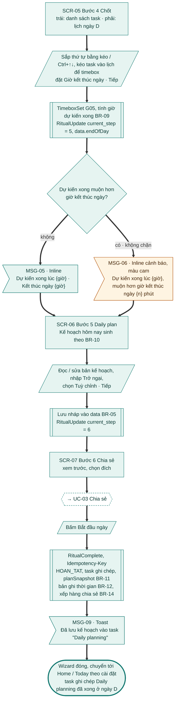

### Nhánh thay thế: mở wizard

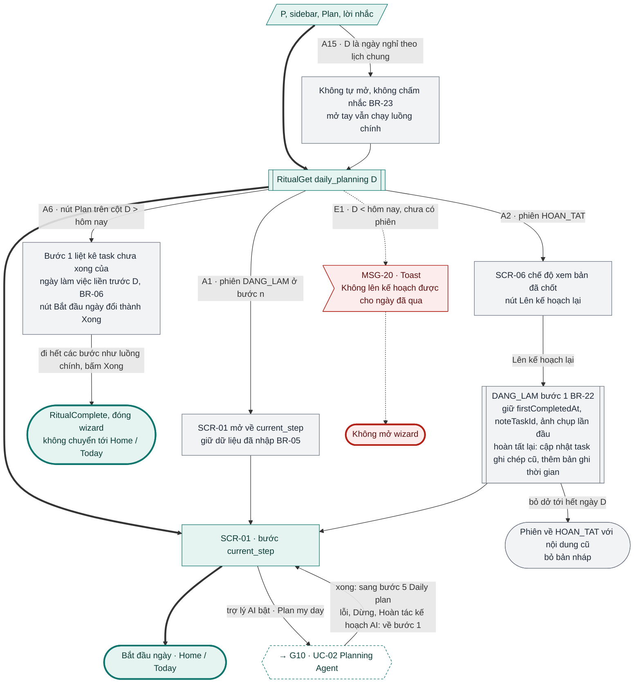

### Nhánh thay thế: điều hướng, ẩn bước, thoát, ân hạn

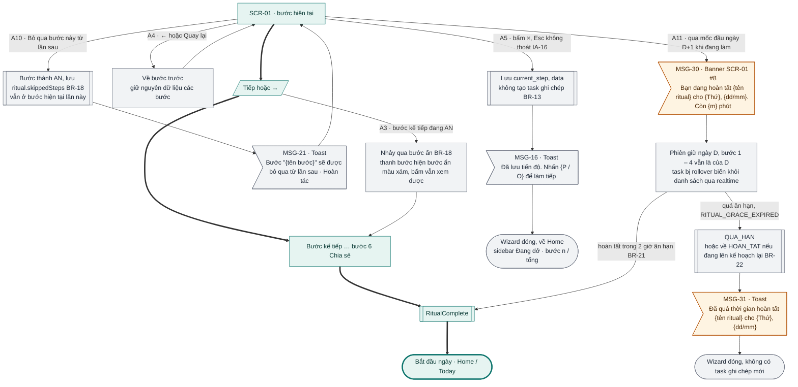

### Nhánh thay thế và lỗi: trong các bước

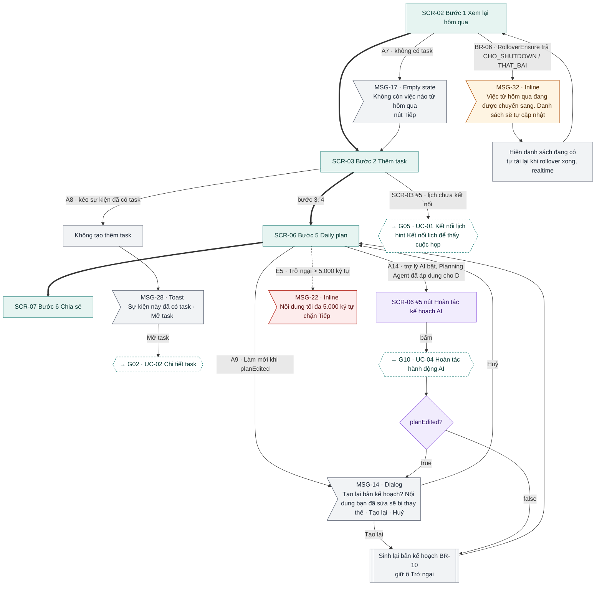

### Nhánh lỗi: thiết bị khác, mất mạng, hoàn tất lỗi

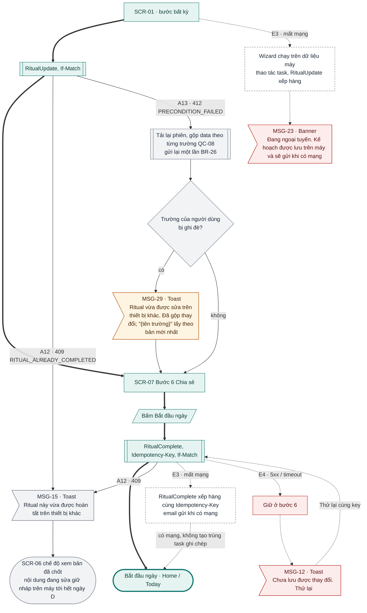

### Đối chiếu

| Mã | Điều kiện | Kết thúc ở | Thông báo |
|---|---|---|---|
| A1 | Phiên đang `DANG_LAM` ở bước n | Mở về `current_step`, giữ dữ liệu | – |
| A2 | Phiên đã `HOAN_TAT` | SCR-06 chế độ xem → Lên kế hoạch lại về bước 1; bỏ dở → `HOAN_TAT` nội dung cũ | – |
| A3 | Bước đang `AN` | Nhảy qua, thanh bước hiện màu xám | – |
| A4 | ← / Quay lại | Bước trước, giữ dữ liệu | – |
| A5 | Bấm × giữa chừng (Esc không thoát, IA-16) | Wizard đóng, về Home, không có task ghi chép | MSG-16 |
| A6 | D > hôm nay (nút Plan cột tương lai) | Bước 1 là task của ngày trước D; nút "Xong", không chuyển trang | – |
| A7 | Bước 1 không có task | Empty state, nút Tiếp | MSG-17 |
| A8 | Kéo sự kiện đã có task | Không tạo thêm; Mở task → [G02 · UC-02](g02-quan-ly-task.md#uc-02-xem-và-sửa-chi-tiết-task) | MSG-28 |
| A9 | Làm mới khi `planEdited` | Tạo lại (giữ Trở ngại) hoặc Huỷ | MSG-14 |
| A10 | Bỏ qua bước này từ lần sau | Bước `AN` từ lần sau, vẫn ở bước hiện tại | MSG-21 |
| A11 | Qua mốc đầu ngày khi đang làm | Hoàn tất cho D trong 2 giờ; quá hạn → `QUA_HAN` / `HOAN_TAT`, wizard đóng | MSG-30, MSG-31 |
| A12 | Phiên vừa hoàn tất ở thiết bị khác (409) | Bản đã chốt ở chế độ xem | MSG-15 |
| A13 | Phiên bị sửa ở thiết bị khác (412) | Gộp theo trường, gửi lại | MSG-29 (khi bị ghi đè) |
| A14 | Trợ lý AI bật, Planning Agent đã áp dụng cho D | Hoàn tác kế hoạch AI → [G10 · UC-04](g10-tro-ly-ai.md); sinh lại hoặc hỏi | MSG-14 (khi `planEdited`) |
| A15 | D là ngày nghỉ theo lịch chung | Không tự mở, không chấm nhắc; mở tay chạy luồng chính | – |
| E1 | D < hôm nay, chưa có phiên | Không mở wizard | MSG-20 |
| E2 | Từ 1.1: workspace chỉ đọc | Bỏ (1.1) | – |
| E3 | Mất mạng | Chạy trên dữ liệu máy, xếp hàng, gửi khi có mạng | MSG-23 |
| E4 | `RitualComplete` 5xx / timeout | Giữ bước 6, Thử lại cùng key | MSG-12 |
| E5 | Trở ngại > 5.000 ký tự | Chặn Tiếp | MSG-22 |
| BR-06 | `RolloverEnsure` trả `CHO_SHUTDOWN` / `THAT_BAI` | Danh sách hiện có, tự tải lại | MSG-32 |
| BR-08 | Quá tải ở bước 3 | Cảnh báo, không chặn | MSG-03 |
| BR-09 | Dự kiến xong muộn hơn giờ kết thúc ngày | Cảnh báo, không chặn | MSG-06 |
| – | Plan my day (trợ lý AI bật) | → [G10 · UC-02](g10-tro-ly-ai.md); xong về bước 5, lỗi về bước 1 | – |
| – | Lịch chưa kết nối ở bước 2 (SCR-03 #5) | → [G05 · UC-01](g05-lich-timebox.md) | – |

---

## UC-02 Daily shutdown

**Mở đầu:** phím O, sidebar "Daily shutdown", hoặc lời nhắc MSG-02; D = hôm nay hoặc phiên D đang trong ân hạn. **Thành công:** phiên `HOAN_TAT`; task chưa xong của D đã có chỗ; task ghi chép "Daily shutdown"; thông điệp cuối ngày hiện; rollover đang chờ được chạy. **Thất bại:** phiên giữ `DANG_LAM`, không có task ghi chép.

Các bước Daily shutdown là **đề xuất, chưa kiểm chứng trên Sunsama** (SRS).

### Happy case

```mermaid
flowchart TD
  start(["Sidebar, phím O<br/>hoặc lời nhắc MSG-02"])
  u1[/"Nhấn O, bấm Daily shutdown<br/>hoặc Daily shutdown (O) ở lời nhắc"/]
  p1[["RitualGet daily_shutdown D<br/>chưa có phiên: tạo DANG_LAM"]]
  s1["SCR-01 · SCR-08 Bước 1 Việc đã xong<br/>actual / planned, tổng h:mm, phân bổ theo channel BR-15"]
  u2[/"Xem · Tiếp"/]
  p2[["RitualUpdate current_step = 2"]]
  s2["SCR-09 Bước 2 Xử lý task chưa xong<br/>mỗi dòng: Ngày mai (ngày đích của task) · Backlog · Xong"]
  u3[/"Chọn cho từng task bằng D / Z / C<br/>hoặc Áp dụng cho tất cả: Ngày mai · Tiếp"/]
  p3[["Áp ngay BR-16: TaskMove G06, TaskComplete G02<br/>không reset số ngày bị hoãn, toast Hoàn tác<br/>RitualUpdate current_step = 3"]]
  s3["SCR-10 Bước 3 Highlights<br/>danh sách sinh sẵn từ task đã xong BR-17"]
  u4[/"Sửa highlights · Tiếp"/]
  p4[["Lưu nháp vào data<br/>RitualUpdate current_step = 4"]]
  s4["SCR-07 Bước 4 Chia sẻ"]
  x4{{"→ UC-03 Chia sẻ"}}
  u5[/"Bấm Hoàn tất"/]
  p5[["RitualComplete: BR-11, notes = việc đã xong + highlights<br/>BR-12, BR-14; ritual.shutdown.closed tới G06"]]
  m5>"MSG-26 · Toast<br/>Đã lưu vào task #quot;Daily shutdown#quot;"]
  s5["SCR-11 Bước 5 Hoàn tất<br/>{n} task xong · {h:mm} thực tế"]
  m6>"MSG-19 · Màn Hoàn tất, khi thông điệp cài đặt trống<br/>Hôm nay vậy là đủ. Hẹn gặp lại ngày mai."]
  u6[/"Bấm Đóng"/]
  ok(["Về Home<br/>task chưa xong đã có chỗ, có task ghi chép Daily shutdown"])

  start ==> u1 ==> p1 ==> s1 ==> u2 ==> p2 ==> s2 ==> u3 ==> p3 ==> s3 ==> u4 ==> p4 ==> s4
  s4 ==> x4 ==> u5 ==> p5 ==> m5 ==> s5 ==> m6 ==> u6 ==> ok

  class start,u1,p1,s1,u2,p2,s2,u3,p3,s3,u4,p4,s4,u5,p5,m5,s5,m6,u6 happy
  class x4 link
  class ok done
  classDef happy fill:#E6F4F1,stroke:#0F766E,color:#0B3B36
  classDef alt fill:#F1F3F5,stroke:#6B7280,color:#1F2937
  classDef err fill:#FDECEC,stroke:#B42318,color:#5C1010
  classDef warn fill:#FEF4E2,stroke:#B45309,color:#4A2604
  classDef ai fill:#F1ECFD,stroke:#6D28D9,color:#2E1065
  classDef sync fill:#FFFFFF,stroke:#6B7280,stroke-dasharray:4 3,color:#1F2937
  classDef link fill:#FFFFFF,stroke:#0F766E,stroke-dasharray:4 3,color:#0B3B36
  classDef done fill:#E6F4F1,stroke:#0F766E,stroke-width:3px,color:#0B3B36
  classDef fail fill:#FDECEC,stroke:#B42318,stroke-width:3px,color:#5C1010
```

### Nhánh thay thế và lỗi: trong các bước

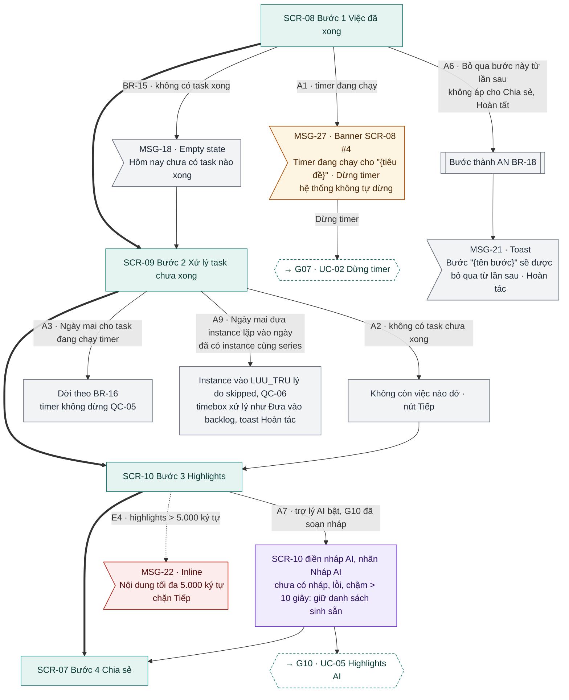

### Nhánh thay thế: mở, bỏ qua hôm nay, thoát

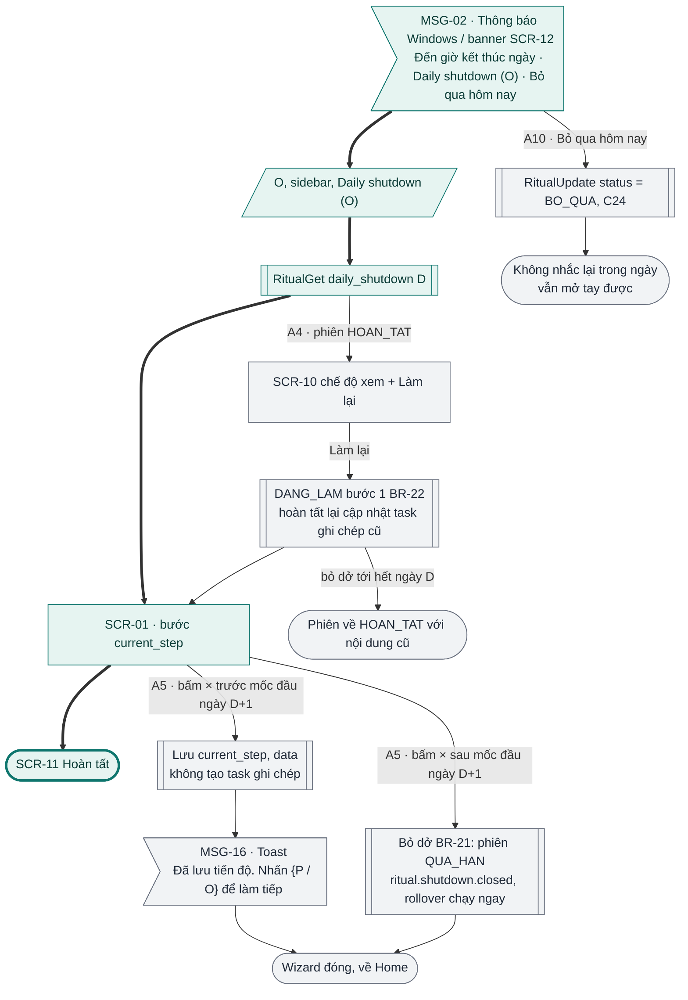

### Nhánh ân hạn, thiết bị khác và lỗi

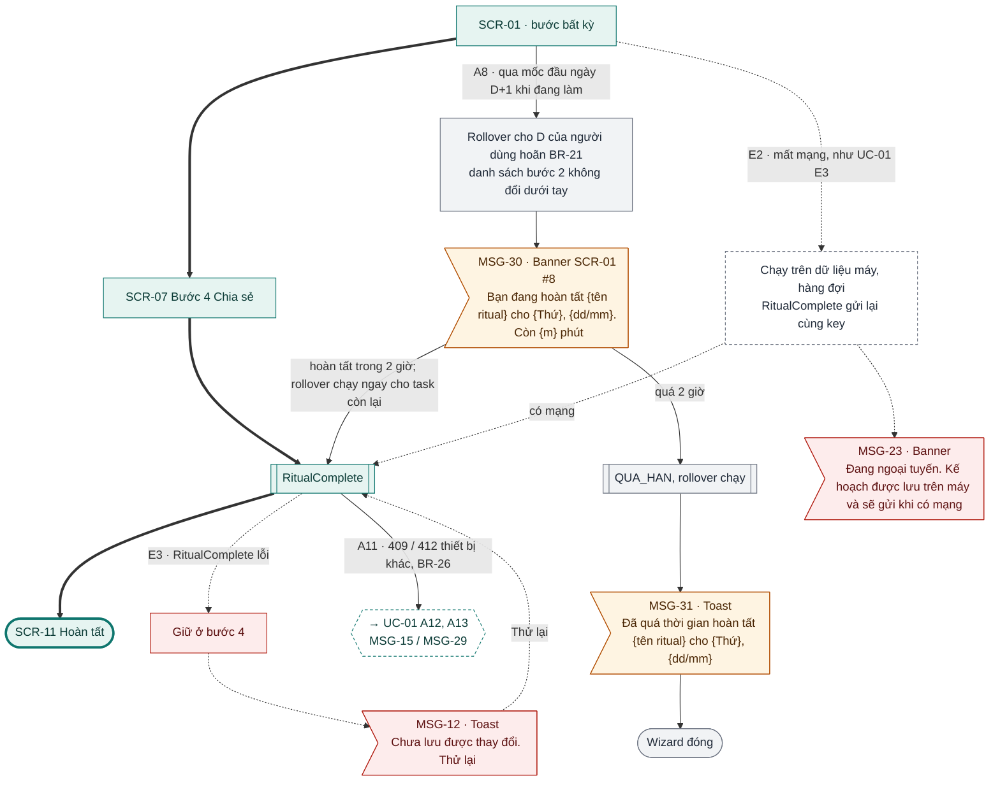

### Đối chiếu

| Mã | Điều kiện | Kết thúc ở | Thông báo |
|---|---|---|---|
| A1 | Timer đang chạy ở bước 1 | Banner, Dừng timer → [G07 · UC-02](g07-focus-timer.md); không tự dừng | MSG-27 |
| A2 | Không có task chưa xong | "Không còn việc nào dở", Tiếp | – (chưa có mã MSG) |
| A3 | Ngày mai cho task chạy timer | Dời, timer chạy tiếp | – |
| A4 | Phiên đã `HOAN_TAT` | SCR-10 chế độ xem → Làm lại; bỏ dở → `HOAN_TAT` nội dung cũ | – |
| A5 | Bấm × giữa chừng | Trước mốc: lưu tiến độ; sau mốc: `QUA_HAN`, rollover chạy | MSG-16 |
| A6 | Bỏ qua bước này từ lần sau | Bước `AN` (không áp cho Chia sẻ, Hoàn tất) | MSG-21 |
| A7 | Trợ lý AI bật, có nháp highlights | Nháp AI trong SCR-10 → [G10 · UC-05](g10-tro-ly-ai.md); không có nháp → danh sách sinh sẵn | – |
| A8 | Qua mốc đầu ngày khi đang làm | Hoàn tất cho D trong 2 giờ; quá → `QUA_HAN`, wizard đóng | MSG-30, MSG-31 |
| A9 | Ngày mai đưa instance lặp vào ngày trùng series | Instance `LUU_TRU` (skipped), Hoàn tác | – |
| A10 | Bỏ qua hôm nay ở MSG-02 | Phiên `BO_QUA` | – |
| A11 | Thiết bị khác sửa / hoàn tất | Như UC-01 A12, A13 | MSG-15 / MSG-29 |
| E1 | Từ 1.1: workspace chỉ đọc | Bỏ (1.1) | – |
| E2 | Mất mạng | Hàng đợi, gửi khi có mạng | MSG-23 |
| E3 | `RitualComplete` lỗi | Giữ bước 4, Thử lại | MSG-12 |
| E4 | Highlights > 5.000 ký tự | Chặn Tiếp | MSG-22 |
| BR-15 | Không có task xong ở bước 1 | Empty state | MSG-18 |

---

## UC-03 Chia sẻ kết quả ritual

**Mở đầu:** bước Chia sẻ của UC-01 (bước 6) hoặc UC-02 (bước 4). **Thành công:** nội dung lưu vào task ghi chép; mỗi đích bật có bản ghi gửi `CHO_GUI` → `DA_GUI`; lựa chọn đích được nhớ. **Thất bại:** ritual vẫn hoàn tất; đích lỗi ở `LOI`, có thông báo "Thử lại".

### Happy case

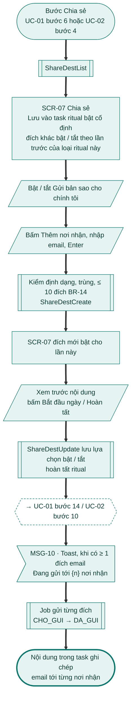

### Nhánh thay thế và lỗi

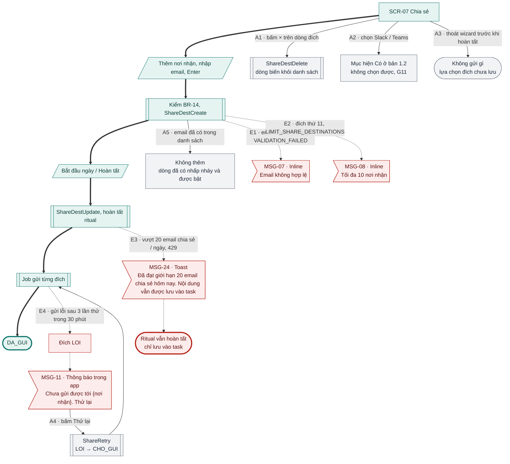

### Đối chiếu

| Mã | Điều kiện | Kết thúc ở | Thông báo |
|---|---|---|---|
| A1 | Gỡ một đích | Đích bị xoá | – |
| A2 | Chọn Slack / Teams ở 1.0 | Không chọn được, nhãn "Có ở bản 1.2" | – |
| A3 | Thoát wizard trước hoàn tất | Không gửi, lựa chọn chưa lưu | – |
| A4 | Thử lại trong MSG-11 | Đích `LOI` → `CHO_GUI` | – |
| A5 | Email đã có | Dòng cũ nhấp nháy, bật | – |
| E1 | Email sai định dạng | Không thêm | MSG-07 |
| E2 | Đích thứ 11 | Không thêm | MSG-08 |
| E3 | Vượt 20 email / ngày | Ritual hoàn tất, chỉ lưu vào task | MSG-24 |
| E4 | Gửi lỗi sau 3 lần thử | Đích `LOI`, thông báo trong app | MSG-11 |

---

## UC-04 Tự kích hoạt và nhắc ritual

**Mở đầu:** job `[ritual.prompt]` mỗi 5 phút, cài đặt "Tự kích hoạt" / "Tự nhắc shutdown" bật. **Thành công:** Daily planning tự mở đúng 1 lần trong ngày trên 1 thiết bị; shutdown được nhắc 1 lần. **Thất bại:** không tự mở; người dùng vẫn mở tay được.

### Happy case

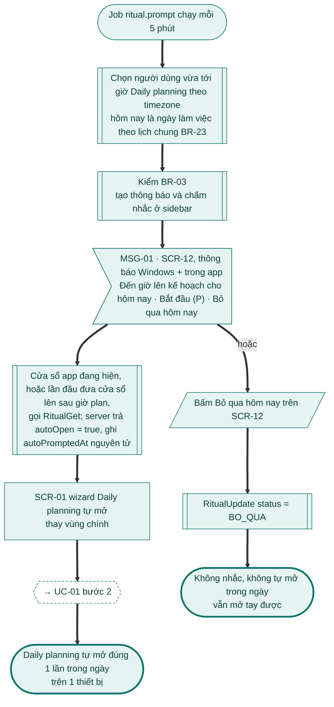

### Nhánh thay thế: Daily planning

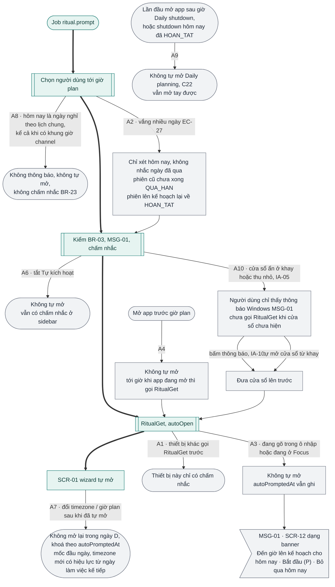

### Nhánh thay thế và lỗi: Daily shutdown, job

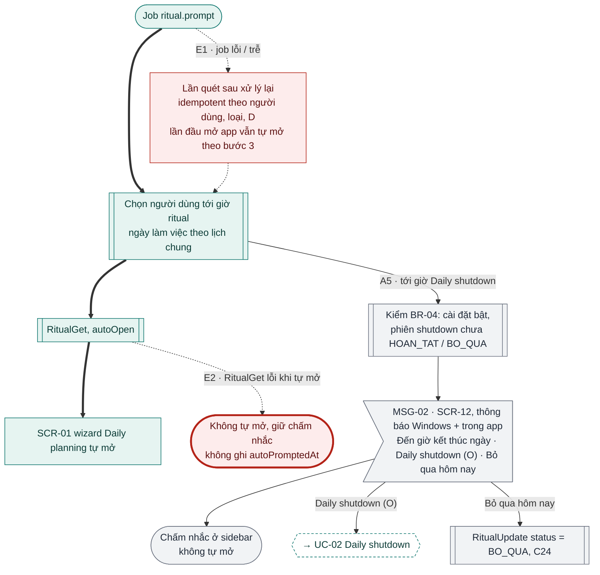

### Đối chiếu

| Mã | Điều kiện | Kết thúc ở | Thông báo |
|---|---|---|---|
| A1 | Nhiều thiết bị đang mở | Thiết bị đầu tiên tự mở; thiết bị khác chỉ chấm nhắc | – |
| A2 | Vắng nhiều ngày | Chỉ xét hôm nay; phiên cũ `QUA_HAN` (lên kế hoạch lại → `HOAN_TAT`) | – |
| A3 | Đang gõ / đang ở Focus | Không tự mở, banner | MSG-01 |
| A4 | Mở app trước giờ plan | Tới giờ thì tự mở | – |
| A5 | Tới giờ Daily shutdown | Thông báo + chấm nhắc, không tự mở; Bỏ qua → `BO_QUA` | MSG-02 |
| A6 | Tắt Tự kích hoạt | Không tự mở, vẫn chấm nhắc | – |
| A7 | Đổi timezone / giờ plan sau khi đã tự mở | Không mở lại trong ngày | – |
| A8 | Ngày nghỉ theo lịch chung | Không thông báo, không tự mở, không chấm nhắc | – |
| A9 | Mở app sau giờ shutdown / shutdown đã xong | Không tự mở | – |
| A10 | Cửa sổ ẩn ở khay / thu nhỏ khi tới giờ (IA-05) | Chỉ thông báo Windows; wizard mở khi cửa sổ được đưa lên | MSG-01 |
| E1 | Job lỗi / trễ | Lần quét sau xử lý lại | – |
| E2 | `RitualGet` lỗi khi tự mở | Không tự mở, giữ chấm nhắc | – |

---

## UC-05 Cài đặt ritual ngày

**Mở đầu:** Cài đặt → Ritual (SCR-13). **Thành công:** cài đặt lưu và áp ngay trên mọi thiết bị (`settings.changed`). **Thất bại:** giá trị cũ giữ nguyên.

### Happy case

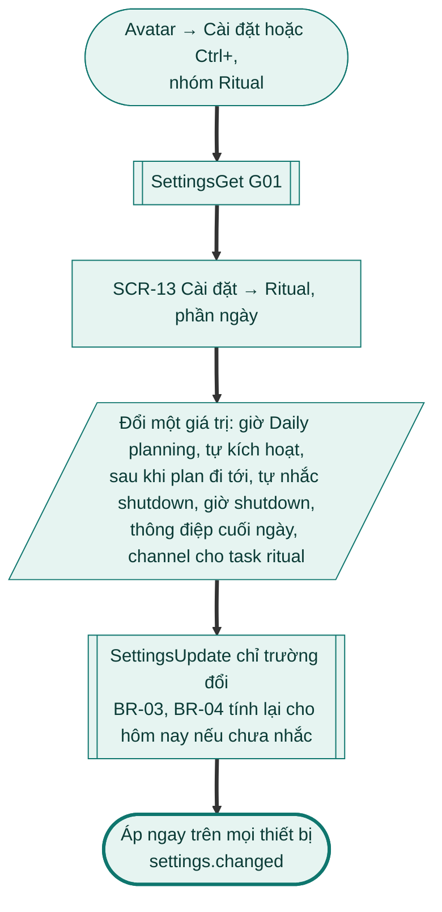

### Nhánh thay thế và lỗi

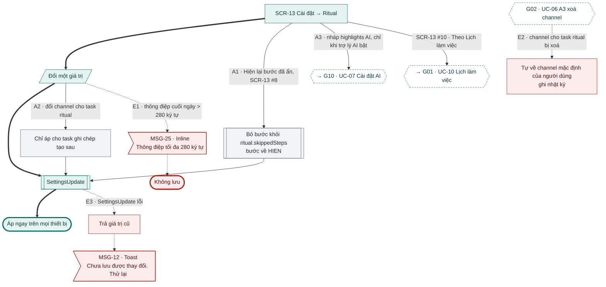

### Đối chiếu

| Mã | Điều kiện | Kết thúc ở | Thông báo |
|---|---|---|---|
| A1 | Bật lại bước đã ẩn | Bước `HIEN` | – |
| A2 | Đổi channel cho task ritual | Áp cho task ghi chép tạo sau | – |
| A3 | Nháp highlights AI (trợ lý AI bật) | → [G10 · UC-07](g10-tro-ly-ai.md) | – |
| A3 | Cài đặt ritual tuần (G09) | Bỏ (1.1) | – |
| E1 | Thông điệp > 280 ký tự | Không lưu | MSG-25 |
| E2 | Channel cho task ritual bị xoá ([G02 · UC-06](g02-quan-ly-task.md#uc-06-quản-lý-context-và-channel)) | Về channel mặc định | – |
| E3 | `SettingsUpdate` lỗi | Giá trị cũ | MSG-12 |
| – | SCR-13 #10 "Theo Lịch làm việc" | → [G01 · UC-10](g01-tai-khoan.md) | – |

## Kiểm tra

- [x] Mọi A# / E# của UC-01 … UC-05 bản 1.0 có trên sơ đồ hoặc ghi "Bỏ (1.1)".
- [x] Mọi nút màn hình có mã SCR; mọi nút thông báo có mã MSG. Ngoại lệ: chữ "Không còn việc nào dở" (UC-02 A2) SRS chưa đặt mã MSG.
- [x] Nội dung MSG chép nguyên văn mục 9 SRS (dấu ngoặc kép viết bằng `#quot;` cho Mermaid).

**Ghi chú cho brief G08**
- **Esc trong wizard mâu thuẫn.** BR-20 ghi "Esc thoát (lưu tiến độ)"; UC-01 A5 "Esc / × giữa chừng"; BR-21 "đóng wizard shutdown (Esc / ×)". SCR-01 #7 và IA-16 chốt Esc **không** thoát wizard. Flow vẽ theo IA (chỉ ×). Đề xuất sửa BR-20, UC-01 A5, BR-21.
- **Vị trí "Plan my day" chưa có trong SRS G08.** IA mục 3 và G10 UC-02 đặt Planning Agent (G10 SCR-02, SCR-03) trong wizard Daily planning, xong thì sang bước Daily plan, lỗi / Dừng thì về bước 1. UC-01 G08 không nói nút nằm ở bước nào (trước bước 1? thay bước 1 – 4?). Flow vẽ tạm nút lục giác từ SCR-01. Ngoài ra G10 UC-02 E1 gọi ô là "Obstacles in my way", G08 gọi là "Trở ngại".
- **UC-02 A2 "Không còn việc nào dở"** chưa có mã MSG (khác UC-01 A7 dùng MSG-17). Đề xuất thêm MSG.
- **D quá xa trong tương lai.** BR-02 chỉ cho Daily planning tới hôm nay + 7 ngày; mã lỗi `RITUAL_DATE_NOT_ALLOWED` map sang MSG-20 "Không lên kế hoạch được cho ngày đã qua", sai nghĩa khi D > hôm nay + 7. Không UC nào mô tả nhánh này; nút "Plan" có hiện trên cột > +7 không cũng chưa rõ.
- **Hai banner offline.** UC-01 E3 dùng banner MSG-23 riêng của ritual, trong khi IA-17 cho tối đa 1 banner và banner offline là của G04 (SCR-01 #5). Cần chốt MSG-23 thay hay đi kèm banner offline chung.
- **Banner lời nhắc SCR-12** (UC-04 A3) không có trong thứ tự ưu tiên banner của IA-17.
- **Hai toast cùng lúc khi hoàn tất.** UC-01 bước 14 hiện MSG-09 (UC-02: MSG-26), UC-03 bước 5 hiện thêm MSG-10 khi có đích email. Cần chốt gộp hay xếp lần lượt. Cũng chưa rõ "Gửi bản sao cho chính tôi" có tính là "đích email" để hiện MSG-10 không.
