# Flow G10 Trợ lý AI

> **Nguồn:** [srs-g10](../../features/srs-g10-tro-ly-ai.md) (commit `8fac830`, sửa theo [chốt 09/11/2026](../../review/cau-hoi-chot-flow-2026-11-09.md)) · **Brief:** `[chờ]`
> **Quy ước:** [_quy-uoc.md](_quy-uoc.md) · **FigJam:** `[chờ]`

Bản 1.0 là app Windows. Trợ lý AI chạy bằng Claude Code CLI do người dùng tự cài trên máy và điều khiển app qua MCP server local (QC-12, ADR-0004). Mọi bước do Claude Code hoặc \[McpServer\] / \[AiActionExecutor\] chạy dùng class `ai`. Nhánh dựa trên dữ liệu tích hợp (BR-20, `hasExternalData`, SCR-05, `ALREADY_LINKED`, `LINKED_TASK`) và chế độ chỉ đọc (QC-09) chỉ có từ 1.1, nên không vẽ.

## Mục lục

| UC | Flow | Màn chính | Nhánh A / E (1.0) |
|---|---|---|---|
| [UC-01](#uc-01-thiết-lập-planning-agent) | Thiết lập Planning Agent | SCR-01 Thiết lập Planning Agent | 2 / 2 |
| [UC-02](#uc-02-lập-kế-hoạch-ngày-với-planning-agent) | Lập kế hoạch ngày với Planning Agent | SCR-02 Nhập và chạy, SCR-03 Review Plan | 8 / 9 |
| [UC-03](#uc-03-trò-chuyện-và-ra-lệnh-cho-trợ-lý) | Trò chuyện và ra lệnh cho trợ lý | SCR-04 Khung chat trợ lý | 13 / 9 |
| [UC-04](#uc-04-hoàn-tác-hành-động-ai) | Hoàn tác hành động AI | SCR-06 Xung đột khi hoàn tác, chip / dòng của SCR-03, SCR-04, SCR-12 | 8 / 2 |
| [UC-05](#uc-05-soạn-và-duyệt-highlights-ai-cuối-ngày) | Soạn và duyệt highlights AI cuối ngày | SCR-07 Highlights AI | 6 / 3 |
| [UC-06](#uc-06-gửi-phản-hồi-về-ai) | Gửi phản hồi về AI | SCR-08 Gửi phản hồi | 2 / 1 |
| [UC-07](#uc-07-cài-đặt-ai) | Cài đặt AI | SCR-09 Cài đặt → Trợ lý AI | 5 / 1 |
| [UC-08](#uc-08-chạy-bộ-đánh-giá-trước-khi-đổi-prompt-công-cụ-mcp-hoặc-phiên-bản-claude-code) | Chạy bộ đánh giá (CI, kỹ sư AI) | – (không có màn) | 0 / 2 |
| [UC-09](#uc-09-đồng-ý-dùng-ai-lần-đầu) | Đồng ý dùng AI lần đầu | SCR-10 Đồng ý dùng AI | 2 / 1 |
| [UC-10](#uc-10-phát-hiện-và-kết-nối-claude-code) | Phát hiện và kết nối Claude Code | SCR-09 #12, SCR-11 Cài đặt để dùng trợ lý AI | 5 / 1 |
| [UC-11](#uc-11-điều-khiển-app-từ-claude-code-trong-terminal) | Điều khiển app từ terminal | SCR-12 Hoạt động AI, toast MSG-29 | 4 / 5 |
| [UC-12](#uc-12-gợi-ý-thời-lượng-và-channel-qua-claude-code-cho-g02) | Gợi ý thời lượng và channel (cho G02) | – (hiện ở G02 SCR-01) | 0 / 1 |

Không có UC nào chỉ có ở 1.1. SCR-05 Thẻ chờ duyệt chỉ dùng cho phiên có dữ liệu tích hợp, nên bỏ ở 1.0.

---

## UC-01 Thiết lập Planning Agent

**Mở đầu:** Claude Code `SAN_SANG`, trợ lý bật và đã đồng ý, Beta "Agentic Daily Planning" bật; chưa có hồ sơ agent hoặc mở lại thiết lập. **Thành công:** \[AgentProfile\] lưu, `setupCompletedAt` có giá trị. **Thất bại:** không có hồ sơ; lần sau bấm "Plan my day" mở lại thiết lập.

### Happy case

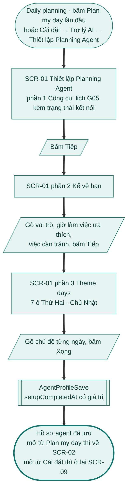

### Nhánh thay thế và lỗi

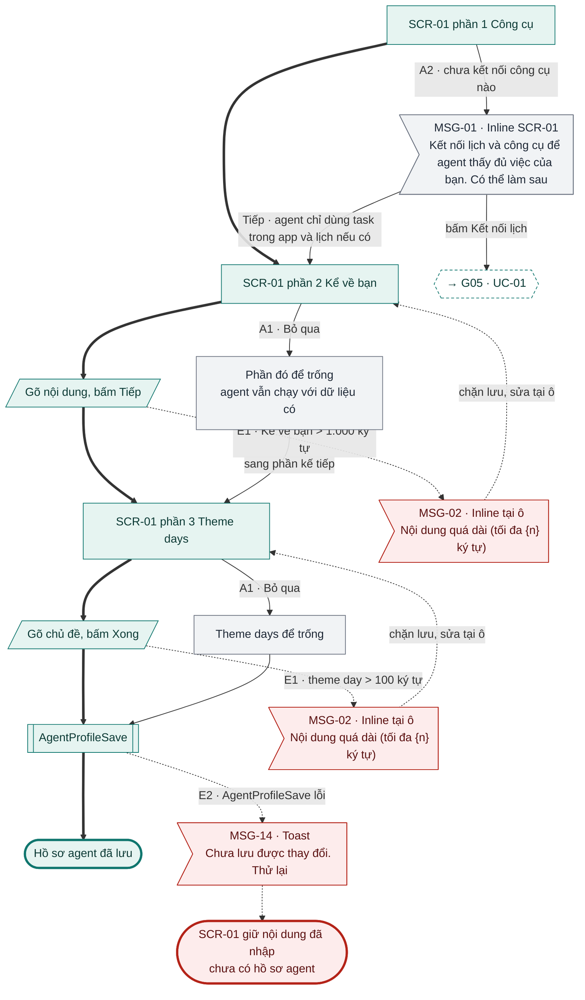

### Đối chiếu

| Mã | Điều kiện | Kết thúc ở | Thông báo |
|---|---|---|---|
| A1 | Bỏ qua một phần | Phần đó trống, lưu hồ sơ | – |
| A2 | Chưa kết nối công cụ nào | Gợi ý kết nối → [G05 UC-01](g05-lich-timebox.md#uc-01-kết-nối-tài-khoản-lịch), hoặc Tiếp | MSG-01 |
| E1 | Văn bản quá dài: Kể về bạn > 1.000, theme ngày > 100 ký tự (C46) | Chặn lưu | MSG-02 |
| E2 | AgentProfileSave lỗi | Giữ nội dung đã nhập | MSG-14 |
| Bước 2 | Công tắc "Cho AI đọc dữ liệu từ công cụ đã kết nối" (SCR-01 #6) và nguồn Gmail / Jira / Notion (G11) | Bỏ (1.1) | MSG-20 |

---

## UC-02 Lập kế hoạch ngày với Planning Agent

**Mở đầu:** bước 1 của wizard Daily planning ngày D (G08), nút "Plan my day" ở đầu bước (B28), Claude Code `SAN_SANG`, trợ lý bật và đã đồng ý, Beta bật, đã có hồ sơ agent. **Thành công:** thay đổi hợp lệ đã áp dụng, đề xuất `DA_AP_DUNG`, ritual nhảy thẳng tới bước Daily plan với nút "Hoàn tác kế hoạch AI". **Thất bại:** không thay đổi nào (hoặc giữ phần đã áp dụng, có "Hoàn tác kế hoạch AI"); người dùng về bước 1 của Daily planning thủ công, giữ nội dung đã nhập.

### Happy case

```mermaid
flowchart TD
  start(["G08 wizard Daily planning ngày D · bước 1"])
  s1["SCR-02 Planning Agent · nhập và chạy<br/>ở đầu bước 1, nhãn Beta"]
  u1[/"Tuỳ chọn gõ Điều quan trọng nhất hôm nay là gì?<br/>bấm Plan my day"/]
  p1[["Kiểm BR-19, BR-25<br/>AgentPlanStart: đề xuất DANG_XU_LY<br/>phiên AI planning_agent"]]
  p2[["ClaudeCodeRun: gọi Claude Code kèm<br/>ngữ cảnh BR-03, chỉ dẫn lập kế hoạch, hồ sơ agent"]]
  s2["SCR-02 #5 Tiến độ<br/>danh sách bước, bộ đếm thời gian<br/>Thường mất 2–4 phút"]
  p3[["Claude Code đọc qua MCP: lịch ngày D, board,<br/>backlog tới kỳ, hồ sơ agent<br/>rồi gọi công cụ ghi BR-01"]]
  p4[["McpServer · AiActionExecutor<br/>kiểm BR-01, BR-02, BR-04, BR-26<br/>áp dụng ngay BR-21, chip AI, nhật ký"]]
  s3["SCR-03 Review Plan · chế độ Đã áp dụng<br/>Planning Agent đã thêm n task, dời m task<br/>HÔM NAY · n thay đổi, mỗi dòng có Hoàn tác<br/>tổng planned so sức chứa ngày"]
  u2[/"Xem, tuỳ chọn hoàn tác dòng không muốn<br/>bấm Tiếp"/]
  ok(["Nhảy thẳng tới G08 bước Daily plan<br/>có nút Hoàn tác kế hoạch AI"])

  start ==> s1 ==> u1 ==> p1 ==> p2 ==> s2 ==> p3 ==> p4 ==> s3 ==> u2 ==> ok

  class start,s1,u1,p1,s2,s3,u2 happy
  class p2,p3,p4 ai
  class ok done
  classDef happy fill:#E6F4F1,stroke:#0F766E,color:#0B3B36
  classDef alt fill:#F1F3F5,stroke:#6B7280,color:#1F2937
  classDef err fill:#FDECEC,stroke:#B42318,color:#5C1010
  classDef warn fill:#FEF4E2,stroke:#B45309,color:#4A2604
  classDef ai fill:#F1ECFD,stroke:#6D28D9,color:#2E1065
  classDef sync fill:#FFFFFF,stroke:#6B7280,stroke-dasharray:4 3,color:#1F2937
  classDef link fill:#FFFFFF,stroke:#0F766E,stroke-dasharray:4 3,color:#0B3B36
  classDef done fill:#E6F4F1,stroke:#0F766E,stroke-width:3px,color:#0B3B36
  classDef fail fill:#FDECEC,stroke:#B42318,stroke-width:3px,color:#5C1010
```

### Nhánh thay thế

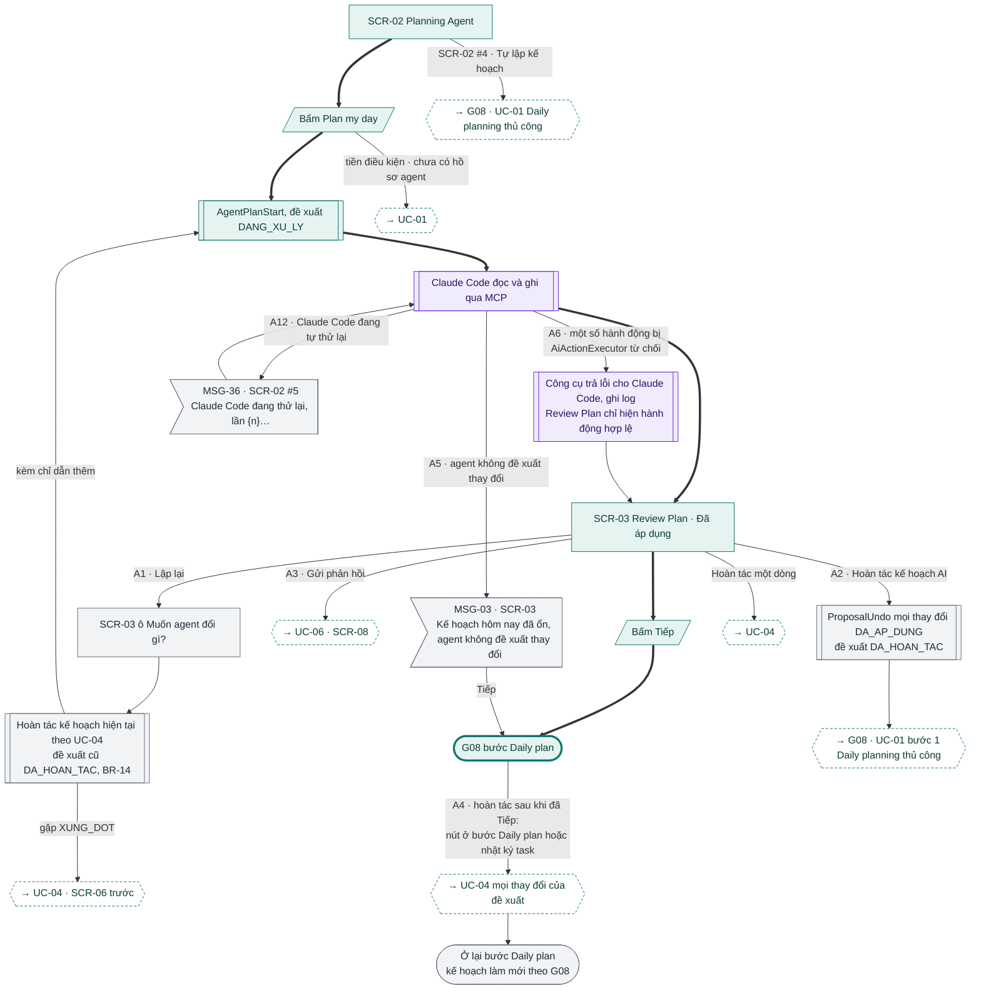

### Nhánh thay thế: dừng agent (A11)

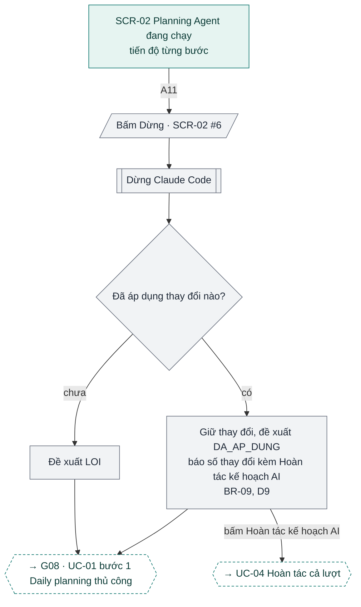

### Nhánh lỗi

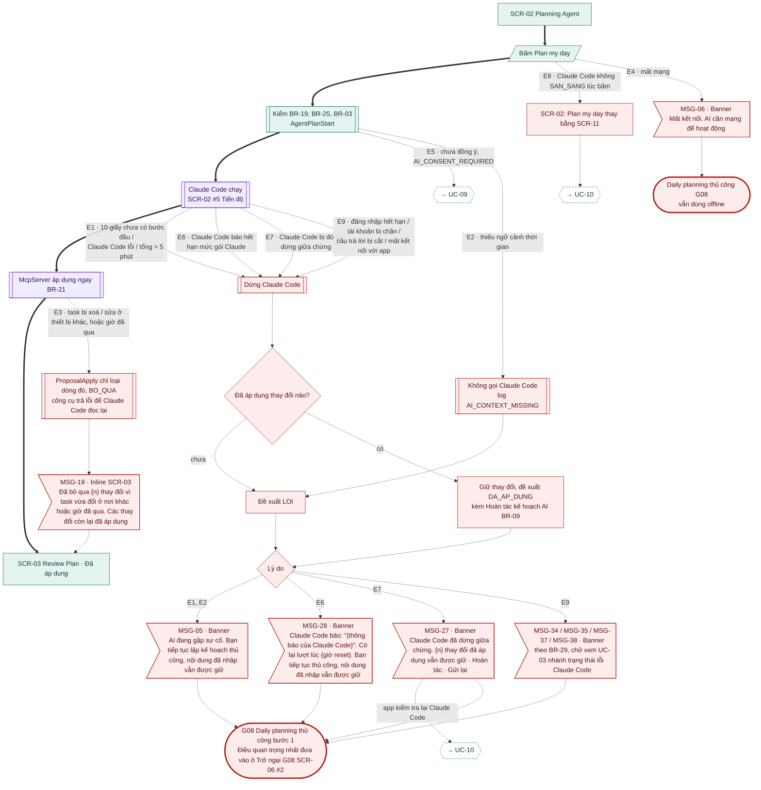

### Đối chiếu

| Mã | Điều kiện | Kết thúc ở | Thông báo |
|---|---|---|---|
| A1 | Lập lại | Hoàn tác kế hoạch cũ ([UC-04](#uc-04-hoàn-tác-hành-động-ai), XUNG_DOT → SCR-06), chạy lại từ bước 2 | – |
| A2 | Hoàn tác kế hoạch AI (chế độ Đã áp dụng) | Đề xuất DA_HOAN_TAC → [G08 UC-01](g08-daily-rituals.md#uc-01-daily-planning-luồng-thủ-công) bước 1 | – |
| A2 (phần "Huỷ tất cả") | Chế độ Chờ duyệt | Bỏ (1.1) | – |
| A3 | Gửi phản hồi | [UC-06](#uc-06-gửi-phản-hồi-về-ai) SCR-08, đề xuất không đổi | – |
| A4 | Hoàn tác sau khi đã Tiếp | [UC-04](#uc-04-hoàn-tác-hành-động-ai), ở lại bước Daily plan | – |
| A5 | Agent không đề xuất thay đổi | Tiếp sang Daily plan | MSG-03 |
| A6 | Một số hành động bị từ chối | Review Plan chỉ hiện hành động hợp lệ | – |
| A7 | (SRS đã bỏ) | – | – |
| A8 | Kế hoạch dùng dữ liệu tích hợp, SCR-03 chế độ Chờ duyệt | Bỏ (1.1) | MSG-22 |
| A9 | Đề xuất CHO_DUYET hết hạn | Bỏ (1.1) | – |
| A10 | Item đã có task, ALREADY_LINKED | Bỏ (1.1) | – |
| A11 | Bấm Dừng khi agent đang chạy | [G08 UC-01](g08-daily-rituals.md#uc-01-daily-planning-luồng-thủ-công) bước 1, giữ phần đã áp dụng | – |
| A12 | Claude Code đang tự thử lại (B45) | Vẫn chạy; quá ngưỡng thì như E1 | MSG-36 |
| E1 | 10 giây không có bước đầu / lỗi / > 5 phút | [G08 UC-01](g08-daily-rituals.md#uc-01-daily-planning-luồng-thủ-công) bước 1, giữ phần đã áp dụng; "Điều quan trọng nhất" vào ô "Trở ngại" (C32) | MSG-05 |
| E2 | Thiếu ngữ cảnh thời gian | Như E1, không gọi Claude Code | MSG-05 |
| E3 | Task đổi / xoá ở thiết bị khác, giờ đã qua | Dòng đó bị loại, các dòng khác áp dụng | MSG-19 |
| E3 (phần "mọi dòng chờ duyệt bị loại") | Chế độ Chờ duyệt | Bỏ (1.1) | MSG-15 |
| E4 | Mất mạng | Daily planning thủ công offline | MSG-06 |
| E5 | Chưa có đồng ý | [UC-09](#uc-09-đồng-ý-dùng-ai-lần-đầu) | – |
| E6 | Hết hạn mức gói Claude | Như E1 | MSG-28 |
| E7 | Claude Code bị đóng giữa chừng | Như E1, kiểm tra lại [UC-10](#uc-10-phát-hiện-và-kết-nối-claude-code) | MSG-27 |
| E8 | Claude Code không SAN_SANG lúc bấm | SCR-11 thay nút → [UC-10](#uc-10-phát-hiện-và-kết-nối-claude-code) | MSG-24 / 25 / 26 |
| E9 | Đăng nhập hết hạn / tài khoản bị chặn / câu trả lời bị cắt / mất kết nối với app (B45) | Như E1 | MSG-34 / 35 / 37 / 38 |
| – | Workspace chỉ đọc, "Plan my day" disabled | Bỏ (1.1) | MSG-12 |

---

## UC-03 Trò chuyện và ra lệnh cho trợ lý

**Mở đầu:** Claude Code `SAN_SANG`, trợ lý bật và đã đồng ý. **Thành công:** câu trả lời hiện trong cuộc trò chuyện; hành động (nếu có) áp dụng ngay, có chip "AI" và Hoàn tác; nhật ký ghi `assistant`. **Thất bại:** task không đổi (hoặc giữ phần đã áp dụng, hoàn tác được); tin nhắn còn trong ô / lịch sử để gửi lại.

### Happy case

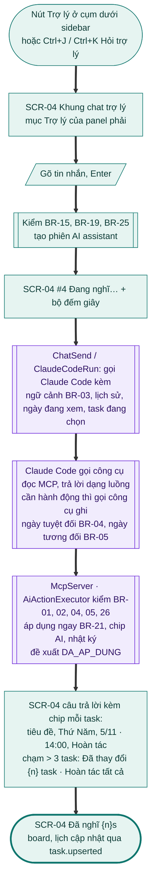

### Nhánh thay thế

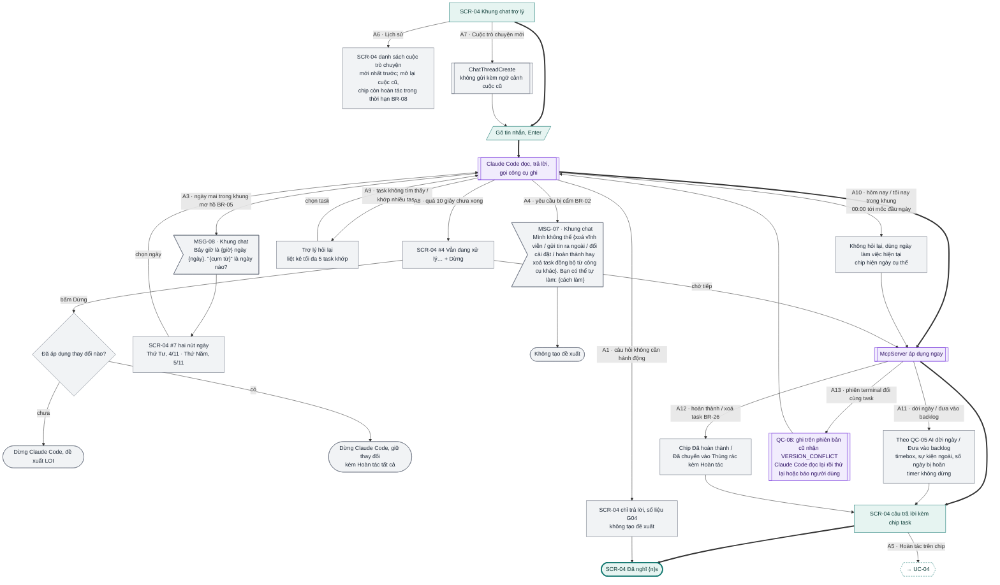

### Nhánh lỗi

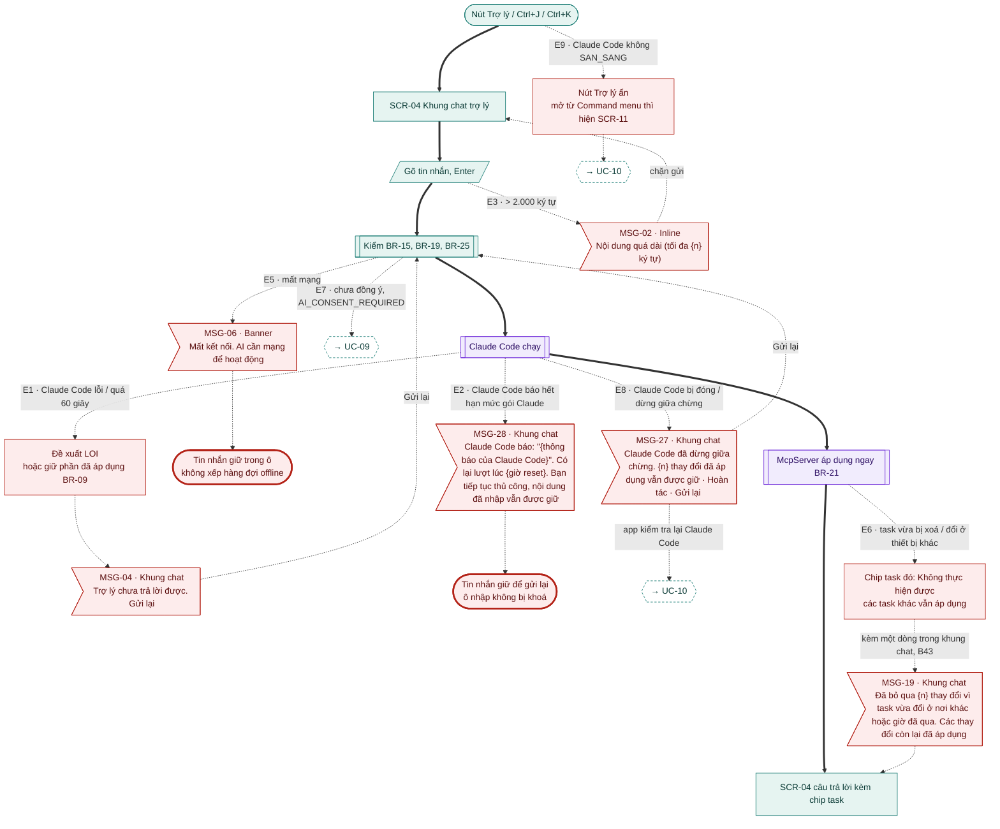

### Nhánh lỗi: trạng thái lỗi Claude Code (B45)

Bộ trạng thái lỗi chốt ngày 09/11/2026 (B45, BR-29). Chữ MSG-28, MSG-34 … MSG-38 là chữ tạm, chốt chữ sau khi thử thật trên Windows (#24). UC-02 (banner SCR-02) và UC-05 (SCR-07 #6) dùng cùng các thông báo này.

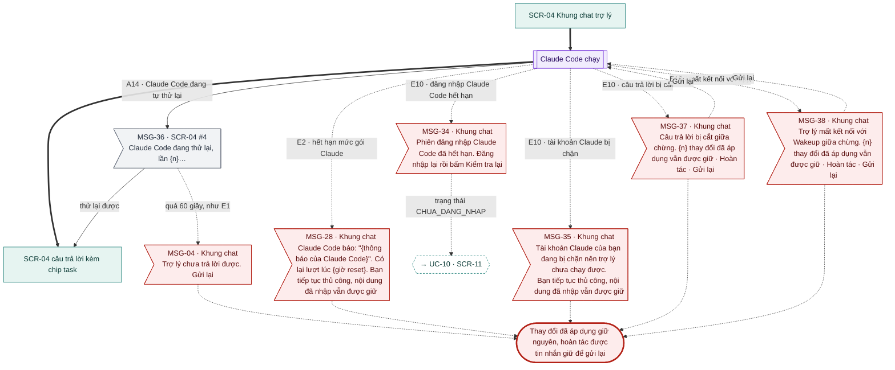

### Đối chiếu

| Mã | Điều kiện | Kết thúc ở | Thông báo |
|---|---|---|---|
| A1 | Câu hỏi không cần hành động | Chỉ trả lời, không đề xuất | – |
| A2 | Phiên đã đọc dữ liệu tích hợp, SCR-05 Thẻ chờ duyệt | Bỏ (1.1) | MSG-22 |
| A3 | "Ngày mai" trong khung mơ hồ | Hỏi lại bằng 2 nút ngày, chọn rồi tiếp | MSG-08 |
| A4 | Yêu cầu bị cấm (BR-02) | Không tạo đề xuất, chỉ cách tự làm | MSG-07 |
| A4 (phần task có liên kết tích hợp) | Hoàn thành / xoá task liên kết | Bỏ (1.1) | MSG-07 |
| A5 | Hoàn tác trên chip | [UC-04](#uc-04-hoàn-tác-hành-động-ai) | – |
| A6 | Lịch sử | Danh sách cuộc trò chuyện | – |
| A7 | Cuộc trò chuyện mới | Ô nhập trống, không kèm ngữ cảnh cũ | – |
| A8 | Quá 10 giây | Chờ tiếp, hoặc Dừng (LOI / giữ phần đã áp dụng) | – |
| A9 | Task không tìm thấy / khớp nhiều | Hỏi lại, tối đa 5 task | – |
| A10 | "Hôm nay" trong khung 00:00 → mốc đầu ngày | Dùng ngày làm việc hiện tại | – |
| A11 | Dời ngày / đưa vào backlog | Theo QC-05 | – |
| A12 | Hoàn thành / xoá task (không cần công tắc, F4) | Chip "Đã hoàn thành" / "Đã chuyển vào Thùng rác" | – |
| A12 (phần task có liên kết tích hợp, `LINKED_TASK`) | Từ chối hoàn thành / xoá | Bỏ (1.1) | MSG-07 |
| A13 | Phiên terminal đổi cùng task | VERSION_CONFLICT, Claude Code đọc lại | – |
| A14 | Claude Code đang tự thử lại (B45) | SCR-04 #4 báo đang thử lại; quá 60 giây → E1 | MSG-36 |
| E1 | Claude Code lỗi / > 60 giây | LOI hoặc giữ phần đã áp dụng, Gửi lại | MSG-04 |
| E2 | Hết hạn mức gói Claude | Tin nhắn giữ để gửi lại | MSG-28 |
| E3 | > 2.000 ký tự | Chặn gửi | MSG-02 |
| E4 | Workspace chỉ đọc | Bỏ (1.1) | MSG-12 |
| E5 | Mất mạng | Tin nhắn giữ trong ô | MSG-06 |
| E6 | Ghi thất bại vì task đổi / xoá ở thiết bị khác | Chip "Không thực hiện được" kèm một dòng MSG-19 trong khung chat, task khác áp dụng (B43) | MSG-19 |
| E7 | Chưa có đồng ý | [UC-09](#uc-09-đồng-ý-dùng-ai-lần-đầu) | – |
| E8 | Claude Code bị đóng giữa chừng | Giữ phần đã áp dụng, Gửi lại, [UC-10](#uc-10-phát-hiện-và-kết-nối-claude-code) | MSG-27 |
| E9 | Claude Code không SAN_SANG | Nút ẩn; Command menu → SCR-11 ([UC-10](#uc-10-phát-hiện-và-kết-nối-claude-code)) | MSG-24 / 25 / 26 |
| E10 | Đăng nhập hết hạn / tài khoản bị chặn / câu trả lời bị cắt / mất kết nối với app (B45) | Giữ phần đã áp dụng, tin nhắn giữ để gửi lại; đăng nhập hết hạn → [UC-10](#uc-10-phát-hiện-và-kết-nối-claude-code) | MSG-34 / 35 / 37 / 38 |

---

## UC-04 Hoàn tác hành động AI

**Mở đầu:** đề xuất `DA_AP_DUNG`, thay đổi áp dụng chưa quá 7 ngày. **Thành công:** thay đổi được chọn `DA_HOAN_TAC`, trường AI đổi về giá trị trước AI, sửa đổi của người dùng giữ nguyên. **Thất bại:** task giữ nguyên.

### Happy case

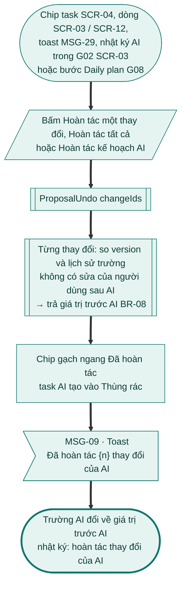

### Nhánh thay thế và lỗi

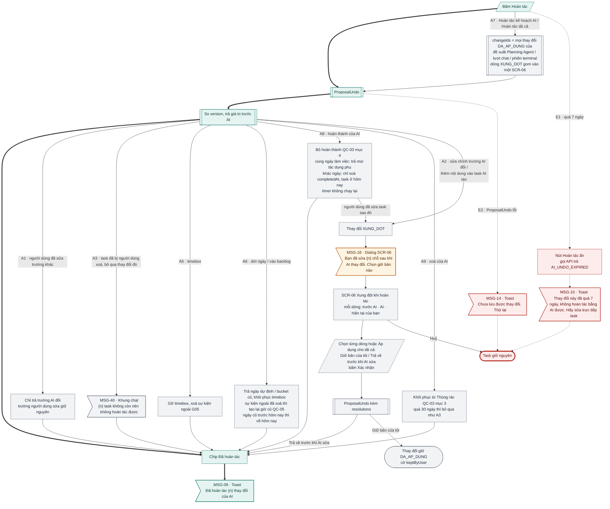

### Đối chiếu

| Mã | Điều kiện | Kết thúc ở | Thông báo |
|---|---|---|---|
| A1 | Người dùng sửa trường khác | Chỉ trả trường AI đổi | MSG-09 |
| A2 | Sửa chính trường AI đổi / thêm nội dung vào task AI tạo | SCR-06, chọn giữ bản nào | MSG-18 |
| A3 | Task đã bị người dùng xoá | Bỏ qua thay đổi đó, báo trong khung chat (C46) | MSG-40 |
| A4 | (SRS đã bỏ, thay bằng A8) | – | – |
| A5 | Hoàn tác timebox | Gỡ timebox, xoá sự kiện ngoài | MSG-09 |
| A6 | Hoàn tác dời ngày / vào backlog | Ngày / bucket cũ (quá khứ → hôm nay) | MSG-09 |
| A7 | Hoàn tác kế hoạch AI / tất cả | Mọi thay đổi DA_AP_DUNG, XUNG_DOT gom một SCR-06 | MSG-09 |
| A8 | Hoàn tác hoàn thành của AI | Bỏ hoàn thành theo QC-03; đã sửa → A2 | MSG-09 |
| A9 | Hoàn tác xoá của AI | Khôi phục từ Thùng rác; quá 30 ngày → bỏ qua | MSG-09 |
| E1 | Quá 7 ngày | Nút ẩn; API trả AI_UNDO_EXPIRED | MSG-10 |
| E2 | ProposalUndo lỗi | Task giữ nguyên | MSG-14 |

---

## UC-05 Soạn và duyệt highlights AI cuối ngày

**Mở đầu:** ngày làm việc D có ≥ 1 task Hoàn thành; Claude Code `SAN_SANG`, trợ lý bật và đã đồng ý. **Thành công:** highlights đã duyệt lưu vào ritual Daily shutdown ngày D, đề xuất `DA_AP_DUNG`. **Thất bại:** bước highlights dùng danh sách việc đã xong biên tập tay (G08 BR-17).

### Happy case

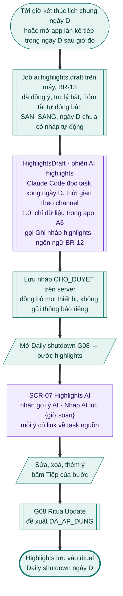

### Nhánh thay thế

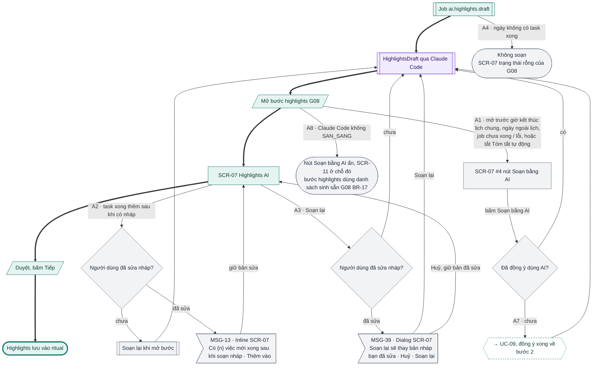

### Nhánh lỗi

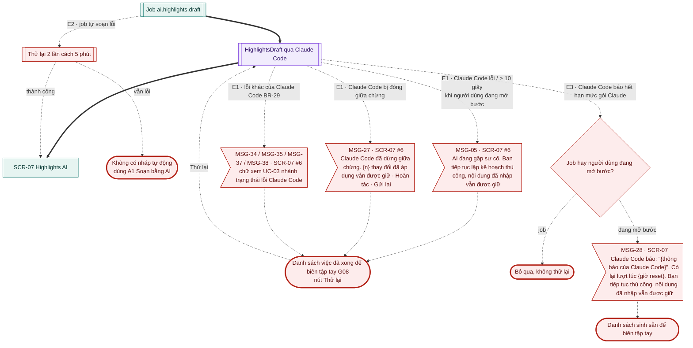

### Đối chiếu

| Mã | Điều kiện | Kết thúc ở | Thông báo |
|---|---|---|---|
| A1 | Mở trước giờ, ngày ngoài lịch, job chưa xong / lỗi, tắt tự động | "Soạn bằng AI" → bước 2 ngay | – |
| A2 | Task xong thêm sau khi có nháp | Chưa sửa: soạn lại; đã sửa: giữ bản sửa | MSG-13 |
| A3 | Soạn lại | Nháp mới; đã sửa → hỏi trước, Huỷ giữ bản đã sửa (C46) | MSG-39 |
| A4 | Ngày không có task xong | Không soạn, trạng thái rỗng G08 | – |
| A5 | Công cụ G11 lỗi / chưa kết nối | Bỏ (1.1) | – |
| A6 | Công tắc dữ liệu tích hợp tắt | Bỏ (1.1) (C44) | – |
| A7 | Chưa đồng ý, bấm "Soạn bằng AI" | [UC-09](#uc-09-đồng-ý-dùng-ai-lần-đầu) → bước 2 | – |
| A8 | Claude Code không SAN_SANG | Nút ẩn, danh sách sinh sẵn ([G08 UC-02](g08-daily-rituals.md#uc-02-daily-shutdown)) | MSG-24 / 25 / 26 (SCR-11) |
| E1 | Claude Code lỗi / bị đóng / > 10 giây khi đang mở bước | Danh sách để biên tập tay, Thử lại | MSG-05 (bị đóng: MSG-27; lỗi khác BR-29: MSG-34 / 35 / 37 / 38) |
| E2 | Job tự soạn lỗi | Thử lại 2 lần; vẫn lỗi → A1 | – |
| E3 | Hết hạn mức gói Claude | Job bỏ qua; đang mở bước → biên tập tay | MSG-28 |
| – | Workspace chỉ đọc | Bỏ (1.1) | – |

---

## UC-06 Gửi phản hồi về AI

**Mở đầu:** có câu trả lời của trợ lý, Review Plan hoặc nháp highlights. **Thành công:** \[AiFeedback\] lưu. **Thất bại:** không lưu, không ảnh hưởng thao tác khác.

### Happy case

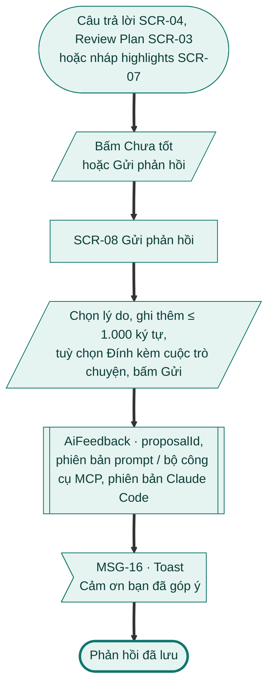

### Nhánh thay thế và lỗi

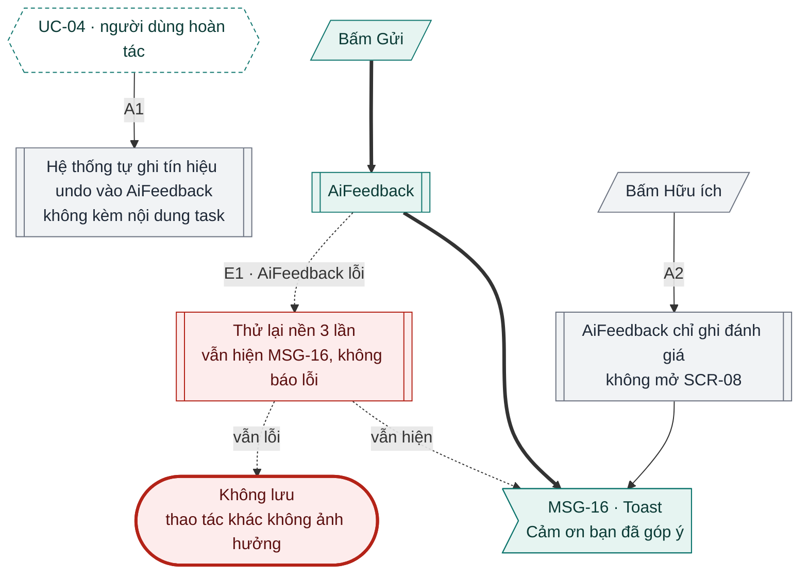

### Đối chiếu

| Mã | Điều kiện | Kết thúc ở | Thông báo |
|---|---|---|---|
| A1 | Người dùng hoàn tác ([UC-04](#uc-04-hoàn-tác-hành-động-ai)) | Tín hiệu `undo` tự ghi, không có màn | – |
| A2 | Bấm "Hữu ích" (C46) | Chỉ ghi đánh giá, không mở SCR-08 | MSG-16 |
| E1 | AiFeedback lỗi | Thử lại nền 3 lần, không báo lỗi, vẫn hiện MSG-16 (C46) | MSG-16 |

---

## UC-07 Cài đặt AI

**Mở đầu:** Cài đặt (khung trang do G01) → Trợ lý AI hoặc Beta. **Thành công:** cài đặt lưu ngay, áp dụng trên mọi thiết bị (`settings.changed`). **Thất bại:** toggle về giá trị cũ, MSG-14.

### Happy case

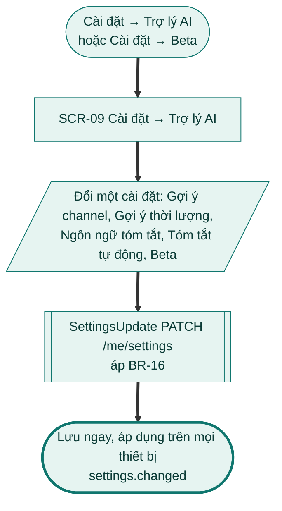

### Nhánh thay thế và lỗi

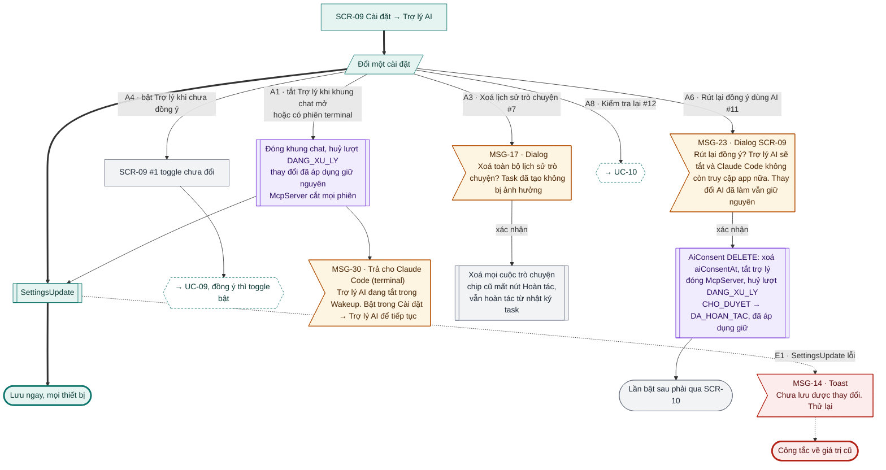

### Đối chiếu

| Mã | Điều kiện | Kết thúc ở | Thông báo |
|---|---|---|---|
| A1 | Tắt Trợ lý khi chat mở / có phiên terminal | Chat đóng, phiên bị cắt | MSG-30 (gửi cho terminal) |
| A2 | Tắt Beta khi có đề xuất CHO_DUYET | Bỏ (1.1) (C44) | – |
| A3 | Xoá lịch sử trò chuyện | Mọi cuộc trò chuyện bị xoá | MSG-17 |
| A4 | Bật Trợ lý khi chưa đồng ý | [UC-09](#uc-09-đồng-ý-dùng-ai-lần-đầu) | – |
| A5 | Bật / tắt "Cho AI đọc dữ liệu từ công cụ đã kết nối" | Bỏ (1.1) | MSG-20 |
| A6 | Rút lại đồng ý | Trợ lý tắt, McpServer đóng | MSG-23 |
| A7 | (SRS đã bỏ — F4: không còn công tắc hoàn thành / xoá) | – | – |
| A8 | Kiểm tra lại Claude Code | [UC-10](#uc-10-phát-hiện-và-kết-nối-claude-code) | – |
| E1 | SettingsUpdate lỗi (C43) | Công tắc về giá trị cũ | MSG-14 |

---

## UC-08 Chạy bộ đánh giá trước khi đổi prompt, công cụ MCP hoặc phiên bản Claude Code

**Mở đầu:** kỹ sư AI có cấu hình AI mới ở môi trường kiểm thử. **Thành công:** báo cáo đạt BR-18, cấu hình gắn nhãn "được phép phát hành". **Thất bại:** cấu hình bị chặn, bản phát hành giữ cấu hình cũ. Không có màn hình trong app; flow để đội kỹ thuật đối chiếu.

### Happy case

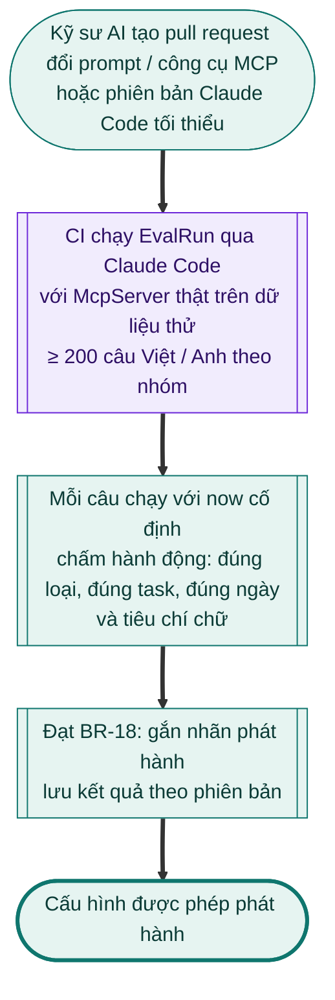

### Nhánh lỗi

```mermaid
flowchart TD
  p1[["EvalRun qua Claude Code"]]
  p2[["Chấm từng câu"]]
  ok(["Cấu hình được phép phát hành"])
  p1 ==> p2 ==> ok

  p1 -.->|"E2 · Claude Code lỗi / hết hạn mức khi chạy"| e2[["Chạy lại câu lỗi tối đa 2 lần"]]
  e2 -.->|"chạy được"| p2
  e2 -.->|"vẫn lỗi: coi là sai"| p2
  p2 -.->|"E1 · dưới 95% tổng hoặc dưới 100%<br/>nhóm rào chắn / ngày giờ / lệnh ẩn trong dữ liệu"| e1["Chặn merge<br/>báo cáo liệt kê câu sai"]
  e1 -.-> fail(["Cấu hình bị chặn<br/>bản phát hành giữ cấu hình cũ"])

  class p2 happy
  class p1 ai
  class e2,e1 err
  class ok done
  class fail fail
  classDef happy fill:#E6F4F1,stroke:#0F766E,color:#0B3B36
  classDef alt fill:#F1F3F5,stroke:#6B7280,color:#1F2937
  classDef err fill:#FDECEC,stroke:#B42318,color:#5C1010
  classDef warn fill:#FEF4E2,stroke:#B45309,color:#4A2604
  classDef ai fill:#F1ECFD,stroke:#6D28D9,color:#2E1065
  classDef sync fill:#FFFFFF,stroke:#6B7280,stroke-dasharray:4 3,color:#1F2937
  classDef link fill:#FFFFFF,stroke:#0F766E,stroke-dasharray:4 3,color:#0B3B36
  classDef done fill:#E6F4F1,stroke:#0F766E,stroke-width:3px,color:#0B3B36
  classDef fail fill:#FDECEC,stroke:#B42318,stroke-width:3px,color:#5C1010
```

### Đối chiếu

| Mã | Điều kiện | Kết thúc ở | Thông báo |
|---|---|---|---|
| E1 | Không đạt ngưỡng BR-18 | Chặn merge, báo cáo câu sai | – |
| E2 | Claude Code lỗi / hết hạn mức khi chạy | Chạy lại tối đa 2 lần, vẫn lỗi coi là sai | – |

---

## UC-09 Đồng ý dùng AI lần đầu

**Mở đầu:** đã đăng nhập, Claude Code `SAN_SANG` (chưa sẵn sàng thì mọi điểm vào AI ẩn, thay bằng SCR-11, không tới đây; B44), `aiConsentAt` trống, người dùng bấm một điểm vào AI. **Thành công:** `aiConsentAt`, `aiConsentVersion` lưu, trợ lý bật, \[McpServer\] nhận kết nối, thao tác ban đầu tiếp tục. **Thất bại:** không lưu gì, trợ lý tắt, không lời gọi Claude Code nào.

### Happy case

```mermaid
flowchart TD
  start(["Bấm nút Trợ lý, Plan my day, Soạn bằng AI<br/>hoặc bật toggle Trợ lý SCR-09 #1<br/>khi chưa đồng ý"])
  s1["SCR-10 Đồng ý dùng AI · dialog gọn<br/>tiêu đề Bật trợ lý AI, chữ phụ chạy bằng Claude Code<br/>dữ liệu đưa cho Claude Code, tài khoản Claude của bạn,<br/>quyền của AI, link chính sách quyền riêng tư"]
  u1[/"Bấm Đồng ý và bật"/]
  p1[["AiConsent: lưu aiConsentAt, aiConsentVersion<br/>bật ai.assistantEnabled, phát settings.changed"]]
  p2[["App mở McpServer BR-27"]]
  ok(["SCR-10 đóng, tiếp thao tác ban đầu:<br/>mở khung chat, chạy UC-02,<br/>soạn highlights hoặc giữ toggle bật"])

  start ==> s1 ==> u1 ==> p1 ==> p2 ==> ok

  class start,s1,u1,p1 happy
  class p2 ai
  class ok done
  classDef happy fill:#E6F4F1,stroke:#0F766E,color:#0B3B36
  classDef alt fill:#F1F3F5,stroke:#6B7280,color:#1F2937
  classDef err fill:#FDECEC,stroke:#B42318,color:#5C1010
  classDef warn fill:#FEF4E2,stroke:#B45309,color:#4A2604
  classDef ai fill:#F1ECFD,stroke:#6D28D9,color:#2E1065
  classDef sync fill:#FFFFFF,stroke:#6B7280,stroke-dasharray:4 3,color:#1F2937
  classDef link fill:#FFFFFF,stroke:#0F766E,stroke-dasharray:4 3,color:#0B3B36
  classDef done fill:#E6F4F1,stroke:#0F766E,stroke-width:3px,color:#0B3B36
  classDef fail fill:#FDECEC,stroke:#B42318,stroke-width:3px,color:#5C1010
```

### Nhánh thay thế và lỗi

```mermaid
flowchart TD
  start(["Bấm một điểm vào AI"])
  s1["SCR-10 Đồng ý dùng AI"]
  u1[/"Bấm Đồng ý và bật"/]
  p1[["AiConsent"]]
  ok(["Tiếp thao tác ban đầu"])
  start ==> s1 ==> u1 ==> p1 ==> ok

  start -->|"A2 · đã đồng ý trên thiết bị khác"| a2["settings.changed cập nhật<br/>không hiện SCR-10"]
  a2 --> ok
  s1 -->|"A1 · Để sau / đóng"| a1(["Không lưu, toggle giữ tắt<br/>Daily planning thủ công,<br/>highlights dùng danh sách sinh sẵn"])
  p1 -.->|"E1 · AiConsent lỗi / mất mạng"| e1m>"MSG-14 · Toast<br/>Chưa lưu được thay đổi. Thử lại"]
  e1m -.-> fail(["Không bật trợ lý"])

  class start,s1,u1,p1 happy
  class a2,a1 alt
  class e1m err
  class ok done
  class fail fail
  classDef happy fill:#E6F4F1,stroke:#0F766E,color:#0B3B36
  classDef alt fill:#F1F3F5,stroke:#6B7280,color:#1F2937
  classDef err fill:#FDECEC,stroke:#B42318,color:#5C1010
  classDef warn fill:#FEF4E2,stroke:#B45309,color:#4A2604
  classDef ai fill:#F1ECFD,stroke:#6D28D9,color:#2E1065
  classDef sync fill:#FFFFFF,stroke:#6B7280,stroke-dasharray:4 3,color:#1F2937
  classDef link fill:#FFFFFF,stroke:#0F766E,stroke-dasharray:4 3,color:#0B3B36
  classDef done fill:#E6F4F1,stroke:#0F766E,stroke-width:3px,color:#0B3B36
  classDef fail fill:#FDECEC,stroke:#B42318,stroke-width:3px,color:#5C1010
```

### Đối chiếu

| Mã | Điều kiện | Kết thúc ở | Thông báo |
|---|---|---|---|
| A1 | Để sau / đóng SCR-10 | Không lưu; luồng thủ công ([G08](g08-daily-rituals.md#uc-01-daily-planning-luồng-thủ-công)) | – |
| A2 | Đã đồng ý trên thiết bị khác | Không hiện SCR-10 | – |
| A3 | Workspace chỉ đọc | Bỏ (1.1) | – |
| E1 | AiConsent lỗi / mất mạng | Không bật trợ lý | MSG-14 |

---

## UC-10 Phát hiện và kết nối Claude Code

**Mở đầu:** đã đăng nhập app trên Windows. **Thành công:** trạng thái `SAN_SANG`, điểm vào AI hiện (khi trợ lý bật và đã đồng ý). **Thất bại:** `CHUA_CAI` / `CHUA_DANG_NHAP` / `PHIEN_BAN_CU`, điểm vào AI ẩn, SCR-11 hiện hướng dẫn, chức năng lõi không bị ảnh hưởng.

### Happy case

```mermaid
flowchart TD
  start(["App khởi động, mở SCR-09, bấm Kiểm tra lại<br/>hoặc một lời gọi lỗi vì CLI"])
  s1["SCR-09 #12 Đang kiểm tra Claude Code…<br/>DANG_KIEM_TRA"]
  p1[["ClaudeCodeDetect: tìm CLI trên máy,<br/>đọc phiên bản, kiểm trạng thái đăng nhập"]]
  s2["SCR-09 #12 Claude Code · {phiên bản} · Sẵn sàng<br/>SAN_SANG"]
  d1{"Trợ lý bật và đã đồng ý?"}
  p2[["Hiện điểm vào AI<br/>mở McpServer BR-27"]]
  ok(["Nút Trợ lý, Plan my day,<br/>Soạn bằng AI dùng được"])
  ok2(["SCR-09 #1 toggle Trợ lý dùng được<br/>bật thì vào UC-09"])

  start ==> s1 ==> p1 ==> s2 ==> d1
  d1 ==>|"có"| p2 ==> ok
  d1 ==>|"chưa"| ok2

  class start,s1,p1,s2,d1 happy
  class p2 ai
  class ok,ok2 done
  classDef happy fill:#E6F4F1,stroke:#0F766E,color:#0B3B36
  classDef alt fill:#F1F3F5,stroke:#6B7280,color:#1F2937
  classDef err fill:#FDECEC,stroke:#B42318,color:#5C1010
  classDef warn fill:#FEF4E2,stroke:#B45309,color:#4A2604
  classDef ai fill:#F1ECFD,stroke:#6D28D9,color:#2E1065
  classDef sync fill:#FFFFFF,stroke:#6B7280,stroke-dasharray:4 3,color:#1F2937
  classDef link fill:#FFFFFF,stroke:#0F766E,stroke-dasharray:4 3,color:#0B3B36
  classDef done fill:#E6F4F1,stroke:#0F766E,stroke-width:3px,color:#0B3B36
  classDef fail fill:#FDECEC,stroke:#B42318,stroke-width:3px,color:#5C1010
```

### Nhánh thay thế và lỗi

```mermaid
flowchart TD
  s1["SCR-09 #12 Đang kiểm tra…"]
  p1[["ClaudeCodeDetect"]]
  s2["SCR-09 #12 Sẵn sàng"]
  s1 ==> p1 ==> s2

  p1 -->|"A1 · không tìm thấy CLI"| a1["CHUA_CAI · ẩn điểm vào AI"]
  a1 --> a1m>"MSG-24 · SCR-11<br/>Cài Claude Code để bật trợ lý AI. Bạn vẫn dùng đầy đủ app khi chưa có trợ lý · Xem hướng dẫn · Kiểm tra lại"]
  p1 -->|"A2 · có CLI, chưa đăng nhập"| a2["CHUA_DANG_NHAP · ẩn điểm vào AI"]
  a2 --> a2m>"MSG-25 · SCR-11<br/>Đã tìm thấy Claude Code nhưng chưa đăng nhập. Đăng nhập tài khoản Claude rồi bấm Kiểm tra lại"]
  p1 -->|"A3 · phiên bản dưới tối thiểu"| a3["PHIEN_BAN_CU · ẩn điểm vào AI"]
  a3 --> a3m>"MSG-26 · SCR-11<br/>Claude Code phiên bản {x} chưa được hỗ trợ. Cập nhật lên {tối thiểu} trở lên rồi bấm Kiểm tra lại"]
  a1m --> s11["SCR-11 Cài đặt để dùng trợ lý AI<br/>thẻ thay mọi điểm vào AI, B44<br/>Xem hướng dẫn · Kiểm tra lại · Ẩn<br/>Bạn vẫn dùng đầy đủ app khi chưa có trợ lý AI"]
  a2m --> s11
  a3m --> s11
  s11 -->|"Xem hướng dẫn"| g1(["Trang hướng dẫn cài / đăng nhập / cập nhật<br/>của Anthropic trong trình duyệt"])
  s11 -->|"Ẩn"| h1(["Thẻ ẩn ở board / ritual<br/>vẫn hiện ở SCR-09"])
  s11 -->|"A5 · cài / đăng nhập xong: Kiểm tra lại<br/>hoặc app được focus lại"| s1
  s2 -->|"A4 · trạng thái xấu đi khi đang dùng:<br/>gỡ, đăng xuất, phiên Claude hết hạn"| a4[["Lượt đang chạy lỗi theo BR-29, ẩn điểm vào AI<br/>thay đổi đã áp dụng vẫn hoàn tác được<br/>từ nhật ký task và SCR-12"]]
  a4 -->|"kiểm tra lại"| s1

  p1 -.->|"E1 · kiểm tra quá 10 giây / lỗi không rõ"| e1["Coi như trạng thái gần nhất đã biết<br/>lần đầu: CHUA_CAI; ghi log"]
  e1 -.-> s11

  class s1,p1,s2 happy
  class a1,a2,a3,a1m,a2m,a3m,s11,g1,h1,a4 alt
  class e1 err
  classDef happy fill:#E6F4F1,stroke:#0F766E,color:#0B3B36
  classDef alt fill:#F1F3F5,stroke:#6B7280,color:#1F2937
  classDef err fill:#FDECEC,stroke:#B42318,color:#5C1010
  classDef warn fill:#FEF4E2,stroke:#B45309,color:#4A2604
  classDef ai fill:#F1ECFD,stroke:#6D28D9,color:#2E1065
  classDef sync fill:#FFFFFF,stroke:#6B7280,stroke-dasharray:4 3,color:#1F2937
  classDef link fill:#FFFFFF,stroke:#0F766E,stroke-dasharray:4 3,color:#0B3B36
  classDef done fill:#E6F4F1,stroke:#0F766E,stroke-width:3px,color:#0B3B36
  classDef fail fill:#FDECEC,stroke:#B42318,stroke-width:3px,color:#5C1010
```

### Đối chiếu

| Mã | Điều kiện | Kết thúc ở | Thông báo |
|---|---|---|---|
| A1 | Không tìm thấy CLI | CHUA_CAI, SCR-11 | MSG-24 |
| A2 | Có CLI, chưa đăng nhập | CHUA_DANG_NHAP, SCR-11 | MSG-25 |
| A3 | Phiên bản dưới tối thiểu | PHIEN_BAN_CU, SCR-11 | MSG-26 |
| A4 | Trạng thái xấu đi khi đang dùng | Lượt đang chạy lỗi, ẩn điểm vào AI, kiểm tra lại | Theo BR-29 (MSG-27 / SCR-11) |
| A5 | Cài / đăng nhập xong, quay lại app | Kiểm tra lại từ bước 2 | – |
| E1 | Kiểm tra quá 10 giây / lỗi không rõ | Trạng thái gần nhất đã biết, SCR-11 | MSG-24 / 25 / 26 |

---

## UC-11 Điều khiển app từ Claude Code trong terminal

**Mở đầu:** app đang mở và đã đăng nhập, trợ lý bật và đã đồng ý, người dùng đã cấu hình Claude Code kết nối tới \[McpServer\] theo SCR-09 #13. **Thành công:** thay đổi áp dụng ngay, chip "AI", nhật ký `terminal`, hoàn tác được ở SCR-12. **Thất bại:** task không đổi, Claude Code nhận lỗi từ công cụ.

### Happy case

```mermaid
flowchart TD
  start(["Terminal · người dùng mở Claude Code<br/>app đang mở, đã cấu hình theo SCR-09 #13"])
  u1[/"Ra lệnh, ví dụ dời các task review sang chiều mai"/]
  p1[["Claude Code kết nối McpServer<br/>kiểm BR-27, tạo phiên AI terminal<br/>đề xuất DANG_XU_LY"]]
  p2[["Claude Code gọi Xem ngữ cảnh thời gian,<br/>công cụ đọc, rồi công cụ ghi ngày tuyệt đối"]]
  p3[["McpServer · AiActionExecutor kiểm BR-01, 02, 04, 26<br/>áp dụng ngay, chip AI<br/>nhật ký Claude Code (terminal) đã …"]]
  m1>"MSG-29 · Toast<br/>Claude Code (terminal) đã thay đổi {n} task · Xem · Hoàn tác"]
  s1["SCR-12 Hoạt động AI<br/>dòng phiên Đang hoạt động; board, lịch cập nhật"]
  u2[/"Thoát Claude Code / ngắt kết nối"/]
  ok(["Phiên kết thúc, đề xuất DA_AP_DUNG<br/>không có thay đổi thì không lưu"])

  start ==> u1 ==> p1 ==> p2 ==> p3 ==> m1 ==> s1 ==> u2 ==> ok

  class start,u1,m1,s1,u2 happy
  class p1,p2,p3 ai
  class ok done
  classDef happy fill:#E6F4F1,stroke:#0F766E,color:#0B3B36
  classDef alt fill:#F1F3F5,stroke:#6B7280,color:#1F2937
  classDef err fill:#FDECEC,stroke:#B42318,color:#5C1010
  classDef warn fill:#FEF4E2,stroke:#B45309,color:#4A2604
  classDef ai fill:#F1ECFD,stroke:#6D28D9,color:#2E1065
  classDef sync fill:#FFFFFF,stroke:#6B7280,stroke-dasharray:4 3,color:#1F2937
  classDef link fill:#FFFFFF,stroke:#0F766E,stroke-dasharray:4 3,color:#0B3B36
  classDef done fill:#E6F4F1,stroke:#0F766E,stroke-width:3px,color:#0B3B36
  classDef fail fill:#FDECEC,stroke:#B42318,stroke-width:3px,color:#5C1010
```

### Nhánh thay thế và lỗi

```mermaid
flowchart TD
  start(["Terminal · Claude Code"])
  p1[["Kết nối McpServer, kiểm BR-27"]]
  p2[["Claude Code đọc, gọi công cụ ghi"]]
  p3[["McpServer áp dụng ngay"]]
  m1>"MSG-29 · Toast<br/>Claude Code (terminal) đã thay đổi {n} task · Xem · Hoàn tác"]
  start ==> p1 ==> p2 ==> p3 ==> m1

  p2 -->|"A5 · ngày tương đối trong khung mơ hồ BR-05"| a5[["Công cụ ghi chỉ nhận ngày tuyệt đối<br/>mô tả công cụ yêu cầu Claude Code hỏi lại<br/>server vẫn chặn PAST_DATE"]]
  a5 --> p2
  p3 -->|"A3 · khung chat của app cũng đang chạy"| a3[["Hai phiên độc lập, xung đột theo QC-08<br/>phiên bản cũ nhận VERSION_CONFLICT"]]
  a3 --> p2
  p3 -->|"A4 · hành động bị cấm / công cụ không có"| a4[["Trả AI_ACTION_FORBIDDEN<br/>kèm MSG-07 dạng chữ"]]
  a4 --> a4m>"MSG-07 · Claude Code báo lại trong terminal<br/>Mình không thể {xoá vĩnh viễn / gửi tin ra ngoài / đổi cài đặt / hoàn thành hay xoá task đồng bộ từ công cụ khác}. Bạn có thể tự làm: {cách làm}"]
  m1 -->|"Xem"| a2s["SCR-12 Hoạt động AI"]
  p3 -->|"cửa sổ app ẩn ở khay / thu nhỏ, IA-21"| hid["MSG-29 không bật toast<br/>vào trung tâm thông báo, badge tăng"]
  hid --> hidx{{"→ G12 · UC-09 A5"}}
  hid -->|"bấm dòng, cửa sổ lên trước"| a2s
  m1 -->|"A2 · Hoàn tác trên toast"| a2{{"→ UC-04 thay đổi của phiên"}}
  a2s -->|"A2 · Hoàn tác tất cả"| a2

  start -.->|"E1 · app không mở / chưa đăng nhập"| e1(["Claude Code không kết nối được McpServer<br/>không có thay đổi"])
  p1 -.->|"E2 · trợ lý tắt"| e2m>"MSG-30 · Trả cho Claude Code (terminal)<br/>Trợ lý AI đang tắt trong Wakeup. Bật trong Cài đặt → Trợ lý AI để tiếp tục"]
  e2m -.-> e2(["McpServer từ chối kết nối<br/>AI_ASSISTANT_DISABLED / AI_CONSENT_REQUIRED"])
  p1 -.->|"E2 · chưa đồng ý"| e2c>"MSG-33 · Trả cho Claude Code và toast trong app<br/>Trợ lý AI cần bạn đồng ý trước khi dùng. Mở Wakeup để xem và đồng ý · Xem và đồng ý"]
  e2c -.-> e2
  e2c -->|"Xem và đồng ý"| e2x{{"→ UC-09 · SCR-10"}}
  p3 -.->|"E3 · tắt trợ lý / rút lại đồng ý / đóng app giữa phiên"| e3[["McpServer cắt phiên<br/>thay đổi đã áp dụng giữ, hoàn tác được"]]
  e3 -.->|"tắt trợ lý"| e2m
  e3 -.-> e3e(["Phiên kết thúc"])
  p3 -.->|"E4 · VERSION_CONFLICT / PAST_DATE"| e4[["Công cụ trả lỗi cho Claude Code"]]
  e4 -.-> e4e(["Task không đổi"])
  p3 -.->|"E5 · app mất kết nối server"| e5[["Công cụ ghi trả AI_OFFLINE<br/>công cụ đọc trả dữ liệu trên máy kèm thời điểm"]]
  e5 -.-> e4e

  class start happy
  class hid alt
  class hidx link
  class p1,p2,p3,a5,a3,a4 ai
  class m1 happy
  class a4m,a2s alt
  class a2 link
  class e2m,e2c,e3,e4,e5 err
  class e2x link
  class e1,e2,e3e,e4e fail
  classDef happy fill:#E6F4F1,stroke:#0F766E,color:#0B3B36
  classDef alt fill:#F1F3F5,stroke:#6B7280,color:#1F2937
  classDef err fill:#FDECEC,stroke:#B42318,color:#5C1010
  classDef warn fill:#FEF4E2,stroke:#B45309,color:#4A2604
  classDef ai fill:#F1ECFD,stroke:#6D28D9,color:#2E1065
  classDef sync fill:#FFFFFF,stroke:#6B7280,stroke-dasharray:4 3,color:#1F2937
  classDef link fill:#FFFFFF,stroke:#0F766E,stroke-dasharray:4 3,color:#0B3B36
  classDef done fill:#E6F4F1,stroke:#0F766E,stroke-width:3px,color:#0B3B36
  classDef fail fill:#FDECEC,stroke:#B42318,stroke-width:3px,color:#5C1010
```

### Đối chiếu

| Mã | Điều kiện | Kết thúc ở | Thông báo |
|---|---|---|---|
| A1 | Phiên đọc dữ liệu tích hợp, thay đổi chờ duyệt ở SCR-12 | Bỏ (1.1) | MSG-31, MSG-22 |
| A2 | Hoàn tác trên toast / Hoàn tác tất cả trong SCR-12 | [UC-04](#uc-04-hoàn-tác-hành-động-ai) | – |
| A3 | Khung chat của app cũng đang chạy | Hai phiên độc lập, QC-08 | – |
| A4 | Hành động bị cấm / không có công cụ | AI_ACTION_FORBIDDEN, Claude Code báo lại | MSG-07 (dạng chữ) |
| A5 | Ngày tương đối trong khung mơ hồ | Claude Code hỏi lại (không bảo đảm), server chặn PAST_DATE | – |
| – | Cửa sổ app ẩn ở khay / thu nhỏ (IA-21, F6) | MSG-29 vào trung tâm thông báo ([G12 UC-09](g12-workspace-billing.md#uc-09-trung-tâm-thông-báo) A5), bấm dòng mở SCR-12 | MSG-29 |
| E1 | App không mở / chưa đăng nhập | Không kết nối được | – |
| E2 | Trợ lý tắt | Từ chối kết nối | MSG-30 |
| E2 | Chưa đồng ý (C45) | Từ chối kết nối; toast trong app, "Xem và đồng ý" → [UC-09](#uc-09-đồng-ý-dùng-ai-lần-đầu) SCR-10 | MSG-33 |
| E3 | Tắt trợ lý / rút đồng ý / đóng app giữa phiên | Phiên bị cắt, giữ thay đổi đã áp dụng | MSG-30 (khi tắt trợ lý, BR-16) |
| E3 (phần thay đổi CHO_DUYET của phiên) | Phiên có dữ liệu tích hợp | Bỏ (1.1) | – |
| E4 | VERSION_CONFLICT / PAST_DATE | Task không đổi | – |
| E4 (phần workspace chỉ đọc) | WORKSPACE_READ_ONLY | Bỏ (1.1) | – |
| E5 | App mất kết nối server | AI_OFFLINE, task không đổi | – |

---

## UC-12 Gợi ý thời lượng và channel qua Claude Code (cho G02)

**Mở đầu:** G02 gọi \[TaskSuggest\] khi người dùng tạo task. **Thành công:** trả `plannedMin`, `channelId`, `confidence` cho G02 trong ngưỡng thời gian của G02. **Thất bại:** không trả gợi ý, G02 bỏ qua (G02 UC-01 A4). G10 không có giao diện riêng; trải nghiệm vẽ ở [G02 UC-01](g02-quan-ly-task.md#uc-01-tạo-task).

### Happy case

```mermaid
flowchart TD
  start(["G02 · UC-01 ô soạn task<br/>gọi TaskSuggest với tiêu đề, ngày dự định"])
  p1[["Kiểm BR-30: trợ lý bật, đã đồng ý, SAN_SANG,<br/>bật Gợi ý channel / Gợi ý thời lượng"]]
  p2[["ClaudeCodeRun lượt ngắn, chỉ đọc<br/>aiAgent task_suggest: danh sách channel,<br/>thời lượng các task tương tự"]]
  p3[["Trả plannedMin, channelId, confidence"]]
  ok(["G02 SCR-01 chip Thời lượng, Channel<br/>có dấu gợi ý AI, nguồn ai"])

  start ==> p1 ==> p2 ==> p3 ==> ok

  class start,p1 happy
  class p2,p3 ai
  class ok done
  classDef happy fill:#E6F4F1,stroke:#0F766E,color:#0B3B36
  classDef alt fill:#F1F3F5,stroke:#6B7280,color:#1F2937
  classDef err fill:#FDECEC,stroke:#B42318,color:#5C1010
  classDef warn fill:#FEF4E2,stroke:#B45309,color:#4A2604
  classDef ai fill:#F1ECFD,stroke:#6D28D9,color:#2E1065
  classDef sync fill:#FFFFFF,stroke:#6B7280,stroke-dasharray:4 3,color:#1F2937
  classDef link fill:#FFFFFF,stroke:#0F766E,stroke-dasharray:4 3,color:#0B3B36
  classDef done fill:#E6F4F1,stroke:#0F766E,stroke-width:3px,color:#0B3B36
  classDef fail fill:#FDECEC,stroke:#B42318,stroke-width:3px,color:#5C1010
```

### Nhánh lỗi

```mermaid
flowchart TD
  p1[["Kiểm BR-30"]]
  p2[["Claude Code lượt ngắn, chỉ đọc"]]
  ok(["G02 chip có dấu gợi ý AI"])
  p1 ==> p2 ==> ok

  p1 -.->|"E1 · không thoả BR-30"| e1(["Không trả gợi ý, không báo lỗi"])
  p2 -.->|"E1 · Claude Code lỗi / chậm hơn ngưỡng G02 / hết hạn mức"| e1
  p2 -.->|"lỗi vì CLI"| e1x{{"→ UC-10 kiểm tra lại Claude Code"}}
  e1 -.-> g02{{"→ G02 · UC-01 A4"}}

  class p1 happy
  class p2 ai
  class e1 fail
  class e1x,g02 link
  class ok done
  classDef happy fill:#E6F4F1,stroke:#0F766E,color:#0B3B36
  classDef alt fill:#F1F3F5,stroke:#6B7280,color:#1F2937
  classDef err fill:#FDECEC,stroke:#B42318,color:#5C1010
  classDef warn fill:#FEF4E2,stroke:#B45309,color:#4A2604
  classDef ai fill:#F1ECFD,stroke:#6D28D9,color:#2E1065
  classDef sync fill:#FFFFFF,stroke:#6B7280,stroke-dasharray:4 3,color:#1F2937
  classDef link fill:#FFFFFF,stroke:#0F766E,stroke-dasharray:4 3,color:#0B3B36
  classDef done fill:#E6F4F1,stroke:#0F766E,stroke-width:3px,color:#0B3B36
  classDef fail fill:#FDECEC,stroke:#B42318,stroke-width:3px,color:#5C1010
```

### Đối chiếu

| Mã | Điều kiện | Kết thúc ở | Thông báo |
|---|---|---|---|
| E1 | Không thoả BR-30, Claude Code lỗi / chậm / hết hạn mức | Không gợi ý → [G02 UC-01](g02-quan-ly-task.md#uc-01-tạo-task) A4; lỗi vì CLI thì kiểm tra lại ([UC-10](#uc-10-phát-hiện-và-kết-nối-claude-code)) | – |

## Kiểm tra

- [x] Mọi A# / E# của UC-01 … UC-12 bản 1.0 có trên sơ đồ hoặc ghi "Bỏ (1.1)" / "SRS đã bỏ".
- [x] Mọi nút màn hình có mã SCR; mọi nút thông báo có mã MSG, nội dung chép nguyên văn mục 9 SRS (chỉ thay dấu ngoặc kép bằng `#quot;` cho Mermaid).
- [x] Không dùng tên "Claude Code" làm tên tính năng / nút trong nhãn màn hình (ADR-0004); "Claude Code" chỉ xuất hiện khi mô tả bước hệ thống, trạng thái SCR-09 #12 và nội dung MSG nguyên văn.
- [x] Không emoji: nút biểu tượng lấp lánh của SRS ghi là "nút Trợ lý", nhãn biểu tượng lấp lánh của SCR-07 ghi là "nhãn gợi ý AI".

**Ghi chú cho brief G10**

1. ~~**Tên có "Claude Code" trên giao diện (ADR-0004).** SRS đặt SCR-09 #13 là "Dùng Claude Code trong terminal", tiêu đề SCR-10 là "Bật trợ lý AI với Claude Code", tên SCR-11 là "Hướng dẫn cài Claude Code". ADR-0004 chỉ cho ghi chữ thường "chạy bằng Claude Code", không dùng làm tên tính năng hay nút. Brief cần đặt lại các nhãn này.~~ **Đã sửa 09/11/2026 (B42):** SCR-09 #13 "Dùng trợ lý từ terminal", tiêu đề SCR-10 "Bật trợ lý AI", SCR-11 "Cài đặt để dùng trợ lý AI"; chữ phụ nhỏ "chạy bằng Claude Code" ở SCR-04 #1, SCR-09 #13, SCR-10 #1.
2. ~~**Vị trí nút Trợ lý.** UC-03 bước 1 ghi "nút [biểu tượng lấp lánh] góc dưới", còn mục 6 Điểm vào ghi "cụm dưới sidebar (không nổi ở góc màn hình)". Sơ đồ theo mục 6.~~ **Đã sửa 09/11/2026 (C42):** UC-03 bước 1 ghi "cụm dưới sidebar" như mục 6 và IA-01.
3. ~~**UC-03 E6 và MSG-19.** E6 chỉ nói chip "Không thực hiện được"; BR-21 lại nói báo MSG-19, và nơi hiện của MSG-19 có "khung chat". Sơ đồ vẽ cả hai; cần chốt khung chat có hiện MSG-19 hay chỉ chip.~~ **Đã sửa 09/11/2026 (B43):** chip "Không thực hiện được" kèm một dòng MSG-19 trong khung chat.
4. ~~**UC-07 không có bảng luồng lỗi.** Chỉ hậu điều kiện thất bại nói "toggle về giá trị cũ, MSG-14". Sơ đồ vẽ nhánh này không có mã E.~~ **Đã sửa 09/11/2026 (C43):** thêm UC-07 E1 (công tắc về giá trị cũ, MSG-14); sơ đồ đã gắn mã.
5. ~~**Nhánh không xảy ra ở 1.0 nhưng SRS không ghi 1.1.** UC-07 A2 (tắt Beta khi có đề xuất CHO_DUYET) và UC-05 A6 (công tắc dữ liệu tích hợp tắt): ở 1.0 công tắc BR-20 ẩn nên đề xuất Planning Agent không bao giờ ở CHO_DUYET và A6 luôn đúng. Tương tự, các ý "task có liên kết tích hợp" (LINKED_TASK) ở UC-03 A4 / A12 không xảy ra khi chưa có G11.~~ **Đã sửa 09/11/2026 (C44, A9):** UC-07 A2, UC-05 A6, phần `LINKED_TASK` của UC-03 A4 / A12 ghi "(1.1)"; sơ đồ bỏ hai nhánh A2, A6, bảng ghi "Bỏ (1.1)".
6. ~~**Chữ nhắc Jira / Notion / Gmail ở 1.0.** Bước tiến độ "Đọc việc từ công cụ" (SCR-02 #5) và danh sách nguồn Gmail / Jira / Notion (SCR-01 #2) nhắc công cụ của G11, trong khi G11 ra ở 1.1. Cần chốt có ẩn ở 1.0 không. (MSG-32 và SCR-09 #14 cũng nhắc, nhưng đã bỏ theo F4.)~~ **Đã sửa 09/11/2026 (C44, A9):** SCR-01 #2 (Gmail / Jira / Notion) và bước "Đọc việc từ công cụ" của SCR-02 #5 ghi 1.1, ẩn ở 1.0.
7. ~~**MSG-30 dùng cho cả hai lỗi.** UC-11 E2 trả MSG-30 cho cả `AI_ASSISTANT_DISABLED` và `AI_CONSENT_REQUIRED`, nhưng chữ "Trợ lý AI đang tắt… Bật trong Cài đặt" không nói tới bước đồng ý (SCR-10).~~ **Đã sửa 09/11/2026 (C45):** `AI_CONSENT_REQUIRED` dùng MSG-33 (nói rõ cần đồng ý, toast trong app có nút mở SCR-10); MSG-30 chỉ còn cho `AI_ASSISTANT_DISABLED`. Sơ đồ UC-11 tách hai nhánh E2.
8. ~~**Thiếu chữ / đích.** UC-05 A3 "hỏi xác nhận ghi đè" chưa có MSG. UC-01: lưu hồ sơ khi mở từ Cài đặt thì về đâu (SRS chỉ nói trường hợp mở từ "Plan my day"). UC-01 E1: theme day > 100 ký tự (SCR-01 #4) chưa ghi rõ có dùng MSG-02 không. UC-04 A3 "ghi 'không còn task'" chưa rõ hiện ở đâu. UC-06: bấm "Hữu ích / Chưa tốt" có mở SCR-08 hay chỉ ghi đánh giá; khi E1 (lưu lỗi, thử lại nền) có còn hiện MSG-16 không.~~ **Đã sửa 09/11/2026 (C46):** UC-05 A3 hỏi trước bằng MSG-39; UC-01 mở từ Cài đặt thì ở lại SCR-09; UC-01 E1 gồm theme ngày > 100 ký tự (MSG-02); UC-04 A3 báo MSG-40 trong khung chat; UC-06 A2 "Hữu ích" chỉ ghi đánh giá, "Chưa tốt" mở SCR-08; UC-06 E1 vẫn hiện MSG-16.
9. ~~**UC-09 tiền điều kiện** "Claude Code `SAN_SANG`" vẫn là câu hỏi mở trong SRS (`[giả định]`). Sơ đồ vẽ theo giả định đó: khi chưa sẵn sàng, mọi điểm vào AI bị ẩn nên không tới SCR-10.~~ **Đã sửa 09/11/2026 (B44):** SRS bỏ `[giả định]`: Claude Code chưa sẵn sàng thì ẩn mọi điểm vào AI, thay bằng SCR-11.
10. **Mới 09/11/2026 (B45, B28):** bộ trạng thái lỗi đủ 6 (MSG-28 kèm giờ reset, MSG-34 … MSG-38) đã vẽ ở UC-03 "Nhánh lỗi: trạng thái lỗi Claude Code", UC-02 E9 / A12, UC-05 E1; chữ là chữ tạm, chốt chữ sau #24. "Plan my day" ở đầu bước 1 của wizard, chạy xong nhảy thẳng tới bước Daily plan (UC-02).
