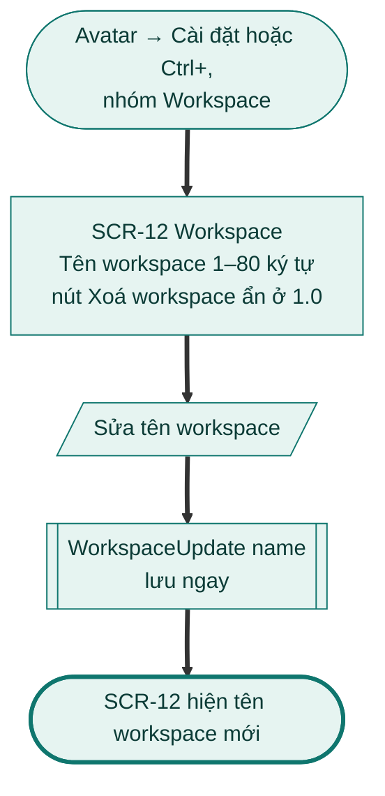
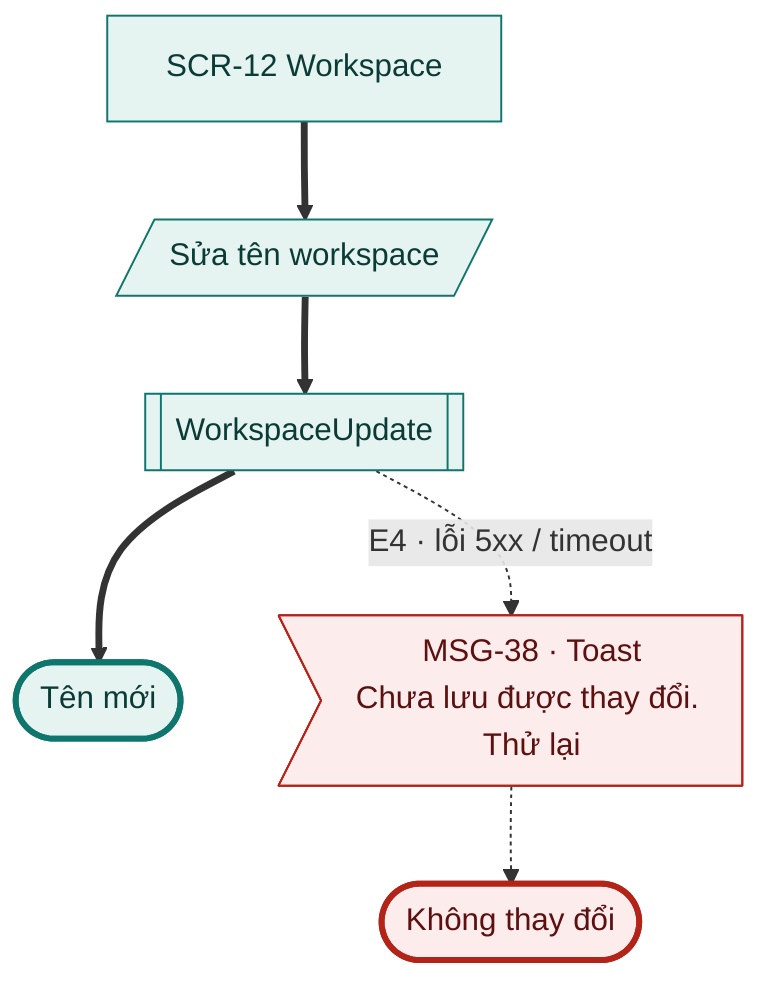
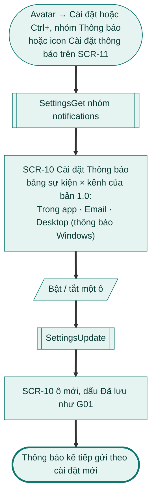
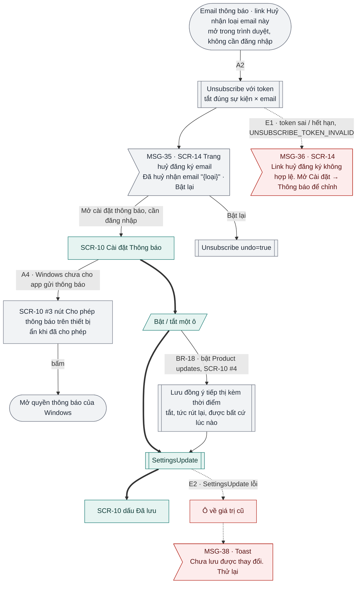
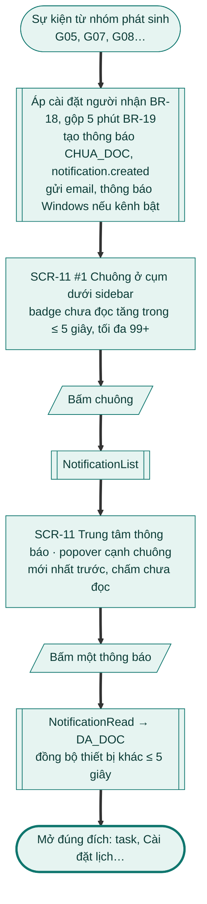
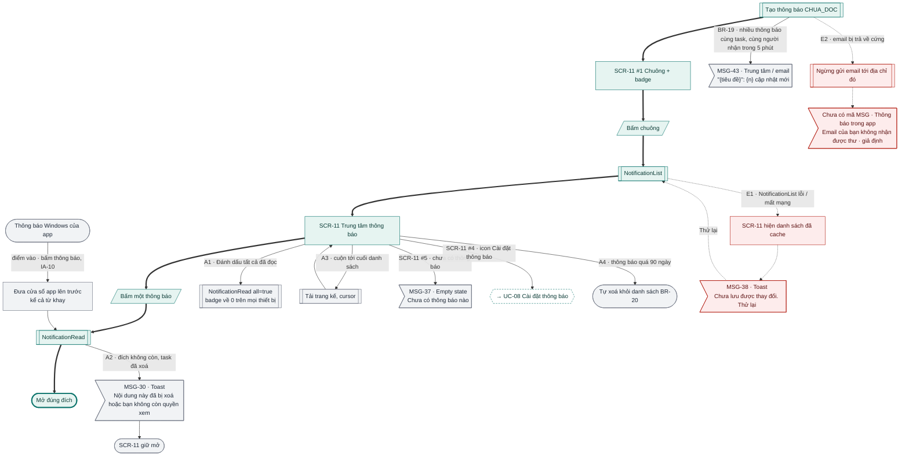

# Flow G12 Workspace, thông báo (phần 1.0)

> **Nguồn:** [srs-g12](../../features/srs-g12-workspace-billing.md) (commit `8fac830`) · **Brief:** `[chờ]`
> **Quy ước:** [_quy-uoc.md](_quy-uoc.md) · **FigJam:** `[chờ]`

Bản 1.0 là app Windows một người dùng, miễn phí, nhãn Beta. G12 ở 1.0 chỉ gồm: workspace cá nhân (đổi tên), cài đặt Thông báo, trung tâm thông báo, huỷ đăng ký email (SRS BR-22). Trial, thanh toán, chế độ chỉ đọc là 1.1; nhiều thành viên, Privacy, giao / follow task là bản sau, từ 1.2 (BR-28).

## Mục lục

| UC | Flow | Màn chính | Nhánh A / E (1.0) |
|---|---|---|---|
| UC-01 | Nâng cấp gói | – | Bỏ (1.1) |
| UC-02 | Hết trial, gia hạn, thử lại và chế độ chỉ đọc | – | Bỏ (1.1) |
| UC-03 | Đổi gói, huỷ gói và tải hoá đơn | – | Bỏ (1.1) |
| UC-04 | Mời thành viên | – | Bỏ (1.2) |
| [UC-05](#uc-05-quản-lý-thành-viên-và-workspace) | Quản lý thành viên và workspace: **chỉ A5 đổi tên workspace** | SCR-12 Workspace | 1 / 1 (phần còn lại Bỏ (1.2)) |
| UC-06 | Cài đặt quyền riêng tư | – | Bỏ (1.2) |
| UC-07 | Giao task và follow task | – | Bỏ (1.2) |
| [UC-08](#uc-08-cài-đặt-thông-báo-và-huỷ-đăng-ký-email) | Cài đặt thông báo và huỷ đăng ký email | SCR-10, SCR-14 | 2 / 2 (A1, A3 Bỏ (1.1)) |
| [UC-09](#uc-09-trung-tâm-thông-báo) | Trung tâm thông báo | SCR-11 | 4 / 2 |

---

## UC-05 Quản lý thành viên và workspace

Ở 1.0 chỉ có **A5 Đổi tên workspace**; luồng chính (đổi vai trò) và các nhánh khác là bản sau (BR-28). Sơ đồ dưới vẽ A5 như luồng chính của bản 1.0.

**Mở đầu:** Cài đặt → Workspace (SCR-12), người dùng là `OWNER` của workspace cá nhân. **Thành công:** tên workspace mới được lưu ngay. **Thất bại:** không thay đổi.

### Happy case (A5 đổi tên workspace)

### Nhánh lỗi

### Đối chiếu

| Mã | Điều kiện | Kết thúc ở | Thông báo |
|---|---|---|---|
| Luồng chính | Đổi vai trò thành viên | Bỏ (1.2) | – |
| A1 | Xoá thành viên | Bỏ (1.2) | – |
| A2 | Chuyển quyền sở hữu | Bỏ (1.2) | – |
| A3 | Rời workspace | Bỏ (1.2) | – |
| A4 | Xoá workspace | Bỏ (1.2); ở 1.0 nút ẩn, xoá workspace cá nhân = xoá tài khoản ([G01 · UC-09](g01-tai-khoan.md)) | – |
| A5 | Đổi tên workspace | Tên mới, lưu ngay | – |
| A6 | Chủ mới chưa nhập phương thức thanh toán | Bỏ (1.2) | – |
| E1 | Sai vai trò | Bỏ (1.2) | – |
| E2 | `OWNER` rời khi còn thành viên | Bỏ (1.2) | – |
| E3 | Gõ sai tên workspace / mật khẩu khi xoá, chuyển quyền | Bỏ (1.2) | – |
| E4 | Lỗi 5xx (áp cho A5 theo bảng map lỗi mục 8) | Không thay đổi | MSG-38 |

---

## UC-08 Cài đặt thông báo và huỷ đăng ký email

**Mở đầu:** Cài đặt → Thông báo (SCR-10), hoặc link "Huỷ nhận loại email này" trong email (không cần đăng nhập). **Thành công:** ô sự kiện × kênh được lưu; thông báo sau đó gửi theo cài đặt mới. **Thất bại:** giữ cài đặt cũ.

### Happy case

### Nhánh thay thế và lỗi

### Đối chiếu

| Mã | Điều kiện | Kết thúc ở | Thông báo |
|---|---|---|---|
| A1 | Ô bắt buộc (email thanh toán, trial, sắp xoá dữ liệu) | Bỏ (1.1): BR-18 ghi mọi email bắt buộc từ 1.1 | MSG-34 (1.1) |
| A2 | Bấm link huỷ nhận trong email | SCR-14, tắt đúng sự kiện × email; Bật lại được | MSG-35 |
| A3 | Recap tuần: thêm người nhận (G09) | Bỏ (1.1) | – |
| A4 | Windows chưa cho phép thông báo | Nút mở quyền thông báo của Windows | – |
| E1 | Token huỷ đăng ký sai / hết hạn | SCR-14 báo lỗi | MSG-36 |
| E2 | `SettingsUpdate` lỗi | Ô về giá trị cũ | MSG-38 |
| BR-18 | Bật Product updates | Lưu đồng ý tiếp thị kèm thời điểm | – |

---

## UC-09 Trung tâm thông báo

**Mở đầu:** sự kiện từ nhóm phát sinh (G05, G07, G08…); người dùng bấm chuông ở cụm dưới sidebar, hoặc bấm thông báo Windows. **Thành công:** thông báo hiện đúng người nhận, đúng kênh; trạng thái đọc đồng bộ mọi thiết bị. **Thất bại:** thông báo giữ `CHUA_DOC`.

### Happy case

### Nhánh thay thế và lỗi

### Đối chiếu

| Mã | Điều kiện | Kết thúc ở | Thông báo |
|---|---|---|---|
| A1 | Đánh dấu tất cả đã đọc | Badge về 0 mọi thiết bị | – |
| A2 | Đích không còn (task đã xoá) | SCR-11 giữ mở | MSG-30 |
| A3 | Cuộn tới cuối | Tải trang kế | – |
| A4 | Thông báo quá 90 ngày | Tự xoá | – |
| E1 | `NotificationList` lỗi / mất mạng | Danh sách cache, Thử lại | MSG-38 |
| E2 | Email bị trả về cứng | Ngừng email, báo trong app | – (chưa có mã MSG) |
| BR-19 | Nhiều cập nhật cùng task trong 5 phút | Gộp thành 1 | MSG-43 |
| – | Danh sách rỗng (SCR-11 #5) | Empty state | MSG-37 |
| – | Bấm thông báo Windows (mục 6, IA-10) | Cửa sổ lên trước, mở đúng đích | – |

## Kiểm tra

- [x] Mọi A# / E# của UC-05 (A5), UC-08, UC-09 bản 1.0 có trên sơ đồ hoặc ghi "Bỏ (1.1)" / "Bỏ (1.2)". UC-01 … UC-03 Bỏ (1.1); UC-04, UC-06, UC-07 Bỏ (1.2).
- [x] Mọi nút màn hình có mã SCR; mọi nút thông báo có mã MSG. Ngoại lệ: thông báo "Email của bạn không nhận được thư" (UC-09 E2) SRS chưa đặt mã MSG.
- [x] Nội dung MSG chép nguyên văn mục 9 SRS (dấu ngoặc kép viết bằng `#quot;` cho Mermaid).

**Ghi chú cho brief G12**
- **Quyền riêng tư không thuộc 1.0.** UC-06 Privacy (SCR-08) là bản sau, từ 1.2 (BR-28, PRD mục 3.1). Bản 1.0 không vẽ.
- **SCR-12 #2 "Xoá workspace" ghi "1.1, chỉ `OWNER`"**, trong khi UC-05 A4 và BR-28 xếp xoá workspace vào bản sau, và BR-14 nói workspace một người thì xoá workspace = xoá tài khoản (G01). Cần chốt nút này có ở 1.1 không.
- **Đổi tên workspace thiếu thông báo.** SCR-12 #1 giới hạn 1–80 ký tự nhưng không có MSG cho tên trống / quá dài, không có phản hồi "Đã lưu" (UC-08 có dấu "Đã lưu" như G01). Cần thêm MSG hoặc quy định dùng chung của G01.
- **UC-08 A1 ô bắt buộc không có ở 1.0.** BR-18 ghi mọi email bắt buộc (sắp xoá dữ liệu, trial sắp hết, gia hạn lỗi) đều từ 1.1; MSG-34 nói về thanh toán. Bảng SCR-10 ở 1.0 không có ô khoá nào.
- **SCR-14 ở 1.0.** Trang huỷ đăng ký là trang web tối giản (mục 6), nhưng link "Mở cài đặt thông báo" (SCR-14 #3) "cần đăng nhập" mà 1.0 chưa có web app (web từ 1.1). Cần chốt link này mở app Windows (deep link) hay ẩn ở 1.0.
- **UC-09 bước 2 ghi "Chuông trên thanh điều hướng"**; IA-10, mục 6 và SCR-11 đặt chuông ở cụm dưới sidebar, danh sách là popover. Flow vẽ theo IA.
- **UC-09 bước 4 "mở đúng đích (task, Billing, Cài đặt lịch…)"**: Billing là 1.1. Chưa có bảng loại thông báo 1.0 → đích mở ra; brief cần liệt kê.
- **UC-09 E2** dùng chữ "Email của bạn không nhận được thư" `[giả định]`, chưa có mã MSG.
